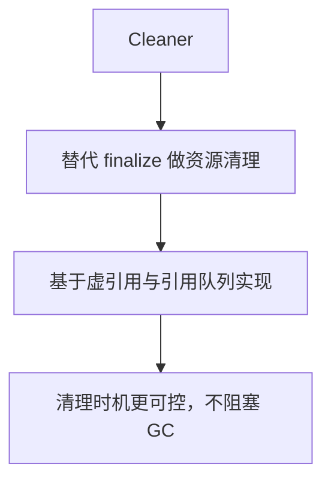

# 四种引用：Cleaner 与资源清理

弱引用和虚引用都可以配合引用队列做资源清理，模式是相通的：先找到哪些对象被垃圾回收了，再把它们关联的引用对象从队列里找出来，对关联资源做进一步清理。比如上一篇的例子，弱引用的 key 被回收后，关联的 Entry 进了引用队列，我们把它找出来继续清理。问题在于，这套 API 直接调用难度不小。从 JDK 9 开始，引入了 Cleaner 类来降低使用门槛。

## 先给结论

Cleaner 可以理解为引用队列方案的官方封装：

- 内部还是虚引用加引用队列那一套，外面包了一层，用起来更简单。
- Cleaner 内部有一个专用线程，从引用队列里取引用对象，并执行对应的资源释放任务。
- 用法是注册：把要关注的资源和要执行的清理动作交给 register，资源一旦被垃圾回收，清理动作就会被执行。
- 执行清理的是守护线程，主线程不能立刻结束，否则清理来不及做。



## 是什么：register 注册清理动作

用法分两步。先调用静态方法拿到一个 Cleaner 对象，再调用它的 register 方法，把要关注的资源和要执行的清理动作传进去。只要第一个参数（资源）被垃圾回收，第二个参数（清理动作）就会被执行，完成资源释放。

```java
import java.io.IOException;
import java.lang.ref.Cleaner;

public class TestCleaner1 {
    public static void main(String[] args) throws IOException {
        Cleaner cleaner = Cleaner.create();
        cleaner.register(new MyResource(), () -> LoggerUtils.get().debug("clean 1"));
        cleaner.register(new MyResource(), () -> LoggerUtils.get().debug("clean 2"));
        cleaner.register(new MyResource(), () -> LoggerUtils.get().debug("clean 3"));
        cleaner.register(new MyResource(), () -> LoggerUtils.get().debug("clean 4"));
        cleaner.register(new MyResource(), () -> LoggerUtils.get().debug("clean 5"));
        cleaner.register(new MyResource(), () -> LoggerUtils.get().debug("clean 6"));

        System.gc();
        System.in.read();
    }

    static class MyResource {
        // 无具体实现
    }
}
```

对比上一篇手写的 clean 方法，差别很明显：不用自己建 ReferenceQueue，不用自己写 poll 循环，不用自己遍历数组置 null。注册一个资源和一段动作，剩下的交给 Cleaner。

## 为什么：封装与守护线程

封装解决的是易用性。引用队列本身不复杂，但建队列、关联引用、轮询、匹配、清理，一套动作写全了代码量不小，还容易漏。Cleaner 把这套流程固化在内部，用户只面对「资源加动作」两个参数。

守护线程解决的是执行时机。Cleaner 内部会创建一个线程，专门从引用队列里取虚引用，取出来之后执行相应的资源释放任务。这个线程是守护线程：如果主线程没有代码可跑了，守护线程也会随之结束。所以样例里在 System.gc() 之后加了 System.in.read() 让主线程暂停，给清理线程留出执行时间。不加暂停，主线程直接结束，清理动作可能还没轮到执行，程序就退了。

## 深入细节：两个实验与内部实现

实验一，六个对象全部可回收。创建六个对象，分别关联六个清理动作，执行垃圾回收。六个清理动作全部被调用，一到六依次执行。

实验二，其中一个对象保持强引用。如果某个对象是局部变量，在方法执行完之前一直被强引用着，它就不会被回收。这时的结果是：对应的那个清理动作不执行，其余五个对象的清理动作照常执行。比如第四个对象没被回收，输出的就只有一、二、三、五、六，第四个不见踪影。可见清理动作的执行严格跟随资源的回收状态，注册了不等于一定执行。

说清楚 Cleaner 的执行模型：清理动作不是在 register 的线程里同步跑的，而是在 Cleaner 内部的守护线程里异步执行。GC 把引用对象送入队列，守护线程取出并执行动作，主线程只负责别提前退出。

还有一点容易混淆：JDK 里有两个 Cleaner。上面用的位于 java.lang.ref 包，是 JDK 9 对外开放的公开 API。另有一个同名类位于 jdk.internal.ref 包，功能类似，用法也差不多，同样是一个资源加一个清理动作，资源一旦被回收，清理动作随即执行，但它是 JDK 内部使用的，不对外提供：

```java
import java.io.IOException;
import jdk.internal.ref.Cleaner;

public class TestCleaner2 {
    public static void main(String[] args) throws IOException {
        Cleaner cleaner1 = Cleaner.create(new MyResource(), () -> LoggerUtils.get().debug("clean 1"));
        Cleaner cleaner2 = Cleaner.create(new MyResource(), () -> LoggerUtils.get().debug("clean 2"));
        Cleaner cleaner3 = Cleaner.create(new MyResource(), () -> LoggerUtils.get().debug("clean 3"));
        Cleaner cleaner4 = Cleaner.create(new MyResource(), () -> LoggerUtils.get().debug("clean 4"));

        System.gc();
        System.in.read();
    }

    static class MyResource {
        // 无具体实现
    }
}
```

注意它的创建方式与公开版不同：直接 Cleaner.create 传入资源和动作，一步注册，不需要先拿 Cleaner 再 register。

jdk.internal.ref.Cleaner 的主要用户在 NIO。DirectByteBuffer 使用直接内存，直接内存不是 Java 堆内的内存，得等 Buffer 对象被 Java 回收之后，想办法释放那块非 Java 内存。DirectByteBuffer 内部就封装了一个 cleaner 字段来完成这件事：

```java
private final Cleaner cleaner;

public Cleaner cleaner() {
    return cleaner;
}

public Cleaner Cleaner() {
    return cleaner;
}
```

只要外层 Java 的 Buffer 对象被回收，就由这个 cleaner 去释放它占用的直接内存。这也是直接内存不需要手动 free 的原因：回收链路由引用机制兜底。这部分细节学到 NIO 时再展开。

## 面试怎么答

面试问 Cleaner，建议把它放回四种引用的体系里答。

弱引用、虚引用配合引用队列，可以在对象被回收后清理关联资源，模式是自己监听队列、自己执行清理。JDK 9 的 java.lang.ref.Cleaner 把这套模式封装成公开 API：register 注册资源和清理动作，内部用虚引用加引用队列检测回收，并用守护线程异步执行清理动作。

两个细节值得主动提。一是清理动作异步执行在守护线程上，主线程过早退出会导致清理来不及做，所以演示代码里要用暂停把主线程拉住。二是执行的前提是资源真正被回收，如果资源还被强引用持着，清理动作不会执行。

如果面试官延伸问 NIO，可以答：jdk.internal.ref.Cleaner 被 DirectByteBuffer 使用，Java 的 Buffer 对象被回收后，由内部的 cleaner 释放直接内存，这是直接内存自动回收的机制。

## 常见误区

**误区一：以为 Cleaner 是新机制。** 它内部还是虚引用加引用队列那套，只是做了封装。理解成新机制，就割裂了它与四种引用的关系。

**误区二：以为注册了就一定执行。** 资源还被强引用着就不会被回收，清理动作也就不执行。实验二里第四个对象因为局部变量强引用而幸存，清理动作随之缺席。

**误区三：忽略守护线程的退出条件。** 清理跑在守护线程上，主线程一结束它也跟着结束。不加暂停，程序可能没给清理留时间，看起来就像「注册了没反应」。

**误区四：混淆两个 Cleaner。** java.lang.ref.Cleaner 是 JDK 9 的公开 API；jdk.internal.ref.Cleaner 是 JDK 内部使用的，服务于 DirectByteBuffer 这类直接内存场景。写业务代码用前者，别 import 后者。
