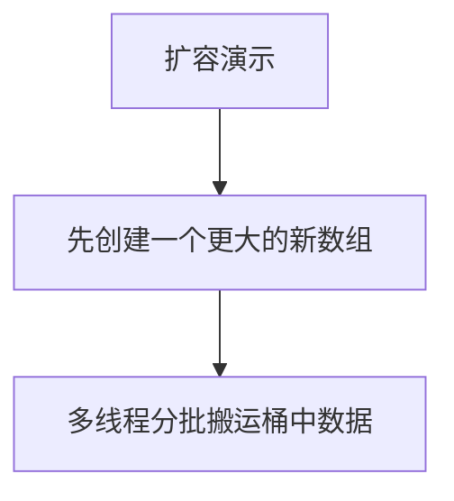

# ConcurrentHashMap v8：演示扩容

并发 put 的锁竞争看过之后，还剩最后一块拼图：扩容。扩容是 ConcurrentHashMap 最复杂的部分，也是并发安全设计最密集的地方。这篇跟着模拟器逐步演示一遍，看旧数组的链表如何迁进新数组，以及转发节点在中间起什么作用。

## 先给结论

扩容流程可以概括成四步：

- 元素个数到达扩容阈值（容量乘以负载因子）时触发，新数组容量翻倍。
- 迁移以链表为单位，一个链表一个链表地搬，从后向前推进。
- 每处理完一条链表，就把旧数组中该链表的头节点替换为 forwarding node，标记此位置已处理，其他线程见到它就知道不必重复处理。
- 全部迁移完成后，用新数组替换旧数组，扩容结束。



## 是什么：演示数据怎么摆的

模拟器提前备好了数据，分两组。

第一组是 A、B、C、D、E、N 六个 key，故意让它们的桶下标各不相同，因此每条链表长度只有 1，属于最省事的迁移对象。

第二组是 1、2、3、4、5、6 六个 key，hash 值被固定过：1 和 4 的 hash 值是 10，2、3、5、6 的 hash 值是 26。一开始按旧容量算出来的桶下标都是 10，于是这六个串成一条链表，挤在同一个位置。

此时整个 Hash 表里有 11 个元素。再放入第 12 个元素，到达扩容阈值，触发扩容。

阈值就是容量乘以负载因子。以容量 16、负载因子 0.75 计，阈值是 12，第 12 个元素落位即触发，与演示数据对得上。

## 为什么：转发节点与迁移方向

扩容期间旧数组还在被其他线程访问，必须解决两个问题：同一条链表不能被重复迁移，其他线程要知道该去新数组找数据。forwarding node 就是为此而生。

每处理完一条链表，Spring 会把旧数组中该链表的头节点替换为 forwarding node。它的含义是「这个位置已经处理过了」：其他线程来到这里，发现链表头是 forwarding node，就知道这条链表已迁移，不会再搬一遍；同时它会顺着转发节点到新数组中对应的位置继续操作。一个节点同时承担了「已处理标记」和「新数组路标」两个职责。

迁移方向是从后向前，即先处理 15 号链表，再 14 号、13 号，一路往前推。这个方向不是随意的：ConcurrentHashMap 约定由先发现需要扩容的线程承担扩容任务，从尾部开始逐个 bin 处理，配合 advancing 的进度标记，多个线程可以在不同 bin 上分工而不重叠。

还有个细节：单节点链表迁移前后是同一个对象，因为一个节点不需要拆分，直接挂到新位置即可；而较长的链表在迁移时会把节点元素复制成新节点，旧链表里的节点对象与新链表里的节点对象就不再是同一个。这一点在排查对象引用问题时很关键。

## 深入细节：跟着演示走一遍

扩容的本质是把旧数组每个链表的元素迁到新数组中去，把每个链表的数据全部迁过去，扩容即告完成。迁移以链表为单位，从后向前。

先处理 15 号链表。这条链表没有元素，一下就处理完，但还要做收尾：把旧数组中这条链表的头替换为 forwarding node，表示处理完毕。

接着处理 14 号链表。把元素迁到新数组，用原来的 hash 按新容量重新计算索引，结果与旧索引一致，位置没动。这条链表只有一个元素，迁移前后是同一个对象。处理完，同样把头节点替换为 forwarding node。

继续处理 13 号、12 号、11 号链表，节奏相同：迁元素、算索引、标转发。空链表直接标记转发。

到 10 号链表，这条比较长。处理方式与前面类似：把链表中每个元素按新容量重新计算索引，索引不变的留在原位，索引发生变化的迁到新位置。只是过程更复杂，因为长链表迁移时要复制节点，旧节点与新节点不是同一个对象。

等所有节点都迁移完成，旧数组中每条链表的头都变成了 forwarding node，这代表整个迁移工作结束，扩容收口。最后用新数组替换旧数组，扩容完成。

看结果。扩容后数组容量翻倍，原来挤在 10 号位置的长链表被拆成两条：1 和 4 的索引没变，仍留在 10；2、3、5、6 的索引发生变化，搬到了 26。

原因在索引计算上。hash 值本身不变，变的是按新容量取模的结果：

```latex
hash = key.hashCode() ^ (key.hashCode() >>> 16)
```

```latex
index = (hash & (capacity - 1))
```

以 hash 26 为例，二进制是 11010。旧容量 16 取低 4 位，26 & 15 等于 10；新容量 32 取低 5 位，26 & 31 等于 26。多出来的那一位正好是 16，于是新索引等于旧索引加旧容量，落点从 10 变成 26。而 hash 10 的低 5 位仍然是 10，位置自然不动。这就是「旧位置加旧容量」规则的由来：扩容后索引要么不变，要么加上旧容量，由 hash 值在新容量多出的那一位决定。

## 面试怎么答

面试问 ConcurrentHashMap 扩容，按流程答，再点并发安全设计。

流程：元素个数超过容量乘以负载因子时触发扩容，新数组容量翻倍；迁移以链表为单位，从后向前逐个处理；每条链表按新容量重新计算索引，索引不变的留原位，变化的迁到新位置（新索引等于旧索引加旧容量）；全部完成后旧数组头节点都变成 forwarding node，最后用新数组替换旧数组。

并发安全：迁移期间旧数组仍在服务，处理完的链表头被替换为 forwarding node，既标记该位置已处理，避免重复迁移，又给后来的线程指路，引导它们到新数组对应位置操作。先到先得，多线程可以在不同 bin 上分工，这就是 ConcurrentHashMap 扩容不阻塞全表的原因。

对象细节：单节点链表迁移不复制，前后是同一个对象；长链表迁移会复制新节点，新旧不是同一对象。

## 常见误区

**误区一：以为扩容期间全表停顿。** 旧数组在整个迁移期间持续对外服务，迁移是渐进式的、按链表推进的，不是「拷贝完再开放」。答成全局停顿，就把 ConcurrentHashMap 的并发优势说没了。

**误区二：不知道 forwarding node 的作用。** 它不只是「处理完了」的标记，还是通往新数组的路标。其他线程遇到它，既不会重复迁移，也知道该去新数组的哪个位置继续操作。

**误区三：以为迁移不换对象。** 只有单节点链表前后是同一个对象。长链表迁移会复制节点，新旧数组里的节点不是同一对象，拿着旧节点引用做判断会出错。

**误区四：以为所有元素索引都会变。** 由 hash 在新容量多出的那一位决定：该位为 0 的索引不变，为 1 的索引加上旧容量。演示里 1、4 留在 10，2、3、5、6 搬到 26，就是这个规则的直接体现。
