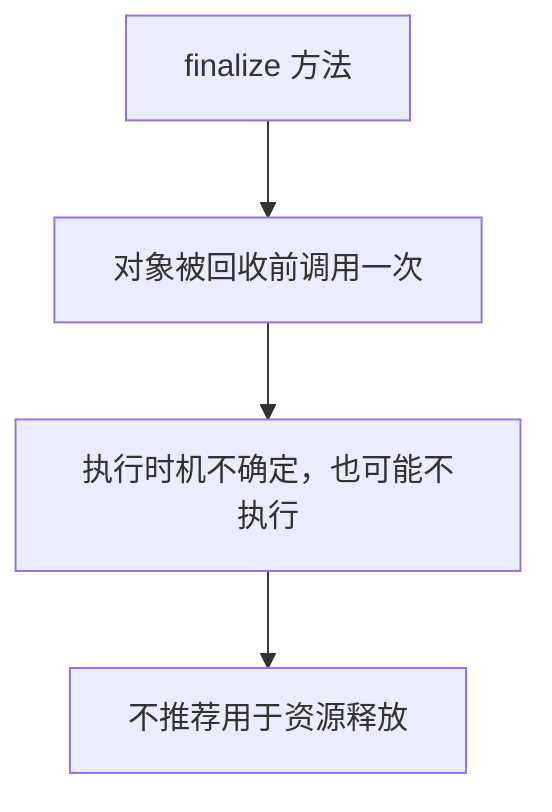

# finalize 概述：从面试答法到四个疑点

有一道经典的 JVM 面试题：请你说一下对 finalize 方法的理解。这道题有两种答法，一种勉强及格，一种能扛住追问。先看两种答法的差距，再用一个实验把 finalize 的疑点全部摆出来，后续几篇从源码层面逐一解答。

## 先给结论

一般回答：finalize 是 Object 中的一个方法，子类重写它，将来垃圾回收时这个方法就会被调用，可以在其中进行一些资源的释放和清理工作。这个回答只说了「是什么」，及格线上下。

优秀回答：把资源的释放和清理放在 finalize 方法里是非常不好的做法，非常影响性能，严重的时候甚至会引起 OOM，也就是内存溢出。从 Java 9 开始，这个方法已经被标记为 Deprecated，不推荐使用了。这个回答直接给出「不能用」的结论，还带上了版本背景。

但如果面试官追问一句「为什么 finalize 非常不好、非常影响性能」，很多人就答不上来了。要答好这一句，得先看懂它到底有哪些问题。



## 是什么：一个实验

准备一个 Dog 对象，里面有一个成员变量 name，重写它的 finalize 方法，方法里打印一行日志，看它被垃圾回收时会不会被调用。再准备三个 Dog 对象，这三个对象没有其他变量引用，调用垃圾回收时它们就会被回收。

运行之后可以看到，三行日志都打了出来，大傻、三笨、二哈这三个狗对象的 finalize 方法确实都被调用了。看起来「垃圾回收后会调用 finalize」这件事得到了验证。

但仔细看日志，能观察到好几个反常的现象，每一个都值得追问。

## 为什么：四个反常现象

现象一，调用次序不能保证。日志里先是大傻调用了 finalize，然后是三笨，然后是二哈，与对象的创建顺序并不一致。这个现象其实好解释：对象的回收顺序本来就不受我们控制，垃圾回收的顺序决定了 finalize 的调用顺序。把清理逻辑写进 finalize，等于把执行顺序交给了不可控的 GC。

现象二，执行者不是业务线程。日志中方括号里打印的线程名是 Finalize，也就是说调 finalize 方法的不是创建对象的主线程，而是一个专门的 Finalize 线程。这个线程在哪里创建、如何工作，留到后面结合源码看。

现象三，不暂停就来不及执行。如果把 main 方法里的 System.in 暂停语句注释掉，很可能发现这几个 finalize 方法根本来不及调用，程序就结束了。原因和前几篇遇到的守护线程一样：Finalize 线程也是守护线程，主线程的代码走完结束，守护线程就不再执行。这暴露一个严重问题：finalize 里的代码并不能保证被执行。本来指望它释放资源，结果它根本没跑，资源就没真正释放，尤其是一些外部资源，泄漏得悄无声息。

现象四，异常被静默吞掉。在 finalize 里加一个除零异常再运行，三个对象的 finalize 方法照旧被调，但除零异常的信息一行都没打印。也就是说，finalize 执行过程中有没有出错，调用方根本无从知晓。清理动作半途失败，日志里一片安静，排查时完全没有线索。

除此之外还有一个疑问：垃圾回收的时候，就会立刻调用 finalize 吗？这个也留待后面从源码层面验证。

## 深入细节：现象背后的共性

四个现象串起来看，指向同一个结论：finalize 的执行完全不受调用方掌控。

执行时机上，它挂在 GC 之后，由专门的 Finalize 线程异步执行；GC 什么时候发生、以什么顺序发生，都不由业务代码决定。于是清理的顺序不可控，是否来得及执行也不可控，主线程一退场，守护线程直接收工。

执行过程上，异常被吞、没有输出，失败无感知。清理逻辑出了错，你甚至不知道它错在哪。

执行结果上，它唯一能保证的只是「对象被回收后有机会调一下」，而不是「资源一定被清理」。把资源释放交给一个时机不定、顺序不定、失败无声的方法，本身就是把正确性寄托在运气上。这也是「非常影响性能、严重时引起 OOM」的来处：该回收的资源没回收，对象占着内存下不去，压力最终堆积到溢出。

下一节从 unfinalized 链表入手，看 JVM 如何收纳待执行 finalize 的对象，现象二里那条 Finalize 线程也会在那里露出真身。

## 面试怎么答

这道题建议按两层答。

第一层给结论：finalize 是 Object 的方法，子类可重写，对象被垃圾回收时会被调用，这是它的机制；但把资源释放和清理放在 finalize 里是非常不好的做法，影响性能，严重时会引起 OOM，Java 9 起已标记 Deprecated，不推荐使用。

第二层给理由，这是拿分的关键：其一，执行时机不可控，调用顺序由 GC 顺序决定；其二，执行没有保证，Finalize 线程是守护线程，主线程结束它就退场，清理可能根本来不及跑；其三，失败无感知，finalize 中抛出的异常会被静默吞掉，没有任何输出；其四，有更好的替代方案，资源管理用 try-with-resources 配合 AutoCloseable，显式关闭、异常可见、时机确定。

能主动补上替代方案，说明不只是知道 finalize 不好，还知道正确的资源管理应该怎么做，这一句往往是加分项。

## 常见误区

**误区一：只答定义不答结论。** 只说「Object 的方法、GC 时调用、可以清理资源」，属于背了半句话。先给「不推荐使用」的结论，再展开原因，才是完整回答。

**误区二：以为重写了就一定执行。** Finalize 线程是守护线程，主线程结束它可能来不及跑。注释掉暂停语句的实验里，三条 finalize 日志一行都没打，程序就结束了。

**误区三：以为 finalize 里抛异常会暴露。** 异常会被静默吞掉，没有任何输出。清理失败无感知，比不清理更危险，因为它给你「已经清理过了」的错觉。

**误区四：以为 GC 一回收就立刻调用 finalize。** 是否立刻调用需要从源码验证，这也是下一篇的主题。至少「GC 完成」和「finalize 执行」之间不是简单的同步关系。

**误区五：把 finalize 当正规的资源释放手段。** 正确的资源管理是 try-with-resources 加 AutoCloseable：关闭时机确定、异常可见、代码可控。finalize 从 Java 9 起已被标记 Deprecated，新代码不应该再用它。

## 课件源码参考

> 以下示例出自课件 day03 的 `TestFinalize.java`，与上文讲解一一对应，可直接对照阅读。

```java
package day03.reference;

import day02.LoggerUtils;

import java.io.IOException;

public class TestFinalize {
    static class Dog {
        private String name;

        public Dog(String name) {
            this.name = name;
        }

        @Override
        protected void finalize() throws Throwable {
            LoggerUtils.get().debug("{}被干掉了?", this.name);
            int i = 1 / 0;
        }
    }

    public static void main(String[] args) throws IOException {
        new Dog("大傻");
        new Dog("二哈");
        new Dog("三笨");
        System.gc();
        System.in.read();
    }
    /*
    第一，从表面上我们能看出来 finalize 方法的调用次序并不能保证
    第二，日志中的 Finalizer 表示输出日志的线程名称，从这我们看出是这个叫做 Finalizer 的线程调用的 finalize 方法
    第三，你不能注释掉 `System.in.read()`，否则会发现（绝大概率）并不会有任何输出结果了，从这我们看出 finalize 中的代码并不能保证被执行
    第四，如果将 finalize 中的代码出现异常，会发现根本没有异常输出
    第五，还有个疑问，垃圾回收时就会立刻调用  finalize 方法吗？
     */
}
```

## 课件配图
> 以下配图取自阶段七课件对应讲义，与上文讲解一一对应，可作为图文对照辅助理解。
**finalize**（课件讲义图示）


