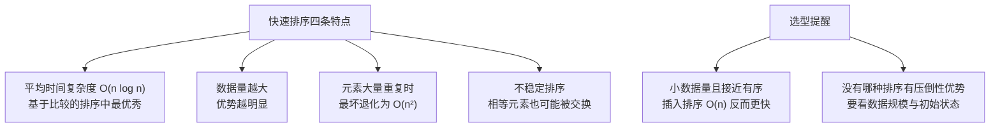

# 快速排序：特点与分区算法对比

快排系列走到最后一篇。前面把 Lomuto 单边循环和双边循环的原理、实现、细节都拆开了，这篇收个尾：记住快排的特点，再看两种经典分区算法在性能上差多少，以及工程上为什么很少单用一种排序。

## 先给结论

快速排序的特点有四条：

- 基于比较的排序算法中最为优秀的一种，平均时间复杂度为 O(n log n)，比冒泡、选择、插入乃至希尔排序都优秀。
- 数据量越大，优势越明显。
- 如果数组中元素大量重复，性能会大受影响，最坏情况退化为 O(n²)。
- 属于不稳定的排序算法：遇到值相等的元素，仍有可能交换两个元素的位置。



## 是什么：特点与横向对比

平均时间复杂度 O(n log n) 是快排的招牌。这个量级已经全面领先此前学过的冒泡、选择、插入、希尔。但招牌不等于全能，两个约束要记住。

约束一是重复元素。数组里大量元素值相同时，分区会严重失衡，性能大受影响，最坏时间复杂度退化为 O(n²)。基准点选得不好加上数据分布不利，分区一边倒，递归深度失去 log n 的保障。

约束二是有序度。快排的最优时间复杂度仍然是 O(n log n)，而插入排序对有序度很高的数组，时间复杂度可以达到 O(n)。也就是说在「数据量小且数组已经接近有序」的场景里，插入排序反而更快。没有哪种排序具有压倒性优势，选型要看数据规模和初始状态。

横向对比可以直接参考维基百科 Sorting algorithm 词条里的 Comparison sorts 表格，学过的几种排序都在里面：QuickSort、Insertion Sort、Selection Sort、Shell Sort、Bubble Sort，每种都列了最好、平均、最坏时间复杂度，空间复杂度占用，以及是否稳定。对着表看一遍，比背结论更有整体感。

## 为什么：工程上很少单用一种排序

既然快排在大数据量上占优、插入排序在小数据有序时占优，工程实现自然想到把两者结合。JDK 的排序实现就是这么干的：数据量较大时采用快排；当快排中某个分区内的元素个数小于一定阈值，也就是数量很小的时候，替换成插入排序。结合多种排序算法各自的长处，才能在各种情况下都得到比较好的效果。

快排不适合小分区，是因为它递归和分区本身有固定开销，数据量小时这点开销占比过高；插入排序在小数据上几乎没有这些负担，有序时更是线性收工。阈值切换是对这份开销的务实妥协。

## 深入细节：Lomuto 与 Hoare 差多少

Lomuto 分区就是单边循环快排，好理解但性能不高；Hoare 分区与课堂讲的双边循环在算法上有些相似，比较难懂但性能更好。两者的性能差异主要体现在平均元素交换次数上。

理论结论：Lomuto 一次分区的平均交换次数约为 (n-1)/2，即二分之 n 减一；Hoare 一次分区的平均交换次数约为 (n-1)/6，即六分之 n 减一。一个除以 2，一个除以 6，相差三倍。

不推导公式也能用数据验证。写一个程序，把 Hoare、Lomuto、双边循环三种分区方法都实现一遍，每个方法传入一个计数器，一旦发生元素交换就让计数加一，最后看平均交换次数。为保证公平，三组数据每次随机生成，并把数组复制若干份，保证三种算法排序面对的是同一组数。

Hoare 分区的实现长这样，注意它取中间元素作为基准点，i、j 从边界外侧起步，与课堂的双边循环并不相同：

```java
private static int hoarePartition(int[] a, int l, int h, AtomicInteger c) {
    int pv = a[(l + h) >>> 1];
    int i = l - 1;
    int j = h + 1;
    while (true) {
        while (a[++i] < pv) {}
        while (a[--j] > pv) {}
        if (i >= j) break;
        c.incrementAndGet();
        swap(a, i, j);
    }
    return j;
}
```

测试方法构造三组同样的随机数组，分别交给三种分区方法统计：

```java
public static void main(String[] args) {
    List<int[]> all1 = new ArrayList<>();
    List<int[]> all2 = new ArrayList<>();
    List<int[]> all3 = new ArrayList<>();
    for (int i = 0; i < 20; i++) {
        int[] array = Utils.randomArray(n: 10000);
        all1.add(array);
        all2.add(Arrays.copyOf(array, array.length));
        all3.add(Arrays.copyOf(array, array.length));
    }
    System.out.println("hoarePartition:" + hoarePartition);
    testPartition(all1, LomutoVSHoare::hoarePartition);
    testPartition(all2, LomutoVSHoare::LomutoPartition);
    System.out.println("otherPartition:" + otherPartition);
    testPartition(all3, LomutoVSHoare::otherPartition);
}
```

数组长度一万个、测试 20 次，看平均交换次数：Hoare 分区平均一次分区交换约 1500 次；Lomuto 分区平均 4690 多次；双边循环与 Hoare 相差不多，都是 1000 多次的量级。一边 4000 多次，一边 1000 多次，相差三倍左右，与理论公式对得上。

以上代码块按课程原稿逐字收录，`n: 10000` 是原稿中夹带的编辑器参数名提示，并非合法 Java 语法，实际代码里应写作字面量 10000。

## 面试怎么答

面试问快排特点，四句话答完：平均时间复杂度 O(n log n)，是基于比较的排序里最优秀的；数据量越大优势越明显；元素大量重复时性能大受影响，最坏退化为 O(n²)；属于不稳定排序，值相等的元素也可能被交换。

追问「那为什么 JDK 不直接用快排」，答混合策略：数据量大用快排，分区内元素个数小于阈值时切换为插入排序，因为插入排序在小数据、高有序度场景下更快，快排的固定开销在小分区上不划算。

追问 Lomuto 与 Hoare 的差别，答：Lomuto 是单边循环，好理解但交换次数多，一次分区平均约 (n-1)/2 次；Hoare 是双边循环思路，难懂但交换次数少，一次分区平均约 (n-1)/6 次，相差约三倍。课堂的双边循环与 Hoare 相似但不完全相同，Hoare 取中间元素为基准点，且返回值语义有差异。

## 常见误区

**误区一：以为快排永远最快。** 数据量小且接近有序时，插入排序更快；元素大量重复时，快排会退化。快排的优势在大规模随机数据，不是全场景通吃。

**误区二：以为快排稳定。** 快排是不稳定排序，分区中的交换会改变相等元素的相对次序。需要稳定场景应选归并排序之类。

**误区三：以为 Lomuto 和 Hoare 只是写法不同。** 两者的平均交换次数相差约三倍，这是实打实的性能差异，也是 Hoare 虽然难懂仍被广泛使用的原因。

**误区四：以为 JDK 的排序是纯快排。** 实际是混合策略，快排加插入排序，小分区切插入。答成纯快排，既不符合事实，也丢掉了展示工程思维的机会。
