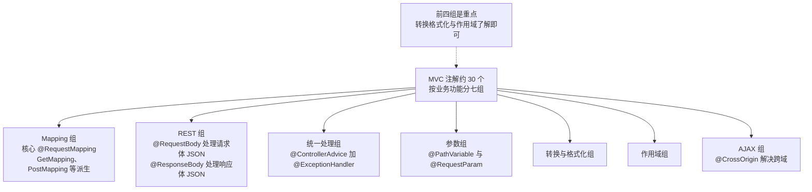

# Spring MVC 注解梳理

上一篇把 Spring Framework 自身的注解按包梳理了一遍，这篇接着梳理 Spring MVC 的注解。MVC 相关的一共三十个左右，按业务功能可以分成七组：Mapping、REST、统一处理、参数、转换与格式化、作用域、AJAX。抓住每组的核心，其余都是延伸。

## 先给结论

七组各有一个抓手：

- Mapping 组的核心只有一个 @RequestMapping，其余 GetMapping、PostMapping 等都是它的派生注解。
- REST 组的 @RequestBody 与 @ResponseBody 一对，一个处理请求体 JSON，一个处理响应体 JSON。
- 统一处理组的 @ControllerAdvice 加 @ExceptionHandler 实现全局异常处理。
- 参数组最重要的是 @PathVariable 与 @RequestParam。
- 转换与格式化组、作用域组用得少，知道即可。
- AJAX 组记住 @CrossOrigin 解决浏览器跨域。



## 是什么：七组注解

Mapping 组负责建立请求路径与控制器方法的映射关系。请求到来后，Spring MVC 根据请求路径与 @RequestMapping 中配置的路径匹配，匹配上就知道该由哪个方法处理。@RequestMapping 还可以加在类上：当一个类里有多个控制器方法共用同一段路径前缀时，把前缀提取到类上的 @RequestMapping，方法上只留剩余部分，路径配置更清爽。

组内其余注解都是 @RequestMapping 的派生，区别只在限制的请求方法。以 @GetMapping 为例，它自身标注了 @RequestMapping，说明功能同源；属性层面，它的 value 通过 @AliasFor 与 @RequestMapping 的 value 建立别名关系，path、headers 同理，二者是同一个东西的两个名字。真正的差异只有一点：@GetMapping 限制 method 只能是 GET 请求，Post、Put 等其他请求它不认。@PostMapping 同理，只认 POST。学会一个，其余全通。

REST 组围绕 JSON 数据交换。@RequestBody 处理请求体，把请求体中的 JSON 数据转换成 Java 对象；@ResponseBody 正好相反，把控制器方法返回的 Java 对象转换成 JSON 写入响应体。一个进一个出，配对使用。@ResponseStatus 用来控制响应的状态码。REST 风格推荐用 JSON 作为数据交换格式，这几个注解主要都在处理 JSON，因此归为一组。

@RestController 是组合注解，看它的定义就明白：

```java
@Target(ElementType.TYPE)
@Retention(RetentionPolicy.RUNTIME)
@Documented
@Controller
@ResponseBody
public @interface RestController {
    // ...
}
```

它等于 @Controller 加 @ResponseBody。标注在类上，既表明这是控制器，又相当于给类加了 @ResponseBody，也就是类中所有控制器方法的返回值都会被转换成 JSON 写入响应体。是一种便捷写法。

统一处理组三个注解。@ControllerAdvice 标注的类是统一处理的落脚点，异常处理方法、转换器方法、ModelAttribute 方法都可以放进去，最常用的就是把异常处理方法集中起来做全局统一处理。@ExceptionHandler 标注的方法是专门处理异常的方法，但它不一定要放在 @ControllerAdvice 类里：放在普通控制器里，是局部异常处理，只对本类生效；放在 @ControllerAdvice 类里，升级为全局异常处理。@RestControllerAdvice 也是组合注解，等于 @ControllerAdvice 加 @ResponseBody，好处是异常处理方法返回的结果同样会被转成 JSON 写进响应体。

参数组解决从请求里拿数据。@RequestHeader 拿请求头，@CookieValue 拿 Cookie 值，@PathVariable 拿请求路径中的参数，@RequestParam 拿问号后面的请求参数，也可以是表单参数。其中 @PathVariable 和 @RequestParam 用得最多，其余相对少见。@RequestParam 还有一个容易被忽略的价值：它可以设置默认值，请求没带这个参数时用默认值顶上，避免参数缺失直接报错。

转换与格式化组用得不多，稍微过一下即可：@DateTimeFormat 转换日期时间格式，@NumberFormat 转换数字格式，@InitBinder 注册自定义类型转换器，@Validated 是数据校验的入口。注意真正干校验的并不是 Spring 的注解，@Validated 只负责标记「这个 bean 要校验」，具体的校验规则加在 bean 的属性上，靠 NotBlank、NotNull 这类第三方注解完成。

作用域组的 @Scope 控制 bean 的作用域，如 application、request、session，但实际用得很少。@ModelAttribute、@RequestAttribute、@SessionAttribute 同样冷门，用注解维护状态容易用错，知道有这组东西即可。

AJAX 组记住 @CrossOrigin。它解决 AJAX 请求的跨域问题，原理是往响应头里加一些特殊的响应头，允许跨域请求通过。注意使用场景：只有浏览器里用 JavaScript 发 AJAX 请求才会有跨域限制，用 HTTP Client 这类客户端不存在跨域问题，也就不需要它。

## 为什么：派生、组合与别名

GetMapping 这类派生注解的存在，是为了把「路径映射」和「请求方法限制」两件事合起来写。看它的属性定义，value、path、headers 都通过 @AliasFor 指向 @RequestMapping 的同名属性：

```java
@AliasFor(annotation = RequestMapping.class)
String value() default "";
@AliasFor(annotation = RequestMapping.class)
String[] path() default {};
@AliasFor(annotation = RequestMapping.class)
String[] headers() default {};
```

@AliasFor 建立的别名关系意味着：两个注解的属性是同一份数据，只是入口不同。功能完全一致，差异只剩 method 的限制。这正是「派生注解」的实现手法，不是另起炉灶，而是站在 @RequestMapping 的肩膀上收窄用途。

RestController、RestControllerAdvice 这类组合注解，存在的理由是省样板。控制器九成九都要返回 JSON，逐个方法加 @ResponseBody 太啰嗦，提到类上一次解决。组合注解把常用搭配固化成一个新注解，是 Spring 注解体系一贯的设计思路。

@RequestParam 的 value 与 name 也是一对别名，同一个属性的两个名字：

```java
@AliasFor("name")
String value() default "";
@AliasFor("value")
String name() default "";
```

参数名能和方法参数名对上时，@RequestParam 可以整个省略；它真正不可替代的价值在 defaultValue，没传参时兜底，这是省略注解做不到的。

## 深入细节：三处高频用法

用法一，路径前缀提取。类上 `@RequestMapping("/user")`，方法上 `@GetMapping("/detail")`，完整路径就是 /user/detail。多个方法共用前缀时，路由表更干净，也便于按模块调整前缀。

用法二，全局异常处理。定义一个 @ControllerAdvice 类，里面放若干 @ExceptionHandler 方法，每个方法声明处理哪类异常。异常抛出后由全局处理器兜底，返回统一格式的错误响应。如果这个 Advice 类标注的是 @RestControllerAdvice，返回的错误对象会自动转成 JSON。反过来，@ExceptionHandler 放在具体控制器里，只对该控制器生效，适合某个模块特有的异常。

用法三，REST 出参与入参。@RequestBody 接请求体 JSON 转 Java 对象，@ResponseBody 把返回对象转 JSON。类上标 @RestController 后两者全覆盖，写 REST 接口时一个注解解决控制器声明和响应体转换。

## 面试怎么答

面试问 Spring MVC 注解，按组答，每组点出核心。

Mapping 组核心是 @RequestMapping，负责路径与方法的映射，可加在类上提取公共前缀；GetMapping、PostMapping 等是派生注解，通过 @AliasFor 与 @RequestMapping 属性互通，差别仅在使用场景上限制了请求方法。

REST 组：@RequestBody 把请求体 JSON 转 Java 对象，@ResponseBody 把返回对象转 JSON 写响应体，@RestController 是 @Controller 加 @ResponseBody 的组合注解。

统一处理组：@ControllerAdvice 加 @ExceptionHandler 做全局异常处理，@ExceptionHandler 放在普通控制器里则是局部处理；@RestControllerAdvice 是 @ControllerAdvice 加 @ResponseBody 的组合，异常响应直接出 JSON。

参数组：@PathVariable 取路径参数，@RequestParam 取请求参数，可省略、可靠 defaultValue 兜底。

AJAX 组：@CrossOrigin 解决浏览器 AJAX 跨域，原理是加响应头；非浏览器客户端不需要。

## 常见误区

**误区一：把 MVC 注解归到 Spring Boot。** @RequestMapping、@RestController 属于 Spring MVC，不是 Boot 的注解。上一篇说过，答题先分层，这里再次强调。

**误区二：分不清 @Controller 与 @RestController。** 后者是前者加 @ResponseBody 的组合。用 @Controller 写接口却忘了加 @ResponseBody，返回值会被当成视图名解析，接口直接坏掉。

**误区三：以为 GetMapping 只是RequestMapping 的简写。** 它限制了 method 只能是 GET。同一个路径上，用 POST 访问 GetMapping 标注的方法，匹配不上，会走到 405 或 404。

**误区四：@ExceptionHandler 放错位置。** 放在具体控制器里只对该类生效，放在 @ControllerAdvice 里才是全局。全局异常失效时，先检查方法是不是放进了 Advice 类。

**误区五：以为校验规则注解来自 Spring。** @Validated 只是校验入口，真正的规则注解如 NotBlank、NotNull 来自 Bean Validation。用错依赖，校验静默不生效。
