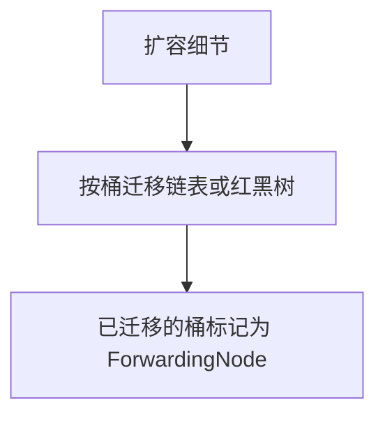

# ConcurrentHashMap v8：扩容中的并发处理

上一篇演示了扩容的完整流程：新数组翻倍、以链表为单位从后向前迁移、处理完的链表头替换为 forwarding node。流程看清了，还有一个更关键的问题：它自称并发集合，扩容过程中有其他线程来 get、来 put，该怎么办。

## 先给结论

扩容期间的并发处理规则：

- get 完全不阻塞。该去哪张表查，看目标位置的链表头是不是 forwarding node：是，说明数据已迁到新表，去新表找；不是，在旧表找。
- put 分三种情况：要 put 的位置在还没迁移到的区间，可以并发执行；要 put 的位置正是当前正在迁移的链表，只能阻塞；要 put 的位置已经迁移完成，put 线程不干等，而是进来帮忙扩容。

三条规则合起来，保证扩容期间读写都不停摆，这也是 ConcurrentHashMap 扩容不停全表的底气。

## 是什么：并发下的 get

取一个扩容中间状态：14、15 两条链表已经迁移完成，0 到 13 还没开始。此时来了一个新线程执行 get，分两种情况。

如果要查的数据在 0 到 13 这些链表里，直接在旧表里找就行，这些数据还没搬走。如果要查的数据在 14、15 这两条链表里，旧表里已经没有了，它们被迁到了新表，查询线程必须到新表里才能找到。

问题来了：查询线程怎么知道该去旧表还是新表？答案极简，看链表头。如果目标位置的链表头是 forwarding node，说明这条链表已经处理完、数据迁走了，去新表找；否则数据还在旧表，在旧表找。一个节点同时充当路标，查询线程看一眼就知道走向。

所以 get 操作在扩容期间根本不会阻塞。哪怕扩容正在进行，get 线程也能自己判断该在旧表还是新表找数据，与扩容线程并发运行，互不干扰。

## 为什么：迁移时要复制节点

get 还有一种更微妙的情况：要查的数据恰好在正在迁移的长链表里。以 1、2、3、4、5、6 这条链表为例，迁移进行到一半，一个线程来查 2。这条链表迁移未完成，get 线程照例在旧表里找 2：先拿到节点 1，再顺着 1 的 next 找到 2。

这里藏着一个必须解决的问题：旧表中的节点 1 与新表中迁移后的节点 1，能是同一个对象吗？不能。因为查询线程要在旧链表里顺着 next 往下走，1 的下一个必须是 2，它才能找得到。可迁移过程要重新计算索引，1 的 next 指向很可能已经变了，比如例子里 1 的 next 已经变成 null。如果新旧两个 1 是同一个对象，查询线程拿到 1 之后，顺着 next 走就再也找不到 2 了。

结论：扩容线程做链表迁移时，很多情况下必须把节点重新创建，不能沿用旧对象，因为旧对象的 next 会被迁移过程改写，而旧表还要继续为查询服务。旧表保持旧结构、新表构建新结构，两张表各自独立，各服务各的读者。

当然也有优化。如果链表最后几个元素扩容后位置相同，就不需要重新创建节点，直接用原对象。例子里 5、6 是链表最后两个元素，扩容后位置也没变，所以它俩不用动，仍用原来的节点对象；而 1、2、3、4 位置会变，必须创建新节点。能不复制就不复制，能复用的坚决复用，这是迁移效率的关键一笔。

## 深入细节：并发下的 put

put 比 get 复杂，分三种情况。

情况一，要 put 的数据位于当前还没迁移到的区间。比如扩容线程正在从后向前推进，目前处理到 14、15，0 到 13 还没动，put 的数据落在 0 到 9 这些位置。这时候 put 可以并发执行，不用加锁，因为扩容线程还没碰这些链表，照常 put 即可。

情况二，要 put 的数据恰好位于当前正在迁移的链表。比如扩容线程正在处理 10 号链表，put 也奔着 10 号来。这种情况只能阻塞。因为扩容线程已经对这条链表的链表头加了锁，put 线程拿不到锁，只能等扩容线程把这条链表处理完、释放锁，才能继续。

情况三，要 put 的位置已经是 forwarding node，也就是这条链表迁移完成了。这时 put 线程不能到新表里去 put，因为新表要等所有节点都迁移完成才能执行 put。那它就只能闲着吗？设计者在这里加了一项优化：迁移工作不是由一个线程包干，而是划分成多个区间，每个线程一次迁移 16 个链表，忙完自己这段可以认领下一段。

举例：旧表容量 16，扩容线程负责 0 到 15 全部 16 条链表，put 线程要的位置已迁移完，它确实得等。但如果旧表容量是 32，扩容线程先认领 16 到 31 这 16 条，put 线程发现要操作的数据已经迁移完，就会进来帮忙，认领 0 到 15 这 16 条链表去迁移。这样一来 put 线程不是干等，而是转化成扩容劳动力，阻塞时间被压到最短。

三种处理归结一句：迁移之前的区间，put 并发执行；当前正在迁移的链表，put 阻塞；已经迁移完成的区间，put 线程帮忙扩容。

## 面试怎么答

面试问扩容期间的并发处理，分读写两侧答。

读侧：get 不会阻塞。它根据目标位置链表头是否为 forwarding node 决定去新表还是旧表查，扩容与读完全并发。另外迁移时长链表要复制新节点，正是为了让旧表维持原结构，保证迁移期间旧表上的查询不断链。

写侧：put 分三种。目标位置在未迁移区间，直接并发 put；目标位置是正在迁移的链表，因链表头已被扩容线程加锁而阻塞；目标位置已迁移完成，put 线程不空等，而是认领一段未迁移区间帮忙扩容，扩容任务按区间划分，每段 16 条链表。

最后可以补一句整体效果：扩容期间旧表持续提供读写服务，新表在后台逐段建成，两条表通过 forwarding node 衔接，读写线程各得其所，所以 ConcurrentHashMap 的扩容不需要停掉全表。

## 常见误区

**误区一：以为扩容期间 get 会阻塞。** get 靠 forwarding node 判断去哪张表，全程无锁。答成「读也要等扩容」，与设计初衷正好相反。

**误区二：以为迁移就是原节点搬个家。** 长链表迁移必须复制新节点，因为旧节点的 next 会被改写，而旧表还要服务查询。复用原节点会让旧表上的遍历断链。只有位置不变、指向不变的尾部节点才直接复用。

**误区三：以为 put 遇到已迁移区只能死等。** 它会帮忙扩容。迁移按区间划分，每线程一段，后来的 put 线程认领未完成区间，把自己从等待者变成建设者。

**误区四：以为新表建成一部分就能往里 put。** 新表要等所有节点迁移完成才接管 put。迁移完成前，已迁移区的 put 一律走「帮忙扩容」逻辑，不会写进半成品的新表。
