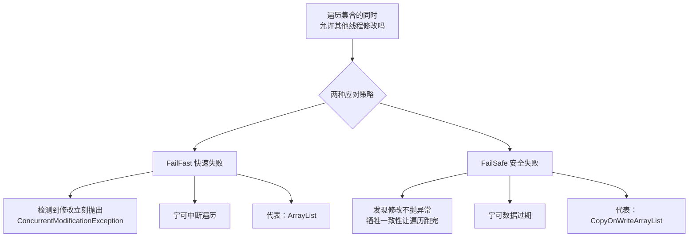

# Iterator：FailFast 与 FailSafe 演示

迭代器的作用是遍历集合，Set、List 都能用。遍历的同时就牵扯出一个问题：允不允许其他线程修改这个集合？允许的话，遍历到一半数据被人改乱了怎么办？不允许的话，又该以什么方式告知对方？围绕这两个问题，集合框架给出了两种截然不同的应对策略：FailFast 与 FailSafe。

## 先给结论

两种策略的分歧只在「发现并发修改之后怎么办」：

- FailFast：检测到遍历期间集合被修改，立刻抛出 ConcurrentModificationException，终止遍历，不允许一边遍历一边改。ArrayList 的迭代器属于这种。
- FailSafe：发现遍历期间集合被修改，不抛异常，牺牲一部分一致性，让遍历继续跑完。CopyOnWriteArrayList 的迭代器属于这种。

一个宁可中断，一个宁可过期，对应的是两种不同的取舍。



## 是什么：两个对照实验

先准备实验环境。一个 ArrayList，里面放四个 Student 对象，name 分别是 A、B、C、D。对列表做遍历，遍历时判断能不能修改它。

为了精确控制「遍历到一半时插入修改」，用 Debug 的条件断点：加上条件 student.name 等于 c，只有遍历到 C 这个元素时断点才停下。运行起来，A、B 已经打印，断点停在正在遍历 C 的位置。

此时模拟另一个线程修改集合：在 Debug 里直接对 list 执行 add，加一个 name 为 E 的 Student。集合从四个元素变成五个。问题来了：正在遍历的迭代器会怎么处理这个外来修改？

## 为什么：两种策略的取舍

FailFast 的哲学是「尽早失败」。遍历期间集合被外部改动，意味着遍历所依赖的结构已经变了，继续走下去拿到的数据不可信，甚至可能踩到坑。与其带着错误数据跑完全程，不如第一时间炸出来，让问题暴露在案发当地。所以它的行为是：检测到并发修改就抛 ConcurrentModificationException，把循环掐掉。

为什么异常不是在修改的那一刻立刻抛出，而要等到下一轮？因为迭代器的检查发生在每次取下一个元素的时候。修改插在两次检查之间，当前这一轮已经取出的元素照常处理完，下一轮取元素时才检测出版本对不上，异常这才抛出。演示里能看到：C 照样被遍历完，进入下一轮循环时才报错。

FailSafe 的哲学是「完成优先」。遍历不被异常打断，哪怕数据已经旧了。它的实现前提是写时复制：修改不在原数组上动手，而是复制出新数组再改，迭代器始终握着旧数组的快照。代价是一致性：遍历期间新增的元素，这次遍历看不见，数据不是最新的。等遍历结束重新打印整个集合，新元素才露面。

两种取舍没有高下，只有场景。并发读多写少、不能容忍遍历中断，用 FailSafe；单人使用、改乱了必须第一时间知道，用 FailFast。

两个实验的代码长这样，差别只在集合的实现类：

```java
import java.util.ArrayList;
import java.util.concurrent.CopyOnWriteArrayList;

public class FailFastVsFailSafe {
    // fail-fast：一旦发现遍历的同时其它人来修改，立刻抛异常
    // fail-safe：发现遍历的同时其它人来修改，应当有应对策略，例如牺牲一致性让遍历跑完

    private static void failFast() {
        ArrayList<Student> list = new ArrayList<>();
        list.add(new Student("A"));
        list.add(new Student("B"));
        list.add(new Student("C"));
        list.add(new Student("D"));
        for (Student student : list) {
            System.out.println(student);
        }
        System.out.println(list);
    }

    private static void failSafe() {
        CopyOnWriteArrayList<Student> list = new CopyOnWriteArrayList<>();
        list.add(new Student("A"));
        list.add(new Student("B"));
        list.add(new Student("C"));
        list.add(new Student("D"));
        for (Student student : list) {
            System.out.println(student);
        }
        System.out.println(list);
    }

    static class Student {
        String name;

        public Student(String name) {
            this.name = name;
        }

        @Override
        public String toString() {
            return "Student{" +
                    "name='" + name + '\'' +
                    '}';
        }
    }

    public static void main(String[] args) {
        failSafe();
    }
}
```

这段代码来自课件 day01 的 list 包。运行时用 Debug 在 `student.name` 等于 c 处打条件断点，遍历暂停后再手动 `list.add(new Student("E"))`，就能复现两种策略的差异。

## 深入细节：两个实验的结果

实验一，ArrayList。断点停在遍历 C 时，通过 Debug 给 list 加了 `Student("E")`，集合变成五个元素。继续运行，迭代器先把 C 遍历完，下一轮进入循环时抛出 ConcurrentModificationException，意思是并发修改异常，不允许一边遍历一边修改。这就是把错误情况尽早检测出来，抛异常让循环不要进行下去，即 FailFast。

实验二，CopyOnWriteArrayList。同样的条件断点，停在遍历 C，同样加一个 `Student("E")`。先确认集合确实变了，A、B、C、D、E 五个元素。继续运行，迭代器顺利执行完毕，没有报错。但注意遍历的结果：拿到的仍然只有旧的四个元素，这次遍历没有发现新增的 E，数据不是最新的。遍历结束重新打印整个集合，才看到 E 已经加进去了。这就是牺牲一致性换取遍历完成，即 FailSafe。

两个实验的差别可以归结为一句话：ArrayList 的迭代器盯着原数组，发现被动过就翻脸；CopyOnWriteArrayList 的迭代器盯着旧快照，你改你的，我走我的。

至于 ArrayList 如何具体检测修改、CopyOnWriteArrayList 如何做到快照遍历，下两篇读源码细看。

## 面试怎么答

面试问 FailFast 与 FailSafe，先给定义再给实现。

FailFast：遍历期间若集合被结构性修改，迭代器会抛出 ConcurrentModificationException，快速失败。典型实现是 ArrayList、HashMap。注意它不是完备的并发保护，只是尽力检测，不能依赖它做线程同步。

FailSafe：遍历期间集合被修改不抛异常，遍历基于快照继续，可能读到旧数据。典型实现是 CopyOnWriteArrayList，原理是写时复制，修改时复制出新数组，迭代器持有旧数组。

对比收尾：FailFast 保证「不错但可能中断」，FailSafe 保证「不中断但可能旧」。并发场景选哪个，看业务更不能容忍异常还是更不能容忍旧数据。

## 常见误区

**误区一：以为 FailFast 是线程安全保证。** 它只是尽力检测，检测不到或检测晚了都可能，多线程并发修改集合该出错照样出错。要安全就用并发集合或加锁，别把异常当保护。

**误区二：以为异常在修改的瞬间抛出。** 检查发生在迭代器取下一个元素时，所以异常推迟到下一轮循环。演示中 C 被遍历完才报错，就是这个原因。

**误区三：以为 FailSafe 能读到最新数据。** 它读的是遍历开始时的快照，遍历期间新增的元素这次遍历看不见。要最新数据，等遍历结束重新读集合。

**误区四：以为单线程就不会触发 FailFast。** 单线程里边遍历边用集合的 remove 添加元素，同样会踩到 ConcurrentModificationException。删除要用迭代器自己的 remove 方法，这是单线程下最常见的踩坑姿势。
