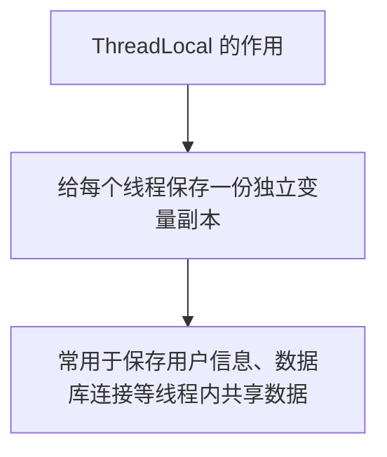

# ThreadLocal 的作用：线程隔离与线程内共享

面试题：谈一谈对 ThreadLocal 的理解。这道题的答法有个讲究：大部分人上来就背「线程本地变量」，但真正能体现理解的，是说清它与加锁、CAS 的思路差异，以及它同时具备的两大作用。

## 先给结论

ThreadLocal 的两大作用：

- 线程间：实现资源对象的隔离。每个线程各用各的资源，彼此不共享、不争抢，从根上避免争用引发的线程安全问题。
- 线程内：实现资源的共享。同一个线程内，跨多个方法都能拿到同一个资源对象，这是局部变量做不到的。

一句话概括：线程间隔离，线程内共享。



## 是什么：与加锁相反的思路

一个共享变量或共享资源对象，多个线程同时读写，就必须考虑线程安全问题，常规手段是加锁或用 CAS 来保证。

ThreadLocal 走的是完全相反的路线：它不做互斥，它做隔离。资源对象被 ThreadLocal 收纳后，每个线程各用各的一份，不存在同一个资源对象被多个线程同时访问的问题。线程一用资源一，线程二用资源二，大家不争抢，自然就没有争用引发的线程安全问题。这就是所谓的线程隔离。

有人会问：线程隔离用局部变量不是也行吗？方法内声明一个局部变量，它也是线程私有的，不牵扯共享。没错，局部变量确实没有线程安全问题，但它有一个硬伤：不能跨越方法。同一个线程内依次调用方法一、方法二、方法三，局部变量的生命周期局限在单个方法内，在方法二里想用方法一的局部变量，做不到。

ThreadLocal 恰好具备局部变量不具备的这个特点：它可以实现线程内的资源共享。用 ThreadLocal，方法一里取得对象存进去，只要是同一个线程，方法二里还能通过 ThreadLocal 取到完全相同的对象。隔离解决线程间问题，共享解决线程内传递，两个能力合在一起才是完整的 ThreadLocal。

## 为什么：隔离消解争用，共享打通方法

隔离之所以能消解线程安全问题，是因为安全问题的前提是「共享」。多个线程碰同一份数据才有竞争，才有可见性、原子性的麻烦。ThreadLocal 把数据变成一人一份，竞争的前提直接消失，连锁都不需要。Connection 就是典型：数据库连接对象本身不是线程安全的，多个线程共用一个连接，事务状态、游标位置互相覆盖，立刻就乱。给每个线程一个独立连接，问题不复存在。

线程内共享之所以有价值，是因为业务调用是跨方法的。一次请求的处理可能横跨 service、dao 多个方法，连接、会话、用户上下文这类对象需要一路带着走。用参数逐层传递，签名会被污染；用局部变量，出了方法就没了。ThreadLocal 存在线程身上，方法之间随手可取，传递链被隐藏起来，方法签名保持干净。

## 深入细节：Connection 例子

用一个数据库连接的例子把两个作用都演示出来。目标是获取 Connection 对象来使用，而 Connection 不是线程安全的，多个线程访问同一个连接就会乱套，所以用 ThreadLocal 对它做线程间隔离，让每个线程用自己的 Connection。

```java
public class TestThreadLocal {
    public static void main(String[] args) {
        test2();
    }

    // 一个线程内调用，得到的是同一个 Connection 对象
    private static void test2() {
        for (int i = 0; i < 2; i++) {
            new Thread(() -> {
                LoggerUtils.get("t").debug("{}" , Utils.getConnection());
                LoggerUtils.get("t").debug("{}" , Utils.getConnection());
                LoggerUtils.get("t").debug("{}" , Utils.getConnection());
            }, name: "t" + (i + 1)).start();
        }
    }

    // 多个线程调用，得到的是自己的 Connection 对象
    private static void test1() {
        for (int i = 0; i < 5; i++) {
            new Thread(() -> {
                LoggerUtils.get("t").debug("{}" , Utils.getConnection());
            }, name: "t" + (i + 1)).start();
        }
    }

    static class Utils {
        private static final ThreadLocal<Connection> tl = new ThreadLocal<>();

        public static Connection getConnection() {
            Connection conn = tl.get(); // 到当前线程获取资源
            if (conn == null) {
                conn = innerGetConnection(); // 创建新的连接对象
                tl.set(conn); // 将资源存入当前线程
            }
            return conn;
        }

        private static Connection innerGetConnection() {
            try {
                return DriverManager.getConnection(
                    "jdbc:mysql://localhost:3306/test?useSSL=false", 
                    "root", "root");
            } catch (SQLException e) {
                throw new RuntimeException(e);
            }
        }
    }
}
```

ThreadLocal 对象的核心作用，就是把需要被隔离的资源对象存入当前线程，或者从当前线程取出。get 方法是到当前线程获取资源，set 方法是将资源存入当前线程。

看 getConnection 的执行逻辑：进来先到当前线程获取，拿不到（返回 null）就创建新连接，再 set 进当前线程，最后返回。

实验一，线程间隔离。循环创建五个线程，每个线程调用一次 getConnection。结果五个线程拿到的 Connection 各不相同，从对象哈希就能看出来。逐个推演：第一个线程来，当前线程里没有连接资源，get 返回 null，if 条件成立，创建新连接并 set 进线程一；第二个线程来，它自己的线程里没有资源（刚才只存进了线程一），于是创建自己的连接，存进自己；线程三、线程四、线程五同理。五个线程五个连接，互不干扰。

实验二，线程内共享。创建两个线程，每个线程在自己的线程体内多次调用 getConnection。结果：线程间拿到的连接不同，但线程内多次调用拿到的是同一个。推演：t1 第一次来，线程里没有连接，创建并存入 t1；t1 第二次来，线程里已经有了，直接取出复用，不再创建；t1 第三次同样复用。t2 独立走一遍自己的流程。同一线程内三次拿到同一个连接，跨方法共享成立。

两个实验合起来，正是 ThreadLocal 的两大作用：线程间实现资源隔离，线程内实现资源共享。

## 面试怎么答

面试问 ThreadLocal，按四层答。

第一层定位：ThreadLocal 采用与加锁、CAS 相反的思路解决线程安全问题，靠的是资源对象的线程隔离而非互斥，每个线程各用各的资源，消除争用。

第二层两大作用：线程间实现资源隔离，线程内实现资源共享。隔离让每个线程有独立副本，共享让同一线程跨方法拿到同一对象，这是局部变量做不到的。

第三层场景：每个线程需要一个独立且线程不安全的对象时使用，典型如数据库连接、SimpleDateFormat，以及跨方法传递的用户上下文、会话信息。可以带出 Connection 的例子：五个线程五个连接，同线程内多次获取是同一个。

第四层原理与注意：底层是每个线程持有自己的 ThreadLocalMap，key 是 ThreadLocal 实例本身。要主动提内存泄漏风险：线程池中的线程会长期存活，ThreadLocal 用完后必须 remove，否则 entries 泄漏。这一句往往是加分项。

## 常见误区

**误区一：把 ThreadLocal 当成同步机制。** 它是隔离，不是互斥。多个线程通过它拿到的是各自独立的对象，之间没有任何协调。需要共享且互斥的场景，它帮不上忙。

**误区二：以为线程内每次获取都会新建。** 线程内是复用的。第一次为空才创建并 set，后续直接从当前线程取。getConnection 里的 if 判断就是干这个的。

**误区三：以为局部变量可以替代。** 局部变量出方法就没了，ThreadLocal 的关键差异正是跨方法的线程内共享。拿局部变量类比，说明没抓住重点。

**误区四：忽略内存泄漏。** ThreadLocalMap 随线程存活，线程池场景下线程不退出，条目不会自动清。用完后调 remove 是必修课，答理解题时主动提这一点，能明显区别于八股式回答。
