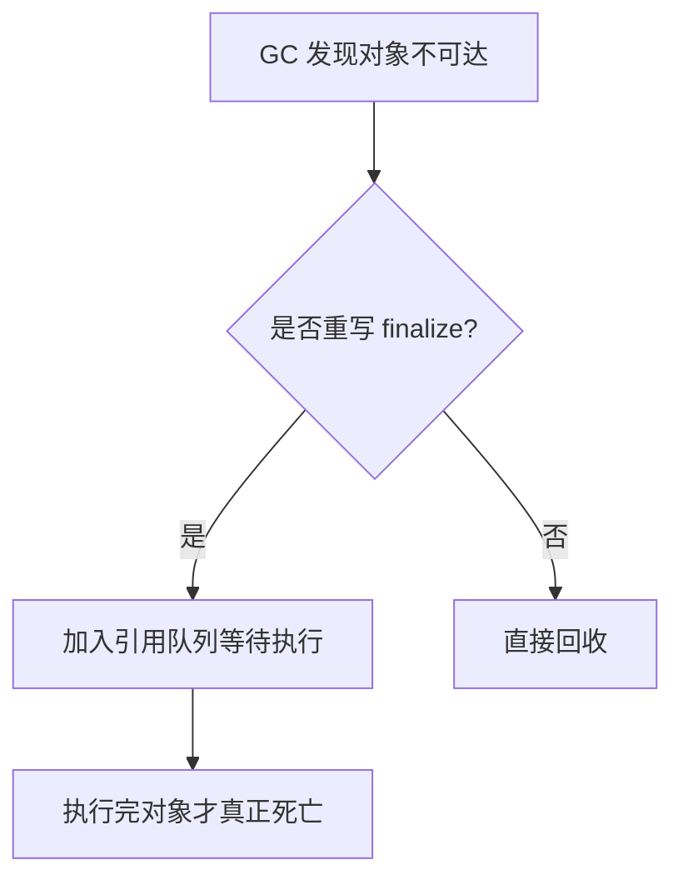

# finalize 调用原理：ReferenceQueue 与 FinalizerThread

上一篇看到，重写了 finalize 的对象在构造时会被包装成 Finalizer 引用，挂进 unfinalized 双向链表。链表里的对象什么时候被调用 finalize、由谁来调用，答案在 ReferenceQueue 和一个专门的线程里。这一篇把源码跟到底，顺手把最初提出的几个疑问全部结清。

## 先给结论

调用链是这样串起来的：对象被判定为垃圾时，关联的 Finalizer 引用进入 ReferenceQueue；名为 Finalizer 的守护线程从队列中逐个取出，先把它从 unfinalized 链表断开，再调用对象的 finalize；断开是为了标记「已调用过」，让下一轮垃圾回收能把它彻底收掉。

由此推出 finalize 的五个真相：GC 后不会立刻调用；第一次 GC 杀不掉重写 finalize 的对象；调用者是 Finalizer 守护线程，不保证执行完；finalize 里的异常会被静默吞掉；调用顺序等于对象被 GC 的顺序。



## 是什么：入队但还不能回收

unfinalized 链表里全是 finalize 尚未被调用的对象，名字已经说明了一切。调用时机要等接下来的垃圾回收：当狗对象不再被任何人引用、可以作为垃圾被回收时，它们关联的那些 Finalizer 对象就会被加入 ReferenceQueue。

这里的 ReferenceQueue 大家不陌生，讲虚引用、弱引用时见过。但有一个关键差异：虚引用、软引用、弱引用的引用对象入队时，它们关联的真实对象已经被回收掉了；而 Finalizer 引用入队时，它关联的对象还不能被回收。

为什么还不能回收？因为回收了就再也没机会调用它的 finalize。调用 finalize 是最终目的，所以必须暂时保留引用关系，狗对象也暂时不能被回收。这正是重写 finalize 的对象的问题所在：第一次垃圾回收回收不掉它，要等 finalize 调用完，再次发生垃圾回收时，它才会真正被回收。

## 为什么：断开链表与吞掉异常

谁来完成 finalize 的调用？看 Finalizer 源码，类的最下方有一个 FinalizerThread 类，显然是个线程。对照之前的日志，执行 finalize 的线程名正是 Finalizer，就是这个线程，创建时起了这个名。

它的 run 方法是一个不断循环，反复从 ReferenceQueue 中取数据。队列里放的是被垃圾回收的对象关联的 Finalizer 引用，当然此时对象还没真正回收，因为回收掉就没机会调 finalize 了。拿到引用后调用 runFinalizer，真正去调用狗对象的 finalize。

runFinalizer 上半段做收尾：把 Finalizer 引用对象从 unfinalized 双向链表里断开。断开保证了这次调用完之后，没有任何引用再指向这个 Finalizer，下一次垃圾回收就能把它回收掉。具体动作是：原本的上一个节点的 next 指向原本的下一个，原本的下一个节点的 previous 指向原本的上一个，摘出的节点自身 next 与 prev 都指向自己，表示已出链。断开之后，这个 Finalizer 成了没人要的孩子，下一轮 GC 连它带狗对象一起收掉。

下半段做执行：确认狗对象不为空，且不是 Enum 类型，就调用 invokeFinalize，这个方法最终调用对象的 finalize。

还有两个必须知道的设计。其一，finalize 的调用包裹在 try catch 里，捕获 Throwable，一旦出现任何异常，什么事情都不做，异常直接被吞。这是它最大的毛病：资源释放到一半出错，外面毫无感知。其二，FinalizerThread 是守护线程，创建时 setDaemon(true)，其他非守护线程都结束时它也结束，所以 finalize 的代码不保证执行完。

## 深入细节：源码与五个疑问

线程主循环等待 JVM 初始化完成后进入轮询：

```java
while (VM.initLevel() == 0) {
    // 等待 JVM 初始化完成
}
```

注册入口只有一行，包一层构造就进了链表：

```java
static void register(Object finalizee) {
    new Finalizer(finalizee);
}
```

队列通过静态方法暴露给 JVM：

```java
static ReferenceQueue<Object> getQueue() { return queue; }
```

runFinalizer 的核心，注意整段在锁内，且异常来者不拒：

```java
synchronized (lock) {
    Object finalizee = this.get();
    assert finalizee != null;
    if (!(finalizee instanceof java.lang.Enum)) {
        jla.invokeFinalize(finalizee);
    }
    finalizee = null;
}
```

优先级常量，普通线程默认 5，最大 10：

```java
public static final int MAX_PRIORITY = 10;
```

线程做的事概括成两件：把引用对象从 unfinalized 链表断开，表示已调用过 finalize，下次不再找它，也没人再引用它；然后真正调用每个对象的 finalize。

回到最初的五个疑问，逐一结清。

疑问一，调用次序。与对象被垃圾回收的先后次序有关：哪个对象先被回收，就先调用哪个对象的 finalize。ReferenceQueue 是单向链表，按入队顺序调用，所以调用是有顺序的，只不过这个顺序等于 GC 时对象的顺序，人控制不了。

疑问二，谁来调用。一个名为 Finalizer 的线程，它从 ReferenceQueue 逐一取出已被判定可回收的 Finalizer 引用，断开链表后调用 finalize。

疑问三，守护线程。创建时 setDaemon(true)，只要其他非守护线程都结束，守护线程也会结束，因此不能保证 finalize 的代码一定执行完。顺带辟个谣：很多资料说这个线程优先级低，其实不低。普通线程优先级是 5，最大优先级是 10，Finalizer 线程是 8，比普通线程还高。它赶不上主线程的步伐，是因为 finalize 执行太慢：移除链表要加锁，且一个一个串行执行，综合原因导致的，与优先级无关。

疑问四，异常为何没有输出。因为调用 finalize 的代码包在 try catch 里，捕获 Throwable，出现任何异常都直接吞掉，什么都不做。

疑问五，GC 时会立刻调用 finalize 吗。不会。先把对象加入 ReferenceQueue，再由线程一点一点取，取一个调一次，不是 GC 当场调用。

## 面试怎么答

面试问 finalize 为什么不好，把四点讲全，再补一个辟谣。

第一，执行没保证。调用者是 Finalizer 守护线程，主线程结束它可能来不及跑，资源没释放完就退场。

第二，失败无感知。finalize 的调用被 try catch Throwable 包着，异常全吞，释放过程出没出错无从判断。

第三，严重影响性能。重写 finalize 的对象第一次 GC 回收不掉，必须先入队、等线程逐个调用完、从 unfinalized 链表断开，下一轮 GC 才真正释放。而 finalize 的调用很慢：链表操作要加锁，还串行执行。内存释放不及时，对象被移入老年代，老年代积累引发 Full GC，恶性循环，最终可能 OOM。

第四，时机与顺序不可控。调用顺序等于对象被 GC 的顺序，GC 时机又不确定，等于把清理逻辑交给运气。

辟谣加分项：Finalizer 线程优先级是 8，比普通线程的 5 还高，它慢不是因为优先级低，而是因为串行加锁的执行方式。

结论收尾：Java 9 起 finalize 已被标记 Deprecated，资源管理用 try-with-resources 与 AutoCloseable。

## 常见误区

**误区一：以为 GC 之后立刻调用 finalize。** 中间隔着入队和 FinalizerThread 轮询，是异步的。GC 完成不等于 finalize 执行。

**误区二：以为一次 GC 就能回收重写 finalize 的对象。** 第一次 GC 只是把它的 Finalizer 引用送入队列，对象本身还活着；要等 finalize 调用完、链表断开，下一轮 GC 才真正回收。

**误区三：以为 Finalizer 线程优先级低所以慢。** 优先级是 8，高于普通线程的 5。慢的原因是链表操作加锁、串行执行，不是调度不公。

**误区四：以为 finalize 里抛异常会暴露。** try catch Throwable 全吞，日志一片安静。清理失败无感知，比不清理更危险。
