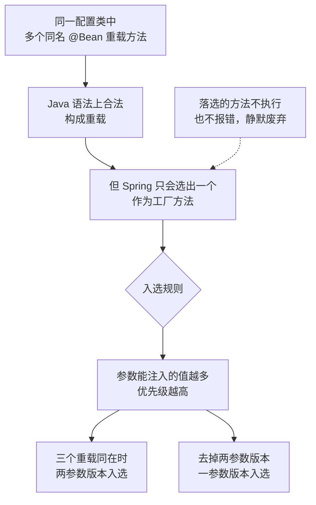

# @Bean 工厂方法不支持重载

@Configuration 的四个要点里，前一篇讲了第一点：配置类是工厂，@Bean 方法是工厂方法。本篇讲第二点，一个日常容易踩的坑：**@Bean 方法不支持重载，多个同名重载方法里只有一个能入选成为工厂方法，其余的全部作废**。这不是编译错误，代码写得合法，跑起来也不报错，但结果往往与直觉相反。

## 先给结论

同一个配置类中，允许存在多个方法名相同、参数不同的 @Bean 方法，Java 语法上这构成重载，完全合法。但 Spring 只会从中选出一个作为工厂方法，入选规则与参数有关：**参数能注入的值越多，优先级越高**。三个重载同时存在时，两个参数的版本入选；把两个参数的版本去掉，一个参数的版本入选。落选的方法不会执行，也不会报错，属于静默废弃。



## 是什么

先看正常的配置类写法，一个 @Bean 方法对应一个 Bean，名实相符：

```java
@Configuration
static class MyConfig {
    @Bean
    public Bean1 bean1() {
        System.out.println("bean1()");
        return new Bean1();
    }
}
```

此时容器调用无参的 `bean1()` 方法生产 Bean1，行为符合直觉。问题出在给方法加重载的时候。带上一个参数、用 @Value 注入 Java 版本号：

```java
@Bean
public Bean1 bean1(@Value("${java.class.version}") String a) {
    System.out.println("bean1(" + a + ")");
    return new Bean1();
}
```

再带上两个参数，同时注入 Java 版本号与 JAVA_HOME：

```java
@Bean
public Bean1 bean1(@Value("${java.class.version}") String a, @Value("${JAVA_HOME}") String b) {
    System.out.println("bean1(" + a + ", " + b + ")");
    return new Bean1();
}
```

四个代码块按课程原稿逐字收录。三个 bean1 重载同时在类中时，Java 编译器不挑刺，因为它们参数列表不同，是合法重载。但 Spring 的 @Bean 语义不是「一个方法一个工厂方法」，而是「一个 Bean 名对应一个工厂方法」。三个方法都叫 bean1、都返回 Bean1、都标注了 @Bean，Spring 必须三选一，没有折中方案。

## 为什么

为什么参数多的版本会入选？判断依据是每个候选方法能注入的参数数量。@Bean 方法的参数不是随便声明的，它们都需要容器提供注入值：可以用 @Value 注入属性，也可以注入容器中的其他 Bean。一个方法声明的参数越多，意味着它需要容器提供的信息越多，Spring 认为它的「工厂意图越明确」，因此在重名冲突时优先选择参数最多的版本。三个版本并存时，两个参数的 `bean1(String, String)` 胜出，控制台打印 `bean1(版本号, JAVA_HOME路径)`，两个参数分别绑定成功。把两个参数的版本注释掉后，一个参数的 `bean1(String)` 胜出，打印 `bean1(版本号)`。

之所以是「静默」而非报错，是因为在 Spring 的解析视角里，它确实为 bean1 这个 Bean 名找到了唯一一个工厂方法，职责已经落实，落选的方法只是没被选上，不构成错误。代价是：如果程序员误以为某个重载会生效，代码会 quietly 不按预期执行，排查时没有异常可循，只能靠日志或调试器发现实际调用的是哪个版本。

## 深入细节

把入选规则放进配置类全貌里看。配置类中除了三个 bean1 重载，还可以有一个无参的 bean2：

```java
@Bean
public Bean2 bean2() {
    System.out.println("bean2()");
    return new Bean2();
}
```

bean2 与 bean1 不重名，不参与竞争，按自己的方法正常生产。这说明重载冲突只在同名方法之间发生，不同 Bean 名互不干扰。

理解这条规则要回到 @Bean 的语义。@Bean 的语义与 Spring XML 配置中的 `<bean>` 元素相似：都是「声明一个由容器管理的 Bean」。XML 中一个 bean 由 id 唯一确定，不存在重载一说；@Bean 用方法名充当 Bean 名，方法重载就相当于两个 XML 声明抢同一个 id，必然只能留一个。

落到实践上，规避办法很简单：不要给 @Bean 方法写重载。需要不同创建逻辑时，用不同方法名、不同 Bean 名区分，把选择权交还给代码结构，而不是交给 Spring 的优先级规则。

## 面试怎么答

被问到 @Bean 方法能不能重载，可以这样答：Java 语法上可以重载，但 Spring 只支持单选。多个同名 @Bean 方法同时存在时，只有一个能入选成为工厂方法，入选规则是参数能注入的值越多优先级越高。比如无参、单参、双参三个 bean1 重载并存，双参版本入选；去掉双参，单参版本入选。落选方法静默废弃，不报错。所以实践中不要写 @Bean 重载，需要不同逻辑就用不同方法名。

## 常见误区

误区一：以为每个重载都会生成一个 Bean。实际上重名方法竞争同一个 Bean 名，只有参数最多的那个生效，其余作废。

误区二：以为冲突会报错。Spring 认为已经找到唯一工厂方法，不视为错误，落选方法静默忽略，问题只在实际输出不符合预期时才暴露。

误区三：以为参数越多越「重」，选择结果与参数类型有关。选择只看可注入参数的数量，与类型、返回值无关；参数少的版本永远竞争不过参数多的版本。
