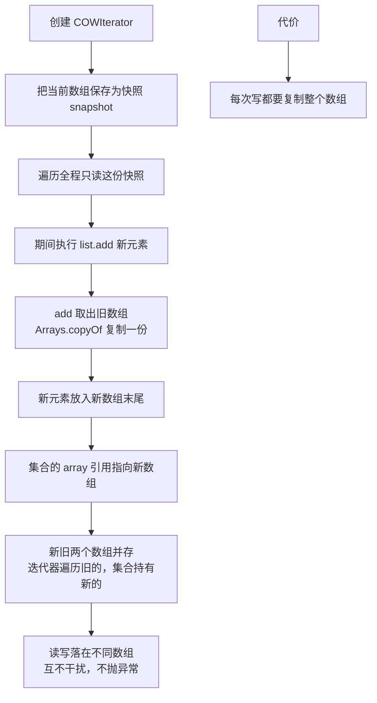

# 安全失败机制的源码实现

上一篇拆解了快速失败的源码：靠 `modCount` 与 `expectedModCount` 的比对发现遍历期间的修改。本篇看它的对立面，安全失败。结论先行：`CopyOnWriteArrayList` 的迭代器在创建时把当前数组保存为快照，后续遍历只读这份快照；任何写操作都会复制出一份新数组、把新元素放进新数组，再把集合的数组引用指向新数组。读写操作落在两个不同数组上，互不干扰，因此遍历过程中修改集合不会抛异常，这就是安全失败。

## 先给结论

安全失败的实现不靠计数比对，而靠读写分离。遍历用的是迭代器创建时固化的旧数组快照，写入的是每次 add 时复制出来的新数组。两套数组彼此独立，遍历自然不受写入影响。`ArrayList` 是快速失败的典型代表，遍历的同时不能修改；`CopyOnWriteArrayList` 是安全失败的典型代表，允许遍历的同时修改，代价是每次写都要复制整个数组。



## 是什么

把上一篇的演示代码换成 `CopyOnWriteArrayList`，同样创建含 A、B、C、D 四个元素的集合并遍历，同样在遍历过程中 add 一个新元素 E。区别在迭代器：增强 for 循环首次执行时创建迭代器对象，这一次创建出来的不是 `ArrayList` 的 `Itr`，而是 `CopyOnWriteArrayList` 内部的 `COWIterator`。

跟进入这个迭代器的构造方法，会看到它把当前正在遍历的数组记录下来，赋值给迭代器自己的 `snapshot` 成员变量。此时集合中有四个元素，快照就是这个四元素数组的引用。构造完成，迭代器与这份快照绑定，之后无论集合怎么变，它只看这份快照。

## 为什么

为什么遍历不受影响？因为写入根本没有碰快照所在的数组。在调试器里走一遍全过程：第一次循环打印 A，第二次循环打印 B，随后执行 `list.add(new Student("E"))`。添加成功后查看迭代器的 `snapshot`，它仍然是那个四元素数组，没有变成五个元素。再对集合本身执行 view as object 查看其 `array` 成员，它已经是一个五元素的新数组。新旧两个数组同时存在：迭代器遍历旧的，集合持有新的。

这一切的根源在 `CopyOnWriteArrayList` 的 add 实现。每次调用 add，它先取出集合当前的旧数组，然后调用 `Arrays.copyOf` 把旧数组整体复制一份，长度加一，再把新元素放到新数组的最后一个位置，最后把集合的数组引用替换为这份新数组。也就是说，add 操作从头到尾没有修改旧数组的任何内容，旧数组被原样留给正在遍历它的迭代器。

## 深入细节

把两个机制放在一起对比，边界更清晰。

快速失败走的是「监控」路线：不阻止你改，只记录修改次数，一旦发现遍历期间次数变了就立刻抛 `ConcurrentModificationException`。它的前提假设是「遍历时被改」属于程序错误，尽早暴露好过延迟暴露。

安全失败走的是「隔离」路线：不监控、不抛异常，直接用快照把读写隔开。它的前提假设是「读旧数据是可接受的」，写操作的成本通过复制数组来承担。

两套设计各自有清晰的适用面。`CopyOnWriteArrayList` 每次写都复制全量数组，写开销大，适合读多写少的场景；`ArrayList` 写零成本，但遍历期间不能修改。选型时问自己一个问题：遍历过程中遇到并发修改，你希望抛异常，还是希望读到旧快照？前者选 ArrayList，后者选 CopyOnWriteArrayList。

还有一点值得记住：安全失败不等于绝对一致。遍历读的是快照，遍历期间的新增元素本次遍历看不到，已经在遍历的元素也不会因为删除而消失。它保证的是「不抛异常、不读到损坏状态」，不保证「读到最新数据」。

最后留一个思考题：`Vector` 的迭代器是快速失败的还是安全失败的？答案不靠猜，用前面两篇的方法在调试器里验证即可。

先跑一遍对照实验，直观感受两者的差别：

```java
// fail-fast：一旦发现遍历的同时其它人来修改，则立刻抛异常
private static void failFast() {
    ArrayList<Student> list = new ArrayList<>();
    list.add(new Student("A"));
    list.add(new Student("B"));
    list.add(new Student("C"));
    list.add(new Student("D"));
    for (Student student : list) {
        System.out.println(student);
    }
    System.out.println(list);
}

// fail-safe：发现遍历的同时其它人来修改，应当能有应对策略，例如牺牲一致性来让整个遍历运行完成
private static void failSafe() {
    CopyOnWriteArrayList<Student> list = new CopyOnWriteArrayList<>();
    list.add(new Student("A"));
    list.add(new Student("B"));
    list.add(new Student("C"));
    list.add(new Student("D"));
    for (Student student : list) {
        System.out.println(student);
    }
    System.out.println(list);
}
```

注意这两段代码的**遍历代码完全一样**，差别只在集合的实现：`ArrayList` 的迭代器是快速失败的，`CopyOnWriteArrayList` 的迭代器是安全失败的。这正说明安全失败不是遍历写法带来的，而是迭代器实现决定的。

## 面试怎么答

被问到安全失败的原理，可以这样答：`CopyOnWriteArrayList` 是安全失败的典型代表。它的迭代器在创建时会把当前数组保存为快照，后续遍历只读这份快照。它的 add 操作会先用 `Arrays.copyOf` 复制一份旧数组、长度加一，把新元素放到新数组末尾，再把集合的数组引用指向新数组。因此写操作落在新数组上，读操作仍读旧数组，两个数组互不干扰，遍历过程中修改集合不会抛异常。与之相对，`ArrayList` 是快速失败的典型代表，靠 `modCount` 与 `expectedModCount` 比对，发现遍历期间被修改就抛 `ConcurrentModificationException`。安全失败的代价是每次写都要复制数组，适合读多写少的场景。

## 常见误区

误区一：以为安全失败是线程安全的保证。它只保证遍历不抛异常、不读到损坏状态，遍历读到的是创建迭代器那一刻的旧快照，期间的新增对本轮遍历不可见。

误区二：以为复制只复制新增的位置。`Arrays.copyOf` 复制的是整个旧数组，长度加一，全量复制，这也是它读多写少才划算的原因。

误区三：以为 `CopyOnWriteArrayList` 的迭代器和 ArrayList 一样会做修改次数检查。它的 `COWIterator` 没有 `checkForComodification`，没有任何计数器比对逻辑，隔离完全由两个数组实现。
