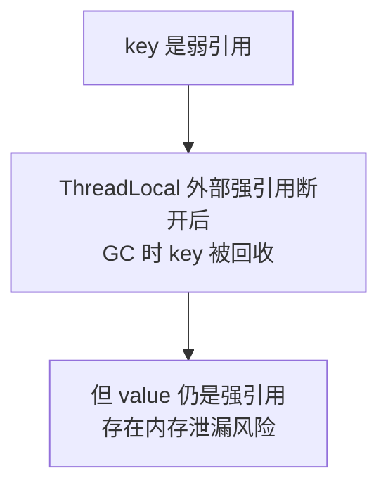

# ThreadLocalMap 的 key 为何是弱引用

ThreadLocal 原理部分的最后一个常见问法是：ThreadLocalMap 中的 key 为什么设计成弱引用？这个问题看似细小，却是理解 ThreadLocal 内存模型的关键一环。结论先行：key 弱引用是一道兜底防线，防止线程长期不退出、程序员又忘记手动 remove 时，key 的内存无人释放；而 value 仍是强引用，它的释放需要另外的机制，那是后面几篇的主题。

## 先给结论

ThreadLocalMap 的 Entry 继承自 WeakReference，key 即 ThreadLocal 对象被包装为弱引用，value 资源对象保持强引用。key 弱引用的目的只有一个：在垃圾回收时，只要外部不再有强引用指向这个 ThreadLocal，key 就能被回收，避免长生命周期线程（如线程池核心线程）的 map 中 key 无限堆积。value 不受此保护，仍是强引用，它的释放要另找时机。



## 是什么

先看源码结构。ThreadLocalMap 中，key 与 value 合在一起用一个 Entry 类型表示，Entry 继承自 WeakReference：

```java
static class ThreadLocalMap {
    // 内部类 Entry 继承自 WeakReference，用于存储 key-value 对
    static class Entry extends WeakReference<ThreadLocal<?>> {
        Object value;
        Entry(ThreadLocal<?> k, Object v) {
            super(k); // 创建一个弱引用，key 是 ThreadLocal 实例
            value = v;
        }
    }
}
```

按课程原稿逐字收录，其中 `super(k)` 一行的注释是稿件原有内容。

注意 Entry 继承 WeakReference，不等于 key 和 value 都是弱引用。看构造方法：key 与 value 都作为参数传入，但只有 key 被交给了父类构造 `super(k)`，这一行调用的就是 WeakReference 的构造函数：

```java
@Contract(pure = true)
public WeakReference(T referent) {
    // 创建一个新弱引用，引用给定对象，但不注册到任何队列中
}
```

经过 `super(k)`，key 成为真正的弱引用；value 只做了普通赋值，没有任何包装，仍然是强引用。所以 ThreadLocalMap 是「key 弱引用、value 强引用」的半弱结构，这个细节直接决定了后面 value 为什么难回收。

## 为什么

设计动机来自一个真实的运维场景：线程可能长时间运行。典型例子是线程池中的核心线程，只要线程池不关闭，它就一直存活。线程存活意味着它内部的 ThreadLocalMap 一直存在。如果程序员没有良好的编程习惯，用完之后没有主动调用 remove 释放 key 与 value，那么随着时间推移，map 中的键值对会越积越多，内存压力持续增长。

问题随之而来：还有没有机会回收这些内存？只剩一个机会，就是垃圾回收。当整个机器的内存都不足时，JVM 会触发 GC，这时才有机会释放这些键值占用的内存。

假设 key 设计成强引用会怎样？即使将来触发了 GC，即使其他任何地方都不再使用这个 ThreadLocal 对象，只要 map 还用强引用握着 key，它就回收不了。强引用是 GC 不可逾越的线，key 的内存将永远得不到释放，直到线程退出 map 被整体抛弃为止。

而 key 设计成弱引用后，GC 时只要外部没有强引用指向这个 ThreadLocal，弱引用对象就可以被回收，key 占用的内存得以释放。这就是 key 弱引用的全部意义：给遗忘兜底，给 GC 一个回收 key 的入口。

## 深入细节

理解这个设计要抓住两个不对称。

第一个不对称在引用强度。key 是弱引用，GC 时若外部无强引用即可回收；value 是强引用，GC 不能动它。所以 key 的内存可以靠 GC 自动释放，value 不行，值的释放必须另找机会。

第二个不对称在释放顺序上。key 被 GC 回收之后，map 中对应 Entry 的 key 就变成了 null。这提供了一个信号：可以据此判断哪些条目已经过期，进而清理 value。后面三篇会分别讲 get、set、remove 三个时机下，如何顺着「key 是否为 null」这条线索把 value 的内存释放掉。也就是说，key 弱引用不仅自己释放，还充当了 value 释放的触发器。

再回到 PPT 上的总结：线程可能长时间运行，比如线程池核心线程；为了让 key 的内存能得到释放，作为最后一道防线，需要在内存不足触发 GC 时，把弱引用 key 占用的内存释放掉。这道防线防的是程序员的遗忘，不是并发错误。若每次使用后都规范 remove，key 与 value 都会及时清理，弱引用的兜底意义才不会体现。

## 面试怎么答

被问到 ThreadLocalMap 的 key 为什么是弱引用，可以这样答：ThreadLocalMap 的 Entry 继承自 WeakReference，构造时只有 key 通过 `super(k)` 被包装成弱引用，value 仍是强引用。这样设计是为了兜底：线程可能长时间运行，比如线程池的核心线程，它内部的 ThreadLocalMap 会一直存在，如果程序员用完没有主动 remove，键值对会越积越多。key 用弱引用后，垃圾回收时只要外部不再强引用这个 ThreadLocal，key 的内存就能被释放，作为最后一道防线防止内存泄漏。value 是强引用，GC 回收不了，需要另外在 get、set、remove 等时机根据 key 是否为 null 来主动清理。

## 常见误区

误区一：以为 Entry 继承 WeakReference 就意味着 key 和 value 都是弱引用。只有 key 走了 `super(k)`，value 是普通赋值，仍是强引用，这个区别是 ThreadLocal 内存泄漏问题的根源。

误区二：以为弱引用能同时解决 key 和 value 的释放。key 弱引用只解放 key 自己；value 是强引用，只能靠后续根据 key 为 null 的线索主动清理。

误区三：以为这是为了防止并发问题。弱引用与线程安全无关，ThreadLocalMap 本就在单线程内使用。它防的是「线程长命加忘记 remove」造成的内存堆积。
