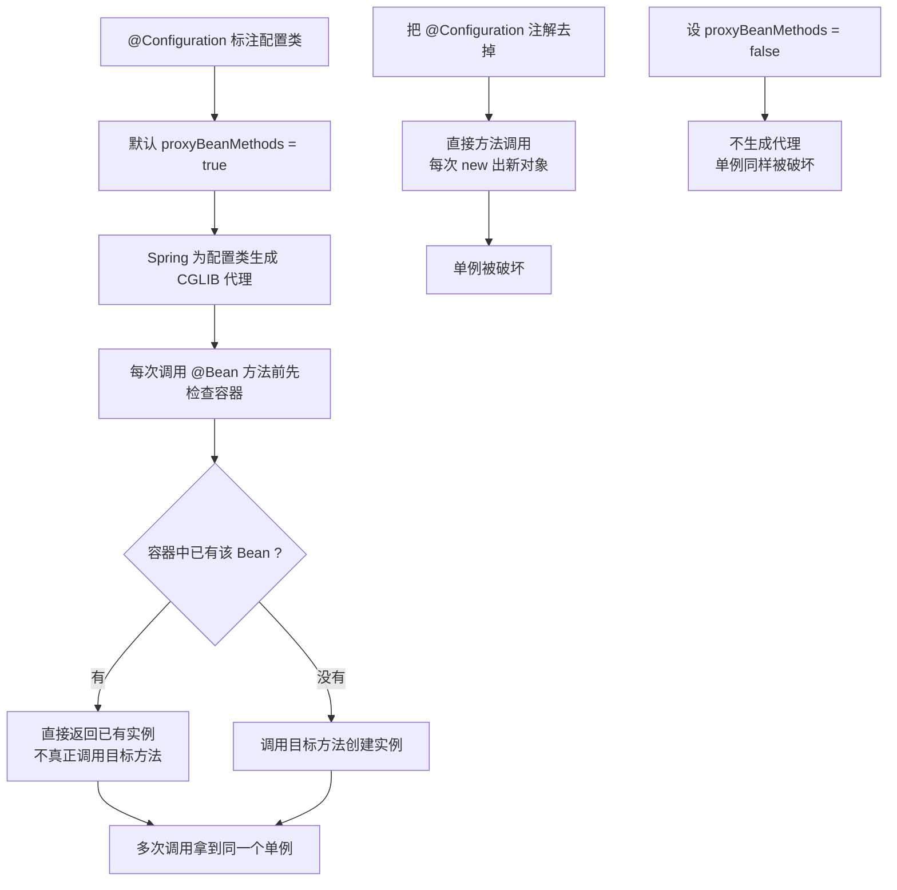

# @Configuration 默认为配置类生成代理

@Configuration 四个要点的第三点，也是它最核心的作用：**标注了 @Configuration 的类，Spring 默认会为它生成一个 CGLIB 代理，目的是保证 @Bean 方法相互调用时仍然保持单例**。上一篇讲 @Bean 不支持重载，这一篇解释为什么 @Configuration 这个注解不能省。不少配置类把 @Configuration 删掉也能跑，但那只是没触发它的核心场景。

## 先给结论

@Bean 方法之间可能存在依赖，比如 bean1 需要用到 bean2 产生的对象。Spring 官方推荐的解法有两种：把 bean2 作为参数传入 bean1，或者直接在 bean1 方法体内调用 bean2 方法。后一种写法要生效，前提是配置类上有 @Configuration：它会默认生成代理，代理在每次方法调用前检查容器中是否已有该 Bean，已有就直接返回，不真正调用目标方法，从而保证多次调用拿到的仍是同一个单例对象。把 @Configuration 去掉，直接调用方法会产生多个不同对象；把 `proxyBeanMethods` 设为 false，代理不生成，单例同样被破坏。

## 是什么

先看一个容易造成的误解。把配置类上的 @Configuration 注释掉，容器启动后 bean1、bean2 依然能正常创建，方法照样被调用。于是有人想当然地认为这个注解可有可无。这个结论在简单场景下成立，但一旦 @Bean 方法之间产生依赖就会失效。

当 bean1 需要 bean2 时，第一种解法是参数注入：在 bean1 方法上加一个 bean2 类型的参数，容器在调用 bean1 之前会解析这个参数，按类型到容器中查找匹配的 Bean，找到就创建出来从参数传入。打印输出可以看到，调用 bean1 之前先调用了 bean2，bean2 创建完成后作为参数传进来，之后 bean1 内部拿着这个 bean2 自行建立依赖关系。整个过程是标准的依赖注入，不依赖 @Configuration。

第二种解法来自 Spring 官方文档：不加参数，bean1 需要 bean2 时直接调用同类中的 bean2() 方法。直觉上这会出问题，每调一次方法就 new 一个新 bean2，调用三次产生三个不同对象，单例被破坏。实验证实了没有 @Configuration 时的后果：bean2 方法被执行了多遍，每次产生的对象哈希值都不同，确实不是单例。

## 为什么

为什么加上 @Configuration 之后直接调用方法就能保持单例？因为 @Configuration 标注的类默认会被生成一个代理对象。容器中实际持有的不是原始的 MyConfig 实例，而是它的 CGLIB 增强代理。之后通过代理调用 bean1、bean2 这些工厂方法，代理就有机会在方法调用前后插入逻辑。

具体做法是：代理在每次方法调用前先检查容器中是否已经存在目标 Bean。第一次调用 bean2 时容器里没有，代理放行，真正执行目标方法创建新对象；后续再调用 bean2，代理检查发现容器中已经有了，就不再真正调用原始 MyConfig 的 bean2 方法，而是直接从 BeanFactory 中取出已有的 bean2 返回。bean2 方法因此只被调用一次，三次打印拿到的是同一个对象。

证据可以直接观察。把 MyConfig 的 class 打印出来，类名带有 CGLIB 增强的痕迹，说明容器中持有的确实是代理而非原始类型。代理的行为还可以关掉：@Configuration 上有一个 `proxyBeanMethods` 配置，默认 true 即生成代理；改成 false 后，打印出的类型回到原始类型，代理不再生成，bean2 又被多次调用、每次产生新对象，单例特性再次被破坏。这个实验从正反两面证明了单例的保持者就是代理。

## 深入细节

这里要区分两层因果关系。@Bean 方法相互调用时不保持单例，根源不在方法本身，而在于「谁持有配置类实例」。没有 @Configuration 时，容器中的配置类是普通实例，方法调用就是普通 Java 调用，每次调用都执行方法体；有 @Configuration 时，容器中的配置类是代理，方法调用被代理拦截，代理拿着 BeanFactory 的账本决定是真正创建还是直接取现。

参数注入与代理调用两种解法并不等价。参数注入天然安全，不依赖任何代理机制，配置类上有没有 @Configuration 都能工作；直接调用方法省去了参数声明，但把正确性完全押在代理上，一旦 @Configuration 被删掉或 proxyBeanMethods 被设为 false，代码立刻退化成多实例。

回到那个最初的实验：删掉 @Configuration 后 bean1、bean2 仍能创建，是因为参数为空、方法间无依赖，代理的核心价值没有被触发。代理不是让 Bean 能被创建，而是让 Bean 之间的相互调用保持单例。这两个功能必须分开理解，否则很容易在重构配置类时把注解删掉而不自知。

## 面试怎么答

被问到 @Configuration 的作用，可以这样答：它有四个要点，配置类是工厂、@Bean 方法是工厂方法、@Bean 不支持重载，以及默认生成代理。最后一点最核心：@Configuration 标注的类默认会被 CGLIB 增强生成代理，目的是保证 @Bean 方法相互调用时仍保持单例。比如 bean1 方法体内直接调用 bean2 方法，代理会先检查容器中是否已有 bean2，已有就直接返回不真正调用，因此 bean2 方法只执行一次。这个行为由 proxyBeanMethods 属性控制，默认 true，改成 false 就不生成代理，单例被破坏。注意，，没有 @Configuration 时配置类在很多简单场景下也能工作，但一旦 @Bean 方法间有依赖，单例就无法保证。

## 常见误区

误区一：以为 @Configuration 只是标记「这是个配置类」。它的核心价值是默认生成代理，删掉它简单场景照常工作，但只要 @Bean 方法相互调用，单例立刻失效。

误区二：以为单例是 @Bean 方法本身的特性。单例是容器层面的保障，靠代理拦截方法调用来实现，与方法的 Java 语义无关。

误区三：以为参数注入和直接调用方法等价。参数注入不依赖代理，始终安全；直接调用依赖代理，@Configuration 或 proxyBeanMethods 一改行为就变，混用两种写法时要格外小心。
