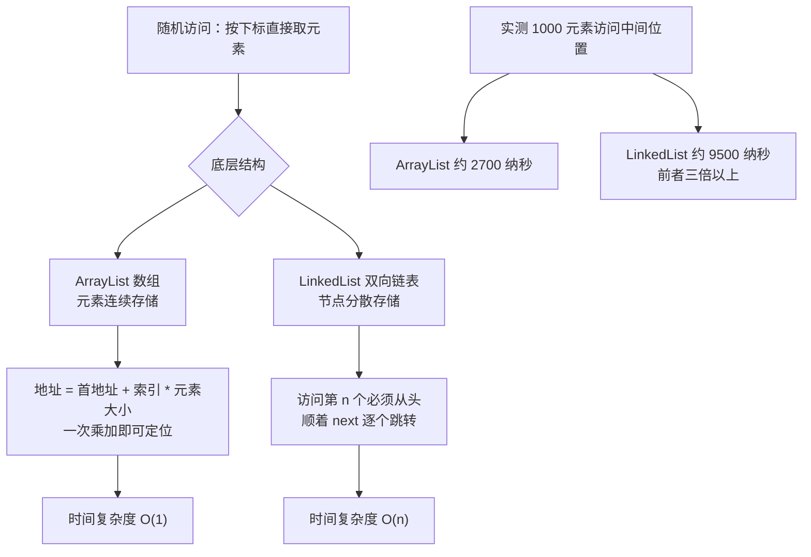

# LinkedList 与 ArrayList：随机访问性能对比

LinkedList 面试时通常不单独考，基本都是与 ArrayList 放在一起做比较。两者各总结四条特性，逐篇展开。第一篇讲随机访问：ArrayList 随机访问速度快，LinkedList 随机访问速度慢。这个结论大多数人都能背下来，但面试官真正想听的是「为什么」，以及你能否用源码与实测数据佐证。

## 先给结论

ArrayList 底层是数组，元素连续存储，知道首地址与元素大小就能直接算出任意下标的地址，随机访问是 O(1)；LinkedList 底层是双向链表，每个节点只记录相邻节点的地址，访问第 n 个元素必须从头节点一步步跳转，随机访问是 O(n)。实测同样 1000 个元素、访问中间位置、循环五次取平均，预热后 ArrayList 约 2700 纳秒，LinkedList 约 9500 纳秒，后者是前者的三倍以上。



## 是什么

先说数据结构这个总根源。ArrayList 底层基于数组，数组在内存分配上需要一块连续空间；LinkedList 底层基于双向链表，链表在内存分配上不需要连续空间。内存布局的差异决定了两者后续所有特性，随机访问只是第一个后果。

所谓随机访问，通俗讲就是按集合中任意一个下标直接取元素。这个「任意」是关键：不从头开始翻，而是直达目标位置。数组结构下这件事是简单算术，链表结构下这件事是逐跳查找。

## 为什么

数组为什么快？因为连续存储。假设第一个元素的内存地址是 0，数组里全是整数，一个整数占 4 个字节，那么索引为 3 的元素，地址就是 3 乘 4 加 0 等于 12。只要知道首地址和元素大小，任意索引的地址都可以通过一次乘法加加法直接算出，计算量固定且极小，与元素在数组中的位置无关。访问第 1 个元素和访问第 1000 个元素，耗时几乎一样。

链表为什么慢？因为节点只记录相邻节点的地址。要找第 4 个元素，头节点给不出第 4 个的地址，只能先拿第一个元素，从它记录的下一个地址找到第二个，再从第二个找到第三个，最后从第三个找到第四个，查找三次才能抵达。位置越靠后，跳转次数越多，耗时线性增长。这就是随机访问慢的根本原因。

## 深入细节

JDK 用一个标记接口把这两种行为显式区分开了。`ArrayList` 的类声明实现了 `RandomAccess` 接口：

```java
public class ArrayList<E> extends AbstractList<E> implements List<E>, RandomAccess, Cloneable, java.io.Serializable
```

而 `LinkedList` 没有实现它。RandomAccess 接口的声明里没有任何方法，它是一个纯标记接口。JDK 底层类库在处理 List 时会检查集合是否实现了 RandomAccess：实现了，获取元素就直接按下标 get；没实现，只能通过迭代器一个一个 next 出来。源码注释给的标准例子就是，若 List 实现 RandomAccess，取其中某个元素直接根据下标 get；否则内部的每次「下一个元素」都得调用迭代器的 next 方法。RandomAccess 这个名字本身就是「支持随机访问」的语义标签，ArrayList 与 LinkedList 的类签名把这个差异摆在了明面上。

实测数据给这个结论以量化支撑。测试代码随机生成一个含 1000 个元素的数组，先用 `Arrays.stream(array).boxed().collect(Collectors.toList())` 构造出 ArrayList，再用同一份数据构造 LinkedList，两个集合装的内容完全相同。测试方法使用 spring-core 自带的 `StopWatch` 工具类计时，分别在调用 ArrayList 的 get 与 LinkedList 的 get 前后打点，最后用 `prettyPrint` 输出各段耗时。访问位置取两个集合的中间元素，循环五次，看平均效果。

结果上第一次运行两者相差不大，原因是 JVM 内代码尚未充分预热，JIT 没完成优化，所以第一次的数据一般不纳入判断。从第二次开始差距显现：ArrayList 约 2700 纳秒，LinkedList 约 9500 纳秒。后续几轮同样稳定复现，StopWatch 输出中数值越小代表速度越快，百分比是该项耗时占总耗时的比例。五次平均下来，随机访问能力上 ArrayList 明显胜出。

有一点需要说明：ArrayList 的 O(1) 依赖的是「按下标」访问，如果按内容查找，两者都是 O(n)。随机访问快不等于一切查找都快，面试中容易被偷换概念。

## 面试怎么答

被问到两者随机访问的差异，可以这样答：根本差异在底层数据结构。ArrayList 基于数组，元素连续存储，知道首地址和元素大小就能直接算出任意下标的地址，随机访问是 O(1)；LinkedList 基于双向链表，节点只存相邻节点地址，访问第 n 个元素要从头跳转 n 次，是 O(n)。JDK 层面也有体现：ArrayList 实现了 RandomAccess 标记接口，LinkedList 没有，JDK 类库据此在取元素时选择直接下标 get 还是迭代器逐个 next。我用 1000 个元素实测过，预热后访问中间位置，ArrayList 约 2700 纳秒，LinkedList 约 9500 纳秒。注意，这里的快指的是按下标访问，按内容查找两者都是 O(n)。

## 常见误区

误区一：只背结论不讲原因。数据结构差异是总根源，地址计算与逐跳查找是直接机制，两句话都说到才算完整。

误区二：以为 RandomAccess 接口提供了能力。它没有任何方法，只是标记；真正的能力来自数据结构，接口只是让 JDK 类库能据此选择不同实现路径。

误区三：把随机访问快推广成查找快。按内容查找时两者都是线性扫描，数组的连续存储帮不上忙。
