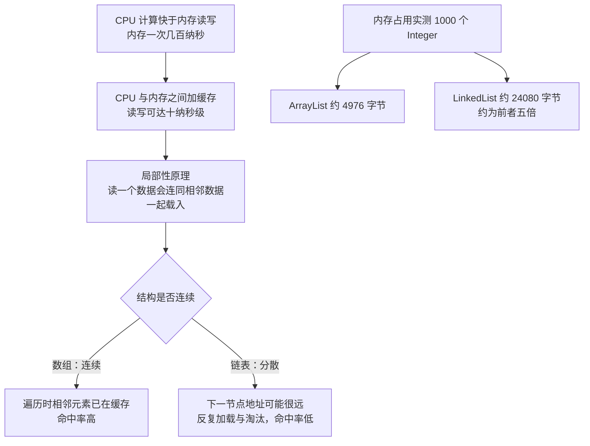

# 局部性原理与 LinkedList 的内存占用

ArrayList 与 LinkedList 比较的最后两项：ArrayList 能利用 CPU 缓存与局部性原理，LinkedList 不行；LinkedList 占用内存比同容量的 ArrayList 多出数倍。一个讲硬件层面的访问效率，一个讲内存层面的空间成本，合起来把两种结构的差异补全。

## 先给结论

CPU 缓存比内存快一个数量级以上，而 CPU 读取数据时会把目标数据及其相邻数据一次性载入缓存，这就是局部性原理。数组元素连续存储，天然契合局部性原理，遍历数组时相邻元素大概率已在缓存中；链表节点分散存储，下一个节点的地址可能离得很远，缓存命中率低。内存占用上，1000 个 Integer 元素的 ArrayList 自身约 4976 字节，LinkedList 约 24080 字节，后者约为前者的五倍。



## 是什么

要理解局部性原理，先看 CPU 为什么需要缓存。CPU 计算所需的数据来自内存：做一次加法，要先把 A 变量的值从内存读入寄存器，再把 B 变量的值读入另一个寄存器，数据就位才能执行加法，算出的结果最终写回内存中的 C 变量。这个过程真正的瓶颈在内存变量的读与写，内存读写一次大约需要几百纳秒。

几百纳秒听起来很快，但对 CPU 是漫长的时间。CPU 执行一次计算的时间在纳秒以下，可能不到一纳秒就算完了，等待数据读入、等待结果写回却要花成百倍的时间。这个比例无法接受，所以 CPU 与内存之间加入了 CPU 缓存，分一级、二级、三级。缓存的读写性能远高于内存，最快的可达十纳秒左右，慢些的也有几十纳秒。

缓存提速的方式是复用。CPU 要读写 A、B、C 这些变量时，先把 A、B 读入缓存。这一次没省时间，还是花了几百纳秒；但后续操作再要用 A、B，缓存里已有，直接取用，不用再去内存。写也一样：算出的结果先写入缓存，缓存会在某些时机同步回内存，而写缓存本身非常快。读写两侧的时间都因此得到压缩。

## 为什么

局部性原理就是缓存读取数据时的规则。CPU 读一个数据时，不会只读这一个，而是把它和相邻的数据一次性都读进缓存。依据是一个概率假设：访问某个变量时，它相邻的变量也有很大几率被访问到。

数组是这个假设的最佳拍档。访问数组中某一个元素时，相邻元素有很大几率随后被访问到，比如遍历数组时要依次读第二个、第三个、第四个元素，它们都已经在缓存里，不必再去内存。链表则不然：读第一个元素时，相邻数据确实也载入了缓存，但链表的下一个节点地址可能离得很远，并不在缓存中。访问下一个元素时，需要把后面的数据再加载进缓存，而缓存大小有限，新载入的数据可能把之前的淘汰掉。反复加载、反复淘汰，缓存对链表的帮助非常有限。

内存占用用 JOL 库实测。测试代码构造一个长度 1000 的随机数组，分别构建 ArrayList 与 LinkedList：

```java
public class ArrayListVsLinkedList {
    public static void main(String[] args) {
        int n = 1000;
        for (int i = 0; i < 1; i++) {
            int[] array = randomArray(n);
            List<Integer> list1 = Arrays.stream(array).boxed().collect(Collectors.toList());
            LinkedList<Integer> list2 = new LinkedList<>(list1);
            // ... 其他操作 ...
        }
    }
}
```

项目依赖 junit-jupiter 用于单元测试：

```xml
<dependency>
    <groupId>org.junit.jupiter</groupId>
    <artifactId>junit-jupiter</artifactId>
    <version>5.8.1</version>
    <scope>test</scope>
</dependency>
```

JOL 的计算结果：

```text
ArrayList size:[4976],array length:[1234],per Element size:[16000]
LinkedList size:[24080],per Node size:[24],per Element size:[16000]
```

三个代码块按课程原稿逐字收录。

## 深入细节

拆解这组数字。两边元素大小都是 16000 字节，因为存的都是 1000 个 Integer 对象，一个 Integer 占 16 字节。差异在容器自身：ArrayList 自身 4976 字节，包含数组本身与少量成员变量；LinkedList 自身 24080 字节，是 ArrayList 的五倍左右。

ArrayList 的数组长度是 1234 而不是 1000，原因是扩容。ArrayList 每次扩容为上一次的 1.5 倍，容量不可能恰好停在 1000，某次扩容到 1234 才装下 1000 个元素。多出的 234 个槽位也是空间成本的一部分，但摊到每个元素上仍然很小。

LinkedList 的昂贵在于节点结构。每个 Node 除了元素本身，还有上一个、下一个指针，单个 Node 占 24 字节。1000 个元素加上头节点、尾节点共 1002 个节点，累积起来总量非常可观。指针换来的只是增删时的灵活，空间上代价高昂。

把四项对比收拢：ArrayList 基于数组需连续内存、随机访问快、尾部增删无碍而其他位置要移动数据、能利用 CPU 缓存与局部性原理。LinkedList 基于双向链表无需连续内存、随机访问慢、头尾增删快、占用内存多。加上前两篇的实测数据，可以下一个明确的选型结论：除了频繁头尾增删这一少见场景，日常开发优先 ArrayList。

## 面试怎么答

被问到局部性原理，可以这样答：CPU 计算的数据来自内存，内存读写一次几百纳秒，而 CPU 一次计算不到一纳秒，等待数据是瓶颈，所以引入 CPU 缓存，最快的缓存十纳秒左右。缓存提速靠复用，而局部性原理指 CPU 读数据时会把目标及其相邻数据一次性载入缓存，基于「访问某变量时相邻变量也大概率被访问」的假设。数组元素连续存储，天然契合这个假设，遍历时相邻元素已在缓存；链表节点分散，下一节点地址可能很远，缓存命中率低。空间上我用 JOL 测过，1000 个 Integer 元素，ArrayList 自身约 4976 字节，LinkedList 约 24080 字节，因为每个 Node 除元素外还有两个指针占 24 字节，1002 个节点累积起来很可观。所以 ArrayList 内存占用小得多，这也是选型上优先它的原因之一。

## 常见误区

误区一：以为缓存只是「更快的内存」。缓存的价值一半在速度，一半在局部性预取，不理解预取规则就看不懂数组与链表的访问效率差异。

误区二：以为链表省内存。链表每个节点都要存两个指针，实测占用是同容量 ArrayList 的五倍左右，数组的连续存储反而更紧凑。

误区三：以为扩容导致的冗余是设计缺陷。1.5 倍扩容用少量空间冗余换取均摊 O(1) 的追加，是刻度的权衡，不是缺陷。
