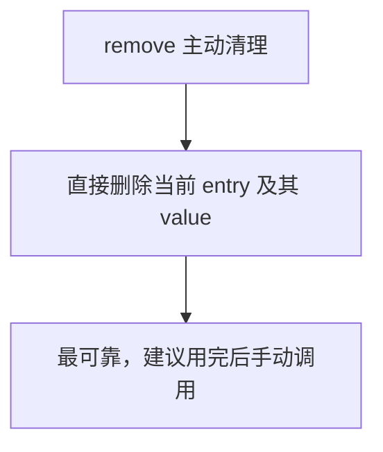

# value 的内存释放时机：remove 时

前两篇讲了 get 与 set 两种被动清理时机，它们有一个共同前提：没有其他地方引用 ThreadLocal 对象，GC 才能把 key 回收成 null，清理逻辑才有触发条件。但真实代码几乎都不满足这个前提。这正是 remove 存在的意义：前两种策略在实战中基本失效，主动 remove 才是唯一可靠的释放途径。

## 先给结论

实际使用 ThreadLocal 时几乎总是用静态变量引用它，静态变量与对象之间是强引用，只要类不卸载，GC 永远回收不了这个 key，key 不会变成 null，get 与 set 的被动清理逻辑永远不会触发。因此 ThreadLocal 的内存释放必须靠自己主动调用 remove，在使用结束时把键值清理掉。长生命周期线程（如线程池核心线程）中不主动 remove，键值会持续堆积，最终内存泄漏。



## 是什么

先回顾前两种时机的前提：GC 之后 key 变成 null，get 或 set 撞见过期条目时顺手清理 value。整条链路的第一步是「key 能被 GC 回收」，这一步在实际代码里恰恰不成立。

实际写法长这样：

```java
private static void test1() {
    // 多个线程调用，得到的是自己的 Connection 对象
    private static final ThreadLocal<Connection> tl = new ThreadLocal<>();
    public static Connection getConnection() {
        Connection conn = null;
        if (conn == null) {
            conn = innerGetConnection(); // 创建新的连接对象
            tl.set(conn); // 特别增大当前线程
        }
        return conn;
    }
    private static Connection innerGetConnection() {
        try {
            return DriverManager.getConnection("jdbc:mysql://localhost:3306/test?useSSL=false", "root", "password");
        } catch (SQLException e) {
            throw new RuntimeException(e);
        }
    }
}
```

按课程原稿逐字收录，`tl.set(conn)` 一行的注释「特别增大当前线程」是稿件原有内容，实际语义是把连接存入当前线程。

ThreadLocal 通常声明为 `private static final`，静态变量与对象之间是强引用，只要这个类还在使用，引用一直握着对象。即使 ThreadLocal 在 ThreadLocalMap 中是弱引用，外部的静态强引用仍然让 GC 无法回收它。key 永远不是 null，get 与 set 的清理条件永远不成立。

## 为什么

为什么被动清理会失效？因为它的触发链太长：GC 回收 key、key 变 null、后续恰好有人 get 或 set 这个 map、恰好命中过期条目或其邻近位置。四个条件串起来，任意一个不成立，清理就不发生。而静态强引用直接掐断了第一环，后面全部免谈。

为什么不主动 remove 会泄漏？把两个因素叠起来：线程长时间运行，它内部的 ThreadLocalMap 一直存在；同时静态变量强引用着 key，GC 不能回收。键值只进不出，越积越多。线程池的核心线程是典型场景：池不关，线程不退，每次请求往 map 里放一个连接，用完后不清理，连接对象与键一起滞留，内存持续增长。

主动 remove 的逻辑则很直接：谁用的谁负责清理。ThreadLocal 对象是你用的，键值是你放进线程的，什么时候没用由你决定，所以清理也应该由你发起，而不是寄托于 GC。在需要清理时调用 remove，把 ThreadLocal 对应的键值从当前线程的 map 中移除，内存随之释放。比如对使用过的 A、B 依次 remove，键值就不会造成泄漏。

## 深入细节

三种时机的可靠性排序很清晰。remove 是主动清理，由使用者在正确的时机调用，最可靠。get 与 set 是被动清理，依赖 key 先被 GC 回收，而静态引用的普遍性让这个前提几乎不成立，实战中基本不生效。

由此得出一条明确的使用规范：使用 ThreadLocal 的代码必须配套 remove，且清理时机应在 finally 块中，确保异常路径也能执行。把 remove 写在业务逻辑末尾而不放在 finally，一旦业务抛异常，清理就被跳过，等于没写。

另一个细节是线程池场景的特殊性。线程池线程会复用，同一个线程先后处理多个请求，如果每个请求都 set 而不 remove，后一个请求可能通过 get 读到前一个请求遗留的值，造成数据串扰。这比内存泄漏更隐蔽，是 ThreadLocal 在线程池中使用时最典型的故障模式。remove 同时解决这两个问题：既释放内存，也切断跨请求的数据残留。

## 面试怎么答

被问到 ThreadLocal 的内存释放，可以这样答：ThreadLocalMap 的 key 是弱引用、value 是强引用，GC 只能回收 key。value 的释放有 get、set、remove 三个时机：get 命中 key 为 null 的条目时顺手清理；set 时用启发式扫描清理目标位置邻近的 null key；remove 是主动删除。但前两种是被动清理，前提是 key 能被 GC 回收，而实际使用中 ThreadLocal 通常声明为静态变量，静态强引用让 GC 永远收不回 key，key 不会变 null，被动清理基本不生效。所以规范做法是使用完 ThreadLocal 后主动调用 remove，并且要放在 finally 里。线程池场景下不 remove 会有双重风险：键值堆积造成内存泄漏，以及后续请求读到前一个请求的残留值。

## 常见误区

误区一：以为有 get 与 set 的被动清理就万事大吉。它们的前提是 key 被 GC 回收，静态引用场景下这个前提不成立，被动清理形同虚设。

误区二：把 remove 写在业务末尾而不放 finally。业务抛异常时清理被跳过，正确做法是 finally 中 remove。

误区三：以为不 remove 只是内存问题。线程池线程复用时，残留值会被后续请求读到，造成数据串扰，这比内存泄漏更难排查。
