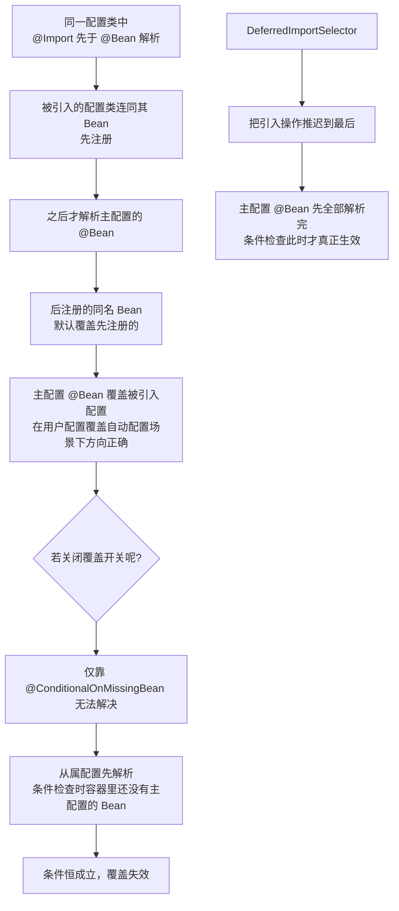

# DeferredImportSelector 的使用场景

上一篇的结尾提到 DeferredImportSelector 会推迟 @Import 的时机，本篇讲清楚它解决什么问题。这是通往 Spring Boot 自动装配的关键一节：自动配置之所以能让用户配置覆盖默认配置，核心机制就在这里。

## 先给结论

同一个类中，@Import 的解析先于 @Bean：@Import 引入的配置类连同其中的 Bean 先注册，之后才解析主配置的 @Bean。后注册的同名 Bean 默认覆盖先注册的，因此主配置的 @Bean 会覆盖被引入配置中的同名 Bean。这个覆盖行为在「用户配置覆盖自动配置」的场景下方向正确，但如果关闭覆盖开关，仅靠 @ConditionalOnMissingBean 无法解决问题，因为从属配置先解析，条件检查时容器里还没有主配置的 Bean，条件恒成立。DeferredImportSelector 把引入操作推迟到最后，让主配置的 @Bean 先全部解析完，条件检查此时才真正生效。



## 是什么

先搭好演示场景。有一个接口 MyBean，两个实现 Bean1 与 Bean2。两个配置类：主配置 MyConfig 中定义 myBean 返回 Bean1；从属配置 OtherConfig 中也定义 myBean 返回 Bean2。两个方法名相同，意味着将来 Bean 名相同，但实现不同。

主配置中通过 @Import 引入从属配置：

```java
@Configuration
@Import(OtherConfig.class)
static class MyConfig {
    @Bean
    public MyBean myBean() { return new Bean1(); }
}
```

问题随之而来：同名 Bean 会不会报错？如果不出错，最终生效的是哪个实现？把主配置注册进容器、refresh、按接口类型 getBean，结果是没报错，返回的是 Bean1，主配置生效。

## 为什么

原因是解析顺序。同一个配置类中，@Import 先解析，@Bean 后解析。@Import 先看 OtherConfig 里有哪些配置，把 OtherConfig 自身连同它的 myBean 先加进容器；之后才回到主配置解析 @Bean，把 MyConfig 的 myBean 也注册进去。此时发现重名，默认规则是覆盖，后解析的配置覆盖先解析的。主配置的 myBean 后解析，所以它覆盖了 OtherConfig 的版本，最终看到 Bean1。

这个行为恰好匹配 Spring Boot 的需求模型：主配置是程序员自己写的配置类，从属配置相当于自动配置，提供的是默认实现。出现同名 Bean 时，应该由程序员写的配置覆盖自动配置的默认配置。默认的覆盖行为在这个场景下方向正确。

现在把覆盖关掉。拿到 BeanFactory，调用 `setAllowBeanDefinitionOverriding(false)`，禁止 Bean 定义覆盖。再运行，报错：MyConfig 中的 myBean 定义非法，因为容器中已存在同名的 myBean，来自先解析的 OtherConfig，后注册的不被允许覆盖，直接抛异常。

有同学会想到用 @ConditionalOnMissingBean：容器中没有同名 Bean 时才注册。Spring 的自动配置类确实普遍用它做条件检查。加到 OtherConfig 上：

```java
@Configuration
static class OtherConfig {
    @Bean
    @ConditionalOnMissingBean
    public MyBean myBean() { return new Bean2(); }
}
```

但单独加它并不解决问题，还是会报同样的错。原因回到执行顺序：@Import 先解析 OtherConfig，执行到 @ConditionalOnMissingBean 检查时，容器中还没有主配置的 myBean，条件成立，OtherConfig 的 myBean 被注册。等主配置的 myBean 后注册时，覆盖已被禁止，冲突爆发。条件注解本身没错，错在它检查得太早。

## 深入细节

解法是让 OtherConfig 的引入延后。写一个 ImportSelector 实现 DeferredImportSelector 接口，返回 OtherConfig 的类名：

```java
static class MySelector implements DeferredImportSelector {
    @Override
    public String[] selectImports(AnnotationMetadata importingClassMetadata) {
        return new String[]{OtherConfig.class.getName()};
    }
}
```

主配置的 @Import 不再直接引入 OtherConfig，而是引入 MySelector：

```java
@Configuration
static class MyConfig {
    @Bean
    public MyBean myBean() { return new Bean1(); }
}
```

两个代码块按课程原稿逐字收录，此处主配置的呈现形态即去掉 @Import 直接引入、改由选择器引入后的样子。

改完之后解析顺序变为：先解析主配置中的 @Bean，把 myBean 注册进容器；最后才处理 MySelector，加载 OtherConfig。OtherConfig 的 @ConditionalOnMissingBean 此时检查，发现容器中已有 myBean，条件不成立，不再注册 Bean2。最终容器中是主配置的 Bean1，条件装配真正生效。

DeferredImportSelector 的工作方式可以概括为：主配置类中的 Bean 全部解析完，最后才解析 DeferredImportSelector 中出现的配置。它不改变引入的内容，只改变引入的时机。

这个时机正是 Spring Boot 自动装配的基础。Spring Boot 自动配置的 @Import 后面跟的选择器都实现 DeferredImportSelector，目的是让选择器的工作放到最后：等主配置类中所有 Bean 处理完毕，再用从属配置中的信息做条件检查。从属配置相当于默认配置，优先级低，只有主配置没有提供对应 Bean 时，默认配置才递补上来。这就是「用户配置优先、自动配置兜底」的底层机制。

## 面试怎么答

被问到 DeferredImportSelector，可以这样答：同一个配置类中 @Import 先于 @Bean 解析，后注册的同名 Bean 默认覆盖先注册的，所以主配置的 @Bean 会覆盖 @Import 引入的从属配置中的同名 Bean，这让用户配置覆盖自动配置成为可能。但如果关闭 Bean 定义覆盖，仅靠 @ConditionalOnMissingBean 解决不了冲突，因为从属配置先解析，条件检查时容器里还没有主配置的 Bean，条件恒成立。DeferredImportSelector 的作用就是把 @Import 推迟到最后：先解析主配置的所有 @Bean，最后才处理选择器返回的配置，此时 @ConditionalOnMissingBean 检查才真正生效。Spring Boot 自动配置的 @Import 选择器都实现这个接口，目的就是让自动配置作为低优先级默认配置，只在用户没有提供时才生效。

## 常见误区

误区一：以为 @ConditionalOnMissingBean 单独就能解决冲突。它检查的时机太早，从属配置先解析时容器里还没有主配置的 Bean，条件恒成立，必须配合 DeferredImportSelector 调整顺序。

误区二：以为 DeferredImportSelector 改变了引入的类。它只改时机，引入内容由 selectImports 返回值决定，与普通 ImportSelector 完全相同。

误区三：以为同名 Bean 一定报错。默认允许覆盖，后解析的覆盖先解析的；只有显式关闭覆盖开关，冲突才会以异常形式暴露。
