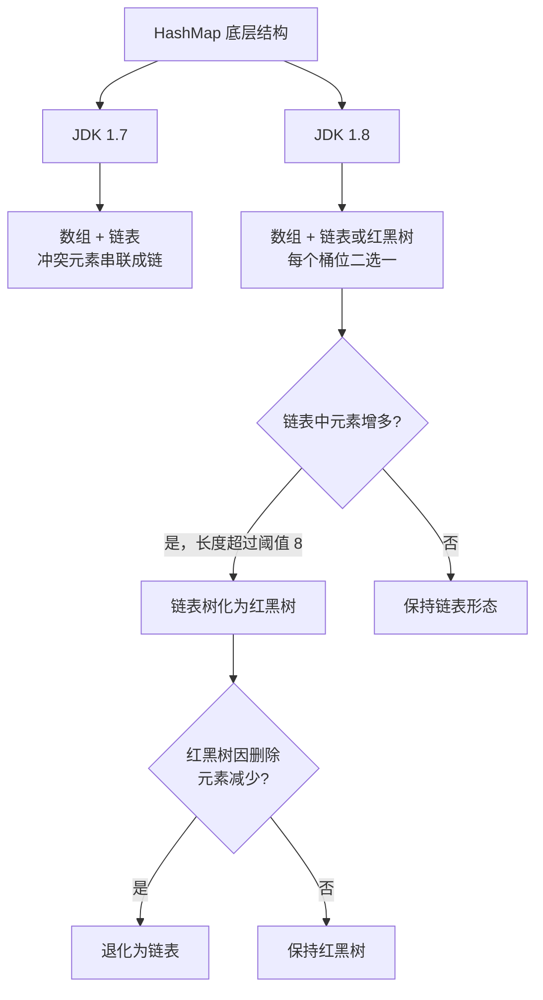

# HashMap 数据结构：1.7 与 1.8 的不同

HashMap 是面试必考的知识点，它的实现细节被面试官研究得很透，任何一处细节都可能被拎出来提问。这一系列从最经典的入口题开始：HashMap 底层的数据结构是什么，1.7 与 1.8 有什么不同。这道题大多数人能答上来，但它只是连环追问的第一环。

## 先给结论

JDK 1.7 的 HashMap 底层是数组加链表；从 1.8 开始变为数组加链表或红黑树，即每个桶位可以是链表，也可以是红黑树。链表与红黑树之间可以互相转换：链表中元素较多时转换为红黑树，红黑树因删除导致元素减少时退化为链表。

## 是什么

先说清两个版本的结构形态。1.7 中 HashMap 的每个桶位挂的是一条链表，冲突元素依次串联，没有别的形态。1.8 引入了红黑树，桶位形态变成二选一：元素少时是链表，元素多时是红黑树。数组部分是两个版本共有的骨架，key 经哈希计算映射到桶下标，冲突元素在桶内组织，差异只在桶内组织方式。

链表与红黑树的可转换性是 1.8 的关键改进。元素增多导致链表过长时，链表树化为红黑树；之后因删除操作元素减少，红黑树再退化为链表。两个方向都存在，不是单向升级。

## 为什么

这道题答完别放松，面试官通常紧跟一串追问：为什么 1.8 要用红黑树？为什么不一开始就数组加红黑树，省掉中间链表这一步？树化阈值为什么选 8 而不是更小的数？链表是一超过阈值就立刻树化，还是要满足其他条件？红黑树什么时候退化为链表？

这些问题每一个都能展开成独立篇章，回答它们需要对 HashMap 的工作过程有深入理解，而不是记住结论。后续会用模拟器逐篇演示：网页的每个按钮对应底层真实 HashMap 的方法调用，点击 put 会执行真正的 put，点击 remove 会执行真正的 remove，执行结果以可视化形式呈现，用来建立直观认识。

先记住入口题的答案本身：1.7 是数组加链表，1.8 是数组加链表或红黑树，两者可互相转换。这是所有后续问题的地基。

## 深入细节

把版本差异落到机制层面。1.7 的结构简单，但链表长度不受控：哈希冲突严重时，链表可以拉得很长，查询退化为在长链表上逐个比对，时间复杂度向 O(n) 恶化。1.8 引入红黑树正是为了给这个恶化设上限：树化之后桶内查找是 O(log n)，链表再长也有树接着。

「先链表后树」而不是「一开始就树」，原因是构建与维护成本。链表结构简单，插入就是改指针，在元素少的场景下开销最小；红黑树维护成本高，插入删除要旋转、变色，元素少时用树是浪费。让结构随数据规模演进，小规模付小成本，大规模付大成本，是刻度的设计。

「阈值是 8」涉及树化条件的完整规则，包括链表长度、数组容量两个条件同时满足才树化，这些在后续篇目结合源码与模拟器展开。「何时退化」同样有明确规则，删除使元素减少到一定程度，树会退回了链表。此处只列问题清单，答案后续逐一兑现。

## 面试怎么答

被问到 HashMap 的数据结构，可以这样答：1.7 的底层是数组加链表，1.8 改成了数组加链表或红黑树，每个桶位可能是链表也可能是红黑树，两者可以互相转换，链表元素过多时树化为红黑树，红黑树元素因删除减少时退化为链表。引入红黑树是为了解决冲突严重时链表过长导致查询退化的问题，树化后桶内查找是 O(log n)。树化阈值是 8，且需要同时满足容量条件，不是一超阈值就转；这些细节可以结合源码再展开。

## 常见误区

误区一：以为 1.8 每个桶位只能是链表或只能是红黑树。两种形态共存于同一张表，不同桶位可以不同，且同一桶位会随数据变化在两种形态间转换。

误区二：只答「数组加链表」不讲版本差异。这是入口题的标准考法，漏掉 1.8 的红黑树等于漏掉整道题的核心。

误区三：把版本差异停留在结论上。结论只是门票，后续的树化原因、阈值选择、树化条件、退化条件才是真正的评分点。
