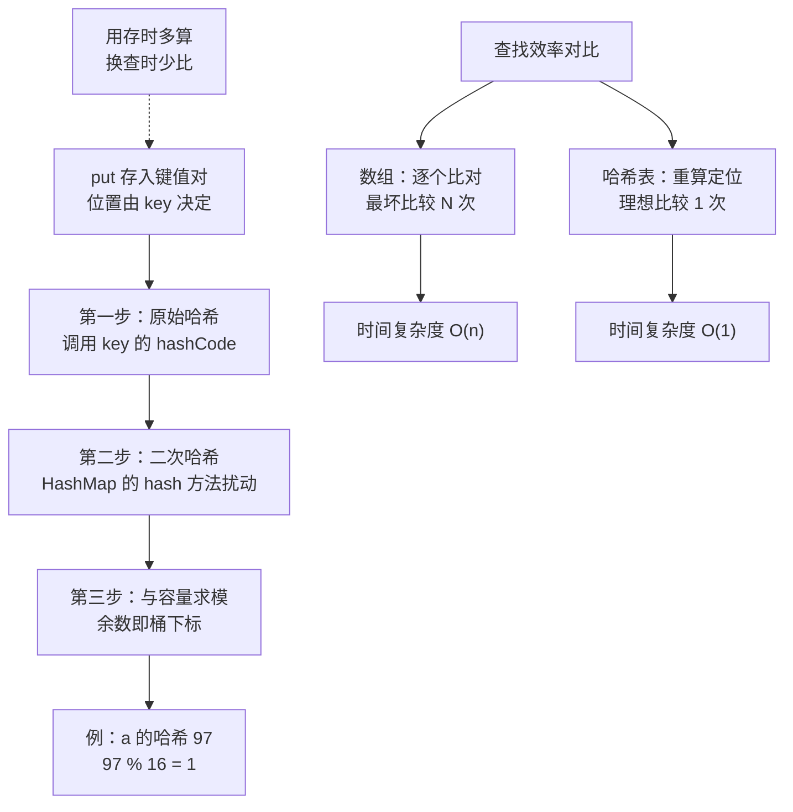

# 快速查找：哈希表存在的意义

put 操作是把键值对存入哈希表，存的时候 value 起不到决定性作用，关键是 key，它决定了键值对在哈希表中的位置。这个定位过程要经过多步计算，看起来比直接放数组麻烦得多。值不值得，要看查找。本篇用正反两个例子说明哈希表为什么存在。

## 先给结论

key 存入前要经过三步计算：先算原始哈希值，即调用 key 的 hashCode 方法得到整数；再做一次扰动得到二次哈希值；最后用二次哈希值与当前数组容量求模，得到桶下标。这一连串计算的意义在查找：数组查找要逐个比对，最坏比较 N 次；哈希表查找只需重算定位，理想情况下比较一次。哈希表用「存时多算」换「查时少比」。



## 是什么

以 key 为字符串 a 为例。放入哈希表时，第一步获取 a 的哈希码，这一步实际调用字符串对象的 hashCode 方法，返回一个整数值，称为原始哈希值，a 的原始哈希值是 97。原始哈希值不能直接用，还要再做一次计算得到二次哈希值，a 的二次哈希值仍是 97。接下来二次哈希值与当前数组容量求模：97 除以容量 16，余数是 1，这个余数就是桶下标。a 最终存放在数组索引为 1 的位置。

三步可以概括为：原始哈希、二次哈希、与容量求模得下标。演示页面把这三步的结果分别列在原始 hash、二次 hash、桶下标三列中，可以直接核对。

## 为什么

先说反例。一个数组里放 10 个元素，比如 B、D、F、K、M、S、N、E、C、A，要找 A 是否存在，只能一个一个比较：先比第一个是不是 A，不是往后，第二个是不是 A，不是再往后。最坏情况 A 在最后一个，要比较 10 次。元素越多，比较次数线性增长，效率很低。

同样的 10 个字符串放进 HashMap，再找 A 只需比较一次。因为查找时重复存的时候那套计算：a 的哈希值是 97，二次哈希还是 97，与当前数组长度求模定位到索引 1，直接到索引 1 找 A。其他位置不用看，2、3、4、5、6、11、13、14 这些桶都不用访问，只与索引 1 的元素做一次比较就能确认。这就是哈希方法的快速查找。

当然这是理想情况：要找的元素在其桶位里只有一个。这种情况下时间复杂度是 O(1)。

## 深入细节

现实中会有冲突。比如找 C，C 的原始哈希是 99，二次哈希也是 99，算出的索引是 3，但索引 3 这个桶里有两个元素。因为 S 与 C 的哈希值虽然不同，算出的桶下标却相同，两者以链表的形式挂在这个位置。找 C 时要先与链表第一个元素比较，不是就沿着链表看下一个，比较两次才能找到 C。

这个例子揭示了桶内链表的职责：哈希表先把查找范围从整个数组缩小到一个桶，桶内若有多元素，退化为在短链表上逐个比对。查找成本取决于桶内冲突的严重程度，冲突越少越接近 O(1)，冲突越多越向 O(n) 恶化。这正是后续篇目要讨论的问题：链表过长怎么办、什么条件下树化、树化阈值为什么是 8。

把 put 与查找连起来看，三步计算是同一套逻辑的两面：存的时候用它们决定位置，查的时候用它们找回位置。key 的哈希计算是哈希表全部机制的基石，包括后续的扩容、树化、索引计算优化，都围绕「如何算得准、算得快、冲突少」展开。

下面这段程序用反射把 HashMap 内部的桶数组掏出来，统计每个桶挂了几个元素，能直观看到哈希表的分布：

```java
// 运行时需要加 JVM 参数：--add-opens java.base/java.util=ALL-UNNAMED
public class HashMapDistribution {
    public static void main(String[] args) throws IOException {
        Object value = new Object();
        Map<String, Object> words = Files.readAllLines(Path.of("words")).stream()
                .collect(Collectors.toMap(w -> w, w -> value));
        System.out.println(words.getClass());
        showDistribution(words);
    }

    private static void showDistribution(Map<String, Object> map) {
        try {
            Field tableField = HashMap.class.getDeclaredField("table");
            Field nextField = Class.forName("java.util.HashMap$Node").getDeclaredField("next");

            tableField.setAccessible(true);
            nextField.setAccessible(true);
            Object array = tableField.get(map);
            int length = Array.getLength(array);
            System.out.println("总的桶个数[" + length + "]");
            Map<Integer, AtomicInteger> result = new HashMap<>();
            for (int i = 0; i < length; i++) {
                Object node = Array.get(array, i);
                AtomicInteger c = result.computeIfAbsent(i, key -> new AtomicInteger());
                while (node != null) {           // 顺着链表数下去
                    c.incrementAndGet();
                    node = nextField.get(node);
                }
            }
            Map.Entry maxEntry = null;
            int max = -1;
            HashMap<Integer, AtomicInteger> counting = new HashMap<>();
            for (Map.Entry<Integer, AtomicInteger> entry : result.entrySet()) {
                int value = entry.getValue().get();
                AtomicInteger c = counting.computeIfAbsent(value, k -> new AtomicInteger());
                c.incrementAndGet();
            }
            counting.forEach((k, v) -> {
                System.out.println(k + "个元素的桶个数[" + v + "]");
            });
        } catch (Exception e) {
            e.printStackTrace();
        }
    }
}
```

跑出来的结果形如「0 个元素的桶有 x 个、1 个元素的桶有 y 个……」，绝大多数桶只挂 0～1 个元素，这就是哈希表能做到 O(1) 查找的原因，元素被均匀打散了。

## 面试怎么答

被问到哈希表为什么快，可以这样答：key 存入时经过三步计算，先调用 hashCode 得到原始哈希值，再做一次扰动得到二次哈希值，最后与数组容量求模得到桶下标。查找时重算这套流程直接定位桶位，理想情况下只需一次比较，时间复杂度 O(1)；而数组查找要逐个比对，最坏比较 N 次。但这是理想情况，如果多个 key 算出同一桶下标，它们以链表挂在同个桶内，查找要在短链表上逐个比对，比如 C 和 S 下标相同，找 C 要比较两次。冲突严重时性能向 O(n) 恶化，这正是 1.8 引入红黑树的原因。

## 常见误区

误区一：以为存的时候算得多就代表设计冗余。存时多算换的是查时少比，哈希表的全部价值在查找侧。

误区二：以为哈希查找永远一次比较。仅当桶内只有一个元素时成立，有冲突就要在链表上多比几次。

误区三：以为哈希值不同就不会冲突。不同哈希值对容量求模后可能得到相同下标，桶下标相同即冲突，与原始哈希是否相同无关。
