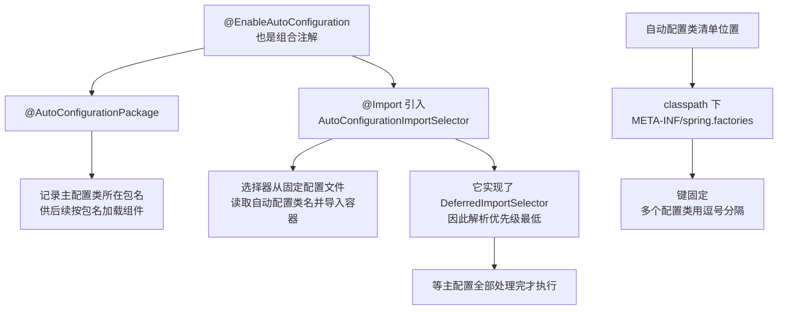

# @EnableAutoConfiguration 与自动配置原理

@SpringBootApplication 三个组成部分的最后一个，也是自动配置的核心：@EnableAutoConfiguration。它本身也是一个组合注解，由 @AutoConfigurationPackage 与 @Import 两部分组成。把这两部分弄清楚，Spring Boot 自动配置的原理就闭环了。

## 先给结论

@EnableAutoConfiguration 由两部分组成：@AutoConfigurationPackage 记录主配置类所在的包名，供后续按包名加载组件；@Import(AutoConfigurationImportSelector) 通过一个选择器从固定的配置文件中读取自动配置类名，再把它们导入容器。这个选择器实现了 DeferredImportSelector，因此自动配置的解析优先级最低，等主配置全部处理完才执行。自动配置类清单写在 classpath 下 META-INF/spring.factories 文件中，键固定，多个配置类用逗号分隔。



## 是什么

先看注解定义：

```java
@Target(ElementType.TYPE)
@Retention(RetentionPolicy.RUNTIME)
@Documented
@Inherited
@AutoConfigurationPackage
@Import(AutoConfigurationImportSelector.class)
public @interface EnableAutoConfiguration {
    String ENABLED_OVERRIDE_PROPERTY = "spring.boot.enableautoconfiguration";
    Class<?>[] exclude() default {};
    String[] excludeName() default {};
}
```

按课程原稿逐字收录。注解带 exclude 与 excludeName 两个属性，用于排除特定的自动配置类。

第一部分 @AutoConfigurationPackage 的作用很单一：它标注的类所在的包名会被记录下来，放进容器。以后要用这个包名时，通过工具类 AutoConfigurationPackages 获取。注意区分：不带 s 的 AutoConfigurationPackage 是注解，带 s 的 AutoConfigurationPackages 是工具类。用法是调用它的 get 方法并传入 BeanFactory，它会返回包名集合。演示中配置类位于 day04.boot 包，打印结果就是 day04.boot。这个注解只负责记住扫描的起始包，作用并不大，但它是后续按包加载的基础。

第二部分是 @Import，也是自动配置的关键。先看一个场景：主配置 MyConfig 想引入从属配置 OtherConfig。最直接的做法是 @Import 后面直接写 OtherConfig.class，容器刷新后 OtherConfig 自身连同其中的 bean1、bean2 都会加入容器。但这样做有两个缺点。

## 为什么

缺点一，强耦合。主配置必须知道从属配置的类名，直接引用对方的名字。从属配置相当于 Spring 提供的自动配置类，主配置是用户编写的配置，两者应该解耦，不应该互相知道对方的存在。

缺点二，优先级不对。前面讲过，@Import 直接引入配置类时解析优先级较高，而从属配置、自动配置、默认配置这类信息，我们希望它的优先级最低：等主配置的组件扫描、主配置自己的 @Bean 全部解析完，最后才解析从属配置。

@EnableAutoConfiguration 中的 @Import 正好解决了这两个问题。它后面跟的是 AutoConfigurationImportSelector，主配置不需要知道任何从属配置的类名，从属配置的类名写在一个固定位置的文件里，由选择器去读取。这就实现了解耦。同时这个选择器实现了 DeferredImportSelector，可以推迟 @Import 的解析，保证主配置中所有配置解析完，最后才解析从属配置，优先级最低。

从属配置写在哪？位置和文件名都固定：classpath 下 META-INF 文件夹中的 spring.factories 文件。它是一个 properties 文件，里面是配置信息，其中键是固定的，对应自动配置的键，值就是各自动配置类的全限定类名。将来有多个配置类，中间用逗号分隔。

## 深入细节

演示中先给 @EnableAutoConfiguration 加上 excludeName，把 Spring 自带的自动配置类排除，因为选择器工作时会把自带的全部扫进来，数量多、打印混乱，排除后只留自己写的从属配置：

```java
@Configuration
@AutoConfigurationPackage
@EnableAutoConfiguration(excludeName = {"org.springframework.boot.autoconfigure.admin.SpringApplicationAdminJmxAutoConfiguration", "org.springframework.boot.autoconfigure.jdbc.DataSourceAutoConfiguration"})
@Import(OtherConfig.class)
static class MyConfig { }
```

配置好 spring.factories 后运行，OtherConfig 连同其中的 bean1、bean2 都被加载进容器，目的达成。好处正是前面说的两点：主配置没有与 OtherConfig 强耦合，OtherConfig 的解析优先级最低。

低优先级带来的是可覆盖性。在从属配置的 bean1 上加 @ConditionalOnMissingBean：主配置中没有这个 bean 时从属配置生效，有则不生效。由于从属配置最后解析，它检查时容器中已经有主配置的 bean1，条件不成立，不会执行从属配置中 bean1 的创建逻辑，最终用的是主配置的 bean1。其余的 bean1、bean2 也都来自主配置与正常扫描。

这解释了自动配置的设计哲学：从属配置提供默认实现，用户可以在主配置中覆盖；用户没配的，默认配置补上。不能缺，但可以被覆盖。

课程原稿在此处还以相同形态反复记录了引入从属配置的配置类写法，逐字收录如下：

```java
@Configuration
@AutoConfigurationPackage
@EnableAutoConfiguration
@Import(OtherConfig.class)
static class MyConfig { }
```

```java
@Configuration
@AutoConfigurationPackage
@EnableAutoConfiguration
@Import(OtherConfig.class)
static class MyConfig { }
```

```java
@Configuration
@AutoConfigurationPackage
@EnableAutoConfiguration
@Import(OtherConfig.class)
static class MyConfig { }
```

```java
@Configuration
@AutoConfigurationPackage
@EnableAutoConfiguration
@Import(OtherConfig.class)
static class MyConfig { }
```

```java
@Configuration
@AutoConfigurationPackage
@EnableAutoConfiguration
@Import(OtherConfig.class)
static class MyConfig { }
```

```java
@Configuration
@AutoConfigurationPackage
@EnableAutoConfiguration
@Import(OtherConfig.class)
static class MyConfig { }
```

```java
@Configuration
@AutoConfigurationPackage
@EnableAutoConfiguration
@Import(OtherConfig.class)
static class MyConfig { }
```

```java
@Configuration
@AutoConfigurationPackage
@EnableAutoConfiguration
@Import(OtherConfig.class)
static class MyConfig { }
```

```java
@Configuration
@AutoConfigurationPackage
@EnableAutoConfiguration
@Import(OtherConfig.class)
static class MyConfig { }
```

```java
@Configuration
@AutoConfigurationPackage
@EnableAutoConfiguration
@Import(OtherConfig.class)
static class MyConfig { }
```

```java
@Configuration
@AutoConfigurationPackage
@EnableAutoConfiguration
@Import(OtherConfig.class)
static class MyConfig { }
```

```java
@Configuration
@AutoConfigurationPackage
@EnableAutoConfiguration
@Import(OtherConfig.class)
static class MyConfig { }
```

```java
@Configuration
@AutoConfigurationPackage
@EnableAutoConfiguration
@Import(OtherConfig.class)
static class MyConfig { }
```

```java
@Configuration
@AutoConfigurationPackage
@EnableAutoConfiguration
@Import(OtherConfig.class)
static class MyConfig { }
```

```java
@Configuration
@AutoConfigurationPackage
@EnableAutoConfiguration
@Import(OtherConfig.class)
static class MyConfig { }
```

```java
@Configuration
@AutoConfigurationPackage
@EnableAutoConfiguration
@Import(OtherConfig.class)
static class MyConfig { }
```

```java
@Configuration
@AutoConfigurationPackage
@EnableAutoConfiguration
@Import(OtherConfig.class)
static class MyConfig { }
```

```java
@Configuration
@AutoConfigurationPackage
@EnableAutoConfiguration
@Import(OtherConfig.class)
static class MyConfig { }
```

```java
@Configuration
@AutoConfigurationPackage
@EnableAutoConfiguration
@Import(OtherConfig.class)
static class MyConfig { }
```

```java
@Configuration
@AutoConfigurationPackage
@EnableAutoConfiguration
@Import(OtherConfig.class)
static class MyConfig { }
```

```java
@Configuration
@AutoConfigurationPackage
@EnableAutoConfiguration
@Import(OtherConfig.class)
static class MyConfig { }
```

```java
@Configuration
@AutoConfigurationPackage
@EnableAutoConfiguration
@Import(OtherConfig.class)
static class MyConfig { }
```

```java
@Configuration
@AutoConfigurationPackage
@EnableAutoConfiguration
@Import(OtherConfig.class)
static class MyConfig { }
```

```java
@Configuration
@AutoConfigurationPackage
@EnableAutoConfiguration
@Import(OtherConfig.class)
static class MyConfig { }
```

```java
@Configuration
@AutoConfigurationPackage
@EnableAutoConfiguration
@Import(OtherConfig.class)
static class MyConfig { }
```

```java
@Configuration
@AutoConfigurationPackage
@EnableAutoConfiguration
@Import(OtherConfig.class)
static class MyConfig { }
```

```java
@Configuration
@AutoConfigurationPackage
@EnableAutoConfiguration
@Import(OtherConfig.class)
static class MyConfig { }
```

```java
@Configuration
@AutoConfigurationPackage
@EnableAutoConfiguration
@Import(OtherConfig.class)
static class MyConfig { }
```

```java
@Configuration
@AutoConfigurationPackage
@EnableAutoConfiguration
@Import(OtherConfig.class)
static class MyConfig { }
```

```java
@Configuration
@AutoConfigurationPackage
@EnableAutoConfiguration
@Import(OtherConfig.class)
static class MyConfig { }
```

```java
@Configuration
@AutoConfigurationPackage
@EnableAutoConfiguration
@Import(OtherConfig.class)
static class MyConfig { }
```

把三个组成部分收拢：@SpringBootConfiguration 表示当前是配置类，且整个应用唯一，用于定位主配置；@ComponentScan 做组件扫描，可用 excludeFilters 排除特定类，其中 @AutoConfigurationPackage 那部分记住扫描的起始包；最重要的是 @Import，它借助 AutoConfigurationImportSelector 导入从属配置。这个选择器有两个特点：一是分离主配置与从属配置，不产生强耦合；二是执行优先级低，主配置全部加载完才解析从属配置。加载位置固定为 classpath 下 META-INF/spring.factories。

## 面试怎么答

被问到 Spring Boot 自动配置原理，可以这样答：核心是理解 @SpringBootApplication，它由三个注解组成。@SpringBootConfiguration 表明这是主配置类，与 @Configuration 等价但整个应用只有一个。@ComponentScan 做组件扫描，其 excludeFilters 可排除特定类，@AutoConfigurationPackage 记住扫描起始包。最关键的是 @EnableAutoConfiguration，它由 @AutoConfigurationPackage 和 @Import(AutoConfigurationImportSelector) 组成，选择器从 classpath 下 META-INF/spring.factories 文件中读取自动配置类名并导入容器。这样主配置与从属配置不产生强耦合。选择器实现了 DeferredImportSelector，所以自动配置优先级最低，等主配置全部解析完才执行，因此主配置中的同名 Bean 会覆盖自动配置的默认配置，从属配置加 @ConditionalOnMissingBean 即可实现「用户没配才用默认」。自动配置更准确的说法是默认配置：不能缺，但可以被覆盖。

## 常见误区

误区一：以为 @Import 直接写 OtherConfig.class 与自动配置等价。直接引入造成强耦合且优先级高，覆盖行为不符合预期，自动配置靠选择器加配置文件解耦并降优先级。

误区二：以为 spring.factories 位置可自定义。位置与文件名固定，classpath 下 META-INF/spring.factories，键也是固定的。

误区三：以为自动配置只能被覆盖不能缺省。它是兜底的默认配置，用户配了就覆盖，没配才生效，保证不缺而非强制生效。
