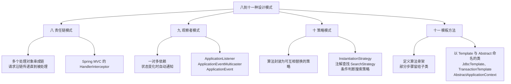

# Spring 中的设计模式：责任链、观察者、策略、模板方法

设计模式系列的最后四种：责任链、观察者、策略、模板方法。四种全部讲完，Spring 中体现的 11 种设计模式就齐了。这四种在 Spring 中的落地都很深，其中模板方法与前面讲 refresh 流程时已经打过照面。

## 先给结论

责任链模式把多个请求处理对象串成链，请求沿链依次传递，直到遇到能处理它的对象，Spring MVC 的 HandlerInterceptor 是其体现。观察者模式定义一对多依赖，状态变化时依赖方自动收到通知，Spring 的 ApplicationListener、ApplicationEventMulticaster 与 ApplicationEvent 三者构成其实现。策略模式把一系列算法封装为可相互替换的策略，Spring 中的 InstantiationStrategy、注解查找的 SearchStrategy、条件判断的搜索策略都是其体现。模板方法定义算法骨架，把部分步骤留给子类，以 Template 与 Abstract 命名的类基本都是，如 JdbcTemplate、TransactionTemplate 与 AbstractApplicationContext。

## 是什么

第八种是责任链模式。定义的大意是：将来有多个请求处理对象，把它们串成一个链，每个对象都有机会处理请求，请求沿链依次向后传递，直到遇到能处理它的对象为止。Spring MVC 中 HandlerInterceptor 符合这个定义：多个拦截器与最终的目标组成调用链，请求先给第一个拦截器处理，放行后交给第二个，依次类推，最终到达控制器方法。

第九种是观察者模式。它在 Spring 容器中的体现是 ApplicationListener 监听器、ApplicationEventMulticaster 事件广播器与 ApplicationEvent 事件对象三者的组合。广播器负责发送事件，监听器负责接触事件，事件通过广播器把发送者与接收者解耦。这个模式平时用得不多，但解耦效果很好。

第十种是策略模式，在 Spring 中体现较多。查找注解时，要考虑只查当前类还是连父类一起查，这是不同的查找策略。做条件判断时，Bean 是在当前容器、父容器还是所有容器中查找，也有不同的搜索策略。不同策略对应不同行为，按需选择。

## 为什么

第十一种是模板方法模式，Spring 中用得非常多。识别方法很直接：以 Template 命名的类基本都是模板方法，如 JdbcTemplate、TransactionTemplate；以 Abstract 命名的类也大量体现模板方法，如 AbstractApplicationContext。

用 refresh 流程理解模板方法最直观。AbstractApplicationContext 的 refresh 一共 12 步，但它只搭了骨架，有些步骤在抽象类里无法决定该怎么做，就留给子类完成，子类通过扩展这些步骤定制自己的行为。骨架固定、步骤可换，这就是模板方法。

四种模式放回整体框架里看：责任链管「请求怎么流转」，观察者管「状态怎么通知」，策略管「算法怎么替换」，模板方法管「骨架怎么定、步骤怎么留」。加上前七种，11 种模式覆盖了造对象、调接口、聚实现、转接口、加功能、控访问、传请求、发通知、换算法、定骨架等不同维度。

## 深入细节

回到最初的面试题「Spring 中实现了哪些设计模式」，完整的回答结构应该是：先给总数约 11 种，再按分组讲，每种点出 Spring 中的具体落地点。有辨析价值的主动澄清：Singleton Bean 不是单例模式，代理与控制访问而不是功能增强。有识别技巧的顺手给出：Builder 结尾是建造器，Composite 结尾是组合，Template 与 Abstract 开头是模板方法。

需要说明的是，每种模式这里只讲到能回答面试题的深度，没有展开每个模式的完整细节。面试中能把「模式是什么、Spring 中哪里体现、和易混模式的区别」三点说清，已经足够。要更深入理解某个模式，需要针对性看源码。

## 面试怎么答

被问到 Spring 中的设计模式，可以系统回答：大约 11 种。工厂方法模式，如 getBean、FactoryBean、@Bean 方法；建造器模式，如 BeanDefinitionBuilder；适配器模式，如 HandlerAdapter、DisposableBeanAdapter；组合模式，如各种 Composite 类；装饰器模式，如 ContentCachingRequestWrapper；代理模式，如 JdkDynamicAopProxy、ObjenesisCglibAopProxy；责任链模式，如 HandlerInterceptor；观察者模式，如 ApplicationListener 加 ApplicationEventMulticaster；策略模式，如 InstantiationStrategy 与各种查找策略；模板方法模式，如 JdbcTemplate 与 AbstractApplicationContext；单例模式在 Spring 中有体现但不是 Singleton Bean。回答时注意两个澄清：Singleton Bean 只保证容器内相同 id 单实例，不是单例模式；代理侧重控制访问，功能增强由通知完成。

## 常见误区

误区一：只罗列名字不讲落地点。每种模式都要点出 Spring 中的具体类或机制，否则答案没有说服力。

误区二：把 Singleton Bean 当单例模式。这是最常被追问的辨析点，答错会显著扣分。

误区三：认不出命名规律。Builder、Composite、Template、Abstract 这些命名是快速定位模式实现的实用线索，主动给出能体现源码阅读量。
