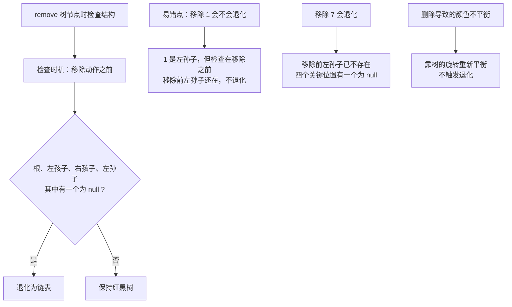

# 树退化为链表：情况二，remove 时结构检查

上一篇讲了第一种退化：扩容拆分后元素个数小于等于 6。第二种退化发生在 remove 树节点时，判据不是元素个数，而是树的结构：移除前检查根节点、左孩子、右孩子、左孙子，其中有一个为 null 就退化为链表。检查时机是移除之前，这一点最容易被忽略。

## 先给结论

第二种退化情况：remove 树节点前会做结构检查，如果根节点、左孩子、右孩子、左孙子这四个位置中有一个已经是 null，就退化为链表。检查发生在移除动作之前，只要移除前这些节点都还在，即使这次移除会删掉其中一个，也不会退化。删除导致的颜色不平衡靠树的旋转重新平衡，不触发退化。

## 是什么

构造演示。一开始就让容量为 64，这样不用先扩容再检查树化阈值。放入 9 个元素，超过树化阈值 8，且容量达标，直接成树。

树的结构：根节点是 4，左孩子是 2，右孩子是 6，左孙子是 1。如果这几个节点在移除前都存在，树不会退化成链表。

## 为什么

逐个移除验证检查规则。先移除 3：不会退化，因为 3 不是那四个关键节点，移除前左孙子、左孩子、右孩子都在，判断不受影响，仍是树。

再移除 1：有同学认为会退化，因为 1 是左孙子，移除后左孙子没了。但检查发生在移除之前，移除前左孙子还在，因此不会退化。这个「之前」是理解本条规则的关键。

再移除 7：会退化。因为移除 7 之前，虽然左孩子、右孩子都在，但左孙子已经不存在了，四个关键位置有一个为 null，条件成立，退化为链表。注意此时移除 7 之后还剩 1 到 6 共 6 个元素，这 6 个元素变成链表形态。

## 深入细节

再看一组从右侧开始移除的例子。数据不变，先移除 7：此时移除前那几个关键节点都在，会变成链表。再移除 9：同样不退化，因为移除前 2、6 以及相关节点都在。再移除 8：也不退化，虽然移除 8 会影响红黑树的平衡，触发节点变色，但由于 6 在移除前还在，不满足退化条件。

接着移除 6：不会退化。因为 6 是右孩子，检查在移除之前，此时它作为右孩子还在。截图确认移除前 6 存在，移除后由 5 补位。

再移除 5：不会退化。移除前它的左孙子、左孩子、根节点、右孩子都在，只是黑色节点被移除后黑色不平衡，树做了一次旋转重新平衡，不发生链表化。

最后随便移除一个比如 3：此时左孙子已经没了，四个关键位置有一个为 null，退化为链表。

两条退化规律总结。第一，扩容时若发生树的拆分，拆分后元素个数小于等于 6 就退化为链表。第二，remove 树节点时，检查一定发生在移除之前，若移除前根节点、左孩子、右孩子、左孙子有一个为 null，也会退化为链表。

这个规则解释了树化与退化的不对称设计：树化要超过 8 且容量 64，退化只需结构缺损或拆分后不足 6。宁可让树存在得久一些，也不在临界点反复转换，旋转与变色足以维持平衡，退化是结构确实残缺时的选择。

## 面试怎么答

被问到树退化的第二种情况，可以这样答：remove 树节点时会先做结构检查，检查时机在移除之前。如果移除前根节点、左孩子、右孩子、左孙子这四个位置中有一个为 null，就退化为链表。比如左孙子已经不存在时再移除任意节点，即使这个节点不是关键节点，也会退化。但如果要移除的正是关键节点之一，只要移除前它还在，就不会退化，这次移除造成的平衡问题靠树的旋转和变色解决。删除导致的元素减少本身不是退化条件，结构缺损才是。第一种退化是扩容拆分后元素个数小于等于 6，与第二种的判据不同，一个看个数，一个看结构。

## 常见误区

误区一：以为移除关键节点就会退化。检查在移除之前，关键节点移除前还在就不退化，删掉它造成的不平衡靠旋转解决。

误区二：以为元素减少到 6 以下才退化。remove 路径的判据是结构缺损，不是元素个数，7 个元素也可能因左孙子为 null 而退化。

误区三：混淆两种退化的判据。扩容路径看拆分后元素个数是否小于等于 6，remove 路径看四个关键位置是否有一个为 null，两套判据互不替代。
