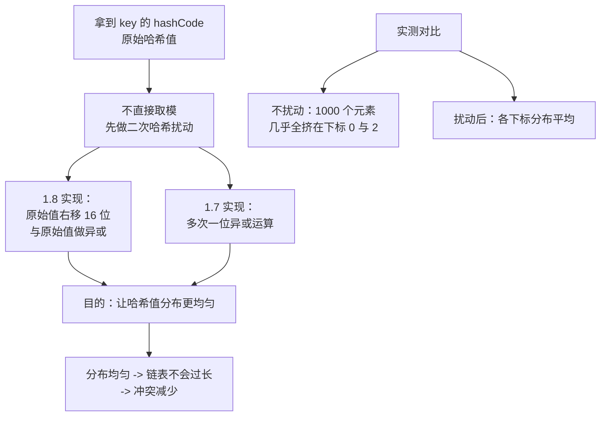

# 为何要二次哈希

拿到 key 计算索引时，并不是直接把 hashCode 与数组容量取模，而是先把原始哈希值经过一系列运算得到一个新哈希值，再用新值去取模。这个中间过程叫二次哈希。它多花了计算量，换来的是哈希分布更均匀。

## 先给结论

二次哈希的目的是让用于计算索引的哈希值分布更均匀。分布越均匀，链表越不会过长，冲突越少。1.8 的实现是把原始哈希值右移 16 位取高 16 位，与原始值做异或；1.7 的实现更复杂，经过多次一位异或运算。效果可以用实验验证：不经扰动的数据 1000 个元素几乎全部挤在下标 0 与 2，扰动后分布均匀。

## 是什么

二次哈希指用对象的 hashCode 得到原始哈希值后，不直接拿它与容量取模，而是先经过运算得到新的哈希值，再用新值取模得索引。

1.8 的二次哈希封装在一个方法里：先拿原始哈希码，把它右移 16 位即取高 16 位，再与原始哈希码做异或，异或结果就是二次哈希的结果。1.7 的计算更复杂，会经过多次一位异或运算得到结果。

## 为什么

为什么不直接用原始哈希码？因为原始哈希码的分布不一定均匀，直接取模会让元素过度集中。哈希值分布越均匀，意味着链表不会过长，冲突概率越低。

看一个正面例子。构造 1000 个足够随机的元素，放进大小为 16 的哈希表。索引 0 放 63 个，索引 1 放 64 个，其余索引各有几十个，最少的 50 多个，最多的 60 多个，分布平均。这就是哈希值选得好时的效果，不会出现某个链表过长。

再看反例。故意构造一组 1000 个元素，同样放进大小为 16 的哈希表。打印出来的数字看起来很随机，但实际分布是：下标 0 放了 495 个，下标 2 放了 505 个，其余下标全是空的。1000 个元素全挤在两个下标上。原因就是这组数字的低位值都一样，对 16 取模得到的余数要么是 0 要么是 2。

取前 10 个数字在浏览器里验证，数字看起来随机，但对 16 取模后余数只有 2 和 0 两种。哈希值不够好，索引就集中在少数位置，链表极长，其余位置空置。

## 深入细节

解法就是二次哈希的扰动。以 1.8 的算法为例，把原始数字右移 16 位后与原来的数字做异或，即原始数字异或上自身右移 16 位的结果。对同一组数据做这个扰动后再对 16 取模，余数不再是永远的 0 和 2，变成了各种不同的值。

把扰动带进模拟案例：计算索引前先做扰动，即先做一次二次哈希再对容量取模。结果分布明显均匀，16 个下标里多的有 72 个元素，中的 60 多个，少的 50 多个，不再出现某个下标 500 多、另一个 200 多的情况。

二次哈希虽然增加了一定计算量，但让哈希分布更均匀，防止超长链表产生。对高频操作来说，这点计算成本换来冲突率的下降，是划算的交换。这也是 1.8 把扰动简化成一步异或的原因：1.7 的多次异或更复杂，1.8 用一次高位混合就够，计算更轻，效果不减。

## 面试怎么答

被问到为什么要二次哈希，可以这样答：直接用对象的 hashCode 与容量取模，哈希值分布不一定均匀，低位相同的值取模后余数相同，元素会过度集中到少数下标，链表过长。二次哈希就是对原始哈希值做一次扰动，1.8 的实现是把哈希值右移 16 位取高 16 位，与原始值异或，让高位参与运算，1.7 则经过多次一位异或。效果可以验证：一组低位相同的 1000 个元素，不扰动时几乎全部挤在下标 0 和 2，扰动后 16 个下标分布均匀。二次哈希增加少量计算，但让分布更均匀、防止超长链表，对高频的索引计算来说是划算的。

## 常见误区

误区一：以为二次哈希是为了安全性。它是为了分布均匀，与加密安全无关，手段是高低位混合。

误区二：以为扰动越复杂越好。1.7 多次异或到 1.8 一次异或的简化说明一步高位混合已够，过度扰动只会增加成本。

误区三：只讲过程不讲效果。正面均匀分布与反面极端集中两组数据对比，才是这个问题的完整答案。
