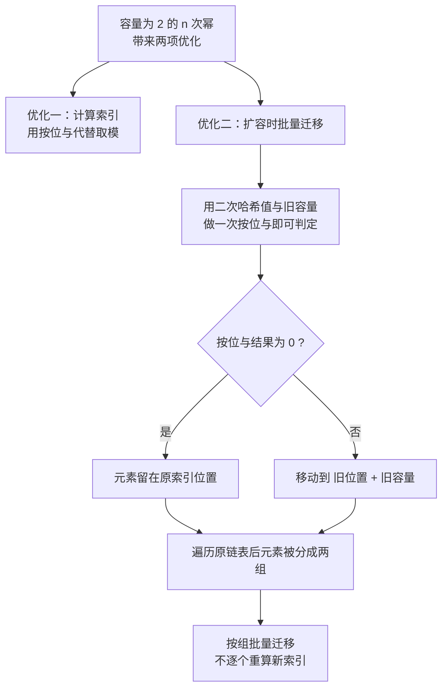

# 容量为何是 2 的 n 次幂：扩容时的批量迁移优化

前面讲过容量取 2 的 n 次幂的第一个好处：计算索引时可以用按位与代替取模。本篇讲第二个好处，也是更硬核的一个：扩容重新计算索引时可以做批量迁移优化，不需要逐个重新计算每个元素的新位置。

## 先给结论

容量是 2 的 n 次幂带来两项优化。第一项是计算索引时按位与代替取模。第二项是扩容时，元素的新位置只需用二次哈希值与旧容量做一次按位与即可判定：结果为 0 的元素留在原位，结果不为 0 的元素移动到「旧位置加旧容量」的新位置，且迁移按链表批量进行，不逐个重算。

## 是什么

准备测试数据。a、b、c、d 四个元素哈希码固定为 10，桶下标算出来也是 10，放入索引 10。1、2、3、4 哈希码为 26，初始容量 16 下算出的下标也是 10，与前者放在一起。5、6、7、8 用来凑数，因为扩容要 13 个元素触发，已有 12 个，放入第 13 个即触发扩容。

扩容意味着所有桶下标要重新计算。如果容量是 2 的 n 次幂，重新计算索引时有优化空间。

## 为什么

优化规律这样展开。遇到需要扩容的链表要移动元素时，用一个简单方法判断每个元素是否需要移动：把元素的二次哈希值与旧容量做按位与。

a、b、c、d 的二次哈希值是 10，与旧容量 16 按位与，结果是 0。结果为 0 表示扩容后位置不变，还在原来的索引 10。1、2、3、4 的二次哈希值是 26，与 16 按位与，结果不是 0。结果不为 0 表示这些元素要移动到新位置。

HashMap 的实现据此做批量优化：按位与旧容量为 0 的元素串成一条短链表等着，按位与旧容量不为 0 的元素串成另一条短链表等着。遍历完原链表后，元素被分成两组。结果为 0 的链表留在原位，结果不为 0 的链表批量移动到新位置。

新位置的计算非常简单：旧位置加旧容量。旧位置是 10，旧容量是 16，新位置就是 26，一次加法即可，不需要对元素重新做完整的哈希取模。

验证结果：a、b、c、d 留在索引 10，1、2、3、4 移动到索引 26。迁移是批量进行的，整条子链表一次性挂到新位置，不是一个一个移。

## 深入细节

为什么按位与旧容量能判定位置变化？因为容量翻倍时，下标可用的二进制位从 n 位变成 n 加 1 位，新增的最高位正是旧容量那一位。哈希值在该位为 0，下标不变；为 1，下标加上旧容量。按位与旧容量恰好测出这一位是 0 还是 1。位置不变不等于该位一定为 0 的补码含义，而是因为只有旧的 n 位参与与运算，结果只取决于新的那一位。

两项优化合起来解释容量设计。第一项省的是每次索引计算的除法开销，第二项省的是每次扩容的重算开销。两项都依赖同一个二进制性质：2 的 n 次幂减 1 是低位全 1。这就是容量取 2 的 n 次幂的核心原因。

还有第三项连带好处：哈希分布在 2 的 n 次幂下更均匀。容量为偶数时，按位与的结果只取决于低位，奇数次幂容量会让高低位混合进下标，分布反而变差。这一点与二次哈希配合，共同保证冲突可控。

## 面试怎么答

被问到容量为何是 2 的 n 次幂，可以这样答：有两个关键优化。第一，计算索引时可以用按位与代替取模，2 的 n 次幂减 1 是低位全 1 的数，按位与等价于取模，省掉除法的 CPU 开销。第二，扩容时可以批量迁移：把每个元素的二次哈希值与旧容量按位与，结果为 0 的元素留在原位，不为 0 的元素移动到旧位置加旧容量的新位置。因为容量翻倍只新增一个二进制位，按位与旧容量测的就是这一位，为 0 位置不变，为 1 加一个旧容量。迁移时把元素分成两条子链表批量搬，不用逐个重新计算哈希取模。此外 2 的 n 次幂让哈希分布更均匀，配合二次哈希控制冲突。

## 常见误区

误区一：只答按位与代替取模。这是第一项好处，批量迁移优化是更硬的第二项，两者都答才算完整。

误区二：以为扩容要重新计算所有元素的哈希取模。只需要一次按位与旧容量做判定，为 0 留、不为 0 加旧容量，且按链表批量搬。

误区三：不知道新位置怎么算。旧位置加旧容量，一次加法，不是重新取模。
