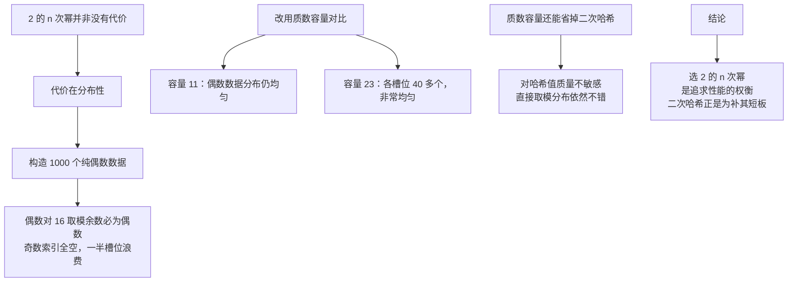

# 容量不用 2 的 n 次幂行不行

前面讲的都是容量取 2 的 n 次幂的好处，但它不是没有代价。代价在分布性：2 的 n 次幂在特定数据模式下会让哈希分布严重不均。这一篇把账算平，并给出 Java 设计者的权衡逻辑。

## 先给结论

容量取 2 的 n 次幂索引计算快，但哈希分布性有短板。构造 1000 个纯偶数放进容量 16 的表，偶数对 16 取模的余数必为偶数，结果偶数索引有元素、奇数索引全空，分布被破坏。改用质数容量如 11、23，同样的偶数数据分布均匀。选 2 的 n 次幂是追求性能的权衡，二次哈希正是为弥补它的分布短板而存在。



## 是什么

构造极端数据。准备 1000 个数字，故意全选偶数，没有奇数，测试它们在容量 16 的哈希表中的分布。结果可以预料：1000 个偶数再怎么对 16 取模，余数也不可能是奇数。因此索引 0、2、4 等偶数索引有元素，索引 1、3、5 等奇数索引根本没有元素。哈希分布不均匀，一半槽位被浪费。

换成质数容量对比。选 11 与 23，都是质数，与 16 做同样对比。容量 11 时即使是偶数数据，分布仍然比较均匀；容量 23 时分布也非常均匀，各槽位都是 40 多个元素。质数容量让取模结果打散，不保留数据的奇偶结构。

## 为什么

质数容量还有一层好处：可以省掉二次哈希。二次哈希的存在，是因为低位相同的值在 2 的 n 次幂容量下分布性差，需要把高位综合进来。而质数容量下不做二次哈希，直接拿原始哈希取模，分布性依然不错。

验证这一点。把那组低位相同的 1000 个元素，去掉二次哈希逻辑，直接对容量取模。2 的 n 次幂容量的分布很糟糕，又是一个下标 500 多、另一个 400 多。质数容量的分布仍然平均，各下标 100 多、80 多、70 多。23 这个质数同样平均。这说明质数容量对哈希值质量不敏感，这是它相对 2 的 n 次幂的根本优势。

验证用的统计代码核心片段如下：

```java
for (int hash : array) {
    for (int j = 0; j < sizes.length; j++) {
        maps.get(j).get(hash >> 16 ^ hash % sizes[j]).incrementAndGet();
    }
}
```

按课程原稿逐字收录。对每个哈希值，遍历所有候选容量，分别统计其落点计数。

## 深入细节

结论因此分场景：追求更高效率，用 2 的 n 次幂；追求更好的哈希分布性，用质数。两者不可兼得，至少在不加辅助手段时不可兼得。

Java 的 HashMap 选 2 的 n 次幂，主要为了性能。前面三篇讲的优化，索引计算的按位与、扩容时的批量迁移、二次哈希对分布性的弥补，全都是配合 2 的 n 次幂的手段：前两项优化只在容量为 2 的 n 次幂时成立，二次哈希则是因为 2 的 n 次幂分布性不够好才需要。如果容量不是 2 的 n 次幂，这些优化既用不上也不需要。

旁证是 Hashtable。Hashtable 的容量就不是 2 的 n 次幂。打印它前 10 次扩容的容量：第一次容量是 0，首次扩容变 11，再次扩容变 23，规律是上一次容量翻倍再加 1。不过它选的并不严格是质数，比如 95 就不是质数，所以这个选取也不算好。更讲究的实现是 .NET 的 Dictionary：数组容量翻倍后找一个比它大的质数作为下一次容量，更侧重哈希分布性。

两种设计没有绝对优劣。Java 的 HashMap 更注重每次计算索引的效率，.NET 的 Dictionary 更注重分布性。这是设计者综合各种因素后的不同取舍。HashMap 最终选 2 的 n 次幂，再用二次哈希补分布，是一条完整的取舍链。

## 面试怎么答

被问到容量不用 2 的 n 次幂行不行，可以这样答：可以，但要有对应手段。2 的 n 次幂的优势是索引计算能用按位与代替取模、扩容能批量迁移，这两项优化都只在 2 的 n 次幂下成立。它的短板是分布性，比如 1000 个纯偶数放进容量 16 的表，取模余数必为偶数，奇数索引全空，一半槽位浪费。所以 HashMap 用二次哈希来弥补分布问题。如果改用质数容量，比如 11、23，同样的偶数数据分布均匀，甚至不需要二次哈希，原始哈希直接取模分布就不错，代价是索引计算退回除法、扩容无法批量迁移。Java 的 HashMap 选 2 的 n 次幂加二次哈希，是侧重性能的选择；Hashtable 的容量就不是 2 的 n 次幂，它按翻倍加 1 增长；.NET 的 Dictionary 翻倍后取更大质数，更侧重分布性。两种路线是不同取舍，没有绝对优劣。

## 常见误区

误区一：以为 2 的 n 次幂全面最优。它在效率上优，分布性上有硬短板，需要二次哈希兜底。

误区二：以为质数容量只是理论选项。Hashtable 与 .NET Dictionary 都在用质数路线，是真实存在的替代设计。

误区三：忽略二次哈希与容量设计的耦合关系。二次哈希存在的理由正是 2 的 n 次幂分布性不足，两个知识点必须连起来答。
