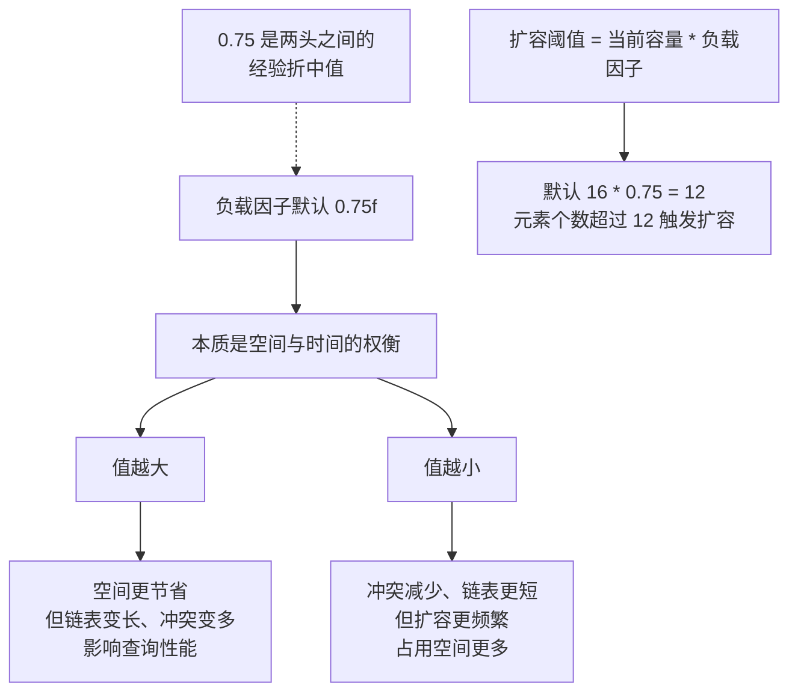

# HashMap 的负载因子为什么是 0.75f

## 开场

「HashMap 的默认负载因子为什么是 0.75」这道题本身不难，但它考的是你能不能讲清楚空间和时间之间那笔账。答案不是「官方规定的」，而是一个在冲突概率、扩容频率、内存占用之间权衡出来的经验值。

## 先给结论

负载因子（也叫扩容因子）默认是 0.75f，本质是**在空间占用和查询时间之间取得一个较好的平衡**：

- **值越大**，空间越节省，但链表一般会变长，冲突变多，影响查询性能；
- **值越小**，冲突确实减少、链表更短，但扩容会更频繁，占用的空间也更多。

0.75 就是这两头之间的一个比较好的折中。



## 是什么：负载因子怎么决定扩容时机

扩容阈值等于「当前容量乘以负载因子」。默认容量是 16，默认负载因子是 0.75，所以阈值是 12，元素个数超过 12 就会触发扩容。

把负载因子调大或调小，扩容时机立刻就变。下面两个实验都是在模拟器里改参数直接观察的。

## 深入细节一：负载因子设成 1.0

把它改成 `1.0f`（注意它是 float 类型）。这时候扩容阈值就是 16 乘 1，也就是超过 16 个元素才扩容。

往里面放 1 到 10，再放 11、12、13，都不会触发扩容。继续放 14、15、16，放满 16 个元素依然不会扩容。直到放第 17 个元素时，超过了 16 乘 1 这个阈值，才触发扩容。

代价是可以观察到的：**扩容之前，很多链表都已经比较长了，都是两个元素**。链表一长，查找就要顺着链表一个个比，性能就受影响了。等第 17 个元素触发扩容之后，明显的链表都变短了。

这就是负载因子比较大的情形：虽然节省了空间，但造成了性能上的损失。

## 深入细节二：负载因子设成 0.25

再把它选小一点，比如 `0.25f`，也就是四分之一。16 的四分之一是 4，超过 4 个元素就会扩容。

放 1、2、3、4，四个元素了；放第 5 个元素时，立马就扩容了。

好处是链表不可能太长，链表还没来得及变长就扩容了，一扩容重新计算桶下标，链表可能就短了。坏处也很明显：**造成了大量的空间浪费**，容量翻了一倍却只放了五六个元素。

## 为什么偏偏是 0.75

把两个极端放在一起看就清楚了：

- 1.0 省空间，但链表长、查询慢；
- 0.25 查询快，但扩容频繁、浪费空间。

0.75 处在这两者之间。从概率上说，0.75 也是个有讲究的数字：在哈希函数足够均匀的前提下，负载因子取 0.75 时，一个桶里链表长度的期望值仍然很低，同时数组利用率又不至于太差。再往上调，冲突带来的链表查找成本上升得很快；再往下调，多出来的空间收益又很小。所以选 0.75 是在空间占用和查询时间上做的一个比较好的权衡。

补充一点：这个值是对「哈希函数分布良好」这个前提成立的。如果你的 key 的 hashCode 实现得很差、大量碰撞，那无论负载因子怎么调都救不了，得先修 hashCode。

## 面试怎么答

「HashMap 的负载因子为什么默认是 0.75？」

> 它是在空间占用和查询时间之间取的平衡。负载因子越大越省空间，但链表更容易变长、冲突变多，查询变慢；负载因子越小冲突越少、链表越短，但扩容更频繁、浪费空间。0.75 是两者之间比较好的折中：阈值等于容量乘以负载因子，默认 16 乘 0.75 等于 12，超过 12 就扩容。实际演示也能看到，设成 1.0 时要放满 17 个才扩容，扩容前链表普遍已经是两个元素；设成 0.25 时放第 5 个就扩容，链表是短了，但空间浪费严重。

追问：「负载因子能不能改？什么时候该改？」

> 能改，构造方法里可以传。如果内存非常紧张、且能接受查询变慢，可以调大；如果追求极致的查询性能、内存充足，可以调小。但绝大多数场景默认值就是最优的，不要为了调而调。另外如果预先知道要放多少元素，更有效的做法是直接在构造方法里指定初始容量，避免多次扩容和 rehash。

追问：「扩容的代价是什么？」

> 扩容要新建一个两倍大的数组，然后把所有元素重新计算桶下标并搬过去，这个 rehash 过程是 O(n) 的，而且期间可能产生大量垃圾对象。频繁扩容会明显影响性能，所以能预估容量就预估。

## 常见误区

- 以为 0.75 是随便定的。它是空间与时间权衡的结果，两个极端实验都能看出它的合理性。
- 以为负载因子越大越好，反正省内存。链表变长之后查询退化，得不偿失。
- 以为负载因子越小越好，反正冲突少。扩容频繁带来的 rehash 成本和内存浪费同样是代价。
- 以为调负载因子能解决所有性能问题。真正的瓶颈往往是 hashCode 实现太差导致大量碰撞，那时候调什么都没用。
- 以为初始容量填了就不会扩容。初始容量会被向上取到最接近的 2 的 n 次幂，而且超过阈值照样扩容，预估容量时要留出余量。

## 课件源码参考

> 以下示例出自课件 day01 的 `HashMapDistribution.java`，与上文讲解一一对应，可直接对照阅读。

```java
package day01.map;

import java.io.IOException;
import java.lang.reflect.Array;
import java.lang.reflect.Field;
import java.nio.file.Files;
import java.nio.file.Path;
import java.util.HashMap;
import java.util.Map;
import java.util.concurrent.atomic.AtomicInteger;
import java.util.stream.Collectors;

// --add-opens java.base/java.util=ALL-UNNAMED
public class HashMapDistribution {

    public static void main(String[] args) throws IOException {
        Object value = new Object();
        Map<String, Object> words = Files.readAllLines(Path.of("words")).stream()
                .collect(Collectors.toMap(w -> w, w -> value));
        System.out.println(words.getClass());
        showDistribution(words);
    }

    private static void showDistribution(Map<String, Object> map) {
        try {
            Field tableField = HashMap.class.getDeclaredField("table");
            Field nextField = Class.forName("java.util.HashMap$Node").getDeclaredField("next");

            tableField.setAccessible(true);
            nextField.setAccessible(true);
            Object array = tableField.get(map);
            int length = Array.getLength(array);
            System.out.println("总的桶个数[" + length + "]");
            Map<Integer, AtomicInteger> result = new HashMap<>();
            for (int i = 0; i < length; i++) {
                Object node = Array.get(array, i);
                AtomicInteger c = result.computeIfAbsent(i, key -> new AtomicInteger());
                while (node != null) {
                    c.incrementAndGet();
                    node = nextField.get(node);
                }
            }
            Map.Entry maxEntry = null;
            int max = -1;
            HashMap<Integer, AtomicInteger> counting = new HashMap<>();
            for (Map.Entry<Integer, AtomicInteger> entry : result.entrySet()) {
                int value = entry.getValue().get();
                AtomicInteger c = counting.computeIfAbsent(value, k -> new AtomicInteger());
                c.incrementAndGet();
            }
            counting.forEach((k, v) -> {
                System.out.println(k + "个元素的桶个数[" + v + "]");
            });
        } catch (Exception e) {
            e.printStackTrace();
        }
    }
}
```
