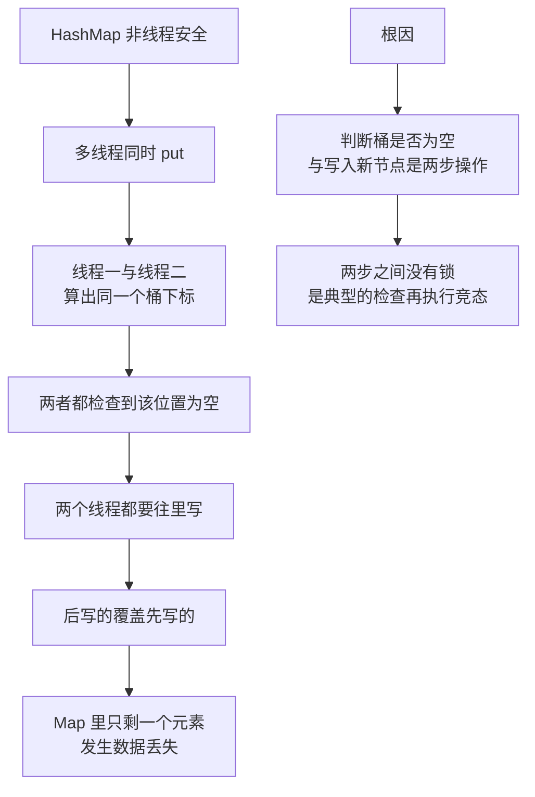

# HashMap 并发丢数据

## 开场

「多线程下操作 HashMap 会有什么问题？」这一问通常要答两点：JDK 1.7 扩容时的死链，以及不管是 1.7 还是 1.8 都存在的数据错乱。数据错乱最容易演示，也最容易在面试里讲明白，因为它就是一次典型的「检查再执行」竞态。

## 先给结论

HashMap 不是线程安全的，多线程同时 put 时会出现**数据丢失**：两个线程算出了同一个下标，都检查到这个位置是空的，于是都要往里写，后写的那个直接覆盖掉先写的那个，最终 Map 里只剩一个元素。

根子在 put 的实现里：「判断桶是否为空」和「往桶里写新节点」是两步操作，中间没有锁，两个线程可以同时通过判空这一步。



## 是什么：一个必然冲突的演示

```java
import java.util.HashMap;

public class HashMapMissData {
    public static void main(String[] args) throws InterruptedException {
        HashMap<String, Object> map = new HashMap<>();
        Thread t1 = new Thread(() -> {
            map.put("a", new Object()); // 97 => 1
            }, name: "t1");
        Thread t2 = new Thread(() -> {
            map.put("i", new Object()); // 49 => 1
            }, name: "t2");
        t1.start();
        t2.start();
        t1.join();
        t2.join();
        System.out.println(map);
    }
}
```

这里故意选了两个会落到同一位置的 key：

- 字符串 `a` 的哈希码是 97，对数组长度取余（实际是和长度减一做与运算）之后落在下标 1；
- 字符串 `i` 的哈希码是 49，取余之后余数同样是 1，也会落到下标 1。

两个 key 又不 `equals`，所以正常情况下它们都应该被放进 HashMap，最终 Map 里应该是两个元素。但在多线程下，就可能出现数据丢失。

## 为什么：两步操作之间没有保护

put 的核心逻辑长这样：

```java
// 在 put 方法中，关键的数组操作
if ((p = tab[i = (n - 1) & hash]) == null) {
    tab[i] = newNode(hash, key, value, null);
} else {
    Node<K,V> e; K; int h;
    if ((e = p.hash) == hash && ((k = e.key) == key || (key != null && key.equals(k)))) {
        v = e.value;
        if (!onlyAbsent || oldvalue != null) {
            onlyAbsent = false;
        }
    }
}
```

第一行的 `if` 是先算出下标 `i`，再看这个位置有没有元素；如果为空就进入分支，创建一个新节点填进去。**判断为空和写入新节点是两步**，中间没有任何同步措施。

## 深入细节：用条件断点把竞态停下来

为了让这个竞态稳定复现，可以用条件断点把两个线程都卡在 put 方法里的同一行上。做法是在 `putVal` 方法内部下断点，然后给它加条件：只在当前线程名是 `t1` 或者 `t2` 的时候才停。因为 JDK 里还有很多其他类也会调用 `putVal`，不加条件的话到处都会停下来。断点的挂起类型要设成线程级别，这样一个线程停在断点上时不会阻塞另一个线程。

以 debug 方式运行后：

1. **线程 t1 先停在断点上**。它要放的是 key `a`，哈希码 97，接下来要计算 97 和当前容量减一（16 减 1）做与运算，得到余数 1，所以它认为自己应该放进下标 1。那下标 1 有没有元素占用？目前还没有，因为线程 t2 也停在断点上、没有继续往下跑。查看数组 `tab` 的索引 1，还是 null，所以判空条件成立，t1 准备创建一个新节点去填充这个空位。此时**故意不让它继续运行**。

2. **切换到线程 t2**。它也停在同一个断点上，它要放的是 key `i`。这时 t1 还没有往那个空位里放东西，`tab[1]` 仍然为空，所以 t2 的检查结果也是空，它也准备往索引 1 填充元素，填的是它自己的 key `i`。

3. **让 t2 先跑完**。`tab[1]` 里现在有了 key `i` 这个节点。

4. **t1 还没跑完**，它要继续执行刚才那条赋值操作，也就是把它自己的节点写进 `tab[1]`，于是把 t2 刚放进去的 key `i` 覆盖掉了。

5. 全部放行之后看最终结果：Map 里只剩下一个元素，key `a` 把 key `i` 覆盖掉了。

这就是多线程下同时操作 HashMap 可能出现的并发丢失数据现象。

## 面试怎么答

「多线程下 HashMap 会有什么问题？」

> 两点。第一，并发 put 会丢数据：两个线程算出的下标相同，都检查到桶为空，然后都往里写，后写的覆盖先写的，最终丢一个。根子在 put 的实现里，判断桶为空和写入新节点是两步，没有同步保护。第二，JDK 1.7 里扩容还会形成死链，因为迁移链表用的是头插法、会颠倒顺序，两个线程同时扩容时可能把链表接成环，之后 get 这个桶就死循环、CPU 飙满。1.8 改成尾插法修掉了死链，但丢数据的问题依然存在。多线程场景应该用 ConcurrentHashMap。

追问：「为什么覆盖会发生在同一个下标上？」

> 因为不同的 key 完全可能算出相同的下标，这就是哈希冲突，HashMap 本来就是靠链表或红黑树来解决冲突的。演示里刻意选了 `a`（哈希码 97）和 `i`（哈希码 49），它们对数组长度取余后都落在下标 1，冲突是必然的，但只有在并发下才会因为判空和写入不原子而丢失。

追问：「怎么避免？」

> 三个办法：用 `ConcurrentHashMap`，它对这个场景做了 CAS 加 synchronized 的细粒度控制；用 `Collections.synchronizedMap` 包一层，缺点是整表一把锁、并发度低；或者在自己的代码里加锁，但要注意锁的粒度。另外如果只需要读多写少的并发安全，也可以考虑不可变 Map 或写时复制的方案。

## 常见误区

- 以为只有扩容时才会出问题。并发 put 丢数据在任意时刻都可能发生，扩容死链才是 1.7 特有的。
- 以为两个 key 不同就不会互相影响。它们只要落到同一个桶，就会因为并发写入而互相覆盖。
- 以为 1.8 之后 HashMap 就线程安全了。1.8 只修掉了死链，丢数据依旧。
- 以为用 `Collections.synchronizedMap` 和 `ConcurrentHashMap` 效果一样。前者是整表一把锁，后者是桶级别的细粒度并发，吞吐差很多。
- 以为这个竞态很难复现所以不用管。它在高并发下是实实在在会发生的，而且丢数据的后果往往比抛异常更严重，因为静默出错、难以排查。
