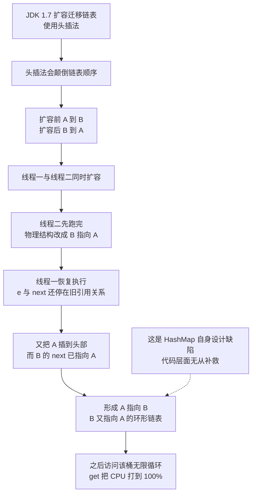

# HashMap 并发扩容死链（JDK 1.7）

## 开场

「多线程下 HashMap 会有什么问题？」标准答案是两点：并发丢数据，以及 JDK 1.7 里更致命的扩容死链。死链一旦形成，get 操作会直接把 CPU 打到 100%，而且这是 HashMap 自身的设计缺陷，代码层面无从补救。理解它的关键只有两个字：头插法。

## 先给结论

JDK 1.7 的 HashMap 扩容迁移链表时用的是**头插法**，这会**颠倒链表顺序**：扩容前是 A 到 B，扩容后变成 B 到 A。两个线程同时扩容时，线程二先跑完，把链表物理结构改成了 B 指向 A；线程一恢复执行时，它自己的临时变量 `e`、`next` 还停留在旧的引用关系上，于是又把 A 插到头部，而 B 的 next 已经指向 A 了，最终形成 A 指向 B、B 又指向 A 的环形链表。之后访问这个桶就会无限循环。



## 是什么：单线程下的迁移流程

先假设 A 和 B 两个元素扩容前后算出来的下标都一样，都是 1。源码里用两个变量完成链表迁移，它们都是**线程内的临时变量**：

- `e`：指向链表中当前要迁移的元素；
- `next`：指向下一个元素。

每一轮循环把 `e` 引用的元素用头插法搬进扩容后的新数组，然后 `e` 后移到 `next` 指向的元素。流程是：

1. 第一轮：`e` 拿到 A，把 A 头插进新数组；循环结束前 `e` 指向下一个元素 B；
2. 第二轮：`next` 指向 B 的下一个（这里没有了，是 null），把 `e` 指向的 B 头插进新数组，因为它要插到头部，A 就往后让一位；循环结束前 `e` 移向 `next` 引用的 null；
3. 第三轮：发现 `e` 已经是 null，循环结束，链表迁移完成。

这个过程中有三点必须注意：

**第一，迁移并没有创建新对象。** 看起来像是复制了一份，实际上 B 还是原来那个 B、A 还是原来那个 A，迁移只是改变了它们之间的引用指向，对象本身没有被重新创建。

**第二，`e` 和 `next` 的分工。** `e` 指向当前要迁移的元素，`next` 保存下一个元素。

**第三，也是最关键的：链表顺序被颠倒了。** 迁移之前是 A 到 B 的顺序，扩容之后因为用的是头插法，顺序颠倒了，变成 B 到 A。

## 为什么：两个线程同时扩容就出事了

现在假设两个线程都要做扩容，还是 A 和 B 这两个元素，它们扩容前后的下标都算出来是 1。

线程一有两个临时变量 `e` 和 `next`，分别指向 A 和 B；线程二同样有自己的 `e` 指向 A、`next` 指向 B。

**线程切换发生在这里**：线程一刚把 `e` 和 `next` 指向的元素记录下来，还没来得及移动，就被切走了，轮到线程二执行。

**线程二跑完了整个扩容**：它按前面的流程走了一遍，最终以 B 到 A 的顺序，把链表迁移进线程二自己创建的新数组里。注意，此时链表的顺序已经被颠倒了，扩容前是 A 到 B，扩容后是 B 到 A。线程二的工作到此结束。

**线程一恢复执行**：它还得从刚才暂停的位置继续往下跑。此时线程一的 `e` 指向 A、`next` 指向 B，这是它切走之前记录下来的旧引用。

接下来看它的三轮循环：

1. **第一轮**：把 `e` 指向的 A 头插进线程一的新数组。循环结束时 `e` 变成 `next` 的值，也就是指向 B。
2. **第二轮**：这一轮开始时 `next` 要指向下一个值。关键来了，此时 B 的下一个值**不再是 null**，因为线程二刚才已经把 B 的 next 改成了 A，所以 `next` 指向 A。这一轮把 `e` 指向的 B 头插进新数组，B 放在头部，A 往后让一位。循环结束时 `e` 又指向 `next`，也就是 A。
3. **第三轮**：`next` 指向 null（没有后续元素了），但 `e` 还需要把 A 以头插法加入链表头。于是 A 又被加到了头部。注意这里的 A 和前面那个 A 是同一个对象，只是画了两份而已。

**死链就在这里形成**：A 被插到头部之后，A 的 next 指向 B；而 B 在线程二的操作之后，它的 next 仍然指向 A。于是链表变成 A 指向 B、B 又指向 A 的环。

循环本身是能结束的（`e` 最终指向 `next` 也就是 null），但**以后访问这个位置的链表时，访问到 A 下一个是 B，访问到 B 下一个又是 A，就变成了死循环**。

## 深入细节：问题的根源

整个问题的根源可以归结为一句话：**头插法会颠倒链表顺序，而并发下两个线程各自持有的临时引用和已经变化的物理结构对不上**。

```java
// 线程2的头插法操作（伪代码）
Node newNode = new Node(data);
newNode.next = head; // 将新节点的next指向原链表头
head = newNode; // 将链表头指向新节点

// 线程1的后续操作（伪代码）
Node current = e; // e 指向原链表头
Node nextNode = current.next; // nextNode 指向原链表第二个节点
// ... 后续操作 ...
```

线程二扩容后，由于头插法，链表顺序被颠倒；但线程一的临时变量 `e` 和 `next` 还引用着这两个节点，它基于过时的引用继续迁移，就把环接上了。

JDK 1.8 对这个问题的处理是：改用**尾插法**迁移，保持了链表原有的相对顺序，因此不会出现环。但 1.8 的 HashMap 依然不是线程安全的，并发 put 仍然会丢数据。

## 面试怎么答

「HashMap 在多线程下有什么问题？」

> 两个问题。一是并发 put 会丢数据：两个线程同时判断某个桶为空然后各自写入，后写的覆盖先写的。二是 JDK 1.7 里扩容会形成死链：扩容迁移链表用的是头插法，会把链表顺序颠倒；两个线程同时扩容时，线程二先跑完把顺序改成了 B 到 A，线程一恢复后它的临时变量 e、next 还停在旧的引用关系上，又把 A 头插进去，而 B 的 next 已经指向 A，于是形成 A 指向 B、B 指向 A 的环，之后 get 到这个桶就会无限循环、CPU 飙满。1.8 改成尾插法解决了死链，但并发丢数据依然存在，多线程场景应该用 ConcurrentHashMap。

追问：「为什么头插法会颠倒顺序？」

> 因为每次都把当前节点插到链表头部，先迁移的 A 先放进去，后迁移的 B 插在 A 前面，最终顺序就反了。这是 1.7 的实现选的，据说出发点是认为后插入的数据更可能被访问、放头部命中更快，但副作用就是并发下的死链。

追问：「1.8 之后就没有问题了吗？」

> 死链没有了，因为改成了尾插法，迁移前后链表相对顺序不变。但 1.8 的 HashMap 仍然不是线程安全的：并发 put 照样丢数据，扩容期间并发 get 也可能读到不完整的结构。要用线程安全的 Map，还是得上 ConcurrentHashMap 或者 Collections.synchronizedMap。

## 常见误区

- 以为迁移链表时会创建新对象。不会，只是改变节点之间的引用指向。
- 以为问题出在 `e` 和 `next` 是共享变量。恰恰相反，它们是线程内的局部变量，问题在于它们引用的对象是被所有线程共享的，别的线程把这些对象的 next 改了。
- 以为 JDK 1.8 之后 HashMap 就可以并发用了。1.8 只修掉了死链，并发丢数据依然存在。
- 以为死链会让 put 卡死。扩容循环本身能正常结束，卡死的是**之后**访问这个桶的 get 操作。
- 以为只有扩容时才有并发问题。并发 put 丢失更新在任何时候都可能发生，扩容死链只是 1.7 特有且后果最严重的那一个。
