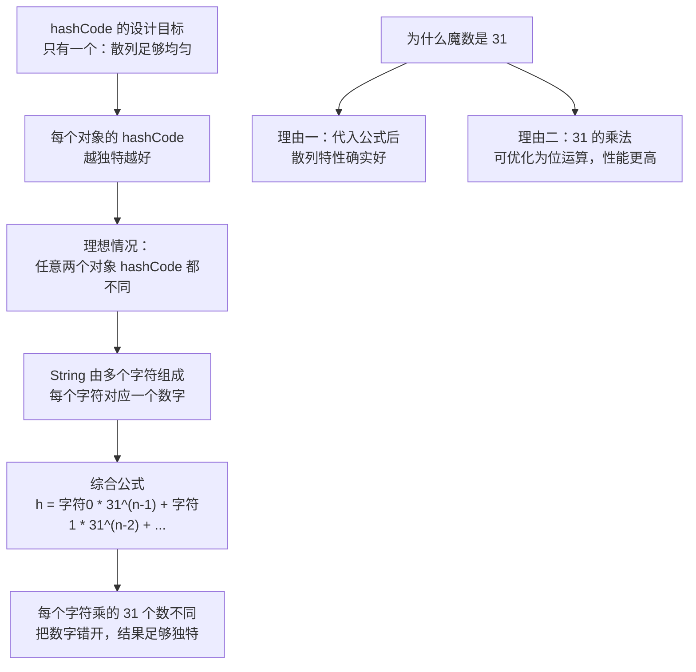

# HashMap 中 hashCode 的设计

## 开场

「String 的 hashCode 是怎么设计的？为什么是 31？」这道题看着像是背数字，实际上考的是你对哈希设计目标的理解：hashCode 存在的唯一意义是让散列效果尽量均匀，而 31 这个魔数是在散列质量和计算性能之间权衡出来的结果。

## 先给结论

不管是 String 还是其他对象，hashCode 的设计目标只有一个：**让最终的散列效果足够均匀**。也就是说每个对象的 hashCode 越独特越好，理想情况下任意两个对象的 hashCode 都不相同。

String 由多个字符组成，每个字符查码表都能表现为一个数字。把这些数字综合起来形成一个独特的 hashCode，靠的是这样一个公式（以 10 个字符为例）：

```text
h = 字符0 × 31^9 + 字符1 × 31^8 + 字符2 × 31^7 + ...
```

每个数字乘的 31 的个数不一样，就把这些数字错开了，算出来的 hashCode 足够独特、不容易和其他对象重复。

之所以选 31 而不是别的数字，有两个理由：一是 31 代入公式后散列特性确实好；二是 31 的乘法可以被优化成位运算，性能更高。



## 是什么：为什么要错开

字符串是多个字符组成的，每个字符通过查询码表都能表现为一个数字。那能不能把多个数字直接相加做成一个 hashCode？不行，直接相加会让大量的字符串撞到一起，比如「ab」和「ba」加起来一样。

正确做法是把这些数字**错开**：让第 0 个字符乘 9 次 31，第 1 个字符乘 8 次 31，第 2 个字符乘 7 次 31，以此类推。每个数字乘的 31 的个数不同，它们在最终数值里占据的权重就不同，于是就把这些数字错开了。用这个公式算出来的 hashCode，就能达到比较独特、和其他对象不重复的效果。

## 为什么是 31：理由一，散列效果好

直接看实测效果。用 Linux 下的单词表，一共 23 万多个单词，把它们代入上面的公式，先把 31 套进去，观察散列分布：把整数的范围分成相等的 256 份，看每一份里落了多少个单词。

结果是相当均匀的，每个范围内分布的单词数量差不多。只有两个位置有明显峰值：一个位置放了 7000 多个单词，另一个位置放了 5000 多个单词，除此之外都比较均匀。

不比不知道，换几个数字对比一下：

- **套入 2**：效果完全没法看。绝大多数单词都挤进了同一个区间，其余区间只分散了很少甚至零个单词。散列效果非常差。
- **套入 11**：11 是质数，一般选质数都会有比较好的效果，但实测下来它没有 31 好。
- **套入 41**：41 的表现其实比 31 还要好一些，分布更均匀，峰值更不明显。

## 为什么是 31：理由二，乘法可以优化

既然 41 的分布性更好，为什么最终选了 31？因为还要看计算性能。

31 乘以 h，可以等价写成 32 × h 减 h。而 32 是 2 的 5 次方，所以乘 32 可以转换成左移运算：把原有数字左移 5 位，就相当于乘了 2 的 5 次方。

```text
31 * h = 32 * h - h = (h << 5) - h
```

于是一个乘法运算最终被转换成一次移位加一次减法，比直接做乘法效率更高。

反观 41，它邻近的数字不是 2 的 n 次幂，没法做这个优化。综合来看，31 在散列质量和计算性能之间取得了最好的平衡。

顺带说一句，2 之所以散列效果差，是因为它虽然是质数但同时是偶数；11 也是质数，效果就比 2 好得多。选质数通常效果不错，但最终还是要以实测分布为准。

## 面试怎么答

「String 的 hashCode 为什么用 31？」

> 设计目标是让散列效果尽量均匀，也就是让每个对象的 hashCode 足够独特。String 的做法是把每个字符的数字按不同权重错开相加，公式大致是 `h = 31 * h + c` 迭代下去，等价于字符0乘31的n-1次方一直加到最后一个字符，这样每个字符占据的权重不同，就被错开了。选 31 有两个理由：一是实测散列效果好，用 23 万个单词做分布测试，31 的分布相当均匀，明显好于 2 和 11；二是 31 的乘法可以优化成位运算，`31 * h` 等价于 `(h << 5) - h`，比乘法快。虽然 41 的分布比 31 更均匀，但 41 没法做这个位运算优化，综合下来 31 最优。

追问：「hashCode 一定要保证不重复吗？」

> 不可能保证。hashCode 是 int，最多 2 的 32 次方种取值，而对象数量远多于这个数，鸽笼原理决定了必然有冲突。设计目标只能是「尽量均匀、尽量减少碰撞」，不是「绝不重复」。所以判断两个对象相等必须同时看 equals 和 hashCode，不能只靠 hashCode。

追问：「那 HashMap 里拿到 hashCode 之后还做了什么？」

> HashMap 并没有直接拿 hashCode 当下标，而是先做了一次扰动（把高 16 位和低 16 位异或），再和数组长度减一做与运算得到下标。扰动是为了让高位也参与进来，减少只靠低位导致的碰撞。

## 常见误区

- 以为 hashCode 保证唯一。它只是 int，冲突是必然的，设计目标是均匀而不是唯一。
- 以为「乘一个质数」就一定好。11 是质数但不如 31，2 是质数且是偶数效果最差，最终要看实测。
- 以为 31 是分布最好的数字。实测 41 分布更好，选 31 是加上了性能考量之后的权衡。
- 把「错开」理解成简单相加。直接相加会让「ab」和「ba」这类组合大量碰撞，必须按权重错开。
- 以为换个更大的乘数一定更好。乘数过大会让中间结果更容易溢出，也会失去位运算优化的机会。
