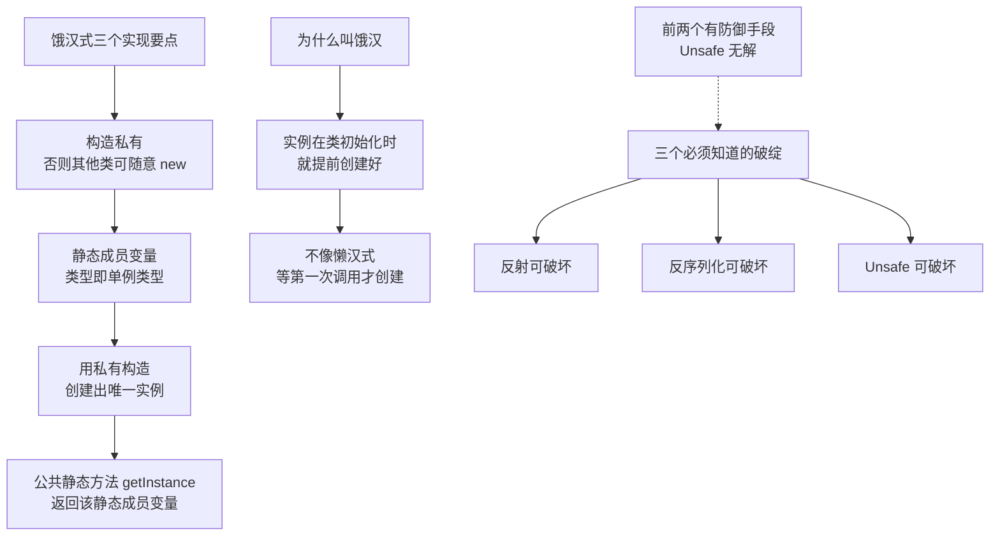

# 单例模式方式一：饿汉式

## 开场

设计模式虽然有很多，但跟面试相关的其实不多，单例模式是其中必考的一个。它的定义很朴素：保证一个类只有一个实例。只要你的代码能达到这个效果，就可以说你的代码实现了单例模式。面试要求掌握两点：一是五种实现方式，二是 JDK 里哪些地方体现了单例模式。这一篇先讲第一种，也是最简单的一种：饿汉式。

## 先给结论

饿汉式有三个实现要点：

1. **构造私有**：这是所有单例实现的共同前提，构造不私有，其他类就有机会调构造创建对象；
2. **提供一个静态成员变量**，类型就是单例类型，值是用私有构造创建出来的唯一实例；
3. **提供一个公共的静态方法**（习惯上叫 `getInstance`）返回这个静态成员变量。

之所以叫「饿汉」，是因为它相对后面的懒汉式而言：实例在类初始化时就提前创建好了，而不是等到第一次调用 `getInstance` 才创建。

它还有三个必须知道的破绽：反射、反序列化、`Unsafe` 都可以破坏它，前两个有对应的防御手段。



## 是什么：代码长什么样

```java
public class Singleton1 implements Serializable {
    private Singleton1() { }
    private static final Singleton1 INSTANCE = new Singleton1();
    public static Singleton1 getInstance() {
        return INSTANCE;
    }
    public static void otherMethod() {
        System.out.println("otherMethod()");
    }
}
```

三个要点逐条看：

**构造为什么必须私有。** 如果构造不是私有的，其他类就有机会调用你的构造方法来创建对象，那就有可能出现多个实例，所以构造一定要私有。而私有的构造在自己这个类内部是可以调用的，所以内部能创建出唯一的实例。

**静态成员变量。** 它的类型是单例类型，值就是用私有构造 new 出来的唯一实例。

**公共静态方法。** 静态变量一般是私有的，外界不能直接访问，所以要提供一个公共的静态方法返回它，方法名习惯上叫 `getInstance`。

## 为什么叫饿汉式

类有加载、链接、初始化三个动作。只要类一初始化，给静态变量赋值的代码就会执行，实例就随之被创建出来。也就是说，**不需要调用 `getInstance`，实例也会被提前创建**。

测试代码验证得很清楚：先调用单例类的另一个静态方法 `otherMethod()`，意图只是触发这个类的加载、链接、初始化。结果 `otherMethod()` 一调用，单例的构造就被调用了一次，说明对象已经创建好了。之后再调用 `getInstance()`，拿到的就是那个提前创建好的对象，而不是这时才创建。这就是饿汉式的含义。

同时，连续调用两次 `getInstance()`，打印出来的哈希值一样，说明拿到的是同一个对象，单例成立。

## 深入细节一：反射破坏与防御

反射破坏最简单。拿到单例类的 Class 对象，调 `getDeclaredConstructor()` 取到无参构造方法，虽然构造是私有的，但 `setAccessible(true)` 之后就可以使用，再调 `newInstance()` 就创建了一个新实例。

```java
private static void reflection(Class<?> clazz) throws Exception {
    Constructor<?> constructor = clazz.getDeclaredConstructor();
    constructor.setAccessible(true);
    Object o = constructor.newInstance();
    System.out.println("反射创建实例：" + o);
}
```

这样一来单例就不成立了：`getInstance` 拿到的是一个对象，反射创建的又是另一个对象，一个类有了两个对象。运行结果里能看到，构造方法的输出信息又被打印了一遍（构造被第二次调用），新对象的哈希值也不一样。

**防御方式**：在构造方法里加判断，如果静态成员变量 `INSTANCE` 已经不为 `null`，说明唯一实例已经创建好了，就抛异常提示单例对象不能重复创建。第一次创建时 `INSTANCE` 还是 `null`，条件不成立，不会抛异常；第二次反射调用构造时 `INSTANCE` 已经有值，条件成立，直接抛异常，不会往下走。

加上这个判断之后再测试，前面两次 `getInstance` 都成功，反射调用时报错，报的就是我们自己抛的那个异常。

## 深入细节二：反序列化破坏与防御

如果单例类实现了 `Serializable` 接口（想让对象转成字节存磁盘或走网络传输，就得实现它），别人就可以用反序列化来破坏单例。

```java
private static void serializable(Object instance) throws IOException, ClassNotFoundException {
    ByteArrayOutputStream bos = new ByteArrayOutputStream();
    ObjectOutputStream oos = new ObjectOutputStream(bos);
    oos.writeObject(instance);
    ObjectInputStream ois = new ObjectInputStream(new ByteArrayInputStream(bos.toByteArray()));
    Object o = ois.readObject();
    System.out.println("反序列化创建实例：" + o);
}
```

先用 `ObjectOutputStream` 的 `writeObject` 把对象变成字节流，再用 `ObjectInputStream` 的 `readObject` 把字节流还原成对象。这个反序列化过程会造出一个新对象，而且**不走构造方法**。测试结果里，原对象的哈希是 7699 开头的那个，反序列化又造出一个 7591 开头的新对象，于是就有了多个实例。

**防御方式**：在单例类里写一个特殊方法 `readResolve`，方法名是固定的，方法里原封不动返回那个静态成员变量。反序列化时如果发现你重写了 `readResolve`，就会用这个方法的返回值作为最终结果，而不是用字节数组反序列化生成的那个对象，单例就保住了。

## 深入细节三：Unsafe 破坏

还有一种是用 `Unsafe` 对象来破坏单例：

```java
private static void unsafe(Class<?> clazz) throws InstantiationException {
    Object o = UnsafeUtils.getUnsafe().allocateInstance(clazz);
    System.out.println("Unsafe 创建实例：" + o);
}
```

`allocateInstance` 可以直接分配一个对象，连构造方法都不调用，所以前面那种「在构造里加判断」的防御对它完全无效。这是任何单例写法都拦不住的一条路径，只能靠不使用、不暴露 `Unsafe` 来规避。

## 面试怎么答

「手写饿汉式单例，并说明它有什么问题。」

> 饿汉式三个要点：构造私有、用一个静态成员变量持有 new 出来的唯一实例、提供公共静态方法返回它。它是类初始化时就创建实例，调用类的任意静态方法触发初始化都会创建，所以不是第一次 `getInstance` 才创建，这是它和懒汉式的区别。它的问题是被三种方式破坏：反射可以拿到私有构造 `setAccessible` 后 new 出新对象，防法是在构造里判断实例已存在就抛异常；反序列化会绕过构造造出新对象，防法是写 `readResolve` 返回既有实例；`Unsafe.allocateInstance` 连构造都不走，防不住。

追问：「为什么饿汉式不需要考虑线程安全？」

> 因为实例是在给静态变量赋值时创建的，这段代码会进入类的静态代码块执行，而 JVM 在执行类初始化时会加锁，保证同一个类的初始化只被一个线程执行一次，所以不存在多线程重复创建的问题。

追问：「`readResolve` 的返回值会被怎么用？」

> 反序列化时，如果类里定义了 `readResolve`，JDK 会调用它并用它的返回值替换掉刚刚从字节流里还原出来的那个对象，作为 `readObject` 的最终结果。方法名和签名是约定好的，写错就失效。

## 常见误区

- 以为饿汉式是调用 `getInstance` 时才创建。它在类初始化时就创建，调别的静态方法也会触发。
- 以为构造私有就万无一失。反射能强制访问私有构造，反序列化更是完全绕过构造。
- 以为 `readResolve` 可以随便命名。它的名字是 JDK 约定的，必须叫 `readResolve`。
- 以为在构造里加判断能防住所有破坏。`Unsafe.allocateInstance` 不调用构造方法，这条防御对它无效。
- 以为 `readResolve` 是 private 就不生效。它是通过反射调用的，访问修饰符不影响，常见写法就是 `private Object readResolve()`。
