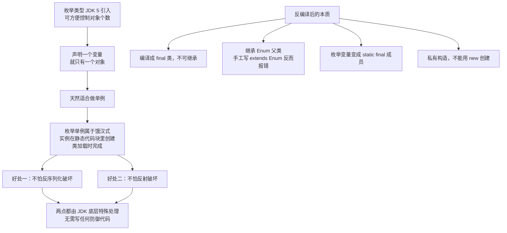

# 单例模式方式二：枚举饿汉式

## 开场

单例最常被追问的不是「怎么写」，而是「你写的这个能防住反射和反序列化吗」。自己写的单例要靠 `readResolve`、构造里加判断来打补丁，而枚举实现的单例天生免疫这两条攻击路径。这就是方式二存在的意义。

## 先给结论

枚举类型从 JDK 5 开始加入，它可以很方便地控制对象的个数：声明两个枚举变量就有两个对象，只声明一个变量就只有一个对象，所以天然适合做单例。枚举单例属于**饿汉式**，实例在枚举类的静态代码块里创建，类加载时就完成。它的两个核心好处是：**不怕反序列化破坏**，**也不怕反射破坏**，这两点都是 JDK 在底层做了特殊处理，不需要我们写任何防御代码。



## 是什么：枚举为什么能控制对象个数

看一个性别枚举类 `Sex`，它有两个变量 `male` 和 `female`，这两个变量分别引用 `Sex` 的两个对象，不多不少正好两个。

枚举这个语法最终还是会被编译器编译成 class 文件，它的本质仍然是一个类。把它编译后的字节码翻译回 Java 代码，大致是这样：

- 枚举类最终被翻译成一个 `final` 类，意味着它不能被继承、不能有子类；
- 它有一个枚举父类 `Enum`，这个继承关系是编译器在编译枚举时帮我们加上的，我们自己手写 `extends Enum` 反而编译不通过；
- 枚举里的 `male`、`female` 两个变量，对应成类里两个 `static final` 的成员变量，类型就是这个枚举类本身；
- 类里还有一个**私有构造**，这就决定了你不能用 `new` 关键字再为这个枚举类创建出新的对象。构造有两个参数：一个是枚举变量的名称，一个是它的序号（序号从 0 开始逐一递增），这两个信息都会传给父类构造，父类把它们记下来。

看静态代码块就明白了：静态代码块里为 `male`、`female` 这两个变量做初始化，`male` 就是 `new` 了一个枚举对象，名称字符串是 `male`、序号是 0；`female` 是另一个对象，名称是 `female`、序号是 1。也就是说静态代码块调用了自己的私有构造，创建出两个（或者说唯二的）实例赋给这两个变量，我们用这两个变量时，用的就是这两个对象。

既然能控制成两个，那控制成一个自然也行：枚举类里只声明一个变量，就只有一个唯一实例。

## 深入细节：枚举单例的写法

```java
package day01.pattern;

public enum Singleton2 {
    INSTANCE;

    private Singleton2() {
        System.out.println("private Singleton2()");
    }

    @Override
    public String toString() {
        return getClass().getName() + "@" + Integer.toHexString(hashCode());
    }

    public static Singleton2 getInstance() {
        return INSTANCE;
    }

    public static void otherMethod() {
        System.out.println("otherMethod()");
    }
}
```

这里几点说明：

- 构造方法其实不写 `private` 也可以，因为枚举的构造默认就是私有的（IDE 会提示这个修饰符是多余的），写它主要是为了打印一行信息，好看构造有没有被调用；
- 重写 `toString` 是为了打印出哈希码，这样能看出拿到的是不是同一个对象。不重写的话，默认只会打印枚举变量的名字（这个例子里就是大写的 `INSTANCE`），看不出对象是不是同一个；
- `getInstance` 这个静态方法是为了模仿前面几种单例的写法，其实可以不要，因为枚举变量本身编译后就是公共的静态变量，直接 `Singleton2.INSTANCE` 就能用；
- `otherMethod` 是为了测试它到底是饿汉式还是懒汉式。

## 为什么它是饿汉式

测试代码里先调用 `otherMethod()`，还没有用到下面的 `getInstance`。但运行结果是：调用 `otherMethod()` 的时候，枚举的单例实例**已经被创建了**。

这说明它是饿汉式。从前面的源码分析也能对上：枚举类的静态代码块里就会把枚举对象创建好，类一加载、一初始化，实例就存在了，而不是等你调用 `getInstance` 时才创建。

## 枚举单例的两个好处

好处一：不怕反序列化破坏。
自己写的单例如果不加 `readResolve`，反序列化时会破坏单例、创建出新的对象。枚举实现的单例没有做任何特殊处理，但反序列化出来的对象和 `getInstance` 拿到的是同一个对象，单例没有被破坏。

原因在 `ObjectInputStream` 这一侧：它在反序列化时会对枚举类做特殊处理，一旦发现是枚举类，就直接把该枚举类已有的实例返回，而不是用字节数组反序列化生成的那个对象作为最终结果。

好处二：不怕反射破坏。
先用反射试一下。要注意枚举是没有无参构造的，所以调 `getDeclaredConstructor()` 不带参数会报错，提示找不到无参构造方法。前面看过原理，枚举的构造有两个参数：一个是枚举变量的名字（String），一个是序号（int）。

于是改成取有参构造，传入 `String.class` 和 `int.class`；拿到之后照样想搞破坏，把 `accessible` 设为 true 允许访问私有构造，调用时传入具体参数，比如名字传 `other`、序号传 1（原来那个是 0）。

结果还是不行。因为反射这一侧也早就想到了：JDK 在反射调用构造时会检查目标类是不是枚举，一旦发现你想通过反射调用枚举的构造，内部就会抛异常，提示不能反射地创建枚举对象。

## 面试怎么答

「手写单例，哪种方式最安全？」

> 枚举方式最省心。枚举类里只声明一个变量，就只有一个实例，对象个数由枚举语法本身保证。它是饿汉式的，实例在枚举类的静态代码块里创建，类加载时就完成。最大的好处是两个不怕：反序列化时 `ObjectInputStream` 对枚举做了特殊处理，直接返回已有实例而不是反序列化出来的新对象；反射调用构造时 JDK 会检查，发现是枚举就抛异常。所以既不用写 `readResolve`，也不用担心反射。缺点是不能懒加载，也不方便继承。

追问：「枚举单例为什么是饿汉式？」

> 因为枚举变量编译后是 `static final` 成员变量，它们的初始化被放进枚举类的静态代码块，类一初始化就执行，实例就创建好了，跟调不调用 `getInstance` 无关。

追问：「枚举单例有什么缺点？」

> 一是不能懒加载，类被加载就创建实例；二是枚举类默认继承 `Enum`，不能再继承别的类，灵活性受限；三是如果单例对象持有较重的资源，饿汉式会提前占用。

## 常见误区

- 以为枚举单例是懒汉式。它是饿汉式，实例在静态代码块里创建。
- 以为枚举的构造可以不私有。编译器强制它是私有的，手写 `private` 只是冗余。
- 以为反射一定能破坏所有单例。JDK 对枚举的反射创建做了拦截，会直接抛异常。
- 以为反序列化一定会生成新对象。枚举是特例，`ObjectInputStream` 直接返回已有实例。
- 以为枚举没有无参构造。它没有，构造固定带名称和序号两个参数，这从反编译后的源码可以看出来。
