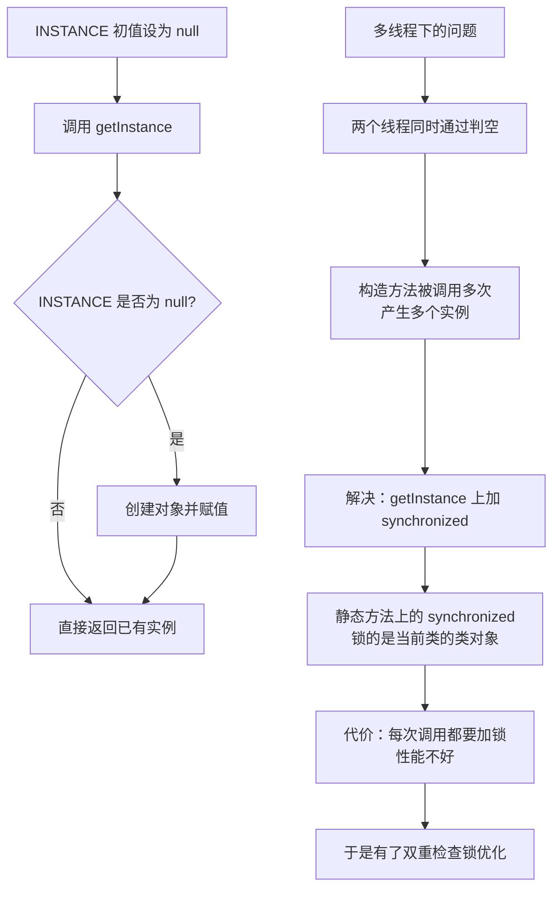

# 单例模式方式三：懒汉式

## 开场

饿汉式不管用不用，类加载时就把对象创建好了。如果对象的构造很重，或者你希望它真正被用到时才创建，就需要懒汉式。方式三是懒汉式最朴素的写法，也是暴露问题最直观的一种：单线程下完全正确，多线程下立刻崩。理解它崩在哪，是理解后面 DCL 和内部类方式的前提。

## 先给结论

懒汉式的思想很简单：一开始 `INSTANCE` 先赋为 `null`，第一次调用 `getInstance` 时判断它是否为 `null`，是 `null` 就创建对象并赋值，之后再来调用时条件不成立，直接返回第一次创建好的实例。

但这样写在多线程下是不安全的：两个线程可能同时通过判空，导致构造方法被调用多次。解决办法是在 `getInstance` 方法上加 `synchronized`，加在静态方法上的 `synchronized` 锁的是当前类的类对象。代价是每次调用都要加锁，性能不好，于是才有了后面的双重检查锁优化。



## 是什么：基本写法

```java
public class Singleton3 implements Serializable {
    private Singleton3() {
        System.out.println("private Singleton3()");
    }

    private static Singleton3 INSTANCE = null;

    public static Singleton3 getInstance() {
        if (INSTANCE == null) {
            INSTANCE = new Singleton3();
        }
        return INSTANCE;
    }

    public static void otherMethod() {
        System.out.println("otherMethod()");
    }
}
```

逻辑就是多了一个判断：第一次调用时 `INSTANCE` 还是 `null`，条件成立，创建对象并赋给 `INSTANCE` 然后返回；第二次调用时 `INSTANCE` 已经有值了，条件不成立，不会重复创建，直接返回第一次创建好的那个实例。

## 为什么：它是真的懒

测试代码里让 `Singleton3` 调用一次 `otherMethod()`、调用两次 `getInstance()`。调用 `otherMethod()` 这个静态方法会触发 `Singleton3` 这个类的加载、链接、初始化，但由于还没有用到 `getInstance`，也就不会触发单例对象的创建。

运行结果印证了这一点：调用 `otherMethod()` 时，单例的构造方法并没有被调用，什么都没发生；只有第一次调用 `getInstance()` 时，才调用到单例的构造，创建出唯一的那个对象。这就是懒汉式的「懒」：类加载不创建对象，第一次使用才创建。

## 深入细节：多线程下为什么不安全

如果这个类要运行在多线程环境下，就必须考虑线程安全。假设没有任何线程安全保护，两个线程都可以调用 `getInstance`，问题就来了：

1. 线程一调用时，`INSTANCE` 还是 `null`（首次调用，还没创建），判空条件成立，它进入 `if` 块；
2. 但它还没来得及把创建好的对象赋给 `INSTANCE` 这个变量；
3. 这时线程二也执行到判空这一步，它看到的 `INSTANCE` 仍然是 `null`，因为赋值还没完成，而且创建加赋值并不是一个一下子就执行完的原子操作；
4. 于是线程二的判空条件也成立，它也进入 `if` 块，也去创建对象。

结果就是单例的构造方法被调用了多次，这个类根本就不算单例了。

## 怎么修：给方法加 synchronized

解决办法很直接：在 `getInstance` 方法上加 `synchronized` 关键字，给这个静态方法加上线程安全的保护。

它的原理是：加在静态方法上的 `synchronized`，本质是给当前类的类对象加锁。线程一运行到这个方法时，发现它是静态方法而且加了 `synchronized`，就会尝试获取 `Singleton3.class` 这个对象的锁；此时没有其他线程持有这把锁，它就拿到了，进入方法内部运行。这时线程二来了，它也要做同样的检查，发现锁已被占用，就只能等在锁对象上，直到线程一执行完释放锁。

加锁之后，同一时刻只有一个线程能进入 `getInstance`，判空、创建、赋值这一串动作变成原子的，构造方法就只会被调用一次。

代价也很明显：哪怕对象早就创建好了，之后每一次调用 `getInstance` 都要加锁解锁，性能损耗白白付出。这正是第四种方式（双重检查锁）要优化的地方。

## 面试怎么答

「写一个懒汉式单例，并说明它有什么问题。」

> 最简单的写法是：`INSTANCE` 初始为 null，`getInstance` 里判断为 null 就 `new` 一个对象再返回。它的问题在多线程下会暴露：线程一判空通过但还没完成赋值时，线程二也判空通过，于是构造方法被调用两次。修法是在 `getInstance` 上加 `synchronized`，加在静态方法上锁的是类对象。缺点是每次调用都要加锁，即使对象已经创建好了也一样，性能不好，所以后来有了双重检查锁，在外面先判一次空，只有没创建时才进入同步块。

追问：「为什么 `otherMethod()` 不会创建单例对象？」

> 因为调用静态方法只会触发外部类的加载、链接、初始化，而单例对象的创建写在 `getInstance` 里，只有调用 `getInstance` 才会执行到。这也说明「类加载」和「创建对象」是两件事，饿汉式把创建放在静态变量初始化里所以类加载时就创建，懒汉式放在方法里所以是第一次调用才创建。

追问：「`synchronized` 加在静态方法和实例方法上有什么区别？」

> 加在静态方法上锁的是当前类的类对象（`Singleton3.class`），加在实例方法上锁的是调用该方法的那个实例对象（`this`）。`getInstance` 是静态方法，所以锁的是类对象。

## 常见误区

- 以为「判空再创建」这样简单的两行代码是原子的。创建加赋值不是原子操作，判空和创建之间存在窗口。
- 以为类加载就会创建单例对象。懒汉式下类加载只做类的加载链接初始化，对象要等第一次调用 `getInstance`。
- 以为加了 `synchronized` 就完美。它解决了正确性，但每次调用都加锁，性能差，需要用 DCL 或内部类方式优化。
- 以为 `synchronized` 加在静态方法上锁的是 `this`。静态方法没有 `this`，锁的是类对象。
- 以为这种写法生产环境完全不能用。它在并发量很低、或者对性能不敏感的场景仍然可用，只是有更好的选择。
