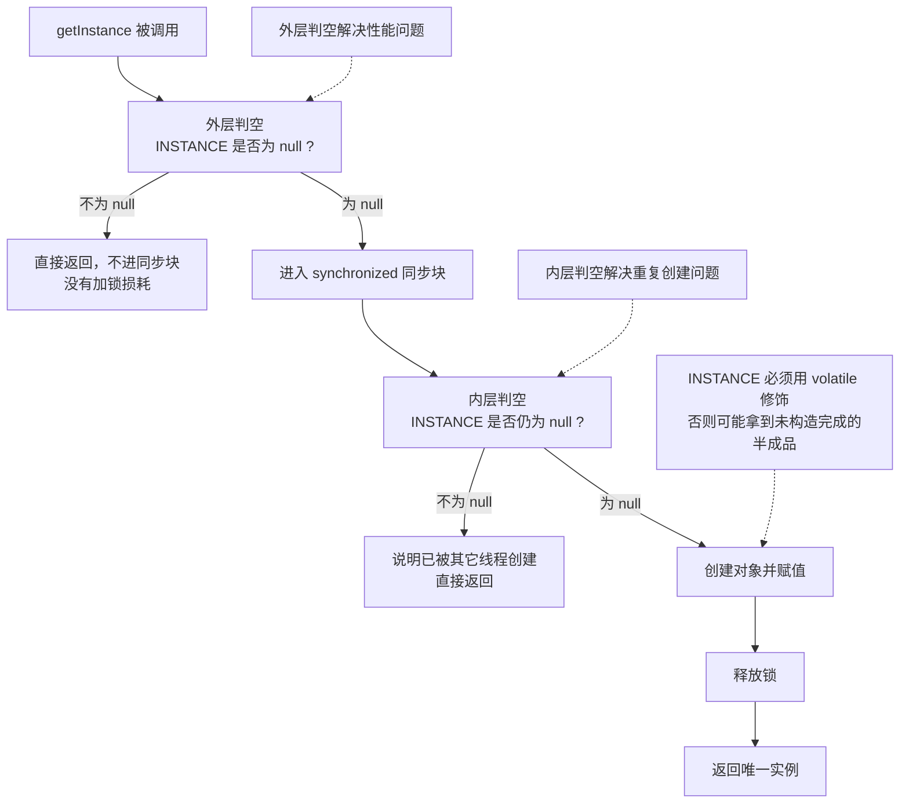

# 单例模式方式四：双重检查锁懒汉式

## 开场

方式三的懒汉式把 `synchronized` 加在整个 `getInstance` 方法上，线程安全是安全了，但每次调用都要加锁，性能太差。第四种方式就是对它的优化：只在真正需要创建对象时才加锁，对象创建好之后直接返回。这就是双重检查锁（Double-Checked Locking，DCL）。

## 先给结论

DCL 的核心结构是在 `synchronized` **外面**加一层判空、在 `synchronized` **里面**再加一层判空：

- 外层判空解决性能问题：对象已经创建好了，后来的线程直接返回，根本不会进入同步块，也就没有加锁的性能损耗；
- 内层判空解决重复创建问题：多个线程在对象还没创建时同时通过了外层判空，抢到锁的线程创建完对象并释放锁后，等待的线程进入同步块，靠内层判空发现对象已经有了，从而不会重复创建。

另外，`INSTANCE` 必须用 `volatile` 修饰，否则指令重排序可能让其他线程拿到未构造完成的半成品对象（这一点单独有一篇详解）。



## 是什么：代码结构

```java
public class Singleton4 implements Serializable {
    private Singleton4() { System.out.println("private Singleton4()"); }
    private static volatile Singleton4 INSTANCE = null;

    public static Singleton4 getInstance() {
        if (INSTANCE == null) { // 段落1
            synchronized (Singleton4.class) { // 段落2
                if (INSTANCE == null) {
                    INSTANCE = new Singleton4();
                }
            }
        }
        return INSTANCE;
    }

    public static void otherMethod() { System.out.println("otherMethod()"); }
}
```

## 为什么：外层那个 if 解决什么

假设 `INSTANCE` 已经创建好了，也就是已经过了最开始的竞争阶段。这时候线程一来了，发现 `INSTANCE` 不为 `null`，直接 `return` 返回；线程二来了也一样，发现不为 `null`，直接返回。它们都不会进入 `synchronized` 块，自然也就不会受到加锁带来的性能损耗。

换句话说：**提前先判断一下，创建好了就直接返回，只有没创建时才用 `synchronized` 去解决创建时的竞争问题**。这就是外层 `if` 的作用。

## 深入细节：内层那个 if 又解决什么

接下来给 `Singleton4.class` 加锁，这是为了防止多线程重复创建对象。但为什么要在这个块里面再加一个 `if` 条件？这正是「双重检查」这个名字的来源：得检查两次。

设想对象还没创建的场景：

1. 刚开始 `INSTANCE` 还没创建好，线程一和线程二都能通过外层那个 `if` 条件，接下来都要去执行同步块，于是它俩竞争这把锁；
2. 假设线程二比较幸运，拿到了 `Singleton4.class` 这把锁，它进入同步块；
3. 线程一竞争锁失败，发现锁已经被占用，只能到锁对象上去等待、挂起；
4. 线程二执行创建对象的操作，给 `INSTANCE` 赋值，然后 `synchronized` 执行完解锁；
5. 线程一获得锁进入同步块，这时它靠内层 `if` 发现对象已经不为 `null` 了（线程二已经创建并赋值），于是跳过创建，不会重复创建对象。

如果没有内层这个检查会怎样？线程二创建完对象、赋值、解锁，线程一获得锁后不管三七二十一，上来还是创建一个新对象，又把后创建的对象赋给 `INSTANCE`，等于重复创建了一次。所以内层检查不能省。

两处 `if` 各司其职：外面那个管性能，里面那个管正确性。

## 验证

```java
public class TestSingleton {
    public static void main(String[] args) throws Exception {
        Singleton4.otherMethod();
        System.out.println(">>>>>>>>>>>>>>>>>>>>>>>>>>>>>>>>>>>>>>>>>>>>>");
        System.out.println(Singleton4.getInstance());
        System.out.println(Singleton4.getInstance());
    }
}
```

调用 `otherMethod()` 不会触发单例对象的创建，因为类的加载和初始化并不会创建对象；只有第一次调用 `getInstance()` 时才创建。后面两次调用打印出来的是同一个对象。

## 面试怎么答

「DCL 单例两处判空分别是干什么的？」

> 外层判空是为了性能：对象一旦创建完成，后续所有线程到这里发现不为 null 就直接返回，不再进入同步块，省掉了加锁解锁的开销。内层判空是为了正确性：对象还没创建时，多个线程可能同时通过外层判空去竞争锁，第一个抢到锁的线程创建完对象并释放锁后，等在锁上的线程进入同步块，如果没有内层判空就会再创建一个新对象覆盖掉原来的，导致重复创建。所以外层管性能，内层管不重复创建。

追问：「`INSTANCE` 为什么要用 `volatile`？」

> 因为 `INSTANCE = new Singleton4()` 在字节码层面是分配空间、调用构造、赋值给静态变量几步，其中调用构造和赋值之间没有因果关系，可能被重排成先赋值再构造。这时另一个线程在外层判空处看到 `INSTANCE` 不为 null，就会直接返回一个成员变量还没初始化的半成品对象。`volatile` 会在写操作后插入内存屏障禁止这个重排序，同时也保证可见性。

追问：「还有没有更简单的懒汉式写法？」

> 有，用静态内部类。把实例放在私有静态内部类的静态变量里，`getInstance` 返回它。外部类初始化不会触发内部类初始化，所以是懒加载；创建过程在内部类的静态代码块里，由 JVM 保证线程安全，不需要自己加锁也不需要 `volatile`，代码还更简洁，是更推荐的做法。

## 常见误区

- 以为外层判空够了，内层是多余的。去掉内层判空会导致重复创建对象，同步块内必须再判一次。
- 以为去掉外层判空也能保持高性能。那就退化成方式三了，每次调用都要加锁。
- 以为同步块保证了全部安全所以不需要 `volatile`。外层判空是在同步块之外读的，那次读没有任何保护，重排序问题正是从这里进来的。
- 以为 `synchronized` 锁的是 `this`。这里 `getInstance` 是静态方法，锁的是 `Singleton4.class` 这个类对象。
- 以为双重检查锁是唯一的高性能懒汉式。内部类方式和枚举方式都能达到同样甚至更好的效果，而且更简单。
