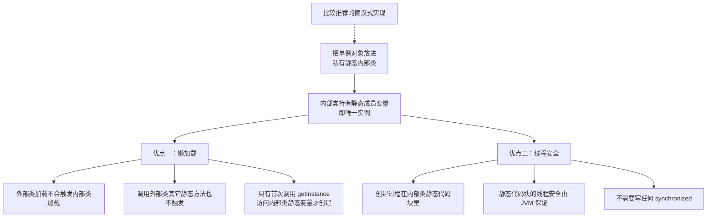

# 单例模式方式五：内部类懒汉式

## 开场

前面讲了两种懒汉式实现：方式三在整个 `getInstance` 方法上加 `synchronized`，方式四把锁的范围缩小成双重检查锁。两者都要自己处理多线程下对象创建的安全问题，方式四还得加 `volatile` 防止指令重排序导致拿到未构造完的对象。有没有一种写法既懒加载、又不用自己操心线程安全？有，就是方式五：内部类懒汉式。

## 先给结论

内部类懒汉式把单例对象的创建放进一个私有的静态内部类里，由内部类的静态成员变量持有实例。它的两个优点同时成立：

- **懒加载**：外部类被加载、甚至外部类的其他静态方法被调用，都不会触发内部类的加载和初始化，只有第一次调用 `getInstance()` 访问内部类的静态变量时才会创建实例；
- **线程安全**：创建过程在内部类的静态代码块里完成，由 JVM 保证线程安全，不需要我们写任何 `synchronized`。

这是比较推荐的懒汉式实现方式。



## 为什么：静态变量赋值天然线程安全

要理解这种方式，先要记住一个结论：**给静态变量赋值的代码，最终会被放进类的静态代码块里执行**，而静态代码块里的线程安全不需要我们考虑，由 JVM 保证其中对象创建和其他代码执行的线程安全。

回头看饿汉式为什么不需要考虑线程安全：它的对象是赋值给静态成员变量创建的，这段代码会进入静态代码块执行，所以不存在多线程重复创建的问题。

```java
public class Singleton1 implements Serializable {
    private Singleton1() {
        if (INSTANCE != null) {
            throw new RuntimeException("单例对象不能重复创建");
        }
    }
    private static final Singleton1 INSTANCE = new Singleton1(); // 饿汉式，类加载时创建

    public static Singleton1 getInstance() { return INSTANCE; }

    public static void otherMethod() { System.out.println("otherMethod()"); }

    public Object readResolve() { return INSTANCE; } // 反序列化时防止创建新实例
}
```

枚举饿汉式同理，枚举变量对应的实际对象最终也是在静态代码块里创建的，线程安全同样不用操心。

既然如此，只要想办法把对象的创建放入静态代码块，它就是线程安全的。这就是方式五的出发点。

## 是什么：代码长什么样

```java
public class Singleton5 implements Serializable {
    private Singleton5() { System.out.println("private Singleton5()"); }

    private static class Holder {
        static Singleton5 INSTANCE = new Singleton5(); // 延迟加载
    }

    public static Singleton5 getInstance() {
        return Holder.INSTANCE;
    }

    public static void otherMethod() {
        System.out.println("otherMethod()");
    }
}
```

结构很清晰：单例类里定义一个私有的静态内部类 `Holder`，在 `Holder` 里创建单例对象并赋给它的静态变量；`getInstance()` 直接返回 `Holder.INSTANCE`。

内部类可以访问外部类的私有成员，包括私有变量和私有构造，所以在内部类里创建外部类的单例对象没有任何障碍。

## 深入细节：懒加载与线程安全是怎么同时成立的

**线程安全**：`Holder` 里给静态变量 `INSTANCE` 赋值的代码，会放在 `Holder` 的静态代码块里执行，由 JVM 保证线程安全，所以对象的创建过程天然是安全的，不需要我们加 `synchronized`，也不需要考虑 `volatile` 和指令重排序。

**懒加载**：`Holder` 是一个内部类，你没有用到它的时候，不会触发这个类的加载、链接、初始化，自然也就不会执行到创建单例对象的那行代码。那什么时候会用到它？放在 `getInstance()` 方法里访问它的静态变量即可：第一次调用 `getInstance()` 时，访问 `Holder.INSTANCE` 触发内部类的加载、链接、初始化，初始化阶段在静态代码块里创建单例对象。

对比一下方式四的写法，就能看出方式五省掉了多少心智负担：

```java
public class Singleton4 implements Serializable {
    private Singleton4() { System.out.println("private Singleton4()"); }
    private static volatile Singleton4 INSTANCE = null; // 可见性，有序性

    public static Singleton4 getInstance() {
        if (INSTANCE == null) {
            synchronized (Singleton4.class) {
                if (INSTANCE == null) {
                    INSTANCE = new Singleton4(); // 创建实例
                }
            }
        }
        return INSTANCE;
    }

    public static void otherMethod() { System.out.println("otherMethod()"); }
}
```

方式四要自己判空两次、加锁、还要用 `volatile` 保证可见性和有序性；方式五把这一切交给了类加载机制。

## 验证：它确实是懒汉式

用测试类验证一下：

```java
import java.io.*;
import java.lang.reflect.Constructor;
import java.lang.reflect.InvocationTargetException;

public class TestSingleton {
    public static void main(String[] args) throws Exception {
        Singleton5.otherMethod();
        System.out.println("================================");
        System.out.println(Singleton5.getInstance());
        System.out.println(Singleton5.getInstance());
    }

    // 反射破坏单例
    // reflection(Singleton3.class);

    // 反序列化破坏单例
    // serializable(Singleton3.getInstance());

    // Unsafe 破坏单例
    private static void unsafe(Class<?> clazz) throws InstantiationException {
        Object o = UnsafeUtils.getUnsafe().allocateInstance(clazz);
        System.out.println("Unsafe 创建实例：" + o);
    }
}
```

运行结果是：调用 `otherMethod()` 时并没有触发单例对象的创建，因为调用外部类的静态方法只会触发外部类的加载、链接、初始化，不会加载内部类；等到第一次调用 `getInstance()` 时，才触发内部类 `Holder` 的初始化，进而创建单例对象。

后面两次 `getInstance()` 打印出来的是同一个对象，说明实例只创建了一次。

## 面试怎么答

「懒汉式单例有哪几种写法？推荐哪种？」

> 常见的有：在 `getInstance` 上直接加 `synchronized` 的懒汉式，性能差；双重检查锁懒汉式，性能好但必须用 `volatile` 修饰实例变量，否则指令重排序可能让别的线程拿到未构造完成的对象；还有一种就是用静态内部类实现。我推荐内部类方式：在单例类里定义一个私有静态内部类，由它的静态成员变量持有实例，`getInstance` 返回这个变量。它既懒加载（外部类的其他方法被调用不会触发内部类初始化，只有第一次调 `getInstance` 才会），又线程安全（创建过程在内部类的静态代码块里，由 JVM 保证），代码还最简单。

追问：「为什么静态变量赋值是线程安全的？」

> 因为给静态变量赋值的代码会被编译器收进类的静态代码块（类初始化方法）里执行，而 JVM 在执行类初始化时会加锁，保证同一个类的初始化只被一个线程执行、且只执行一次，其他线程会阻塞等待。所以创建过程天然线程安全。

追问：「内部类方式能防住反射和反序列化破坏吗？」

> 防不住。反射可以调到私有构造再造一个实例，反序列化也会绕过构造方法生成新对象。反序列化的破法是在单例类里写 `readResolve` 并返回既有实例，就像 `Collections` 里那些空集合类做的那样；反射的破法则要在构造方法里加判断，实例已存在就抛异常。至于 `Unsafe.allocateInstance`，它连构造方法都不走，任何单例写法都拦不住。

## 常见误区

- 以为内部类方式和饿汉式一样是类加载时就创建。外部类初始化不会带动内部类初始化，只有真正访问内部类的静态成员才会。
- 以为调用外部类的任意静态方法都会创建实例。调用 `otherMethod()` 不会，这是一个很好的验证点。
- 以为不加 `volatile` 就有重排序风险。内部类方式的创建发生在类初始化阶段，由 JVM 保证，不需要 `volatile`。
- 以为用了内部类方式就万事大吉。反射、反序列化、`Unsafe` 这三条破坏路径依然存在，需要额外防御。
- 把 `Holder` 写成非静态内部类。必须是 `static` 的，否则每个内部类实例都依附于一个外部类实例，就谈不上单例了。
