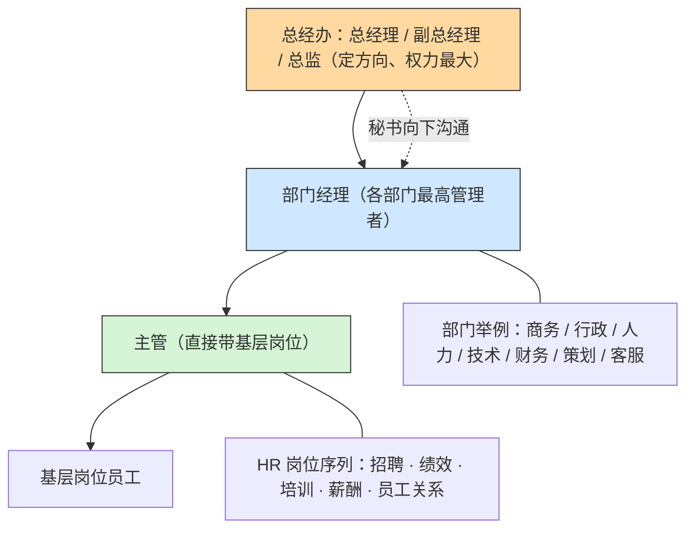
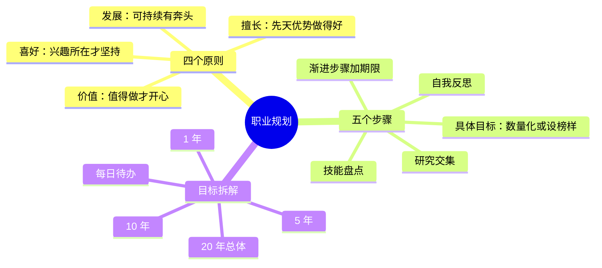

# 工作篇：公司架构、职业规划与行业选择

刚拿到 offer，脑子里冒出来的问题往往特别具体：进公司之后我归谁管，遇到事该找谁？这份工作能做多久，三年之后往哪儿走？互联网现在还值不值得进，我到底挑哪个岗位？这几个问题看着零散，其实说的是同一件事，先看清公司的结构，再想清楚自己要站的位置。这篇就按公司架构、职业规划、行业与岗位选择三块往下聊。

> **读前须知**：这是「求职到入职」系列的第一篇。如果你刚接触职场，还不清楚公司里都有哪些岗位、技术人未来能往哪走，先读这篇打底；读完顺着看市场篇、简历篇、面试篇，整套就是从「了解行业」到「拿到 offer 入职」的完整路径。

## 先给结论

- 公司架构基本是三层：总经办定方向，部门经理管部门，主管带基层员工。有问题找直接领导，跨级去找部门经理是大忌。
- 职业规划的目的不只是帮一个人按资历和条件找到一份工作，更重要的是真正了解自己，定下事业大计，在权衡外部环境和自身条件之后，设计出合理可行的方向。
- 设定目标看四个原则：喜好、擅长、价值、发展。四个都占，目标才站得住脚。
- 制定规划分五步：自我反思、技能盘点、研究与目标的交集、定渐进步骤、设最后期限。
- 目标要么数量化，要么找个榜样当参照，再往 10 年、5 年、1 年拆，一直拆到每天早上的待办事项。
- 大学生求职关注最多的还是 IT/互联网行业，占比 25.72%；IT 岗位里 Java 工程师需求最高，占 25.5%。

## 公司架构图：三层结构和汇报关系

下面这张图把上面说的三层结构和汇报关系画出来，先看图再往下读：

**第一，为什么要先讲架构。** 大部分准备入行的人没有工作经验，也没有互联网行业的从业背景，对一家公司的组织架构基本没概念。上班之前先把这张图看明白，能省掉很多不必要的困惑。

**第二，最上面一层是总经办。** 总经办指的是公司最高职级那批人的职称，通常是总经理、副总经理或者总监，公司决定性的权力在他们手上，权力最大，能力也最大。也有的公司不叫总经理，一些大型公司集团会分总裁、董事长之类的叫法，职称名称不一样，性质其实差不多。总经办通过秘书向下属各部门的负责人直接沟通。

**第三，中间一层是各个部门。** 商务部、行政部、人力资源部、技术部、财务部、策划部、客服部，每个部门都有部门的最高管理者，也就是各自的部门经理：商务部经理、行政部经理、人力资源部经理、技术部经理，以此类推。

**第四，经理下面是主管，主管直接管理本部门的基层岗位员工。** 具体到每个部门，岗位差别不小。商务部有商务顾问、商务助理；行政部有行政专员和采购专员；人力资源部分得比较细，因为工作性质就摆在那儿，分成了招聘专员、绩效专员、培训专员、薪酬专员，还有员工关系专员。

技术部在这张图上写的不太多，只有 SEO（搜索引擎优化）专员、PHP（一门做网站后台的脚本语言）专员，PHP 就是后台，另外还有网站编辑和网页设计。以一家规模较大的技术型公司为例，技术部的构成往往会更全面，有产品、有 UI、有前端、有后端，还有测试和运营，因为不少平台都是自研的，团队规模也更大。

再往后看，财务部有财务、会计、出纳；策划部有活动策划员，还有高级会议主持、市场督导这类岗位。公司性质不一样，有些岗位在有的公司是没有的。客服部则一般是在线专员和 400 专员客服。

**第五，这套结构怎么用。** 上面这个是绝大多数公司的组织脉络，可以参考。真上班了有问题，找你的直接领导沟通就行。假如你是一名后端开发的程序员，工作上的问题解决不了、事情不好处理，找你的部门主管就对了，不能越级去找技术部的经理。这个道理进职场之后一定要明白。

## 为什么要做职业规划

职业生涯设计的目的，绝不只是帮助一个人按照自己的资历、条件找到一份工作，达到和实现个人目标。更重要的是帮助个人真正了解自己，为自己定下事业大计，筹划未来，进一步详尽估量主观客观条件、内外环境的优势和限制，在衡外情、量己力的情形下，设计出符合自己特点的、合理而又可行的职业生涯发展方向。

具体拆开看是三个点。

**第一，认识你自己，搞清楚你想要什么。** 你现在从事这份工作，是为了解决当前的经济状况，还是为了买房买车、在大城市扎根立足，或者是为了实现自身的自我价值和自我目标。你要的是什么，这个必须先想明白。

**第二，设定目标。** 好的目标直接决定你的具体路径。目标一旦设定好，落实目标的措施就有了，接下来只要按制定好的方式方法一一执行，过程是好的，结果肯定不会太坏。

**第三，贯彻执行。** 严格按照自己制定的方法去执行，中间不要因为任何问题就停下来，今天不太舒服就不想学了，明天心情不好也不想学了，这样下去肯定不行。

## 设定目标的四个原则

**第一，喜好原则，一定要是你的兴趣所在。** 只有是你喜欢的事情，碰到强大对手的时候你仍然会坚持，遇到极其困难的情况也不会轻易放弃，有巨大诱惑的时候你也不会动摇。只要是自己喜欢的，那就是你所坚持的。

**第二，擅长原则，做你擅长的事情才有能力把它做好。** 同样一件事情，别人不擅长而我擅长，先天的优势就摆在那儿，我肯定比别人做得好。花同样的时间，别人做出来的活不一定有我的漂亮。

**第三，价值原则。** 你认为这件事足够重要、值得你去做，你才会去做。否则再有能耐，事情做得再好，你也不会特别开心，因为它没有价值。

**第四，发展原则。** 你所做的事情要在现在乃至未来都具有可持续发展性。首先你得有机会去做这样的事情，有机会做了，还得有足够大的市场、足够大的成长空间，这样职业才有奔头。不能说同一个岗位做了两年、三年就摸到天花板了，那图什么呢。

## 制定规划的五个步骤

**第一，问自己什么会让你感到满足、使你快乐。** 自我反思需要你去面对自己的梦想、恐惧、局限性，以及对他人的义务。

第二，确定你精通哪些技能，并思考这些技能在团队当中或者其他地方还能不能应用得上。
**第三，研究哪些领域与你的目标产生交集。** 举个例子，你现在要做后端开发，那最好对前端的知识有一定了解，知道前后端是怎么交互的，这就是与你目标产生交集的地方。

**第四，确定渐进的步骤，以及完成目标所设定的最后期限。** 步骤制定好了，目标也有了，完成期限最好也有。一件事决定要做却没有期限，既没有成果，也没有东西约束你，那它不一定能做得好。

**第五，制定具体的目标。** 具体怎么定，有两个好用的办法。

一个办法是数量化。抽象地描述你想达到什么状态很难，那就把目标数量化：我要开三家公司，我要写五本书，我要挣到一千万，这些都属于数量化的目标。另一个办法是设立榜样。比如你想成为一名企业家，可以先找一个同类型的企业家当参照，比如马云，如果你的收入、家庭与事业的平衡、休闲时间、待人接物的状态都和马云一样，那你就成功了。这就是一个非常具体的职业目标参照体系。

## 职业规划一图流（四原则 + 五步骤）

把前面讲的目标设定原则和规划步骤合到一张图里，方便记忆：

## 目标怎么拆到每一天

先定总体目标，比如 20 年之后你应该达到一个什么样的状态。有了总体目标之后，第二步就是分解：10 年后要达到什么标准，5 年后要达到什么状态，1 年后要达到什么情况。

分解到这里还不算完，还要继续细化，大目标分成小目标，小目标再往更小的目标拆，细化、细化、再细化，一直细到每天早上起来之后的待办事项。

这里有个判断标准：待办事项一定是不能再分解的。你说今天要解决一个找工作的问题，那就不是待办事项，那是一周或者一个月之内的短期目标。今天投了 10 份简历，打了 10 通电话，认识 10 个老板，增加找工作的机会，这才叫待办事项。

拆到这个粒度有个明显的好处，你每天都会专注去做这些事，不会有焦虑的心理。而且每天只要把这些事做完，就意味着即使事情重新再来一遍，你也不会做得更好，于是你就能坦然接受结果，把目光集中在事情本身。还是那句话，过程做得足够好，结果肯定不会太差。

## 行业分类：从业者都往哪儿投简历

先看这张大学生求职关注行业的排行图，数据来自拉勾网，横向柱状图。

IT/互联网行业占比最高，25.72%。金融行业位居第 2，15.86%。其次是通信行业，9.59%。然后是制造行业，8.09%。往后再看是文化传媒、专业服务、教育、房地产、消费、能源、物流、生物医药、交通、汽车、零售，占比依次递减。

把互联网行业和排在后面的汽车、零售行业放在一起比，绝大多数人都会选互联网。不只是现在的大学生，很多已经工作但不在这一行、不在这一岗位的人，也会把目光聚焦到这里，因为 IT 发展确实太迅猛了，眼光不得不往这边聚。

## 岗位分类：IT 里挑哪个方向

大趋势选定互联网、IT 行业之后，接下来就是岗位。这张图是一线城市、新一线城市对互联网岗位的需求量，数据同样来自拉勾网。

Java 工程师排在第 1，占 25.5%。随后是 Web 前端，然后是测试、IT 技术支持，再到 C++、运维、算法，还有数据分析师、安卓工程师。

这些岗位的占比会随城市变化。一线城市、二线城市可能后端开发居多，有些做实业的城市测试工程师会比较多，还有做大型机器的城市对运维的需求会更大。所以选行业的时候这张图可以当参考，具体情况还是要按你当地的情况来划分。

总的来看，这些岗位都是当前比较热门的。另外，随着疫情开始，近些年短视频新媒体行业发展迅猛，图里虽然没有写到，但可以看网上的相关数据，新媒体的招聘人数也比较多；图里没写到的产品岗同样可以考虑。

一句话概括，IT 行业里跟开发相关、跟技术相关、跟互联网相关的岗位，选下来大体上不会错。剩下的就看你自己的情况了。

有一定基础、大学专业学的是计算机，可以选 Java、后端、C++，或者人工智能、算法这些方向。没有相关工作经验的，选一个简单好入门、好就业的方向，运维、测试、前端都比较符合个人情况。还有人说我不太喜欢写代码，更偏向其他岗位，那就可以选设计类岗位，或者产品、新媒体，都是可以的。

各种不同的岗位各有各的优势，你根据自身情况衡量一下，再选自己喜欢的那个岗位。还是那句话，一定要选兴趣所在，你喜欢这个行业，它才真的足以支撑你走得更久、更远。

## 常见误区

- **误区一**：有问题越级找部门经理。入职前没理清汇报关系，小事直接捅到经理那儿，主管和经理都会尴尬。
- **误区二**：目标定了却不设期限。没有期限就没有成果，也没有东西约束你，事情很难做得好。
- **误区三**：把「今天解决找工作的问题」当成待办事项。它是一周或一个月的短期目标，真正的待办事项是投几份简历、打几通电话这种不可再拆的动作。
- **误区四**：只看行业热度，不看自己的兴趣和擅长。热度决定的是入口宽不宽，能不能走得远，还是看喜好原则和发展原则。

## 要点回顾

- 公司架构多为三层：总经办定方向、部门经理管部门、主管带基层；有事找直接领导，避免越级汇报。
- 职业规划的核心是认识自己，目标遵循「喜好、擅长、价值、发展」四原则，按五步法落地并拆到每日待办。
- IT/互联网仍是求职者关注最高的行业，Java 工程师在 IT 岗位中需求居前；选方向时兼顾兴趣与擅长。
- 常见误区：越级汇报、目标不设期限、把短期目标当待办、只看热度不看自身匹配。
