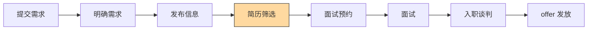
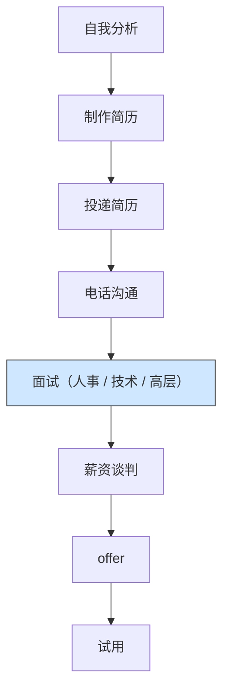

# 简历怎么写：从企业招聘流程倒推出来的简历制作要点

简历改了好几版，投出去还是没回音，这是投简历时最常见的一种卡壳。问题多半不在你写得不够多，而在你不知道对面那个人是怎么看简历的。HR（人力资源，也就是看你简历的那位招聘负责人）一天过手上千份简历，早就养成了固定的阅读习惯和筛选方法，你的简历如果不能在很短时间内把关键信息递到他眼前，后面写得再认真也白搭。这篇文章顺着企业的招聘流程往下推，讲清楚一份简历到底该包含什么、每一块怎么写。

> **读前须知**：前面的工作篇、市场篇帮你认清行业和岗位，这一篇开始进入「动手求职」环节。它从企业 HR 怎么筛简历倒推，告诉你简历每一块该怎么写。下一篇讲怎么把简历投出去才有人看。

## 先给结论

- 招聘帖子上的信息就五个块：岗位名称、薪资待遇、职位描述、岗位要求、企业基本信息，简历要对着这些字段去写。
- 企业招聘流程大体是：提交需求、明确需求、发布信息、简历筛选、面试预约、面试、入职谈判、offer 发放。
- 求职这一侧的流程是：自我分析、制作简历、投递简历、电话沟通、面试、薪资谈判、offer、试用。
- 一份完整简历包含：个人信息、求职意向、教育经历、工作经历、项目经历、在校经历、自我评价。
- 好简历的核心模块是基本信息、专业技能、工作经验、项目经验、教育经历、自我评价，其中项目经历里的责任描述和框架是重点。
- 项目经历要倒序排列，工作内容要具体化、量化；简历格式自己统一，导出成 PDF 再投。

## 招聘信息是怎么来的

企业招聘流程大体是八个模块，按顺序画成下图，先建立整体印象：

**第一，先看帖子长什么样。** 日常在招聘网站上看到的帖子，大概就包含岗位名称、薪资待遇、职位描述、岗位要求以及企业基本信息这几类需求。以一份真实的招聘页面为例，标题写着「Java开发工程师（可应届 12-24K）」。

**第二，这些需求从哪儿来。** 用人部门向人事部门提交需求，用人部门的人最清楚自己要什么样的人。

**第三，需求里包含什么。** 第一部分是岗位职责，也就是招这个人进来做什么工作；第二部分是任职要求，招这个人应该具备什么样的素质、什么样的技能；第三部分是薪资待遇；最后是一些其他需求，有的是年龄要求，有的是学历要求，有的是工作经验要求。比如现在一些互联网企业招实习生的时候，反而更偏向于当前还没有工作经验、还在学校里的学生。投递的时候多留意这些信息，对精准投递有很大帮助。

**第四，信息发到哪儿。** 主要是发布到网络招聘渠道上，目前最常用的是 BOSS 直聘和拉勾，当然还有公司官网、公司内网等等。

**第五，招聘流程的八个模块。** 提交需求、明确需求、发布信息、简历筛选、面试预约、面试、入职谈判、offer 发放。示例里的流程图把前四步单独拎了出来：提交需求、明确需求、发布招聘信息、简历筛选。

**第六，简历筛选这一关。** HR 已经经过了千分万分简历的洗礼，养成了固定的阅读习惯和筛选方法。所以做简历、投简历的时候一定要照顾到他们筛选的方法，这样才更有可能得到一个高效的反馈。

**第七，面试预约和面试。** 预约的时候尽量合理安排时间。面试之前一定要先了解好公司的需求，这个岗位大概需要什么样的技术点、应该具备哪些素质和因素，再有就是刷题准备，这样面试的时候才能从容面对面试官提出的问题。面试结束之后一定要总结。

**第八，入职沟通和 offer。** 入职沟通谈的是试用期时长、薪资这些内容，这个阶段有时候还会要求提供背调信息。谈判的时候尽量给对方传递出好的印象度，如果觉得这家公司还不错，一定要先把握住这次机会。offer 发下来之后还有审批流程，每个公司都有自己的一套，大厂尤其如此：有的时间比较短，一个星期内就走完了，有的企业要求比较长，可能需要一周多两周。面试官跟你说「这边已经通过了，但是我们需要走一个流程」的时候不要怀疑，通过了就是通过了，走流程确实是存在的程序。

## 求职流程：自我分析到 offer

求职这一侧的流程画成下图，每一步都对应后面要展开的内容：

求职流程主要也是分几步走：自我分析、制作简历、投递简历、电话沟通面试、薪资谈判、offer、试用。

**第一，自我分析分横向对比和纵向对比。** 横向对比是分析现在市场的需求，看大概需要什么样的学历、什么样的专业、年龄大概是什么范围，技术要求有哪些，工作年限有哪些。纵向对比是看自身的情况，你的年龄、学历、工作经验在整个市场当中占的是什么样的位置，对应的薪资范围或者工作内容大概是什么样的。这两方面合起来做求职定位：找一个什么样的岗位，在哪个城市找，期望薪资大概是多少，意向企业是哪些，以及意向企业应该具备什么样的规模、什么样的技术要求、什么样的薪资等等。

**第二，制作简历。** 一份完整的简历应该包含个人信息、求职意向、教育经历、工作经历、项目经历、在校经历和自我评价，下面会逐块展开讲。

**第三，投递简历的渠道。** 主要是网络投递、邮箱投递和内推，再有就是招聘会。网络投递走的是公司官网、公司自己的招聘入口或者其他招聘网站，也有通过公众号、小程序投递的；邮箱投递是自己通过一些渠道获取到招聘信息，再发邮件过去；内推是公司内部的员工帮忙推荐，成功的几率可能更大一些。

**第四，电话沟通都聊什么。** 首先是工作经历的确认，会问一下你的基本信息，然后就是技术摸底。一些比较讲究的企业会对候选人做简单的技术提问，来确认你跟岗位是否匹配，从而提高预约面试的效率。预约的时间可以跟 HR 那边协调，不一定非得是对方定的那个具体时间，比如对方说今天下午两点，还是可以商量着来的，按自己的情况合理安排就行。另外一定要注意自己接电话时的态度。

**第五，面试分人事面试、技术面试和高层面试。** 人事面试主要了解基本情况、求职的原因，还有你的专业能力，面试之前可以根据这些需求来梳理，之前没有过相关工作经历的，准备的时候要更细致、更充分一些。技术面试更多是围绕项目展开，项目开发过程当中经常用到的技术栈、实现原理、实现的方式方法都要搞清楚。两三轮面试都过了，可能就进入高层面试环节，高层面试也看技术，但技术不是最重要的，更看重的是你的印象度、价值观是否正确，再有就是高层个人的喜好，跟高层面试的时候尽量保持积极正能量的态度就可以。面试的时候还要注意保持整体的形象，不要邋里邋遢，态度要正能量，带上一份甚至两份三份纸质简历，注重基本礼仪。

**第六，薪资谈判。** 每个公司都有自己固定的薪资构成，谈判之前可以先了解一下这家公司的构成大概是什么样的，再了解一下调薪的机制：是一年一次，还是一年两次，还是没有固定的机制。正常情况下每个公司每年都会有一到两次调薪机制，可以关注一下。报期望薪资的时候一定要往上多报 10%，给 HR 留出压价的空间。也可以用对比的方式来溢价：横向对比是看同样的工作经验在市场当中定位是什么样的、薪资是什么样的；纵向对比是看自己之前的薪资情况，比如在上家单位已经拿到了 10K，现在期望有 10% 到 20% 的上浮空间，那期望薪资就应该报在 12K 左右。当然如果人家给的已经是比较理想的薪资，那基本上就可以接受了，这些技巧是在对方给的不在你期望区间时用来沟通的。

**第七，offer 和入职准备。** offer 发放一般会有一些流程，通常是三到五天，有的公司会有一周左右，耐心等待就行，这很正常。离职证明、学历证明、流水，以及背调需要了解的一些情况，可以根据自己的情况来准备。拿到 offer 之后如果不知道怎么操作，一定要联系就业指导（职业顾问）。

## 一份好简历该有的模块

一份好的简历应该具备这些模块：基本信息、专业技能、工作经验、项目经验、教育经历以及自我评价。下面就按这个顺序逐块说。

## 基本信息

**第一，字段按自己的情况来写。** 姓名、性别、年龄、学历、电话、邮箱、所在地、工作年限、期望职位、期望薪资等等，都可以列上。

**第二，电话和邮箱一定要写对。** 邮箱尽量不要选 QQ 邮箱，可以选择像 163、网易邮箱或者其他的一些邮箱。

**第三，薪资建议写面议。** 如果已经有了一个具体的期望值，也可以根据自己的情况来写。

**第四，可以贴照片。** 形象不错的话，建议贴一张证件照或者职业照。

## 专业技能

**第一，除了写基本技能，还要写掌握情况。** 光列技能名字不够，尽量把你对这个技能的掌握程度也做一个对应的描述。

**第二，写的时候遵循一个顺序：熟练掌握、熟悉、了解。** 之前也见过有求职者根据不同的开发环境或者开发的模块来梳理，我觉得也挺好，只要逻辑清晰、简洁简略、方便 HR 筛选，都可以。写技能点的时候，建议你一般写一到三点，把自己的技术学习能力、年龄这些因素综合起来判断一下。

## 工作经历

工作经历一定要包含在职时间、公司名称、在职岗位这几部分。如果能再写一些在公司的基本工作情况、业务情况或者业绩情况，那是再好不过的。

## 项目经历

**第一，四个要素缺一不可。** 项目要有具体的项目名称、项目简介、责任描述（也就是工作内容），还有项目框架和开发环境，这些按自己的项目情况来写。

**第二，责任描述和框架是重点。** 面试官会根据你的项目经历来做技术方面的提问，所以写项目的时候一定要对自己的项目有足够的了解，面试时才能从容应对。

**第三，尽量采用倒序。** 有多个项目的话，把最近的或者最熟练的项目放在最上面。

**第四，工作内容要具体化、量化。** 写项目的时候一定要写得具体，能量化就量化，把自己做过的事情用数字和结果摆出来。

## 教育经历与在校经历

**第一，基本包含四项。** 在校时间、大学的名字、学位、专业。资料里给的示例是硕士（2013-2016）和本科（2009-2013）两段教育背景，格式上写清楚时间、学校和专业就行。

**第二，可以酌情添加在校经历。** 如果你的大学不错，或者大学时的成绩还可以，可以加一些在校的经历，比如学过哪些跟求职岗位相关的课程，参加过哪些比赛，拿过哪些奖学金，这些奖项都可以在这里梳理一下。

**第三，体现最高学历就够了。** 高中以下的学历，建议不写或者直接忽略。

## 自我评价

**第一，不要写浮夸的话。** 尽量写得客观一些，比如之前从事过什么样的工作，能够承担什么样的工作内容或者什么样的角色。

**第二，列出自己身上的几个优点，并且结合工作来写。** 一定要简洁，不要跟前面重复。

## 格式、照片和联系方式

**第一，格式一定要自己统一。** 尽量把简历改成 PDF。为什么要改成 PDF 呢，因为投递简历一般是通过邮箱或者其他渠道，转过去之后 HR 那边的 Word 版本跟你这边不一样的话就会出现乱码，PDF 可以避免这种情况。

**第二，联系方式再核对一遍。** 这是最后也是最重要的一点。假如电话没留好，或者邮箱没留好，HR 筛选简历的时候即使你这边通过了，也不好联系你。

## 常见误区

- **误区一**：项目经历写得又虚又长，没有具体化和量化。面试官是按项目提问的，写得越具体，你越好答。
- **误区二**：薪资一栏把数字写死。没有明确期望值的时候写面议，把谈判留到谈薪环节，往上多报 10% 才有余地。
- **误区三**：用 QQ 邮箱投简历，或者电话邮箱写错一位。联系方式出错，前面写得再好也接不到面试通知。
- **误区四**：求职之前不做自我分析。没有精准的定位，投出去的量再大也是碰运气。
- **误区五**：面试之前不刷题、不梳理项目。技术面试基本围着项目展开，临时想是想不起来的。

## 要点回顾

- 简历要对应招聘帖子的五个字段来写，核心模块为基本信息、专业技能、工作经验、项目经验、教育经历、自我评价。
- 项目经历倒序排列，责任描述与框架是重点，工作内容要具体、可量化；技能按「熟练掌握 / 熟悉 / 了解」分层。
- 导出 PDF 避免乱码，联系方式务必核对；薪资无明确预期时写「面议」，谈薪时往上多报 10% 留空间。
- 投递前先做自我分析，精准定位岗位、城市、期望薪资与意向企业。
