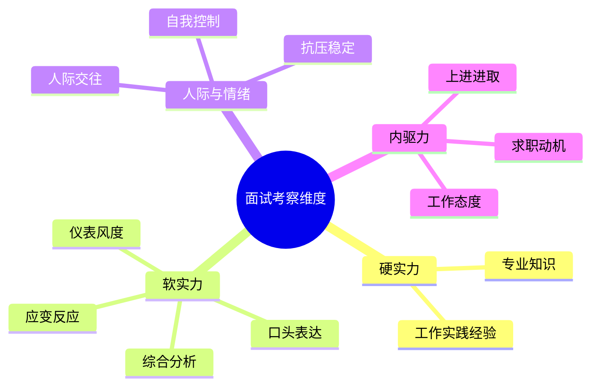
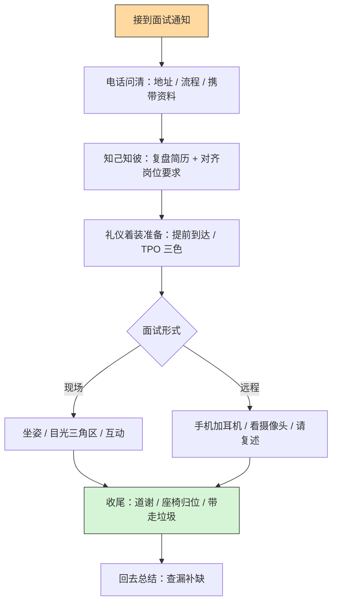

# 面试技巧：从接到通知到走出会议室，中间这些环节怎么准备

> 面试不是考试，而是一场双向选择：你在评估岗位与团队，对方在评估你的能力与匹配度。技术实力决定你能不能被录用，但流程、礼仪、心态这些「软实力」往往决定你能否把实力完整地展示出来。这一篇沿着「接到通知 → 知己知彼 → 礼仪着装 → 现场/远程面试 → 收尾复盘」这条线，把流程里容易踩坑的环节讲清楚，帮你在有限的时间里把最好的一面呈现给面试官。

> **读前须知**：面试分两篇，这一篇先讲「流程、礼仪、心态」这些软实力：技术再强，展示不出来也白搭。把流程和礼仪吃透后，下一篇（面试篇 2）再攻技术面的原理题。两篇配合，面试才稳。

## 先给结论

- 接到面试邀约电话时，把面试地址、面试流程、需要携带的资料一次问清楚。
- 面试前最要紧的是知己知彼：先看清自己的强项和弱项，再去看公司和岗位要什么。
- 礼仪上提前到达只是底线，路上可能出状况的时间要另外预留，宁可多等，不要迟到。
- 着装遵循 TPO（时间 Time / 地点 Place / 场合 Occasion）原则和三色原则，干净得体比突出个性重要。
- 远程面试优先用手机加耳机，没听清要有礼貌地请面试官复述一次。
- 面试六大禁忌：忌不守时、忌举止不当、忌毫无互动、忌言语离题、忌提幼稚问题、忌自惭形秽。
- 面试结束要道谢、座椅归位、把纸杯和垃圾带走，回去之后再做一次总结，查漏补缺。

## 面试官到底在考察什么

面试官手里的评估维度大致分四类。准备时对着这几块补自己的弱项，比临场发挥管用：

除了专业知识和工作实践经验，仪表风度、口头表达能力、综合分析能力、反应能力与应变能力都在考察范围内；人际交往能力、自我控制能力、抗压能力与情绪稳定性属于同一类，看的是你在压力下的稳定程度；工作态度、上进心与进取心、求职动机，则是判断你能不能长期干下去。

面试官不是在等一个标准答案，而是在十几分钟里尽可能确认你和这个岗位的匹配度。

## 接到通知：先问清三件事

把「接到通知到收尾」整条线画出来，每一步都对应后面要展开的内容：

简历投出去之后争取到了面试邀约，接下来要做的就是在电话沟通里尽可能多地获取你需要的信息。面试地址、面试流程、面试需要携带的东西和资料，这些都要在电话里问明白。

提前了解这些信息，既是给面试当天省事，也是给自己心里留个底：你知道要去哪、要见谁、要带什么，现场就不会慌。

## 知己：先看清自己的定位

先说「知己」。观察身边找工作的开发者，有一类人求职最吃力：对自己不了解、对职业定位不准确。比如技术基础还很薄弱，却执着要投核心开发岗；沟通表达偏弱，却硬要去面需要大量对接客户的技术支持；手上没有拿得出手的项目经验，却对薪资预期过高。还有一类，连自己练手的项目都没做完，就匆匆去面试，这也并不可取。

更稳妥的顺序是：先把基本功打扎实、能独立完成像样的项目，再带着真实的能力去面相应的岗位，胜算才大。正式求职前，先看清自己的强项和弱项，而不是看别人投什么就跟着投。

## 面试礼仪与着装

### 礼仪七条

**第一，提前到达只是底线。** 这里写的是提前 10 分钟，但现实里光留 10 分钟往往不够。很多大厦下车之后不好找，尽管现在都有导航，位置还是很隐蔽。所以一定要比「提前 10 分钟」更早到达，把路上可能发生的情况预留出时间。有人对面试非常认真，每次面试前会提前一天去探路，这样保证面试当天绝对不会迟到。

**第二，复习你的简历表和准备的应答。** 很久之前做的工作，具体时间、工作内容等等都记不太清了，而简历上又写得很精准。如果面试官问到相关问题，你的回答和简历有偏差，可能引起误会。所以要把简历过一遍，把应答准备好。

**第三，检查自己的仪表。** 检查一下仪表是否得体，去面试的前一天就应该把面试当天要穿的服装准备好。

第四，用职业的方式向接待人员通报自己的到来。
第五，握手时也要根据具体情况和本人的性格特点去做。
第六，对于初入职场的开发者，建议鞠躬致意即可。
**第七，微笑并示意面试官。** 第一印象非常重要，面部表情包括微笑，都属于第一印象的一部分。

### 女生怎么穿

说到第一印象，服装也是其中一块。女生着装注意几点：

**第一，以简单大方为主。** 颜色以中性为主，避免夸张。有人穿着破洞裤去面试设计岗，觉得这样显得自己有个性。虽然做 IT 的不像金融、房地产那些行业对职业装有硬性要求，但也要得体。像露背装、迷你裙这类，不适合在面试时穿，甚至不适合职场。

**第二，不建议穿又长又高的高跟鞋。** 毕竟不是靠外表去争取岗位。

**第三，配饰适合简洁高雅。** 饰品不在多，耳饰尽量精简。

第四，可以化个淡妆，切记浓妆艳抹。
### 男生怎么穿

男生着装不一定是西装革履，但一定要干净整洁、落落大方，第一印象非常重要。

**第一，不建议戴首饰。** 有的男士喜欢戴首饰，觉得自己很有范儿，但面试时建议摘掉。

第二，不要留胡须。
**第三，夏天一定要勤洗澡，避免出汗带来太多异味。** 有些男士夏天容易忽略这一点。夏天容易出汗，时间一长就会有异味，所以每天一定要勤洗澡。

**第四，建议带一包口香糖，但面试的时候不要吃。** 面试时如果咀嚼口香糖，可能会让面试官觉得你有点轻浮。

**第五，面试之前不要抽烟。** 曾有案例，有人烟瘾太大，面试前刚扔掉烟头，结果面试官是位女性，办公室里也大多是女同事，最后以烟味太大为由没有通过。

**第六，建议带个包，把重要的资料放在包里面。** 这样简历从包里拿出来时纸张还是平整的；不带包的话，简历随手一放很可能就变得褶皱，观感不好。

### TPO 原则与三色原则

不少求职者没听过 TPO，其实它挺重要。TPO 是三个单词的首字母，说的是穿着要在时间（Time）、地点（Place）、场合（Occasion）上适宜为好。举个朴素的例子，去参加葬礼肯定不能穿红色的衣服，道理是一样的。服饰上的搭配，展现的是你对这次面试的尊重。

具体来说，衣服要干净整洁自然，发型要简单朴素大方，不要涂腮红，男士一定要注意身上的异味，尽量穿深色的袜子，对鞋也要重视一下。

再就是三色原则。从头到脚，身上的穿着颜色不要太多，尽量不要穿得太花哨。

## 心态与沟通

除了整理好仪容仪表，面对不同的面试官保持良好的心态同样重要。

有的面试官问问题非常直接，说话比较直率，不要因此产生逆反心理，要以一种宽容平和的心态去面对。有的面试官比较温和、非常友好，这个时候也不要因此麻痹大意，防止遇到「笑面虎」一类的人。

沟通的时候不要自惭形秽，也不要自暴自弃。面试本身是双方互相选择的过程，你同样可以选择对方，也可以不选择对方，它只是了解彼此的一种形式。

## 远程面试与现场面试

### 远程面试

近年来，远程面试愈发普及，被大量企业接受。远程面试可能是电话面试，也可能是视频面试。和现场面试相比，远程面试不会那么紧张，但需要注意的点不少。

**第一，处理好面试背景。** 有人当天正在外面，很可能在非常嘈杂的环境里和面试官约了面试，对方很可能听不清楚，甚至会影响面试结果。

**第二，眼睛要直视对方。** 不能因为是视频面试，就觉得反正看着电脑就行。对方同样在注意你的面部表情和各种表现方式。目光游移不定，会影响面试官对你的信赖。

**第三，没听清楚要有礼貌地请面试官复述一次。** 视频设备、信号等原因会让视频品质参差不齐，问题没听清就请对方再说一遍，不要硬答。

**第四，远程面试建议用手机。** 从很多远程面试的反馈看，手机的音效和沟通流畅度要比电脑好一些。同时提前准备好用耳机接听，耳机本身有降噪功能。如果网络不太好，尽量调整为用手机流量，毕竟面试可能也就几分钟、十几分钟，流量用不了太多。

### 现场面试

现场面试是人和人面对面地交流，需要注意的地方会更多一点。

首先要放松自己、表现自然，避免紧张状态。其次要集中注意力，耳到眼到，听清面试官每一个人的问题。和面试官说话的时候眼神要平视，同时注视对方面部的三角区域，也就是两个眼睛和嘴巴之间的这块区域。注视这个区域是有讲究的，目光会更柔和一些，不会显得特别凌厉，给面试官的感觉更好。

同时坐姿也要非常注意，尽量不要翘二郎腿。面试结束时还有几个小细节：座椅归位，把自己产生的垃圾带走，包括纸杯之类，这属于素质层面的问题，该注意的还是要注意。

## 六大禁忌

回答问题不要太过于单一，要正确、积极地与面试官互动交流，保持微笑，保持礼貌，认真听、认真问、认真去答。还要克制自己因紧张带来的陋习，比如抖腿、摇头晃脑。有人面试时特别紧张，明明答案心里有数，回答的时候却因为紧张说得乱七八糟，而且小动作特别多。

控制的方法是调整好心态，放松下来，把精力集中到面试官的问题上。小动作太多，很容易带来不好的结果。

具体来说，六大禁忌是这样的：

- **忌不守时。** 约好的时间一定不要迟到。
- **忌举止不当。** 面试时一定要避免过多的手势动作以及各种小动作，毕竟不是在表演。
- **忌毫无互动。** 一个人只顾自言自语、不考虑对方，显然不合适，毕竟是在交谈。
- **忌言语离题。** 面试官问东，你回答西，显然很不合适。
- **忌提一些幼稚的问题。** 都是职场里成熟的人了，提幼稚的问题显然不在一个水平线上。
- **忌自惭形秽。** 不要因为对方是面试官、自己是求职者就感到惭愧。面试本身是双方互相选择的一个过程，没有谁求谁，也没有谁高谁低，保持平和的心态就好。

## 收尾与复盘

面试结束之后，除了把纸杯放到垃圾桶或者带走、座椅归位这些小动作，还有一件事一定要做，就是表示感谢。这些最基本的礼貌用语要养成习惯。有人家里没有这些习惯，很多时候就忘了，但从进入职场的那一刻起就要注意起来，这会给你的形象加分。

将椅子放回原位，将纸杯带走，垃圾也带走，或者扔到垃圾桶里。这些小细节很容易展现一个人的职场素质。

同时，面试结束之后要做一下反思，做一个面试总结，查漏补缺，以免下次面试该注意的地方又没注意到。

## 技术面怎么准备

前面说的都是流程和话术，但技术面的核心不是背题，是面试官顺着你简历里的项目一点点往下刨。你写了用某套设计模式，他可能让你现场讲清楚为什么用、不用会怎样；你写了高并发经验，他会问流量一上来怎么扛；你写了数据库优化，他会让你说一条慢 SQL 是怎么定位的；甚至现在还会问，AI 能不能接进你做的系统。

这些点，靠临时背八股顶不住，得是你真的做过、能讲明白它解决了什么问题。本系列的拓展篇把四块讲得很系统：设计模式实战、秒杀架构与微服务、MySQL 性能优化、Java 与人工智能入门。面试前把这几块里和自己项目沾边的点逐一理清，比背任何题库都管用。至于这些点在技术面里具体怎么问、怎么答，下一篇按「是什么 → 为什么 → 怎么避坑」逐题拆过了，基础还薄的话按它开头给的阅读顺序走就行。

## 要点回顾

- 流程上：接到通知先问清地址、流程、资料；提前到达比卡点更稳；收尾道谢、归位、带走垃圾；回去复盘。
- 仪表上：TPO（时间/地点/场合）+ 三色原则，干净得体优先于个性表达。
- 心态上：双向选择，不卑不亢；面对直率或温和的面试官都保持平稳。
- 表达上：互动、不抖腿、不游移、不答非所问；远程面试看摄像头、用手机加耳机、听不清就请复述。
- 技术上：把简历里的项目吃透，能讲清「解决了什么问题、怎么用的」，比背题更重要。

## 常见误区

- **误区一**：只盯着技术题复习，把简历内容忘在一边。简历是面试官提问的第一手素材，答得和简历对不上，误会就来了。
- **误区二**：把「突出个性」理解成穿着随意。破洞裤、露背装、迷你裙这类，面试和职场都不合适。
- **误区三**：视频面试时盯着屏幕看，忘了看摄像头。对方看到的是你目光游移，信赖感直接掉一截。
- **误区四**：面试完就等通知，不做总结。不查漏补缺，下一次同样的坑还会再踩一遍。
