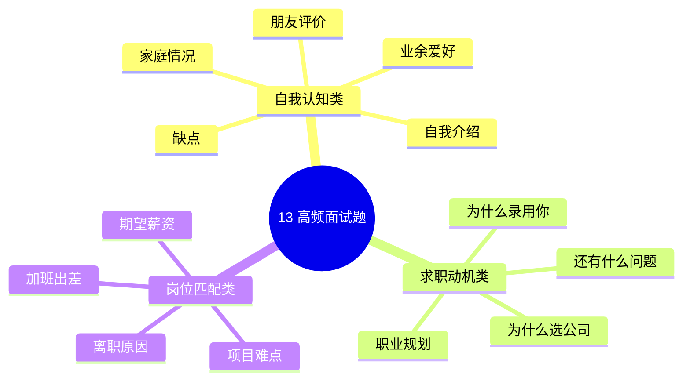
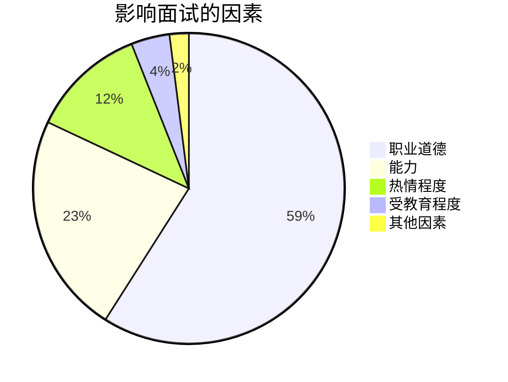

# 面试常见问题：13 道高频题怎么答，附参考话术与技术原理

> 面试准备到后半程，很多人卡住的地方往往不是技术，而是那些看起来谁都会答、真开口却说不到点子上的问题：自我介绍讲了三句就断片，被问缺点时要么说「我没有缺点」要么把优点包装成缺点，谈到离职原因就忍不住吐槽上家。而真正的技术面，又要求你能顺着项目把原理讲透，而不是背八股。这一篇分两部分：前半是 13 道高频通用题的回答思路，后半是技术面试的原理篇，覆盖 JVM（Java 虚拟机）、并发、Spring、MySQL、Redis、分布式锁、消息队列等高频考点。

> **读前须知**：这是面试的技术篇。建议先读完面试篇 1（流程与礼仪），再来看这一篇的硬核原理题。如果你基础还薄，正文开头给了三轮阅读顺序，先挑最贴平时写代码的题入手，别一上来就啃 JVM。

## 先给结论

- 自我介绍围绕三个问题展开：我现在是干什么的，我将来要干什么，我过去是干什么的。以现在为出发点，以将来为目标，以过去为例证。
- 家庭、爱好、缺点、朋友评价这四类问题，考察的都是性格、观念和心态，不是信息本身。
- 谈缺点不要说没有缺点，也不要把明显的优点说成缺点，可以说与岗位无关紧要的缺点，甚至是看上去是缺点、从工作角度看却是优点的缺点。
- 离职原因有四个标准：不自毁长城、诚实为上、不抱怨不满、事先准备好答案。
- 谈规划要落到专业技能提升的步骤上，不要说「过几年当主管、过几年当经理」这类空话。
- 期望薪资最好给出具体数字，不要报一个宽泛的范围，那样只能拿到最低限度的数字。
- 影响面试的因素里，职业道德占 59%，能力占 23%，热情程度占 12%，受教育程度占 4%，其他因素占 2%。

## 面试软实力：13 道高频通用题

先把 13 个问题按面试官真正想看的东西分个类，回答时心里有谱：



下面逐个拆开：先说清楚面试官为什么问，再给回答思路和参考话术。

**问：自我介绍怎么说？**

**答：** 自我介绍几乎是每场面试的开场题，核心是回答三个问题：我现在是干什么的，我将来要干什么，我过去是干什么的。以现在为出发点，以将来为目标，以过去为例证。

几个注意点：第一，礼貌地做一个极简短的开场白，向所有面试人员示意；第二，注意掌握时间，考官规定了时间就严格遵守；第三，内容不要过多停留在姓名、工作经历、时间这些简历上已有的东西上，要更多地谈和所应聘职位相关的工作经历，以及在这些经历中取得的成绩和成长；第四，眼睛不要四处游离，多注视考官，但也不要长久目不转睛；第五，尽量少加手势辅助，自我介绍完毕道声谢谢。

非应届可以参考这个思路：我是某某，毕业于某某大学，主修什么专业，先后任职于哪些公司，在其中担任什么岗位，负责或参与过什么级别的项目，取得过什么成绩，现在应聘贵公司的某某岗位。应届生没有工作经历，就用在校经历来弥补，包括实习、比赛奖项等。

网上流传很广的一段面试录像里，一位资深新闻播音员 21 岁时的自述很值得看：他讲清了专业、成绩、锻炼经历，最后落到「为普通人服务」的真诚态度。成功的人背后都付出了努力，但更值得记下来的是那句：真诚非常重要，自我介绍和日常表达时，也要展现自己真诚的一面。

问：谈谈你的家庭情况。
**答：** 面试官问家庭问题，主要是想了解你的性格、观念、心态。回答时简单罗列家庭成员即可，并强调温馨和睦的家庭氛围、父母对教育的重视、家庭成员对自己工作的支持。如果已经结婚，要强调另一半对自己工作的支持，以及对家庭的责任感，让面试官对你的工作稳定性放心。

**问：平时有什么业余爱好？**

**答：** 业余爱好能在一定程度上反映性格、观念和心态，这是招聘方问这个问题的主因。几条要避开：最好不要说自己没有业余爱好；也不要说那些庸俗的、令人感觉不好的爱好；最好不要局限于读书、听音乐、上网，这类爱好容易让人怀疑性格孤僻。最好能有一些户外爱好来点缀形象。

问：谈谈你的缺点。
**答：** 被问到缺点时有几个原则：不适合说自己没有缺点，也不适合把明显优点说成缺点，不适合说出严重影响岗位的缺点，也不要说出令人不放心或不适的缺点。可以说出一些对应聘工作无关紧要的缺点，甚至是一些表面上看是缺点、从工作角度看却是优点的缺点。

反例：有人被问「你有什么缺点」时回答「我干活需要有人盯着我，否则可能就不努力甚至不干活」，这样的答案一说出口，面试基本就失败了，因为明摆着会影响工作。换个思路就顺了：比如「我比较爱说话，跟什么人都能聊很久」，看上去是个缺点，但反过来反映了性格外向、表达能力不错。

**问：你的朋友怎么评价你？**

**答：** 面试官问身边人如何评价你，是想从侧面了解你的性格，以及你与人相处的情况。两个参考角度：一是「朋友都说我是个可以信赖的人，答应别人的事一定会做到」，侧面反映踏实靠谱；二是「我比较随和，能和不同的人友好相处，总站在别人角度考虑问题」，侧面反映情商高、团队协作融洽。

**问：为什么选择我们公司？**

**答：** 面试官想从中了解你的求职动机、愿望以及对此项工作的态度。建议从行业、企业、岗位三个角度回答：我看好贵公司所在的行业，认为贵公司重视人才，而且这项工作很适合我，我有信心做好。核心是告诉面试官你的求职动机和对此项工作的态度。

**问：为什么录用你？**

**答：** 最好站在招聘单位的角度回答。招聘单位一般会录用基本符合条件、对这份工作有兴趣、并且有自信心的人。参考答案：我符合贵公司的招聘条件，凭我目前掌握的技能、高度的责任感和良好的适应力、学习能力，完全能胜任这份工作；我十分希望能为贵公司服务，如果给我这个机会，一定能创造价值。

**问：做项目遇到过什么难点？**

**答：** 问项目难点，是了解你处理问题的能力。回答思路很固定：你在之前的项目中遇到的最大困难是什么，你采取了什么措施解决，最后达到了什么效果。关键是这个困难必须是真实的，靠编非常不靠谱，面试前一定要想好自己真实遇到过的困难，并琢磨清楚当时是怎么解决的。

**问：你的离职原因是什么？**

**答：** 回答离职原因有四个标准。第一，不要自毁长城：即使离开上一家，也要顾全老东家的颜面，因为新雇主可能做背景核实，多说你的优点自然最好。第二，诚实为上：上司很容易查到离开原因，如实回答但不用和盘托出细节，简单明了最好。第三，不要抱怨不满：不要对上家和同事表示不满，那会让潜在雇主打低印象分。第四，事先做好准备：提前把答案想好，避免现场苦思冥想。

**问：你的职业规划是什么？**

**答：** 面试官想了解你的自我认知、求职动机、价值观与公司的匹配度，以及你能在公司踏实干多久。好的回答既能体现事业心和成就动机，又能体现平和的心态。几条建议：面试前了解公司的背景、现状与未来，谈规划时适当结合公司发展；强调自己有长远规划能力，但更要说明对当前应聘职位会努力做好；不要说「过几年当主管、过几年当经理」这类空话，规划应落到专业技能提升的步骤上；避免期望太高让面试官无法接受。

**问：你怎么看加班 / 出差？**

**答：** 很多公司问这个，并不证明一定要加班，只是想测试你是否愿意为工作投入。参考思路：如果公司需要，我会义不容辞地加班；同时我也会提高工作效率，减少不必要的加班。出差也是同样的思路：愿意为自己热爱的工作付出努力，照这个逻辑回答即可。

**问：你的期望薪资是多少？**

**答：** 当面试官谈到薪资，表明他已对你有认可，想确认你的期望是否在这个岗位的预算内。雇主通常事先定好开支预算，第一次出的价钱往往就是最高价，问你只是想确认这笔钱能否引起你的兴趣。分寸在于：要得太低贬低自己能力，要得太高显得公司受用不起。建议先了解市场行情，再给出具体数字，而不是一个宽泛范围，范围只会让你拿到最低限度的数字。

**问：你还有什么问题要问吗？**

**答：** 这个问题看上去可有可无，其实很关键。企业不喜欢说「没有问题」的人，因为企业注重员工的个性和上进心。同时，企业也不喜欢求职者问一些个人福利之类的问题。可以换成这样问：贵公司对新入职的员工有没有什么培训项目，我可以参加吗？或者说贵公司的晋升机制是什么样的？企业会非常欢迎喜欢学习、有上进心的人，因为这体现了你愿意学习的一面，也体现了对公司的忠诚度。

## 技术面试：原理篇

技术面的核心不是背题，而是面试官顺着你简历里的项目一点点往下刨。下面这些题覆盖了 Java 后端面试最高频的原理性考点，每道题都按「是什么 → 为什么 → 怎么用/怎么避坑」来讲。

> **基础还薄的话，别从第一题硬啃。** 建议分三轮看：先读第四题（MySQL 索引）、第八题（策略模式）、第十题（慢 SQL 定位），这三道最贴近平时写代码的经验，看懂了能立刻用上；再读第二题（并发）、第三题（Spring）、第七题（消息队列），开始碰原理；最后攻第一题（JVM 与 GC）、第五题（缓存三问题）、第六题（分布式锁）、第九题（高并发架构），这几道偏底层和架构，需要前面垫着才吃得下。

### 一、JVM（Java 虚拟机）内存模型与 GC（垃圾回收）原理

**问：JVM 的内存是怎么划分的？GC 又是怎么工作的？**

**答：**

先说「是什么」：JVM 的运行时数据区分为几块。堆（Heap）是对象实例分配的地方，也是 GC 的主战场；方法区（JDK8 之后是元空间 Metaspace）存放类信息、常量、静态变量；虚拟机栈存放栈帧（局部变量、操作数栈）；还有本地方法栈和程序计数器。

堆内部又做了分代：新生代（Eden + 两个 Survivor）和老年代。分代的原因是「大部分对象朝生夕死」，把容易死的对象放在一起，用更轻量的方式回收，能大幅提升效率。

再说「为什么 / 怎么工作」：新对象优先在 Eden 分配，Eden 满了触发 Minor GC，存活的对象被复制到 Survivor；在 Survivor 之间来回熬过若干轮（年龄达到阈值，默认 15），就晋升到老年代。老年代满了则触发 Full GC，回收速度慢、会 STW（ stop-the-world），所以要尽量避免。

判断对象是否存活有两种思路：引用计数（互相引用会漏，Java 不用）和可达性分析（从 GC Roots（栈帧局部变量、静态变量、常量、JNI（Java 本地接口）引用等出发，不可达的对象才回收）。

GC 算法对应不同区域：复制算法用于新生代（Survivor 之间拷贝，无碎片）；标记-清除用于老年代（有碎片）；标记-整理用于老年代（无碎片但慢）。常见收集器：Serial / Parallel 追求吞吐；CMS 追求低停顿（并发标记清除，但有碎片、对 CPU 敏感）；G1 把堆切成 Region，可预测停顿，是 JDK9 之后的默认选择。

> 避坑：Full GC 频繁往往是老年代空间不足或内存泄漏，定位时先看堆 dump 和 GC 日志，不要盲目调参数。

### 二、并发编程：synchronized、volatile 与线程池

**问：synchronized 和 volatile 有什么区别？线程池的核心参数怎么理解？**

**答：**

synchronized 是互斥锁，可重入，JDK6 之后做了锁升级优化：无锁 → 偏向锁（同一个线程反复进入）→ 轻量级锁（CAS 自旋，CAS 即「比较并交换」）→ 重量级锁（操作系统互斥量）。它保证原子性、可见性和有序性。

volatile 保证可见性（写立即刷主存、读从主存）和禁止指令重排（内存屏障），但**不保证复合操作的原子性**：比如 `i++` 这种「读-改-写」三步，volatile 管不住，必须用锁或原子类。

线程池是并发面试的重中之重，核心参数是 `ThreadPoolExecutor` 的七个参数：

```java
ThreadPoolExecutor executor = new ThreadPoolExecutor(
    2,                      // corePoolSize   核心线程数，常驻
    4,                      // maximumPoolSize 最大线程数
    60, TimeUnit.SECONDS,   // 非核心线程空闲存活时间
    new ArrayBlockingQueue<>(100), // workQueue 任务队列
    Executors.defaultThreadFactory(),
    new ThreadPoolExecutor.CallerRunsPolicy() // handler 拒绝策略
);
```

任务提交后的流转逻辑是：**核心线程 → 任务队列 → 非核心线程 → 拒绝策略**。四种拒绝策略：AbortPolicy（抛异常）、CallerRunsPolicy（调用者线程自己执行，变相限流）、DiscardPolicy（静默丢弃）、DiscardOldestPolicy（丢弃队列最老任务）。

> 为什么用线程池而不是手写 `new Thread()`？因为线程创建销毁有开销，线程池能复用线程、控制最大并发数、统一管理任务队列，避免把系统资源打爆。

### 三、Spring IOC（控制反转）与 AOP（面向切面）原理

问：说说 Spring 的 IOC 和 AOP 原理。
**答：**

IOC（控制反转）指的是对象的创建和依赖装配不再由开发者手动 `new`，而是交给容器。DI（依赖注入）是 IOC 的实现手段。容器启动后，扫描 Bean 定义（XML / `@Component` / JavaConfig）→ 实例化 → 依赖注入（构造器 / setter / 字段）→ 放入单例池供使用。

一个经典问题是循环依赖：Spring 用三级缓存解决单例的 setter/字段注入循环依赖：一级缓存 `singletonObjects`（成品）、二级 `earlySingletonObjects`（早期引用）、三级 `singletonFactories`（放能生成早期引用/代理的工厂）。这样 A 没完全初始化好时，B 能先拿到 A 的早期引用，等 A 初始化完再补全。

AOP（面向切面）是把日志、事务、权限这类「横切逻辑」从业务代码里剥离出来，统一织入。Spring AOP 基于动态代理：目标类有接口用 JDK 动态代理，无接口用 CGLIB 子类代理。织入发生在运行时。开发中常用的 `@Transactional` 本质就是一个 AOP 环绕通知：在方法前后开启、提交或回滚事务。

### 四、MySQL 索引、事务、隔离级别与锁

**问：MySQL 为什么用 B+Tree 做索引？最左前缀和覆盖索引是什么？事务隔离级别和锁又是怎么一回事？**

**答：**

为什么是 B+Tree：B+Tree 矮胖、层数少，非叶子节点不存数据只存索引，扇出大，一次查询只需要很少的磁盘 IO；叶子节点之间用链表相连，特别适合范围扫描。InnoDB 的聚簇索引叶子节点直接存整行数据，二级索引叶子节点存的是主键值。

最左前缀：组合索引 `(a, b, c)` 只有在查询条件用到 `a`、`(a,b)` 或 `(a,b,c)` 时才能命中；跳过 `a` 或中间断了（比如只用 `b,c`）就走不上索引。

覆盖索引：如果查询要的列刚好都在某个索引里，MySQL 读完索引就不必回表，用 `EXPLAIN`（在 SQL 前加它就能看到 MySQL 的执行计划）看时，`Extra` 一栏会显示 `Using index`，能显著减少 IO。

事务的 ACID：原子性靠 undo log，持久性靠 redo log，隔离性靠锁和 MVCC（多版本并发控制），一致性是最终目标。四个隔离级别：读未提交（会脏读）、读已提交 RC（解决脏读）、可重复读 RR（MySQL 默认，解决不可重复读，靠 MVCC + 间隙锁解决幻读）、串行化（锁全表，解决幻读但性能差）。

MVCC 的核心是用 undo log 版本链 + ReadView，让 RR/RC 下的读不加锁、不阻塞写。锁方面：InnoDB 有行锁（Record）、间隙锁（Gap）、Next-Key Lock（RR 默认，锁住记录及间隙，专门防幻读）。

> 避坑：RR 下范围查询会加 Next-Key Lock，容易引发锁等待甚至死锁；高并发写同一行时，要控制事务粒度、缩短持锁时间。

### 五、Redis 缓存击穿、穿透与雪崩

**问：缓存击穿、穿透、雪崩分别是什么，怎么应对？**

**答：**

三者都和「缓存没能挡住请求、压力打到数据库」有关，但场景不同：

- **缓存雪崩**：大量 key 在同一时刻过期，或者 Redis 本身宕机，导致瞬时所有请求穿透到数据库。应对：给过期时间加随机抖动，避免同时失效；Redis 做高可用（主从 + 哨兵 / 集群）；上游限流降级；引入多级缓存。
- **缓存击穿**：某个极热点的 key 过期的瞬间，大量并发同时发现缓存没了，一起冲去查数据库重建缓存。应对：用互斥锁（只放一个线程去重建，其余等待）；或者逻辑过期（key 不真过期，异步重建）；热点 key 干脆不设过期。
- **缓存穿透**：查询的数据在数据库里根本不存在，缓存和数据库都查不到，被恶意或异常请求反复刷。应对：缓存空值（设短过期，防止同 key 反复穿透）；用布隆过滤器在入口拦截非法 key；做好接口参数校验。

> 三者记忆口诀：雪崩是「集体失效」，击穿是「单点热点失效」，穿透是「查根本不存在的东西」。

### 六、分布式锁与 Redisson 看门狗

**问：如何用 Redis 实现分布式锁？Redisson 的看门狗（watch dog）解决了什么问题？**

**答：**

最朴素的实现是用 `SET key value NX EX seconds` 加锁，`DEL` 释放。但这里有两个坑必须堵：一是释放锁要校验 value 是不是自己加的（否则可能误删别人的锁），要用 Lua 脚本保证「校验 + 删除」原子；二是必须设过期时间，防止客户端崩溃后锁永远不释放（死锁）。

更大的问题是：如果业务执行时间超过了锁的过期时间，锁提前失效，别的线程就进来了，并发安全被打破。这就是 Redisson 看门狗要解决的。

Redisson 加锁时如果不指定 `leaseTime`，默认锁 30 秒过期，并启动一个 watch dog 后台定时任务，每隔 `30 / 3 = 10` 秒给锁续期一次，直到你主动释放锁。一旦你显式指定了 `leaseTime`，看门狗就不再生效。释放锁同样用 Lua 保证原子。同时 Redisson 的锁是可重入的，内部用 Hash 记录持有线程和重入次数。

```java
RLock rlock = redissonClient.getLock(orderInfo.getUserName());
// 不指定 leaseTime，看门狗自动续期；指定则按指定时间，不续期
boolean isLock = rlock.tryLock(5, 6, TimeUnit.SECONDS);
if (isLock) {
    try {
        // 查用户、组装订单、发 MQ、落库
    } finally {
        rlock.unlock();
    }
}
```

> 避坑：用用户名当锁 key 能保证同一用户不会重复成单；`tryLock(5, 6, ...)` 表示最多等 5 秒抢锁、锁本身 6 秒过期（这里显式传了时间，看门狗不介入，需自行保证业务在 6 秒内完成，否则改用不传 leaseTime 的写法）。

### 七、消息队列：削峰、解耦与异步

**问：消息队列在面试里常问什么？削峰、解耦、异步怎么理解？**

**答：**

消息队列的核心价值是三点：

- **解耦**：生产者不直接依赖消费者，系统间通过 MQ（Message Queue，消息队列）异步通信，一方变动不影响另一方。
- **削峰**：瞬时高并发请求先写入 MQ，后端按自己的处理能力匀速消费，保护数据库不被冲垮，这在秒杀场景是关键一环。
- **异步**：发短信、记日志这类非核心链路异步化，缩短主链路响应时间。

常被追问的也是它的代价：消息丢失（靠生产者 confirm、消费者 ack 保证）、重复消费（消费端要做幂等）、消息顺序（Kafka 按分区保序）、消息积压（消费者能力不足时要扩容或优化消费逻辑）。常见选型：RabbitMQ 功能全（死信队列可做延迟和重试），Kafka 高吞吐、适合大数据量日志和流式场景。

### 八、设计模式：策略模式的实战价值

问：你在项目里用过设计模式吗？举一个策略模式的例子。
**答：**

很典型的场景是电商报价：新客户不打折、老客户 9 折、VIP（重要客户 / 会员等级）8 折。朴素写法是一堆 `if-else`，每加一种客户就改一段分支，耦合严重、改不动。策略模式把「报价」抽象成接口，每种客户给一个实现类，再用一个 Context 把客户端和具体策略隔开：

```java
public interface QuotationStrategy {
    BigDecimal getQuotation(BigDecimal originalPrice);
}
// Context 屏蔽具体策略，客户端只跟 Context 打交道
public class QuotationContext {
    private QuotationStrategy strategy;
    public QuotationContext(QuotationStrategy strategy) { this.strategy = strategy; }
    public BigDecimal getPrice(BigDecimal originalPrice) {
        return strategy.getQuotation(originalPrice);
    }
}
```

这样新增 MVP 客户打 7 折，只要加一个实现类，老代码一行都不用动，这就是开闭原则（对扩展开放、对修改关闭）。JDK 里也到处是策略模式，比如 `ThreadPoolExecutor` 的 `RejectedExecutionHandler` 拒绝策略、`Collections.sort` 的 `Comparator` 比较器，都是「算法可自由替换」的活例子。

### 九、高并发架构：以秒杀场景为例

**问：高并发场景（比如秒杀）你怎么设计架构？**

**答：**

秒杀的本质不是业务逻辑复杂，而是「瞬时流量远超系统常态处理能力」。设计思路是把流量一层层削平，而不是让它全压到数据库：

1. **前端防重复刷**：按钮置灰、Token 校验，拦掉用户手快和脚本猛点带来的无效重复请求。
2. **网关鉴权限流**：没登录/没带身份凭证的直接踢回（如 Zuul 的 `PRE` 过滤器返回 401）；带票的请求按 IP 等维度限流（如每 60 秒最多 N 个，超了返回 429），限流计数放 Redis 以便多节点共享。
3. **后端分布式锁 + 异步 + 缓存**：用 Redisson 分布式锁挡超卖和重复下单（如上一节 `tryLock`），拿到锁后再查用户、发 MQ、落库，把写库压力进一步削峰。
4. **依赖服务熔断降级**：下游服务超时或挂掉时，用 Hystrix 这类熔断器走降级实现，不让调用方线程一直阻塞把连接池拖死。
5. **消息队列兜底**：下单消息发到 MQ，后端慢慢消费；配合死信队列做延迟和重试。

讲清楚每一层在解决什么，就过关。注意 Netflix 那批组件（Ribbon、Hystrix、Zuul）已进入维护期，新项目可以对照往 Spring Cloud Gateway、Resilience4j 上迁移。

### 十、数据库优化：一条慢 SQL 怎么定位

**问：线上一条慢 SQL，你一般怎么定位和治理？**

**答：**

先别凭感觉改，把事实和工具摆出来：

1. **开慢查询日志**：`show variables like 'slow_query_log'` 看是否开启，用 `set global slow_query_log=1` 临时开，或改 `my.cnf` 的 `slow_query_log=1`、`long_query_time=1`。再用 `mysqldumpslow` / `pt-query-digest` 分析日志，锁定最该优化的那条。
2. **用 EXPLAIN 看执行计划**：重点看 `type` 字段（保底到 `range`，最好 `ref`，`ALL` 是全表扫描要消掉）和 `Extra`（`Using index` 是覆盖索引好事，`Using filesort` / `Using temporary` 往往是性能杀手）。
3. **索引与 SQL 写法**：索引别超过 6 个（维护有成本）；组合索引守最左前缀；避免 `SELECT *`（只取需要的列还能促成覆盖索引）；`like` 别前置百分号；别在字段上做函数或表达式计算；分页深翻页用「延迟关联」优化。
4. **单库到顶再谈架构**：主从复制做读写分离、备份高可用；数据量再大做分片（Sharding），用 MyCat / ShardingSphere 这类中间层对应用透明。

> 优化是持久战：业务量涨了，原来快的 SQL 又可能变慢，所以先优化最大瓶颈，比到处微调强得多。

### 十一、AI 趋势：Java 开发者要懂什么

**问：现在面试官常问 AI，Java 开发者需要了解哪些？**

**答：**

先理清三者关系：人工智能（AI）是最大的范畴，机器学习（ML）是实现 AI 的一种方法，深度学习（DL）是 ML 的一种实现方式，而人工神经网络（ANN / MLP）是驱动 ML 和 DL 的主要算法。

对 Java 工程师来说，重点不是去从头训大模型，而是理解工程落地的角色：Java 在工程侧主要扮演「调用已训练模型」的角色：把研究人员训练好的模型接入业务系统。JVM 生态里也有成熟的 ML 库，比如 DL4J（Deep Learning for Java，可几行配置搭网络并序列化模型）、WEKA、MOA 等。

如果想讲得更深，可以提一个最经典的 BP（反向传播）神经网络：它本质是「全连接层 + 带权重的神经元 + 非线性激活函数 + 均方误差代价函数 + 梯度下降驱动的正反向传播」。用纯 Java 也能写出一个认 MNIST 手写数字的 BP 网络（输入 784、隐藏 30、输出 10，mini-batch SGD），这能体现你既懂工程也懂一点 AI 原理。面试时能讲清「AI/ML/DL 的关系 + Java 在工程里的定位」，就已经够用。

## 影响面试的因素

把这组占比直接画成饼图，权重一眼看清：



最后看一组数据。影响面试的因素里，职业道德占 59%，能力占 23%，热情程度占 12%，受教育程度占 4%，其他因素占 2%。

也就是说，主动、诚实、认真地工作，比其他因素更重要。这一点一定要了解。

## 要点回顾

- **通用题**：自我介绍讲「现在/将来/过去」三点；缺点说无关紧要或反向是优点的；离职原因不自毁、不抱怨、提前备好；期望薪资给具体数字而非范围；结尾用「培训项目 / 晋升机制」展示上进心。
- **JVM/GC**：分代收集、可达性分析、G1 可预测停顿；Full GC 频繁要先看堆 dump。
- **并发**：synchronized 锁升级、volatile 不保原子、线程池七参数与「核心→队列→非核心→拒绝」流转。
- **Spring**：IOC 容器管理 Bean 与依赖、三级缓存解循环依赖；AOP 基于动态代理、`@Transactional` 是环绕通知。
- **MySQL**：B+Tree 聚簇索引、最左前缀、覆盖索引；RR 靠 MVCC + 间隙锁防幻读；Next-Key Lock 防幻读但易锁等待。
- **Redis**：雪崩（集体失效）、击穿（热点失效）、穿透（查不存在）三类问题与应对；Redisson 看门狗自动续期避免锁提前失效。
- **MQ**：削峰、解耦、异步三价值，以及丢失/重复/积压的代价。
- **架构与优化**：秒杀分层防御（前端防重→网关限流→分布式锁+异步→熔断）；慢 SQL 用慢日志 + EXPLAIN 说话。

## 常见误区

- **误区一**：自我介绍背简历。姓名、工作时间这些简历上已经有的内容再讲一遍，等于把宝贵的开场时间浪费在重复信息上。
- **误区二**：被问缺点时回答「我没有缺点」，或者把优点包装成缺点。前者显得不真诚，后者面试官一问就穿帮。
- **误区三**：谈离职原因时吐槽上家和同事。新雇主可能做背景核实，抱怨只会拉低印象分，还会被怀疑相处能力。
- **误区四**：被问期望薪资时报一个宽泛范围。范围只会让你拿到最低限度的数字，应当先了解市场情况，再给出具体数字。
- **误区五**：最后一句「你还有什么问题要问吗」随口答没有问题。这个环节恰恰是展示学习意愿和上进心的机会。
- **误区六**：技术面靠背八股。面试官顺着项目往下挖时，能讲清「它解决了什么问题、你怎么用的、为什么这么设计」，远比背定义管用。
