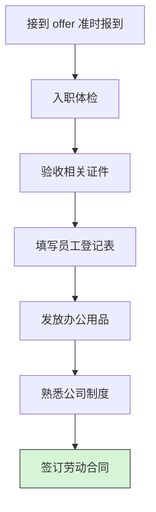
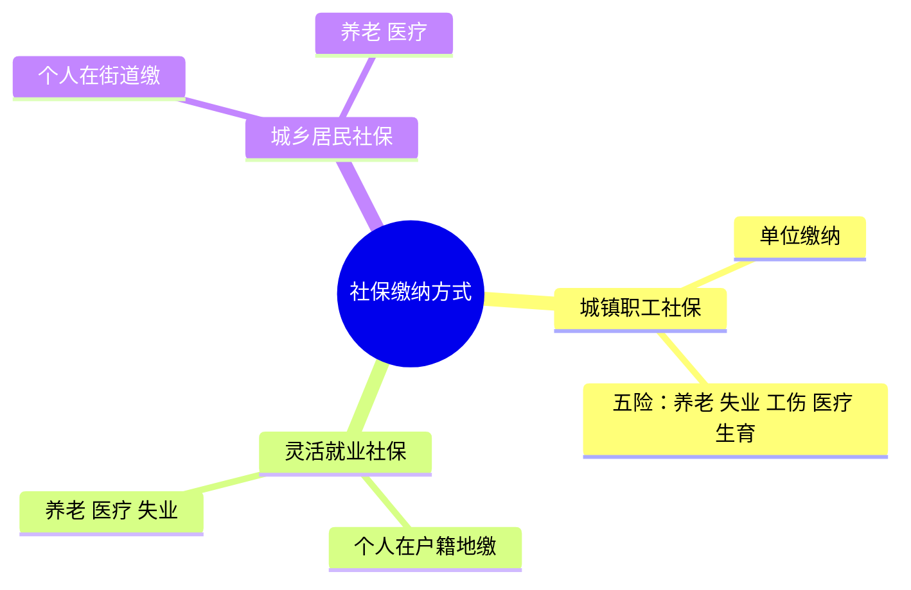
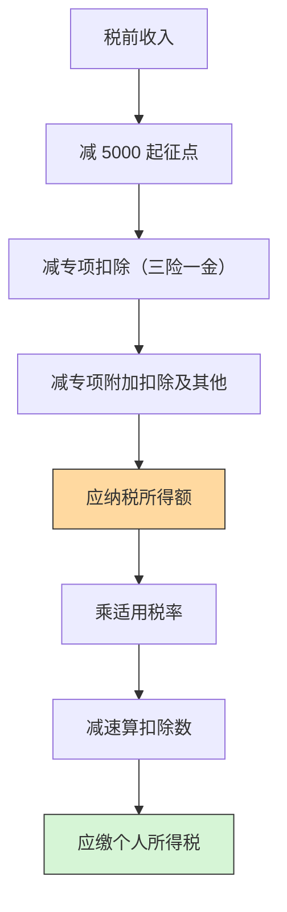

# 拿到 offer 先别急着高兴：入职准备与社保、公积金、个税解析

offer 到手那一刻，大多数人第一反应是终于有着落了。但真要说考验，其实从这一刻才算开始：试用期工资怎么算、入职要带哪些材料、手续走什么流程、社保和公积金公司给不给缴、到手的钱又是怎么扣出来的。这些东西不提前弄明白，等入职第一天手忙脚乱，或者几个月后对着工资条发懵，就来不及了。关于试用期，常见的疑问大致集中在五块：入职准备及社保解析、了解各部门制度、试用期可能遇到的问题、试用期技术问题解决办法、试用期结束后的结果。本篇先把第一块讲透。

> **读前须知**：拿到 offer 不是终点，试用期才是真正的考验开始。这是试用期两篇的第一篇，讲入职准备、社保公积金个税这些「钱和手续」的事。下一篇讲部门规矩、避坑和转正结果。

## 先给结论

- offer 上会写明岗位、试用期工资、试用期时长、转正工资，以及福利补贴，同时会提示报到时办理入职手续需要携带的材料。
- 入职手续的标准流程是：入职体检、验收相关证件、填写员工登记表、发放办公用品、熟悉公司制度、签订劳动合同。
- 体检项目由公司根据岗位和体检目的自行确定。国家明确禁止将携带乙肝病毒作为限制就业的条件，禁止在体检中做乙肝血清学检测（俗称「乙肝五项」/「乙肝两对半」），肝功能正常即可。
- 离职证明的规范名称是「解除或者终止劳动合同的证明」（口语常连写作「终止解除劳动合同证明书」），出具它是用人单位的法定义务，每次离职都要记得索取。
- 薪资证明有三种形式：与离职证明开在一起、银行流水账单、网上银行收入流水截屏。
- 背景调查要遵守授权、知情、不涉及未离职公司、不涉及个人隐私、第三方只记录客观情况、信息保密这些原则。
- 社保有三种缴纳方式：城镇职工社保、灵活就业社保、城乡居民社保。
- 北京 2019–2020 年企业职工社保缴费比例（以下为历史数据，生育保险已并入职工医保，现行比例以当地社保局最新公布为准）：养老公司 16%、个人 8%；失业公司 0.8%、个人 0.2% 或 0；工伤公司按行业规定 0.3 到 2、个人 0；医疗公司 10%、个人 2%（原单列生育保险已合并入医疗，当时公司 0.8%、个人 0）。
- 住房公积金单位和个人免税比例确定为 12%，缴存基数不低于当地上年度社平工资的 60%、不高于 300%，缴存比例 5% 到 12%，最常见的是 8%，公司和个人按 1 比 1 等额缴存。
- 个人所得税等于税前收入减去 5000 元、专项扣除、专项附加扣除和依法确定的其他扣除，再乘适用税率，最后减速算扣除数。

## offer 上到底写了什么

先看一份录用通知函的样子。开头一般是「通过对您的面试，经我公司综合评定，很高兴您已经被我公司录用」，接下来会写清楚担任什么职位、试用期工资多少、试用期几个月、转正工资多少，还有一些福利补贴也会写进去。

同时，offer 里会提示报到时办理入职手续需要携带哪些材料：学历证原件和复印件、离职证明、收入证明，还有体检报告等，入职时间也会写在里面。这些信息报到前逐条核对一遍，缺什么提前补。

## 入职材料与手续流程

入职手续的顺序基本是固定的，画成下图，报到前逐环节对一遍：

确定被录用的应聘者，接到 offer 之后应当准时到公司报到，并且携带身份证、学历证书等复印件，以及公司规定的免冠照片、离职证明、薪资证明和社会保险等相关材料，办理入职手续。

主要的入职手续大致是这样一个流程：先进行入职体检，然后验收相关证件，接着填写员工登记表，发放办公用品，熟悉一下公司的制度，最后签订劳动合同。每一步都不复杂，但顺序基本是固定的，因为签合同这一步要等前面都确认完。

## 入职体检：有一条红线不能碰

入职体检的一般项目，都是平时体检常见的那些。不过特殊时期会有所调整，比如疫情期间，有的公司、甚至有的城市会要求提供核酸检测证明。也就是说，具体的体检项目是由公司根据体检目的自行确定的，目的是保证入职员工的身体状况适合从事相关工作，不会因为身体原因影响到他人。

这里有一条必须知道的硬性规定，遇到不合理的体检要求时心里要有底：

> 国家已经明确禁止将携带乙肝病毒作为限制入学、就业的条件，全面禁止用人单位和体检机构在体检中要求做乙肝血清学检测（俗称「乙肝五项」/「乙肝两对半」），只要肝功能正常即可。

## 离职证明：每次离职都要记得要

离职证明的规范名称是「解除或者终止劳动合同的证明」（口语中常连写为「终止解除劳动合同证明书」），是用人单位与劳动者解除劳动关系的书面证明。用人单位与劳动者解除劳动关系之后，必须出具这份书面材料，因为出具解除或者终止劳动合同证明书是用人单位的法定义务。

所以每次离职之后，一定要去索要离职证明。一般情况下，被开除的职工拿到的是开除证明书，正常离职拿到的是离职证明书，两者不一样，别拿错了。

离职证明的用途主要有几个：一是证明用人单位与劳动者已经解除劳动关系；二是证明离职是按正常手续办理的；三是证明本人现在是自由人，可以申请失业金或者应聘新的职位；四是凭此转移人事关系、社保、公积金等。

离职证明的要素也要留意。首先一定要有标题，写「离职证明」或者「解除/终止劳动合同证明」。其次正文必须体现关键信息，比如姓名、身份证号、离职时间、岗位，这几项是必须要有的。像性别、入职时间、在哪个部门从事什么岗位、薪资多少，这些可以不体现，也可以体现，自行选择。

最后是落款：要有公司名称或者公司人力资源部的名称，落款时间，还要加盖公章。盖公司的公章，或者人力资源部的部门公章都可以。

离职证明有两种形式，纸质版和电子版。常用的一般是纸质版，由公司开具一份离职证明书。电子版多用于不方便跨城去取纸质证明的情况，公司会发一份电子版，比如扫描件之类。

## 薪资证明：三种形式

薪资证明也要了解一下，比如工资条，分纸质版和电子版两种，记录着每个员工的月收入，分项和收入的总额。

薪资证明可以和离职证明开在一起，它是一种加盖公司公章、证明经济收入的文书。

第二种是银行流水账单，可以去银行柜台开具近六个月连续的银行代发工资账户流水，然后让银行盖一个章。

第三种是存折复印件，同样显示近六个月连续的银行代发工资账户流水。

还有就是登录网上银行，对收入流水截屏形成的文书。截屏信息打开之后，可以看到持卡人的姓名、卡号，还有近六个月的工资流水。这个也算是一种证明。

## 背景调查：原则与方式

背景调查有几条原则。第一，背景调查要被背调人授权；第二，要让被背调人知情。第三，不涉及被背调人尚未离职的公司，也就是说人还在职、没有离职，是不能够背调的。第四，不涉及被背调人个人隐私。第五，第三方仅记录客观情况，不评价被背调人是否胜任岗位、有没有胜任能力，同时给予认为有问题的被背调人申辩的权利。第六，信息要保密。

背景调查的方式有三种：一是电话询问，打电话到原公司去询问；二是发背景调查函；三是实地拜访，亲自到原公司去拜访了解一下情况。这三种是比较常用的方式。其他方式比如利用互联网做调查，不太常用。

## 社保的三种缴纳方式

三种方式按「谁缴、缴什么」画成下图，先看清自己属于哪一类：

社保是我国一项重要的社会保障制度，也是国家给予每个人的福利。社保在生活当中影响着很多权益，比如在北京想要买房、买车、子女上学、积分落户等等，都需要社保的缴纳年限，再就是最基本的养老和医疗报销。由于每年的社保缴费基数不同，每年的社保费用也不同。

在北京，交社保因工作不同、身份不同，大概涉及三种缴纳方式。

**第一种是城镇职工社保。** 在一家企业单位上班缴纳的五险，包括养老、失业、工伤、医疗、生育。

**第二种是灵活就业社保。** 个人在户籍所在地，由本人到社保局缴纳，包括养老、医疗、失业，属于个人参保。有些城市没有失业保险，这个分城市。

**第三种是城乡居民社保。** 同样是个人缴纳，在户籍所在地，由本人在辖区街道缴纳，包括养老和医疗。

这三种方式，有单位缴纳的，也有个人缴纳的，城镇和城乡的还不一样，了解清楚自己属于哪一种就行。

## 北京职工社保缴费比例（2019–2020 年北京历史数据，仅作参考）

2019 年到 2020 年北京企业职工社保缴费比例如下。注意：自 2019 年起生育保险已与职工基本医疗保险合并实施，多数地区到 2020 年已完成合并，现今不再单独列「生育保险」；同时社保缴费基数与比例每年调整，现行标准以当地社保局最新公布为准。

养老保险，公司缴纳 16%，个人缴纳 8%。

失业保险，公司缴纳 0.8%，个人缴纳 0.2% 或者是 0。

工伤保险，公司缴纳比例根据行业规定，在 0.3 到 2 之间，个人缴纳 0。

生育险（现已并入职工医保，不再单列；以下为合并前 2019–2020 年北京历史数据），当时公司缴纳 0.8%，个人缴纳 0。

医疗保险，公司缴纳 10%，个人缴纳 2%。

另外，疫情期间国家阶段性减轻国内中小型企业负担，对企业社保实行了一系列减免优惠政策。减免之后需要交多少钱，要看具体的图表。由于每个城市的减免优惠政策和缴费基数不同，其他地区可以咨询当地社保局。每年 7 月份是国家调整基数的时间。

考虑到社保的重要性，建议即使离职了或者失业了，也不要让社保产生断缴。现在社保对生活的影响非常大，断一次可能就影响买房、摇号、落户的资格连续性。

## 住房公积金：能缴就尽量缴

财政部、国家税务总局联合发布通知，将单位和个人住房公积金免税比例确定为 12%。也就是说，职工每个月实际缴存的住房公积金，只要在其上一年度月平均工资 12% 的幅度内，就可以在个人应纳税所得额中扣除。

缴存比例就是你应缴公积金的系数。例如本人月平均工资是 100 元，应缴纳的公积金系数是 3%，那么应缴公积金的数额就是 3 元。它和本人月平均基数、应缴系数都有关系，平均工资额和系数增加或者减少，应缴纳公积金的数额都会相应变化。

住房公积金的缴纳基数是员工上一年度月平均工资，这个缴费基数不低于上年度当地社平工资的 60%，不得高于 300%。缴纳的比例是 5% 到 12%，用人单位可以在这个范围内自行决定，最常见的是 8%。

公司和个人是按 1 比 1 的比例等额供款的，也就是说个人缴纳多少，公司也缴多少，这个是比较合适的。此外，公司还可以根据自愿的原则为员工缴纳补充公积金，补充公积金不用个人缴纳，全部由公司缴纳。

住房公积金缴纳比例按单位种类分：机关及事业单位一般是 12%；外商、港澳台商企业一般为 10% 到 12%；企业化管理的事业单位及其他企业，缴存比例是 8% 到 12%。

公积金的好处主要有三个：一是免征个人所得税，单位和个人按国家规定比例缴存的住房公积金，免征个人所得税；二是享受低息公积金贷款的优惠；三是可以作为个人或家庭的其他补充资金。

公积金的好处很多，能缴的尽量去缴。将来入职的时候，这些福利是要主动争取的。

## 个人所得税怎么算

个税的计算步骤画成流程图，对着工资条一步步核：

依法纳税是每个公民的基本义务，税收取之于民、用之于民。这里看一下个人所得税的计算公式：

个人所得税等于税前收入减去 5000 元，再减去专项扣除、专项附加扣除和依法确定的其他扣除，乘以适用税率，最后减速算扣除数。其中专项扣除包括三险一金等。

举两个例子。

小明每月工资扣除五险一金等项目后的月收入额是 30000 元，那么他应缴纳的个人所得税是：30000 减去 5000，乘以 25%，再减速算扣除数 2660，结果是 3590 元。税后工资总额是 30000 减去 3590，等于 26410 元。

小红每月工资扣除五险一金等项目后是 8000 元，应缴纳的所得税是：8000 减去 5000，乘以 3%，结果是 90 元。税后总额是 8000 减去 90，等于 7910 元。

知道工资是怎么算出来的就行，以后自己也能对着工资条核对一遍。

## 常见误区

- **误区一**：以为 offer 只是通知一下，随便看看。offer 上写明的试用期工资、转正工资、福利补贴，都是后面核对合同和工资条的依据。
- **误区二**：离职时不好意思索要离职证明。出具它是公司的法定义务，没有它，失业金、新工作应聘、社保公积金转移都会卡住。
- **误区三**：以为背景调查可以背着现任公司做。人还没离职就不能背调，这是原则，也是保护被背调人的方式。
- **误区四**：离职后放任社保断缴。买房、买车、子女上学、积分落户都看缴纳年限，断一次很麻烦。
- **误区五**：只关心到手多少钱，不看公积金缴存比例。公积金是公司和个人 1 比 1 等额缴存的，比例低了等于少拿一块收入。

## 要点回顾

- offer 上的试用期工资、转正工资、福利补贴，都是后续核对劳动合同和工资条的依据，逐项对照不可马虎。
- 离职证明的规范名称是「解除或者终止劳动合同的证明」，出具它是用人单位的法定义务，每次离职务必索取。
- 入职体检不得检测乙肝；背景调查须遵循授权、知情、不涉隐私、不背调未离职公司的原则。
- 社保连续缴纳关系买房、落户、子女教育等权益，离职后尽量别断缴；公积金单位和个人 1:1 等额缴存，比例越高越划算。
- 个税按「起征点—专项扣除—专项附加扣除—税率—速算扣除数」的顺序计算，可对照工资条自行复核。
