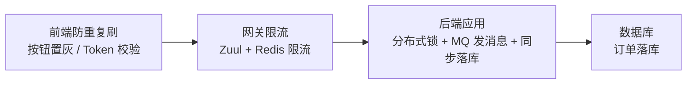
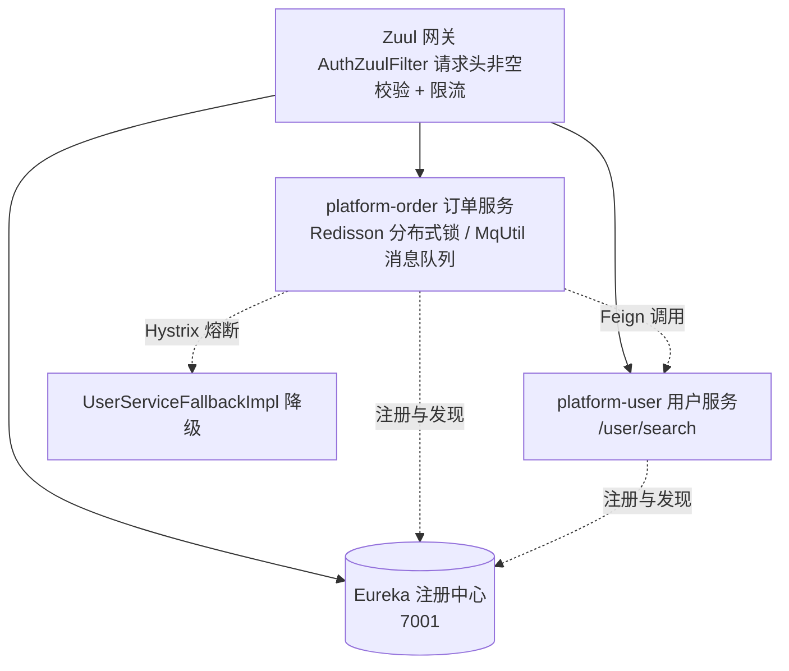

# 大促零点一到，服务被打挂：用 Spring Cloud 搭一套扛得住的秒杀架构

秒杀的本质不是「业务逻辑复杂」，而是「瞬时流量远超系统常态处理能力」。本文对照一套 Spring Cloud 开源脚手架的源码，拆解如何在前端、网关、后端三层把流量峰值一层层削平，让系统消化得动。

大促零点钟声一响，几万个人同时点同一个「立即抢购」按钮。你盯着监控，QPS（每秒请求数）曲线瞬间拉成一根竖直的线，数据库连接池被占满，下游用户服务开始超时，网关那边一堆 500 往外吐，于是整个下单链路雪崩。这种画面，做过电商业务的开发者基本都梦到过。

秒杀场景的本质不是「业务逻辑复杂」，而是「瞬时流量远超系统常态处理能力」。普通 CRUD（增删改查）系统一天几万单慢慢来就行，秒杀是几万单在几秒内一起砸过来。这时候拼的不是功能多不多，而是你能不能在流量入口一层层把水位的峰值削平。

下面这套思路和一个开源脚手架的源码对照着讲，组件、代码都来自那个示例项目，可以跟着跑起来看效果。

> **读前须知：** 这是本组文章里最偏工程实战的一篇，建议至少用过 Spring Boot 再读。文中每个组件第一次出现时，都会先说清「它在整条链路里负责干什么」，不会默认你已经认识它。万一某一节卡住了，可以先跳到「微服务骨架」那一节补一下整体画面，再回头看细节，会顺很多。

## 秒杀到底难在哪三件事上

资料里把秒杀架构要解决的问题拆得很直白，就三块，缺一不可。

**第一，** 前端页面要防重复刷。用户手速快、或者有人用脚本猛点，同一个下单请求可能一秒发十几次。如果不拦，后面的压力会被人为放大好几倍。

**第二，** 网络流量要控制。这里分前端页面自身的流量控制和后端网关这一层的流量控制，核心思想都是「能挡在门外的请求，别放进来」。

**第三，** 后端应用服务处理要讲究策略。异步处理、缓存、分布式锁、数据库系统处理，这四样得组合起来用。同步把所有请求都怼到数据库，那是多少连接池都扛不住的。（这四条是资料给出的架构原则，不代表示例项目里都实现了，后文会对照源码说明边界。）

把这三层叠起来，就是一条完整的防御链路。

## 一张图看懂请求是怎么被拦下来的



链路很朴素：前端先拦掉一部分无效重复请求，网关再按规则限流，真正进到后端服务的流量已经是收敛过的，后端用分布式锁把同一用户的临界区串行化后直接同步落库，最终才落到数据库。需要说明的是，「缓存 + 异步削峰」是资料给出的架构原则，示例项目的 Java 源码里并没有 RedisTemplate / @Cacheable / @Async 这类实现，Redis 实际只用于网关限流计数和 Redisson 分布式锁。

## 微服务骨架：注册中心、网关、两个服务

示例项目用的是 Spring Cloud 这一套（它本质是一系列框架的有序集合，里面大量用了 Netflix 开源组件）。五个组件各管一摊，用大白话说就是：

- **Eureka（注册中心）**：所有服务启动后都来这里「报到」，互相调用时报服务名就行，不用写死对方的 IP；
- **Ribbon（客户端负载均衡）**：同一个服务部署了好几份，它决定这次请求发到哪一份上；
- **Zuul（网关）**：外部请求的统一入口，除了转发路由，还能顺手做校验和限流；
- **Feign（声明式调用）**：把「调别的服务」写成一个普通接口方法，用起来跟调本地方法一样，HTTP 的细节全被藏起来了；
- **Hystrix（熔断器）**：依赖的服务挂了或太慢时负责「跳闸」，改走备用方案，不让故障顺着调用链蔓延。

全部基于 Spring Boot 构建。

整体拓扑长这样：



Eureka 是纯注册中心，`PlatformEurekaApplication` 上加一个 `@EnableEurekaServer` 就起来了。订单服务和用户服务各自带 `@SpringBootApplication`，启动后把自己注册进 Eureka，互相调用时通过服务名而不是写死的 IP 寻址。网关 Zuul 既做路由，也顺手把请求头校验和限流做了。

## 网关这一层：先把没带票的拦在门外

秒杀请求千千万，但有一类必须第一时间踢掉：没登录、没带身份凭证的。示例项目在 Zuul 里写了一个 `AuthZuulFilter`，类型是 `PRE_TYPE`，也就是在请求转发到后端服务之前执行。它干的事特别简单，就是看请求头里有没有 `userToken`：

```java
@Override
public Object run() throws ZuulException {
    RequestContext ctx = RequestContext.getCurrentContext();
    HttpServletRequest request = ctx.getRequest();
    String userToken = request.getHeader("userToken");
    if(StringUtils.isEmpty(userToken)){
        ctx.setSendZuulResponse(false);
        ctx.setResponseStatusCode(401);
        ctx.setResponseBody("userToken is null");
        return null;
    }
    return null;
}
```

这段代码来自示例项目的 `AuthZuulFilter.java`。这里要如实说明它的强度：它**只判断 `userToken` 请求头是否为空**，不校验签名、不校验真伪、也不看过期时间，所以准确说法是「请求头非空校验」，属于示意级鉴权，不能当生产鉴权用。好处是这层校验成本极低：没有 token 直接返回 401，请求根本不会往下走，后端服务完全感知不到这波无效流量，在秒杀开场时也能挡掉大量爬虫和未登录的瞎请求。

## 网关还能顺手做限流

光校验请求头不够，带了 token 的请求也可能瞬间涌进来太多。示例项目在 Zuul 的配置里直接用上了限流插件，规则写在 `application.yml`：

```yaml
zuul:
  ratelimit:
    enabled: true
    repository: REDIS
    policies:
      platform-order:
        limit: 10
        refreshInterval: 60
        type:
          - ORIGIN
```

意思是针对 `platform-order` 这个服务，按客户端 IP（`ORIGIN`）维度，每 60 秒最多放 10 个请求，超了就返回 429。限流计数放在 Redis 里，这样网关本身可以多节点部署、共享同一份计数，不会各限各的。

## 下单核心：分布式锁 + 发消息 + 同步落库

流量到了订单服务，真正的硬仗才开始。示例项目的 `OrderController` 里 `/order/pay` 这个接口，把「分布式锁 + 远程调用 + 消息队列 + 落库」串在了一起。

> **分布式锁是什么：** 单机程序里用 `synchronized` 就能让同一段代码一次只进一个线程；但服务一旦部署多份、跑在不同机器上，它就管不着别的机器了。分布式锁的做法，是把「锁」放到一个所有机器都看得见的公共地方（这里是 Redis），谁先在那里占到记号谁执行。Redisson 是 Redis 的 Java 客户端，把占锁、续期、释放这些琐碎细节都封装好了。

核心的加锁逻辑长这样（来自示例项目）：

```java
RLock rlock = redissonClient.getLock(orderInfo.getUserName());
boolean isLock = rlock.tryLock(5, 6, TimeUnit.SECONDS);
if (isLock) {
    strJson = userService.searchUser(orderInfo.getUserName());
    // 调用户服务成功，组装订单并发送消息队列，再落库
    MqUtil.instance(host,port,username,password,virtualHost)
          .sendMsg("orderQueue", JsonUtils.toText(order));
    int payOrderResult = orderMapper.insert(order);
    rlock.unlock();
}
```

这里用 Redisson 的 `tryLock(5, 6, ...)`：最多等 5 秒抢锁，锁自己 6 秒后过期。但有三点必须按源码如实说，不能想当然：

- **锁的 key 是用户名**（`orderInfo.getUserName()`），所以它只做「同一个用户」的临界区互斥，不同用户之间互不阻塞。源码里没有库存字段、也没有扣减和幂等逻辑，因此这把锁**既不能防超卖，也不能保证不重复下单**：防超卖需要的是商品维度的库存锁加扣减校验，这里根本没有这层。
- **显式传了 leaseTime（6 秒），Redisson 不会启用 watch dog 自动续期**。锁到 6 秒必然失效，如果临界区里的业务（查用户服务 + 发消息 + 落库）耗时超过 6 秒，锁会提前被释放，别的请求就能进来。真想依赖看门狗续期，得用不指定 leaseTime 的 `tryLock` / `lock`。
- **落库是同步的**：`sendMsg` 发完消息，紧接着就是 `orderMapper.insert(order)`，两条语句在同一个请求线程里先后执行，并由 `payOrderResult > 0` 决定返回「下单成功」还是「下单失败」。也就是说 MQ 在这里只负责把订单消息发出去，**没有承担异步落库**；`MqUtil.consumerMsg()` 在整个项目里也没有任何调用点。

## 服务挂了怎么办：Feign + Hystrix 熔断降级

订单服务要查用户信息，得去调用户服务。用了 Feign 之后，这件事写起来就像一个普通的接口方法，HTTP 请求的细节全被藏起来了，这就是所谓「声明式调用」。接口上直接挂了降级类：

```java
@FeignClient(name = "PLATFORM-USER",
             configuration = FullLogConfiguration.class,
             fallback = UserServiceFallbackImpl.class)
public interface UserService {
    @GetMapping(value = "/user/search")
    public String searchUser(@RequestParam("userName") String userName);
}
```

一旦用户服务超时或挂掉，Hystrix 会走 `UserServiceFallbackImpl` 这个降级实现，直接返回一个失败响应，而不是让订单线程一直阻塞把连接池拖死：

```java
@Override
public String searchUser(String userName){
    LOGGER.error("用户信息查询接口调用异常:searchUser");
    return JsonUtils.toText(ResponseUtils.failure("调用用户信息查询接口服务异常！"));
}
```

`@EnableCircuitBreaker` 加在订单服务的启动类上，熔断器才生效。这是微服务高可用的关键一环：单个依赖服务故障，不能把调用方一起带崩。

## 消息队列的兜底：死信队列

下单成功后的消息通过 `MqUtil` 发到 RabbitMQ（一个消息队列中间件，作用是把消息先存下来，让消费方按自己的节奏慢慢取，不必和下单请求同步完成）。交换机和队列都是在 `sendMsg` 里现场声明的（源码见 `MqUtil.java`）。这个类的死信拓扑值得专门说清楚，因为**方向和直觉相反**：

- 死信交换机 `e-{queueName}Dead` + 死信队列 `{queueName}Dead`：队列参数里的 `x-dead-letter-exchange` 指向的是**正常交换机** `e-{queueName}`，并带 `x-message-ttl = 15*60*1000`（15 分钟）；
- 正常交换机 `e-{queueName}` + 正常队列 `{queueName}`：队列参数里的 `x-dead-letter-exchange` 指向**死信交换机** `e-{queueName}Dead`。

所以它走的是「**延迟重试**」而不是「过期丢弃」：正常队列里被拒绝的消息先落到死信队列，在死信队列里待满 15 分钟后，再被投递回**正常交换机**重新进入正常队列。并不是「正常消息 15 分钟没人消费就进死信队列」。

下面是 `MqUtil.java` 中 `sendMsg` 声明这两组交换机/队列的原文：

```java
//创建死信队列-并绑定到正常路由
Map map=new HashMap();
map.put("x-dead-letter-exchange","e-"+queueName);
map.put("x-dead-letter-routing-key", "key");
//消息过期时间 单位毫秒 15*60*1000 15分钟
map.put("x-message-ttl", 15*60*1000);
channel.queueDeclare(queueName+"Dead",true,false,false,map);
channel.queueBind(queueName+"Dead","e-"+queueName+"Dead","key");

//创建正常队列-并绑定到死信路由
map.clear();
map.put("x-dead-letter-exchange","e-"+queueName+"Dead");
map.put("x-dead-letter-routing-key", "key");
channel.queueDeclare(queueName,true,false,false,map);
channel.queueBind(queueName,"e-"+queueName,"key");
```

配合 `consumerMsg` 里对 `basicAck` / `basicNack` / `basicReject` 的区分处理：`ACCEPT` 走 `basicAck`，`RETRY` 走 `basicNack(deliveryTag, false, true)` 回退重投，`REJECT` / `DEATH` 走 `basicReject(deliveryTag, false)` 拒绝，被拒绝的消息就按上面的参数进入死信队列，等 15 分钟后再回投一次，而不是悄无声息地丢。另外提醒一句：`consumerMsg()` 在整个项目里没有调用点，它只是工具类里准备好的一段消费模板。

## 分布式锁怎么配：单机还是哨兵

Redisson 的客户端在 `RedissonConfig` 里用 `@ConditionalOnProperty` 做条件装配，单机模式和哨兵模式靠配置项二选一。下面是 `RedissonConfig.java` 里两个 Bean 的原文（字段 `singleAddress` / `singlePassword` / `sentinelMasterName` / `sentinelAddresses` / `sentinelPassword` 都通过 `@Value` 从配置项注入）：

```java
@Bean
@ConditionalOnProperty(name="redisson.single-is",havingValue="true")
public RedissonClient getSingleRedisson(){
    Config config = new Config();
    SingleServerConfig serverConfig = config.useSingleServer().setAddress("redis://" + singleAddress).setPassword(singlePassword);
    if(StringUtils.isNotBlank(singlePassword)){
        serverConfig.setPassword(singlePassword);
    }
    return Redisson.create(config);
}

@Bean
@ConditionalOnProperty(name="redisson.sentinel-is",havingValue="true")
public RedissonClient getSentinelRedisson(){
    Config config = new Config();
    SentinelServersConfig serverConfig = config.useSentinelServers().addSentinelAddress(sentinelAddresses).setMasterName(sentinelMasterName);
    if(StringUtils.isNotBlank(sentinelPassword)) {
        serverConfig.setPassword(sentinelPassword);
    }
    return Redisson.create(config);
}
```

按环境切组件形态这个思路本身没问题，但要看清**源码现状**：`dev` / `test` / `uat` / `prod` 四份环境文件里的 Redisson 配置完全一致，都是 `single-is: true`、`sentinel-is: false`，`application-prod.yml` 也不例外，也就是说生产配置目前仍然是单机模式；`sentinel-master-name` / `sentinel-addresses` 那组值只是预先填好的占位（`business-master`、`127.0.0.1:26379,127.0.0.1:26380,127.0.0.1:26381`）。**若要在生产上让锁服务本身具备高可用，建议把 prod 的 `single-is` 关掉、`sentinel-is` 打开并换成真实哨兵地址**：这是给项目的建议，不是它现在的状态。

## 多环境配置：dev / test / uat / prod

示例项目每个模块都拆了四套配置：`application-dev.yml`、`application-test.yml`、`application-uat.yml`、`application-prod.yml`，外加一个通用的 `application.yml`，跑的时候指定 `spring.profiles.active` 即可，不用改代码。

不过拆得并不彻底，得分模块看。订单、用户这两个服务确实是「通用配置用 `${...}` 占位、具体值放到各环境文件」：数据库地址、RabbitMQ 地址、Eureka 地址、Redisson 的单机/哨兵开关，都由 `application-{dev,test,uat,prod}.yml` 给值。

网关这一层则没有做到：Zuul 的 `application.yml` 里 Redis 地址与密码（`127.0.0.1:6379` / `123456`）、数据源地址、以及整段限流策略（`limit: 10`、`refreshInterval: 60`、`ORIGIN`）都是**直接写死在通用配置里的**，四套环境并没有各自给出一套限流阈值，`application-test.yml`、`application-uat.yml` 只覆盖了 Redis 连接信息，`application-prod.yml` 里是 Eureka 的多 profile（peer1 / peer2）配置，都没有重新定义限流规则。

## 通用包：一套 Response 和 RetCode 拉齐返回值

微服务一多，最怕各写各的返回格式。示例项目抽了个 `common` 通用包统一这事。`Response` 是统一的响应对象，带 `code` / `msg` / `data` / `timestamp`；`RetCode` 是返回码枚举，系统级从 0 到 9，比如 `SUCCESS("0")`、`LOCKED("4")`、`TIMEOUT("8")`，业务级从 10 到 99，登录会话错误从 100 起。`Response.success()` 内部就是判断 `code` 是否等于 `RetCode.SUCCESS`。

另外还有 `Session` 会话对象和 `BizException` 业务异常，业务代码里直接 `throw new BizException(RetCode.LOCKED)` 就能带上标准错误码往外抛。这一层统一之后，网关、订单、用户三个服务之间对账就清爽多了。

## 选型时也要看清楚边界

资料里也把主流框架列了一圈：Dubbo（阿里开源）、Spring Cloud（Netflix 组件集合）、gRPC（谷歌开源）、Motan（微博开源）。它们区别主要在多语言支持程度、性能协议、社区活跃度上。秒杀这种重 Java 生态、又要网关限流熔断全家桶的场景，Spring Cloud 这套开箱即用的组合确实省心。顺带一提（这属于行业现状，不是本次资料里讲的内容）：Netflix 那批组件（Ribbon、Hystrix、Zuul）如今都已进入维护期，所以新项目可以对照着往 Spring Cloud Gateway、Resilience4j 上迁移。

> 回到开头那个被打挂的零点。把前端防重刷、网关校验与限流、后端分布式锁加同步落库、依赖服务熔断降级这几层都铺上，再配合统一返回码和多环境配置，秒杀流量就能从一根竖直的尖峰，变成一条系统消化得动的水位线。架构不是堆组件，是把每一层该挡的挡在门外、该削的削平、该兜底的兜住。

## 要点回顾

- 秒杀难在三件事：前端防重复刷、网络限流、后端处理（异步、缓存、分布式锁是资料给出的架构原则；示例源码里 Redis 只用于网关限流和 Redisson 锁，没有缓存与异步实现）。
- 网关层用 `AuthZuulFilter` 做请求头非空校验（`userToken` 为空直接 401，属示意级鉴权，不校验签名 / 真伪 / 过期），用 Zuul + Redis 按 IP 限流。
- 下单核心：Redisson 锁的 key 是用户名，只做同一用户的临界区互斥（不防超卖、也不保证不重复下单）；`tryLock(5, 6, ...)` 显式给了 6 秒 leaseTime，**没有 watch dog 续期**，业务超时锁会提前失效；订单是 `sendMsg` 之后 `orderMapper.insert` **同步落库**，MQ 不承担落库，`consumerMsg()` 全项目无调用点。
- 依赖服务故障用 Feign + Hystrix 走 `UserServiceFallbackImpl` 降级，避免连接池被拖垮；MQ 的死信是「延迟重试」拓扑：正常队列拒绝 → 死信队列 → 15 分钟后投回正常交换机。
- `RedissonConfig` 用 `@ConditionalOnProperty` 按 `single-is` / `sentinel-is` 切换单机 / 哨兵（现状四套环境含 prod 都是单机，启用哨兵是建议）；`dev/test/uat/prod` 四套配置 + `common` 通用包统一返回格式，是这套骨架能落地的基础，但网关侧的 Redis、数据源和限流阈值仍硬编码在通用 `application.yml` 里。
