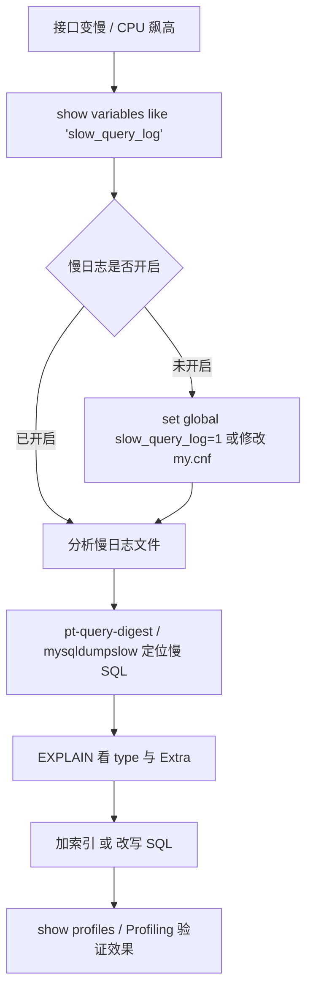
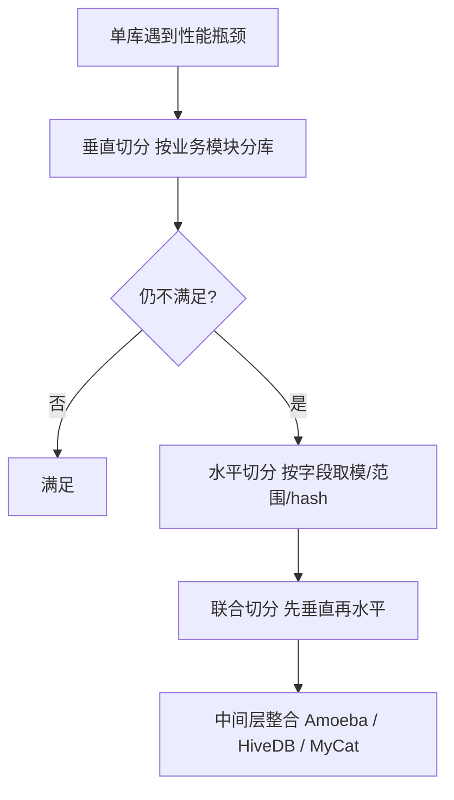

# MySQL 性能优化实战：从一条慢 SQL 到索引与架构调优

接口变慢，往往是一条慢 SQL 在作祟。性能优化不能凭感觉，本文从慢查询日志、执行计划，一路讲到索引技巧与架构调优，给出一条可落地的排查路径。

接口突然变慢，查半天发现是一条慢 SQL。这种事后端开发者基本都撞上过：白天跑得好好的接口，晚上高峰突然响应飙到好几秒，监控里应用没变，Java 虚拟机（JVM）的内存也没满，最后把锅甩给数据库才定位到问题。优化这事儿说大不大，说小也不小，但有一点是确定的，别凭感觉瞎改，先把事实和工具摆出来。

**先说清版本：** 本文所有示例基于 **MySQL 5.7**。如果跑在 MySQL 8.0 上，下面几条已经失效：`query_cache_size` / `query_cache_type` 已被移除，`sql_no_cache` 关键字已被移除，`SET global profiling` 与 `SHOW PROFILE` 已被移除（改看 Performance Schema 或 `EXPLAIN ANALYZE`），`grant ... identified by ...` 也不能再隐式创建用户（要先 `create user` 再授权）。

> **读前须知：** 只要会写基本的 `SELECT` 和建表，就能看懂全文。文章的顺序就是真实排查的顺序：先开慢日志把慢 SQL 找出来，再用 `EXPLAIN` 看它为什么慢，然后改索引和写法，最后才轮到架构层面的主从、读写分离和分库分表。前面几节最实用，后面几节可以先跳过，等真遇到瓶颈了再回来读。

**第一，** 性能优化不是玄学，它有几条原则得先记心里。

## 性能优化几条原则

资料里把优化的心态讲得很实在，一共五条，值得贴在工位上：

**适度优化，** 切忌过度优化。很多开发者一上来就想把每条 SQL 都榨干，结果改出一堆难维护的写法，收益还没 bug 多。先优化最大瓶颈，事半功倍，把力气花在占比最高的那条慢查询上，比到处微调强得多。

**更关键的是，** 依据数据而不是凭空猜测。到底哪条慢，得看慢日志、看执行计划，不能拍脑袋说「这个字段应该加索引」。

**再说，** 性能优化是持久战，道高一尺魔高一丈。业务量涨了，原来快的 SQL 又慢了，这是常态。最后一条也常被忽略：深入理解业务。索引怎么建、分不分表，归根结底看业务访问模式，脱离业务谈优化都是空谈。

下面这张图把这套方法论串起来，定位问题永远比直接动手改 SQL 更重要。



## 先把慢查询日志打开

MySQL 有个慢查询日志，当查询超过一定的时间没返回结果，才会被记进去。**默认是不开启的**，所以采样时要手工打开。

**先看日志状态，** 用下面三条命令确认：

```sql
-- 查看慢 SQL 日志是否启用（on 表示启用）
show variables like 'slow_query_log';

-- 查看执行慢于多少秒的 SQL 会记录到日志
show variables like 'long_query_time';

-- 模糊搜索，查看所有含 query 的变量
show variables like '%query%';
```

**在配置层面，** Windows 下改 `my.ini`（Linux 是 `my.cnf`），找到 `[mysqld]` 区段加上这些参数。资料里给的常用配置项很全：

```ini
# 是否开启慢查询日志
slow_query_log=1
# 指定保存路径及文件名，默认为数据文件目录
slow_query_log_file="bxg_mysql_slow.log"
# 指定多少秒返回查询的结果为慢查询
long_query_time=1
# 记录所有没有使用到索引的查询语句
log_queries_not_using_indexes=1
# 记录那些由于查找了多于 1000 次而引发的慢查询
min_examined_row_limit=1000
# 记录那些慢的 optimize table、analyze table 和 alter table 语句
log_slow_admin_statements=1
# 记录由 Slave 所产生的慢查询
log_slow_slave_statements=1
```

注意 `datadir` 是数据文件目录，改完这些参数需要重启数据库服务才生效。如果不想重启，也可以用命令行临时改，不过重启后会失效：

```sql
set global slow_query_log=1;
set global slow_query_log_file='bxg_mysql_slow.log';
set long_query_time=1;
set global log_queries_not_using_indexes=1;
set global min_examined_row_limit=1000;
set global log_slow_admin_statements=1;
set global log_slow_slave_statements=1;
```

**慢日志的格式，** 主要包含五块：时间、主机信息、执行信息、执行时间、执行内容。拿到日志后，可以用 `mysqldumpslow`（MySQL 自带，基于 perl）、`mysqlsla` 或者 `pt-query-digest` 去分析，后者能统计每条查询的执行时间、次数和占比，帮你锁定该先优化哪条。

**顺带提一句查询缓存。** Query Cache 会缓存 select 查询，至于默认开不开要分版本说：MySQL 5.6.8 之前 `query_cache_type` 默认是 `ON`（资料里说的「安装时默认开启」指的就是这个时期），从 5.6.8 起默认值已改为 `OFF`，本文的 5.7 环境即是如此。但无论是哪个版本，一旦对表做 INSERT、UPDATE、DELETE、TRUNCATE、ALTER TABLE 等操作，旧缓存就失效删掉，所以频繁变动的表开缓存并不明智，测试性能时也得关掉它。

```sql
-- 查看缓存命中情况
show VARIABLES like '%cache%';
select count(*) FROM test;
select count(*) FROM test;
show status like '%qcache%';

-- 临时关闭缓存
set global query_cache_size=0;
set global query_cache_type=0;

-- 单条语句禁用缓存
Select sql_no_cache count(*) from pythonlearn.lianjia;
```

永久关闭就改 `my.cnf`，加上 `query_cache_type=0` 和 `query_cache_size=0`。

## 用 EXPLAIN 看执行计划

光有慢日志还不够，得知道慢在哪。`EXPLAIN` 是 MySQL 自带的一个「执行计划查看器」：在任意一条 `SELECT` 前面加上 `EXPLAIN` 再执行，MySQL 不会真的去查数据，而是把「它打算怎么查这张表」列成一个表格给你看。资料里重点讲了它，常用三种写法：`EXPLAIN SELECT …` 看执行计划；`EXPLAIN EXTENDED SELECT …` 再用 `SHOW WARNINGS` 看优化器改写后的语句；`EXPLAIN PARTITIONS SELECT …` 看分区表是否用到了索引。

**最该盯的是 type 字段，** 它表示 MySQL 在表里找行的方式，按优劣排是这样的：

```text
NULL > system > const > eq_ref > ref > fulltext > ref_or_null
> index_merge > unique_subquery > index_subquery > range > index > ALL
```

一般来说要保底到 `range`，最好能到 `ref`。`ALL` 就是全表扫描，得想办法消掉。`Extra` 列也很有信息量：`Using index` 是覆盖索引，好事；`Using where` 是存储引擎取完行再过滤；`Using temporary` 用了临时表，常见于排序分组；`Using filesort` 是没法用索引排序；`Using join buffer` 说明连接没走索引，该加索引了。

**想看资源消耗，** 可以用 Query Profiler，会话级开启后能看到 CPU、IO 明细：

```sql
SET global profiling=on;
show VARIABLES like '%profiling%';
set profiling_history_size=100;
select * from person limit 10000,100;
show profiles;
show profile cpu,block io for query 501;
```

另外 `show status like 'last_query_cost';` 能看上一条查询的代价（IO 和 CPU 开销总和），`show processlist;` 则能实时看当前连接都在干什么。

## 索引与 SQL 优化要点

**说起索引，** 本质是快速定位某列有特定值的行，不建索引 MySQL 就得从头遍历整张表。存储类型主要是 BTREE 和 HASH，InnoDB 实际用的是 B+Tree。聚簇索引一个表只能有一个，默认就是主键。

**但索引不是越多越好。** 资料里这些使用原则很落地：索引数最好别超过 6 个，否则插入更新时维护索引反而拖慢；像「性别」这种不同值很少的列别建索引，sex 一半男一半女，建了也用不上；数据量小的表干脆别用索引，全表扫都比遍历索引快。经常更新的表少建索引，经常查询的字段才该建。

**组合索引要守最左前缀，** 比如 `INDEX MultiIdx(id,name,age)`，只有用到 `(id,name,age)`、`(id,name)` 或 `(id)` 才走索引，`(name,age)` 就不行。资料里还有一段很好记的口诀：

```text
全值匹配我最爱，最左前缀要遵守；
带头大哥不能死，中间兄弟不能断；
索引列上少计算，范围之后全失效；
Like 百分写最右，覆盖索引不写星；
不等空值还有 or，索引失效要少用；
VAR 引号不可丢，SQL 高级也不难！
```

**落到 SQL 上，** 几条实打实的建议：避免 `SELECT *`，只取需要的列，还能顺便促成覆盖索引；`where` 里别用 `!=` 或 `<>`，引擎会放弃索引全表扫；`like` 别前置百分号，`'%LVc1o%'` 失效，`'LVc1o%'` 才走索引；别在字段上做表达式或函数操作，比如 `where num/2=100` 改 `where num=200`；用 `UNION` 代替 `OR`，资料里对比过，UNION 的 type 一般到 `ref`、ref 是 `const`，OR 只有 `range`、ref 为 `null`；能用 `exists` 就别用 `in`。

**分页是个大坑。** `limit 999900,100` 这种翻到万页后会很慢，因为 limit offset 是逐行查找先查再跳。资料给了两个技术法子：

```sql
-- 方法一：id 连续时直接用 id 过滤，约 0.001s
select * from person where id>999900 limit 100;

-- 方法二：延迟关联，先只查 id 走覆盖索引，再回表
select id from person limit 999900,100;
select p.* from person p
  inner join (select id from person limit 999900,100) as tmp on p.id=tmp.id;
```

还有个细节：MySQL 5.7 里 `where num is null` 已经能用索引了，老资料说「别做 null 判断」那条在 5.7 可以不用纠结。

**覆盖索引值得专门说。** 如果索引本身就包含了查询要的所有字段，MySQL 读完索引就不必回表，EXPLAIN 的 Extra 会显示 `Using index`。资料里举了个图片表的例子：原来是 `(user_id)` 单列索引，改成 `(user_id,picname,smallimg)` 联合索引后，平均耗时从 40ms 降到 30ms，靠的就是覆盖索引减少 IO。

## 架构层面：从主从复制到分库分表

单库扛不住时，就得往上走。**主从复制是第一步，** 数据可以从一个主节点复制到多个从节点，默认异步。目的有三个：数据同步备份（主库挂了切从库）、读写分离（写走 master 读走 slave）、高可用（分摊磁盘 IO）。原理是 master 把更新事件写进 binlog，slave 开两个线程，IO 线程读 binlog 写进 relay log，SQL 线程再执行。关键配置：

master 的配置文件（`/etc/my.cnf`）：

```ini
[mysqld]
Log_bin=mysql-bin
server-id=10
```

slave 的配置文件（`/etc/my.cnf`）：

```ini
[mysqld]
Log_bin=mysql-bin
server-id=11
```

**主从的 server-id 必须不同**，它是每个节点的唯一标识，默认是 1，一般取 IP 最后一段（这里主库取 10、从库取 11）。如果两边配成一样，复制起不来。改完配置文件都要重启 mysqld 才生效。

```sql
-- master 上创建复制用户
grant replication slave on *.* to 'root'@'%' identified by '123456';
show master status;
-- slave 上指向 master
change master to
  master_host='192.168.33.10',master_user='root',
  master_password='123456',master_log_file='mysql-bin.000001',master_log_pos=437;
start slave;
show slave status\G;
```

**上面那条授权只是演示，别原样照抄到生产。** 它同时踩了三个坑：用 `root` 这个超管账号、`'%'` 对全部客户端开放、`123456` 还是弱口令。资料里其实已经提示过：`*.*` 表示对所有库的所有操作，`%` 表示所有客户端都可能连，可以用具体的客户端 IP（如 `192.168.33.11`）代替以加强安全；而在讲 `mysqlreplicate` 时更直接地说明：创建用户时**从库 IP 要明确，不要用 `'%'`**。实际做法是用一个专用复制账号、把 host 限定成从库 IP、口令设成强口令，例如 `create user 'repl'@'192.168.33.11' identified by '强口令';` 再授予 `replication slave`。

`show slave status\G` 里 `Slave_IO_Running` 和 `Slave_SQL_Running` 都必须为 `Yes`。

**读写分离可以上中间件。** MaxScale 是 MariaDB 出品、插件式结构，路由插件负责把请求分发到后端实现读写分离和负载均衡；MySQL-Proxy 是官方代理层，本身靠 LUA（一种很轻量的脚本语言）脚本实现路由、过滤、负载均衡。

**数据量再大就得分片（Sharding）。** 按切分规则分三类：垂直切分按不同表或 Schema 分到不同库，规则简单、模块清晰，但跨库 Join 得在程序里做；水平切分把同一张表按字段（取模、范围、hash）拆到多库，表关联基本能在库内完成，扩展性好，但规则难统一；联合切分就是先垂直再水平，综合两者优势。整合这些分散的数据源，常见方案有 Amoeba、HiveDB、MyCat 这类中间层，让后端集群对应用透明。



**最后的硬货在硬件和操作系统。** 资料里点得很实，按「投入产出比」从高到低列几件最划算的事：

- 存储：用 SSD（固态硬盘）或 PCIe SSD，能拿到数百到上万倍 IOPS（每秒读写次数）提升。
- 磁盘阵列写策略设 WB（Write Back，先写缓存再慢慢落盘，快但断电有丢数据风险）甚至 FORCE WB，严禁用 WT（Write Through，写完盘才算完，安全但慢）。
- 阵列方案尽量选 RAID-10（多块硬盘组成的阵列方案，性能和冗余兼顾），而非 RAID-5。
- 文件系统用 xfs 别用 ext3，挂载时加上 `noatime,nodiratime,nobarrier`。
- I/O 调度器用 deadline/noop，别用 cfq。
- MySQL 自身：把 `innodb_buffer_pool_size` 设成物理内存的 80%，超过 1G 就配上 `innodb_buffer_pool_instances` 多实例（比如 25G 配 24 个）；再加上 `sort_buffer_size`、`join_buffer_size`、`table_cache` 这些按状态值调，整体吞吐就上来了。

> 优化这事没有银弹，先把慢日志打开、用 EXPLAIN 说话，索引和 SQL 写好，单库到顶了再谈主从、分片。一步一步来，比一次性大改稳当得多。

## 要点回顾

- 优化靠数据不靠感觉：开 `slow_query_log`、看 `long_query_time`，用 `pt-query-digest` / `mysqldumpslow` 定位慢 SQL。
- `EXPLAIN` 盯 `type`（保底 `range`、最好 `ref`，消掉 `ALL`）与 `Extra`（`Using index` 覆盖索引是好事）。
- 索引守最左前缀，别在列上做函数/表达式运算，`SELECT *` 与前置 `%` 的 `like` 会让索引失效；分页深翻用延迟关联。
- 单库到顶再走架构：主从复制 + 读写分离（MaxScale / MySQL-Proxy 这类读写分离中间件），再分片（垂直 / 水平 / 联合），经 Amoeba、HiveDB、MyCat 这类中间层整合。
- 硬件层把 `innodb_buffer_pool_size` 设到物理内存 80%，配合 SSD、RAID-10、xfs 与 deadline 调度器，整体吞吐才上得来。
