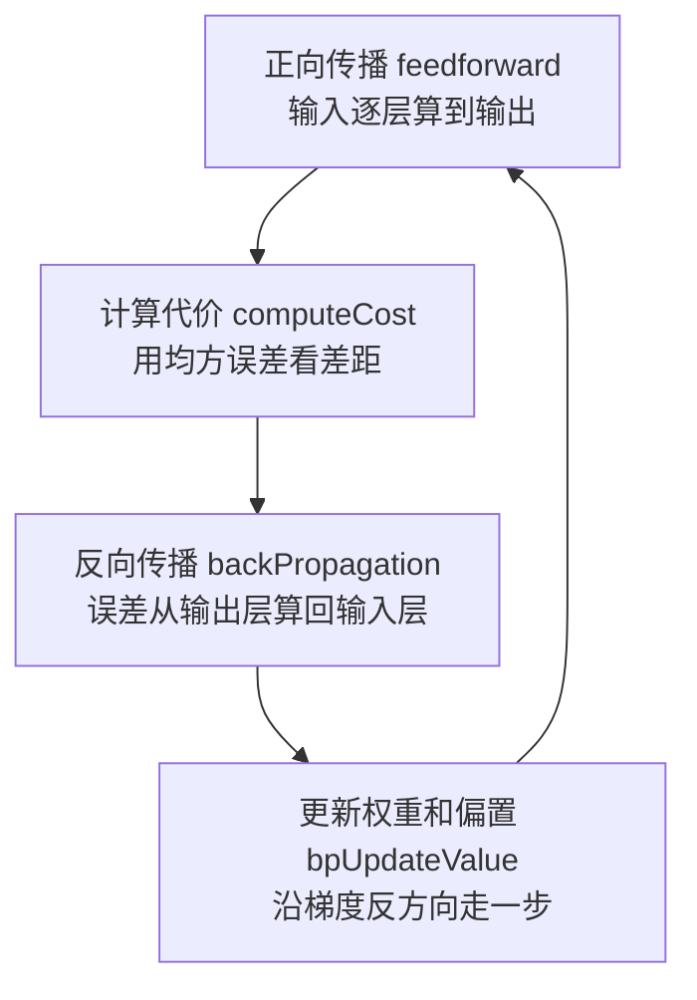
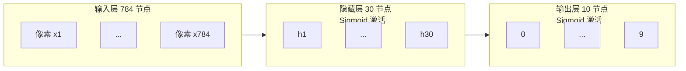

# Java 工程师入门 AI：用纯 Java 手写一个 BP 神经网络识别手写数字

神经网络没那么玄，本质上就是一个用 Java 也能写出来的数学结构。本文用纯 Java 手写一个最经典的 BP（反向传播）神经网络，在 MNIST（一个公开的手写数字图片数据集，相当于机器学习界的「Hello World」题库）上把 0 到 9 认出来，并顺带梳理 Java 生态里现成的机器学习库。

**写在前头，** 做 JavaEE 这些年，AI 这个词听得耳朵起茧，但总觉得那是算法工程师的领地，跟日常写业务代码的开发者隔着一层。直到有一天产品说「能不能给后台加个手写数字录入」，才发现：神经网络没那么玄，它本质上就是一个用 Java 也能写出来的数学结构。这篇文章就用纯 Java 手写一个最经典的 BP（反向传播）神经网络，在 MNIST 数据集上把 0 到 9 认出来。不堆公式推导，只讲清楚每一步在代码里长什么样。

> **读前须知：** 别被「神经网络」这四个字吓住。全文用到的数学只有加减乘除，再加一点点「往低处走」的直觉（梯度下降说白了就是反复往代价更小的方向挪一小步）。顺序上是先讲概念、再拆单个神经元、最后才组装成完整网络和 Java 代码。遇到公式不用推导，看懂它对应代码里的哪几行就够了。

## AI、机器学习、深度学习，到底谁包含谁

**先理清楚概念，** 不然看资料很容易绕晕。这三者的关系是一个层层包含的子集：

- 深度学习（Deep Learning）是机器学习（Machine Learning）的一种实现方式；
- 机器学习和深度学习都属于人工智能（Artificial Intelligence）的子集；
- 而人工神经网络（ANN）是驱动机器学习和深度学习的主要算法。

简单说，你写一个神经网络，其实就已经站在了「用机器学习实现人工智能」这条链路上。顺便提一句，人工神经网络也叫多层感知机（MLP，Multilayer Perceptron），它最底层是输入层，中间是隐藏层，最后是输出层，层与层之间是全连接的，也就是上一层的任意一个神经元都连着下一层的所有神经元。

## 神经元、权重和偏置：先把网络拆成一个公式

**落到代码上，** 一个神经元干的事特别朴素。它接收好几个输入 x1、x2……xn，每个输入乘一个对应的权重 w1、w2……wn，全部加起来，再补一个偏置 b，得到：

```text
∑(x * w) + b
```

这个 `∑x*w+b` 就是单个神经元在「激活之前」算出来的中间值。权重决定了某个输入有多重要，偏置相当于给整体输出挪了个基准线。在示例项目里，`Layer` 这个类就老老实实把这俩东西存成了两个二维数组：

```java
private double[][] weights; // 权重 [i][j]，i 是当前层节点，j 是上一层节点
private double[][] biases;  // 偏置 [i][1]
```

构造 `Layer` 时权重和偏置都是随机初始化的，比如 `Math.random() * (random.nextInt(2) == 0 ? -1 : 1)`，让网络一开始有个随机的起点，后面再靠训练往好的方向调。

## 激活函数为什么不能省

**这是新手最容易踩的坑。** 如果把激活函数去掉（相当于激活函数就是 `f(x) = x`），那每一层节点的输入都是上一层输出的线性函数。你可以验证一下：不管网络叠多少层，最终输出始终都是输入的线性组合，网络的逼近能力就非常有限，学不出那些弯弯曲曲的真实规律。

所以必须在 `∑x*w+b` 外面套一层非线性函数 `f(∑x*w+b)`。示例项目里把激活函数抽象成了 `ActivationFunction` 接口，抽象方法一共四个，是两两重载的两组：`activate(double zElement)` 和 `activate(double zElement, double[] z)`，`computeDerivative(double zElement)` 和 `computeDerivative(double zElement, double[] z)`。带第二个参数 `z` 的那组是给 Softmax 这类「一个节点的输出依赖同层所有节点」的函数留的口子。

具体实现有 `SigmoidActivation` 和 `SoftmaxActivation` 两种（Sigmoid 可以理解成一条 S 形曲线：不管输入多大或多小，都被它压进 0 到 1 之间；Softmax 则是把一组输出压成「全部加起来正好等于 1」的概率分布），但要注意：**示例项目实际启用的是 Sigmoid，而且是所有层都用同一个 `SigmoidActivation`**。看训练入口就能确认：

```java
NeuralNetworkModel neuralNetworkModel = new NeuralNetworkModel(
        netStructureList, new MSECostFunction(), new SigmoidActivation(), learningRate);
```

`NetTrainAndTest` 只 new 了一个激活函数实例，构造函数再把它原样传给每一层（`Layer` 对象），所以隐藏层和输出层共用同一套 Sigmoid。Softmax 属于**预留的可替换实现**：它本身写得没问题，但全项目从头到尾没有 `new SoftmaxActivation()`，`Layer` 和 `NeuralNetworkModel` 里那几处 `instanceof SoftmaxActivation` 只是分支判断；想换的话要自己调用 `setActivationFunction(int i, ActivationFunction)` 给指定层塞进去。这也解释了为什么输出层的十个值加起来不等于 1：只有 Softmax 才会把它们压成和为一的概率分布，Sigmoid 只管把每个值各自压到 0~1。

## 代价函数：网络好不好，得有个量法

**训练的目标很直白，** 就是让网络输出 `y'` 尽可能贴近真实标签 `y`。怎么衡量「贴近不贴近」？靠代价函数（也叫损失函数）。示例项目用的最常见的均方误差：

```text
C = 1/m ∑(y – y')²
```

这里 m 是样本数量，把每个样本的预测值和真实值的差平方求和再平均。代价越小，说明网络越准；最优的输出，就是那些让代价函数值最小的输出。代码里代价函数被抽象成 `CostFunction` 接口，均方误差的具体实现是 `MSECostFunction`，同样提供了 `computeCost` 和 `computeDerivative` 两套方法，导数在反向传播时用来算误差该怎么往回传。

**对着源码看时这里容易错位，** 资料上的公式和 `MSECostFunction` 的实现差了一个 1/2：

```java
@Override
public double computeCost(double aElement, double yElement) {
    return Math.pow(aElement - yElement, 2) / 2.0; // 两值差的平方除2
}

@Override
public double computeDerivative(double aElement, double yElement) {
    return aElement - yElement;
}
```

也就是说，单个输出节点上实现的是 `(a - y)² / 2`，正好是资料公式里那一项的一半。多除这个 2 是有意为之：求导时指数 2 落下来刚好和分母的 2 约掉，导数就干干净净剩下 `a - y`，反向传播里少乘一个常数。它不影响梯度下降的方向和最优解的位置，只影响代价的绝对数值。另外 `NeuralNetworkModel#computeCost` 在累加完所有输出节点后，还会再除以输出层的节点数 `getCurrNodeNum()` 做一次平均，这是资料公式里没体现的第二处细节。所以别拿公式直接硬套打印出来的 cost 数值，两者差一个 1/2 和一个 1/10 的缩放。

## 梯度下降：怎么让代价变小

**代价有了，** 接下来要回答「往哪个方向调权重能让代价降下去」。梯度下降就是干这个的优化算法：它沿代价函数的梯度反方向走一小步，代价就小一点。根据每次用多少样本，分三种变体：

- 批量梯度下降（BGD）：每次迭代都用全部样本来更新梯度；
- 随机梯度下降（SGD）：每次只用一个样本；
- 小批量随机梯度下降（Mini-batch SGD）：折中，每次用一小批样本，最常用。

这里还牵连出三个训练相关的概念：**周期（epoch）** 是整个网络把所有批次都跑一遍的迭代次数；**批次（batch）** 是做小批量下降时每个批量的样本大小；**学习速率（learning rate）** 是梯度下降时每一步的步幅，调太大容易来回震荡，调太小又收敛得慢。

## 正向传播与反向传播：训练的两步舞

**训练的核心就四个动作循环。** 正向传播把输入一层层算到输出，计算代价看差多少，反向传播把误差从输出层一路算回输入层、得到每个权重和偏置该往哪调，最后更新参数。示例项目的 `NeuralNetworkModel` 里 `feedforward` 负责正向、`backPropagation` 负责反向、`bpUpdateValue` 负责按 `learningRate / total * delta` 更新。用一张图把流程串起来：



反向传播在源码里标了 BP1 到 BP4 四步：先算最后一层的误差，再逐层往前传，最后汇总出每个偏置和权重的调整量。数学上不复杂，关键是矩阵乘法别写错位。

## MNIST：现成的手写数字题库

**数据不用自己造，** MNIST 是全球最权威的手写数字库，由美国邮政系统开发，采集自人口调查局员工和高中生手写的 0 到 9。资料里这四个名字习惯写成连字符形式（`train-images-idx3-ubyte` 这种），但源码里 `MNISTRead` 用的是**点号**：

```java
public static final String PATH = "D:\\anaconda3\\data\\MNIST";
public static final String TRAIN_IMAGES_FILE = PATH + "/train-images.idx3-ubyte";
public static final String TRAIN_LABELS_FILE = PATH + "/train-labels.idx1-ubyte";
public static final String TEST_IMAGES_FILE  = PATH + "/t10k-images.idx3-ubyte";
public static final String TEST_LABELS_FILE  = PATH + "/t10k-labels.idx1-ubyte";
```

对应到四个文件就是：

- `train-images.idx3-ubyte`：60000 个训练图片；
- `train-labels.idx1-ubyte`：这 60000 个图片对应的数字标签；
- `t10k-images.idx3-ubyte`：10000 个测试图片；
- `t10k-labels.idx1-ubyte`：测试图片对应的标签。

官网下载解压出来的文件名是连字符形式，所以照着源码跑之前得先把文件名改成点号形式（或者反过来把源码里的常量改成你本地的名字），两边对齐了才不会 `FileNotFoundException`。另外 `PATH` 也是写死的 Windows 路径，跑之前同样要换成自己机器上的实际目录。

每张图是 28×28 像素，拉平就是 784 个输入特征，所以网络输入层固定是 784 个节点。示例项目的 `MNISTRead` 类负责读这些 `idx3-ubyte` 文件，读像素时做了一件很关键的事：归一化。

```java
// 读取单字节像素后除以 255，把 0~255 压到 0~1 区间
element[j] = bin.read() / 255.0;
```

归一化让数值落在小范围里，训练更稳定，这一步省掉后面很容易训不动。

## 用 Java 手写一个 BP 网络的关键设计

**串起来看整体结构。** 三层网络 784（输入）→ 30（隐藏）→ 10（输出），全连接，画出来是这样：



整个示例是一个 Spring Boot 工程，`AIApplication` 是启动类。真正触发训练的是 `AIRestController`，它挂了两个接口：`/train` 启动训练，`/recognition` 用训练好的模型识别前端传来的手写图（base64 转成 784 维数组再喂给网络）。训练参数就写在这个控制器里：

```java
// 三层网络：输入 784，隐藏层 30，输出 10
int[] nodeNum = {784, 30, 10};
int epoch = 6;          // 周期：全部批次跑 6 遍
int batchSize = 60;     // 小批量：每批 60 个样本
double learningRate = 0.5; // 学习速率
NetTrainAndTest.train(nodeNum, epoch, batchSize, learningRate);
```

`NeuralNetworkModel` 拿着这组拓扑和参数，内部用 `miniBatchSGD` 做小批量随机梯度下降：每轮先把样本下标 `Collections.shuffle` 打乱，再按 `batchSize` 切成小批，逐批调用 `BGD` 完成正向、算代价、反向、更新。隐藏层和输出层都用 Sigmoid，代价函数用均方误差。

**关于准确率那个 95%，得说清楚它的出处。** 它来自 `NeuralNetworkModel` 类的注释（原话是「能在 MNIST 数据集上取得 95% 左右的准确率」），而注释对应的工程配置其实是 `NetTrainAndTest#main` 里的那组更大的网络：`{784, 300, 100, 10}`，四层、`epoch = 30`、`batchSize = 60`、`learningRate = 0.5`。前面 `/train` 接口给的 `{784, 30, 10}` + `epoch = 6` 是给 Web demo 调试用的小网络（源码里那行还留着被注释掉的 `{784, 300, 100, 10}` 和 `epoch = 6; //30` 的痕迹），它比上面那组小得多、也跑得少得多，别把 95% 直接安在这个配置头上：真要复现那个数字，请用 `main` 方法里那组参数。

**值得记一笔，** 这个示例项目把「网络、层、激活函数、代价函数」都做成了可替换的接口（`Layer` / `ActivationFunction` / `CostFunction`），想试别的激活函数或代价函数，实现接口换进去就行，不用动训练主流程。这种面向对象的分层，对 Java 工程师来说比数学公式还亲切。

### 实测：这套纯算法类真的能跑起来

**光看代码总觉得悬，所以我实跑了一遍。** 抽出来的是不含 Spring、不含 DL4J 的纯算法部分（`Layer`、`NeuralNetworkModel`、`MSECostFunction`、`SigmoidActivation`、`SoftmaxActivation`、`MyUtils`），用 JDK 17 直接 `javac` 编译 + `java` 运行，零依赖通过。几点实测结果：

- `{784, 30, 10}` 三层网络能正常构造，`Layer` 实际生成 2 层（3 个节点数对应 2 个 Layer），权重维度分别是 `[30][784]` 和 `[10][30]`，跟全连接的预期一致；
- 喂一个 784 维输入做前向传播，输出确实是 10 维，`getOutput()` 也能正常取到预测数字；
- 按 `epoch=6 / batchSize=60 / lr=0.5` 跑 `miniBatchSGD`，6 轮全部跑完没抛异常，打印出来的代价整体在往下走：0.0522 → 0.0491 → 0.0486 → 0.0471 → 0.0462 → 0.0468（最后一轮有一点点回升，因为源码是每个 epoch 结束后重新取一批样本估算代价，不是在同一批上统计，有几分抖动很正常）；
- Sigmoid 的输出落在 [0,1] 区间，中间取值严格在 (0,1) 内，导数 `computeDerivative` 和 `a*(1-a)` 对得上；
- `SoftmaxActivation` 类本身是能用的，两参数版本 `activate(z_i, z)` 输出求和正好是 1.000000，单参数版本会直接抛 `UnsupportedOperationException`（源码就是这么设计的），再次佐证它只是一份备用实现。

有一点必须说明：**本地没有 MNIST 原始数据文件**（源码里 `MNISTRead.PATH` 写的是作者机器的路径），所以上面跑的是随机构造的 0~1 之间的 784 维向量，数值范围等价于 `MNISTRead` 归一化后的像素。**这只验证了这套代码能编译、能跑、前向反向能通、代价会降，不能据此声称在真实 MNIST 上达到某个准确率。** 要出准确率请自己备好四个数据文件，改掉 `PATH`，用 `NetTrainAndTest#main` 那组参数完整跑一轮。

## Java 生态里现成的 ML（机器学习）库

**自己写网络是为了懂原理，** 真上生产没必要重复造轮子。Java 这边成熟的机器学习库不少，挑五个常用的了解一下：

- **DL4J（Deep Learning for Java）**：https://deeplearning4j.org ，面向 JVM 的深度学习框架，示例项目里的 `DL4JDemo` 用它几十行配置搭了一个「同一任务的另一种实现」，同样是 MNIST 手写数字识别，但网络结构和超参跟手写版并不是同款，还能直接 `ModelSerializer` 存模型、恢复模型做识别。两边的真实对比：

  | | 手写版 `NeuralNetworkModel` | `DL4JDemo` |
  | --- | --- | --- |
  | 网络结构 | 784 → 30 → 10 | 784 → 1000 → 10 |
  | 激活函数 | 全部 Sigmoid | 隐藏层 ReLU，输出层 Softmax |
  | 代价/损失 | 均方误差 MSE | 负对数似然 NEGATIVELOGLIKELIHOOD |
  | batchSize | 60 | 128 |
  | epoch | 30（`main`）／6（`/train`） | 15 |
  | 优化器 | 手写 SGD（学习率 0.5） | Nesterovs，学习率 0.006、动量 0.9 |
  | 初始化 | `Math.random()` 随机 | WeightInit.XAVIER |

  看出来了吧：DL4J 版本明显更接近主流做法：ReLU 配 Softmax、配 Xavier 初始化、带动量的优化器，所以学习率才敢给到 0.006 这么小。这也正好印证前面说的：Sigmoid 还是 Softmax、ReLU 还是别的，都是通过框架配置切换的选项，手写版里对应的是 `setActivationFunction` 那个方法。

- **WEKA**：https://www.cs.waikato.ac.nz/ml/ ，老牌数据挖掘套件，分类聚类啥都有；
- **MOA**：http://moa.cms.waikato.ac.nz/ ，专注数据流和在线学习；
- **MALLET**：http://mallet.cs.umass.edu/ ，偏自然语言处理，主题模型、序列标注强；
- **ELKI**：https://elki-project.github.io/ ，主打数据挖掘里的聚类算法研究。

## 要点回顾

**回过头看，** 一个能认手写数字的神经网络，拆开就是：全连接的层、带权重的神经元、非线性的激活函数、衡量差距的均方误差、以及梯度下降驱动的正向反向两步舞。这些概念不用先啃完高数也能动手，示例项目已经用 `Layer`、`ActivationFunction`、`CostFunction`、`NeuralNetworkModel` 把骨架搭好了，参数就那几个：784*30*10、epoch=6、batchSize=60、learningRate=0.5。把源码跑一遍，比看十篇科普都来得实在。等原理通了，再切到 DL4J 这类库做正经业务，心里就有底了。
