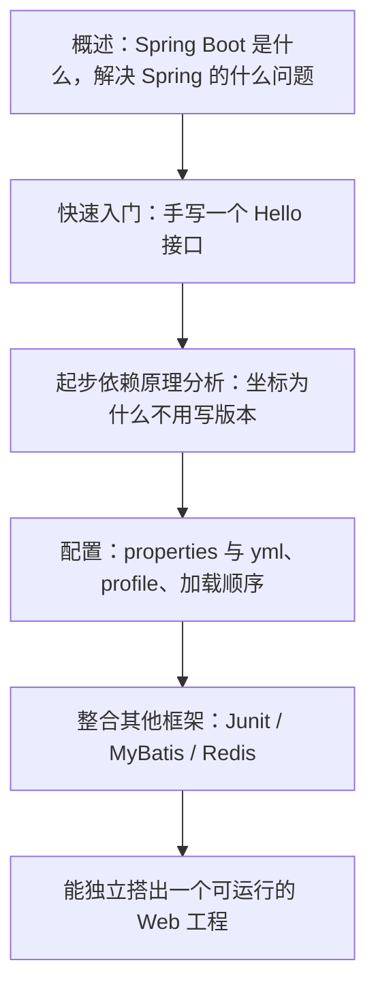
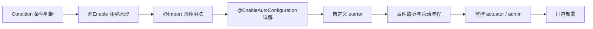

# 两天学完 Spring Boot：先跑通第一个接口，再拆开自动配置

翻开任意一份 Spring Boot 教程，前几页总是同一套动作：继承父工程、加一个 starter、写个引导类、浏览器出 Hello。照着做完确实能跑，但紧接着就会遇到三连问：这个依赖为什么不用写版本号？`application.properties` 到底能写多少东西？整合 MyBatis 的时候报错了，该去哪儿查？

问题不在于教程写得浅，而在于知识点是平铺的，没有告诉你哪块是地基、哪块是装修。下面把两天课程的内容按「解决什么问题」重新排一遍，让你在动手之前就知道每一步踩在哪块板上。

## 先给结论

- 第一天解决「能用」：从零搭工程、跑通接口、搞清坐标从哪来、搞清配置往哪写、把第三方框架接进来。
- 第二天解决「懂为什么」：自动配置的条件判断、`@Enable` 系列注解、`@Import` 的四种用法、自定义 starter、启动流程、监控与部署。
- 两天的分界线很清楚：第一天你是使用者，第二天你要具备造轮子的能力。
- 真正需要投入精力的只有三块：起步依赖的版本仲裁、配置文件的加载顺序、自动配置的条件装配。
- 整合 JUnit、MyBatis、Redis 属于熟练度问题，看懂一遍套路即可，遇到新框架照抄结构。

## 第一天的路线：把工程从零跑到能访问

第一天五块内容是按「依赖顺序」而不是「难度顺序」排的，前面没搞清楚，后面就只能抄：



图里 C 和 D 是最容易被跳过、也最容易在后面反复回头的两块。跳过 C 的典型表现是：一旦自己加依赖就报版本冲突；跳过 D 的典型表现是：改了配置不生效，却不知道是被别的文件覆盖了。

## 每块内容对应的真实问题

**概述解决的是定位问题。** 很多人把 Spring Boot 当成「一个更厉害的 Spring」，其实它不是 Spring 的增强版，而是改变了使用方式：Spring 提供 IOC、AOP 这些能力，Spring Boot 负责把这些能力以最少的配置组装起来。它在 Spring 生态里和 Spring Framework、Spring Cloud 是同级别的顶级项目，官网那张三层图分得很清楚：Spring Boot 负责 Build Anything（构建单体应用），Spring Cloud 负责 Coordinate Anything（协调多个应用），Spring Cloud Data Flow 负责 Connect Everything（数据连接）。认清这一层，才不会在单体项目里硬塞微服务组件。

**快速入门解决的是最短路径问题。** 目标只有一个：证明「一个 pom、一个 Controller、一个引导类」就能跑。这一步不要纠结细节，先跑通再回头看每一步。

**起步依赖原理分析解决的是依赖地狱。** 传统 SSM 项目里，Spring、Spring MVC、Jackson、Tomcat 插件的坐标要逐个引进 pom，每个都要挑版本，A 坐标和 B 坐标能不能兼容只能靠试。起步依赖把一组经过版本验证的坐标打成一个包，你引 `spring-boot-starter-web`，其余的靠依赖传递带进来，版本由父工程 `spring-boot-starter-parent` 仲裁。

**配置解决的是「配置写在哪、谁说了算」。** 包括 `properties` 与 `yml` 两种格式、yaml 的数组和对象写法、`@Value` 与 `Environment` 两种读取方式、多环境 `profile` 切换，以及最关键的加载顺序：项目内部四个位置的优先级、外部配置如何覆盖内部配置。

**整合其他框架解决的是落地问题。** 课程里给了三个典型：JUnit（把测试跑起来）、MyBatis（接数据库）、Redis（接缓存）。这三块的价值不在于记住配置，而在于看出同一个套路：引 starter、写配置项、业务代码里直接注入。

## 第二天的路线：把自动配置拆开看

第二天全部围绕一个问题展开：Spring Boot 到底是怎么判断「该配什么、不该配什么」的。



这条线的关键转折点在 E。前面四块都是「读别人的源码」，到自定义 starter 变成「自己写一个」，你会亲手创建 `xxx-spring-boot-autoconfigure` 和 `xxx-spring-boot-starter` 两个模块，写自动配置类、写 `spring.factories`。走完这一遍，前面所有的条件注解都会从「背过」变成「用过」。

收尾是打包部署：打成 jar 用 `java -jar` 就能跑起来。

## 三块值得多花时间的地方

**第一，版本仲裁。** `spring-boot-starter-parent` 里维护了一张巨大的依赖版本清单，你写的 starter 不带版本号就是这个清单在起作用。一旦你手动给某个依赖指定版本，就可能和这张清单打架，症状是 `NoSuchMethodError` 而不是明确的版本冲突提示。

**第二，配置加载顺序。** 同一项配置在项目内部可以有四个位置，外部配置（命令行参数、环境变量、外部配置文件）又能覆盖内部。改了不生效时，先确认是不是被更高优先级的配置盖掉了。

**第三，条件装配。** `@ConditionalOnClass`、`@ConditionalOnMissingBean`、`@ConditionalOnProperty` 这三个注解决定了自动配置的实际行为。理解「classpath 里有什么才配什么」和「你没有我才配」这两条规则，就能解释绝大多数「为什么我的配置没被自动装配」类问题。

## 走完第一天，你应该能独立写出这些

不用背，能照着这个结构复现一遍就算过关。pom 只有两个关键处：

```xml
<parent>
    <groupId>org.springframework.boot</groupId>
    <artifactId>spring-boot-starter-parent</artifactId>
    <version>2.1.8.RELEASE</version>
</parent>

<dependencies>
    <dependency>
        <groupId>org.springframework.boot</groupId>
        <artifactId>spring-boot-starter-web</artifactId>
    </dependency>
</dependencies>
```

Controller 和传统 Spring MVC 的写法完全一致：

```java
package com.example.controller;

import org.springframework.web.bind.annotation.RequestMapping;
import org.springframework.web.bind.annotation.RestController;

@RestController
public class HelloController {

    @RequestMapping("/hello")
    public String hello() {
        return "hello Spring Boot !";
    }
}
```

引导类是 Spring Boot 新增加的部分，`main` 方法就是项目入口：

```java
package com.example;

import org.springframework.boot.SpringApplication;
import org.springframework.boot.autoconfigure.SpringBootApplication;

@SpringBootApplication
public class HelloApplication {

    public static void main(String[] args) {
        SpringApplication.run(HelloApplication.class, args);
    }
}
```

运行 `main` 方法，看到控制台打出 `Tomcat started on port(s): 8080`，访问 `http://localhost:8080/hello` 拿到字符串，第一天的目标就达成了。

## 常见误区

- **把 Spring Boot 当成新框架从头学**：它不改变编程模型，`@RestController`、`@Service`、`@Autowired` 的用法和以前一样，变的只是工程搭建和配置方式。
- **入门阶段死磕原理**：第一天先跑通、先会整合，等到第二天有源码上下文时再回头看条件装配，效率高得多。
- **自己指定依赖版本号**：和父工程的版本清单冲突时，报错往往不在依赖本身，而在运行时的方法缺失，排查成本很高。
- **跳过自定义 starter**：只读不写，`@Conditional` 系列注解永远停留在「听说过」的状态。

## 面试可能被问到的问题

1. 面试官追问：「Spring Boot 和 Spring Framework 是什么关系？」
   答：两者是 Spring 生态下同级别的顶级项目，不是包含关系。Spring Framework 提供 IOC、AOP 等核心能力，Spring Boot 提供快速使用这些能力的方式。Spring Boot 并没有增强 Spring 的功能，它简化的是配置和依赖管理。

2. 面试官追问：「课程为什么要先讲快速入门再讲起步依赖原理？」
   答：因为起步依赖原理讲的是版本仲裁和依赖传递，没有亲手引过坐标、没有见过版本冲突的现象，直接讲原理很难建立直观认识。先跑通产生疑问，再回头解答，接受度更高。

3. 面试官追问：「第一天的配置和第二天的高级内容，哪部分对日常工作影响更大？」
   答：配置。日常开发里改动最多的是配置项，而加载顺序、`profile` 切换、外部配置覆盖这些问题天天都会遇到。自动配置原理主要影响排查疑难问题的能力，属于进阶要求。

4. 面试官追问：「学 Spring Boot 需要先把 SSM 学扎实吗？」
   答：需要。Spring Boot 简化的是搭建和配置，业务代码仍然用 Spring MVC 的注解、MyBatis 的映射写法。没有 SSM 基础直接学 Boot，会看不懂自动配置到底替你配了什么。

5. 面试官追问：「自定义 starter 这一块在工作中用得上吗？」
   答：中型以上的项目基本都会封装自己的 starter，把公司统一的组件（比如鉴权、日志、分布式锁）做成开箱即用的依赖。这一块是从「会用框架」到「能搭基建」的分水岭。

## 配套资料

- 第一天入门工程：`materials/code/01/1.spring boot/1.spring boot/SpringBoot 第一天/代码/springboot/springboot-helloworld/`
  （含 `pom.xml`、`HelloApplication.java`、`HelloController.java`，文中包名已改为 `com.example`）
- IDEA 快速构建版工程：`materials/code/01/1.spring boot/1.spring boot/SpringBoot 第一天/代码/springboot/springboot-init/`
- 配置读取示例工程：`materials/code/01/1.spring boot/1.spring boot/SpringBoot 第一天/代码/springboot/springboot-config/`
- 第二天自动配置与自定义 starter：`materials/code/01/1.spring boot/1.spring boot/SpringBoot 第二天/代码/springboot02/`（`springboot-condition`、`springboot-enable`、`redis-spring-boot-starter`、`springboot-actuator`、`springboot-deploy`）
