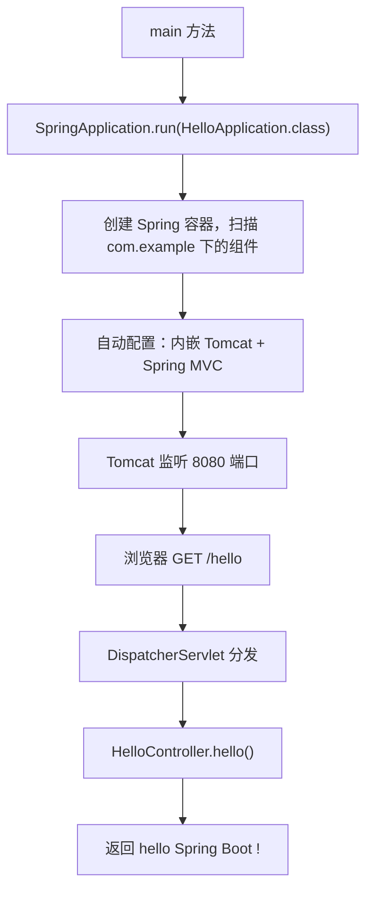

# 十分钟搭出第一个 Spring Boot 接口：从 Maven 工程到浏览器返回 Hello

写一个返回字符串的 Web 接口，传统 Spring 要走多少步？建 Maven 工程、引 Spring 和 Spring MVC 两组坐标、
写 Controller、配 Spring MVC、装 Tomcat 插件、打成 war 包、丢进容器、启动、访问。任何一步坐标写错版本号，
就是一下午的排查。

这篇讲的就是怎么用 Spring Boot 把上面这套流程压到「一个 pom、一个 Controller、一个引导类」，
跑起来之后浏览器直接出结果，全程不需要你自己碰 Tomcat。

## 先给结论

- Spring Boot 工程的坐标只有两处关键：继承 `spring-boot-starter-parent` 父工程，加一个 `spring-boot-starter-web` 起步依赖。
- 业务代码写法和传统 Spring 完全一致，`@RestController` + `@RequestMapping` 照旧。
- 多出来的是一个**引导类**：带 `@SpringBootApplication` 的 `main` 方法，它就是项目入口，直接 run 就行。
- Tomcat 由 `spring-boot-starter-web` 传递进来并自动启动，默认端口 8080，不用自己装、不用打 war。
- 打包方式是 jar 而不是 war，因为项目靠 `main` 方法启动，不依赖外部容器。

## 一、先看清需求，才知道 Boot 省掉了什么

需求就一句话：搭一个 Spring Boot 工程，定义一个 `HelloController` 的 `hello` 方法，返回字符串 `hello Spring Boot !`。

把传统 Spring 的做法和 Spring Boot 摆在一起看，差别非常直观：

| 步骤 | 传统 Spring | Spring Boot |
|---|---|---|
| 建工程 | Maven 工程，手配目录 | Maven 工程（或直接 `start.spring.io` 生成） |
| 引坐标 | Spring、Spring MVC、Jackson、Tomcat 插件…逐个引 | 一个 `spring-boot-starter-web` |
| 写 Controller | `@Controller` + `@ResponseBody` | `@RestController` |
| 配置 | 自己配 Spring MVC、配视图解析器、配包扫描 | 无，全部按约定自动配好 |
| 容器 | 外置 Tomcat，打 war 部署 | 内嵌 Tomcat，jar 直接 run |
| 启动 | 部署到容器后再启动 | 运行引导类的 `main` 方法 |

**第一，坐标收敛是最大的变化。** 起步依赖（starter）把「开发 Web 应用要用的那一堆 jar」打包成一个坐标，
依赖传递把 Spring MVC、Jackson、内嵌 Tomcat 全带进来了。

**第二，版本不用你管。** pom 里没有写 `spring-boot-starter-web` 的版本号，版本由父工程 `spring-boot-starter-parent`
统一管理（这个父工程到底做了什么，下一篇原理分析单独拆开讲）。

## 二、pom 文件：两个坐标搞定

课程源码里这个工程的 pom 长这样（包名已改成中性的 `com.example`）：

```xml
<?xml version="1.0" encoding="UTF-8"?>
<project xmlns="http://maven.apache.org/POM/4.0.0"
         xmlns:xsi="http://www.w3.org/2001/XMLSchema-instance"
         xsi:schemaLocation="http://maven.apache.org/POM/4.0.0 http://maven.apache.org/xsd/maven-4.0.0.xsd">
    <modelVersion>4.0.0</modelVersion>

    <groupId>com.example</groupId>
    <artifactId>springboot-helloworld</artifactId>
    <version>1.0-SNAPSHOT</version>

    <!-- Spring Boot 工程需要继承的父工程 -->
    <parent>
        <groupId>org.springframework.boot</groupId>
        <artifactId>spring-boot-starter-parent</artifactId>
        <version>2.1.8.RELEASE</version>
    </parent>

    <dependencies>
        <!-- Web 开发的起步依赖 -->
        <dependency>
            <groupId>org.springframework.boot</groupId>
            <artifactId>spring-boot-starter-web</artifactId>
        </dependency>
    </dependencies>
</project>
```

注意这里**没有写 `<packaging>war</packaging>`**，默认就是 jar。官方文档给的示例还会带一个
`spring-boot-maven-plugin` 插件，那是用来打可执行 fat jar 的，学习阶段不导也能正常启动。

## 三、Controller：和以前写的一模一样

```java
package com.example.controller;

import org.springframework.web.bind.annotation.RequestMapping;
import org.springframework.web.bind.annotation.RestController;

@RestController
public class HelloController {

    @RequestMapping("/hello")
    public String hello() {
        return " hello Spring Boot !";
    }
}
```

`@RestController` 等价于 `@Controller` 加 `@ResponseBody`，方法返回值直接写进响应体，不再走视图解析。
这一步和你在传统 Spring MVC 里写的东西没有任何区别。

## 四、引导类：Spring Boot 项目真正多出来的东西

```java
package com.example;

import org.springframework.boot.SpringApplication;
import org.springframework.boot.autoconfigure.SpringBootApplication;

/**
 * 引导类。Spring Boot 项目的入口
 */
@SpringBootApplication
public class HelloApplication {

    public static void main(String[] args) {
        SpringApplication.run(HelloApplication.class, args);
    }
}
```

引导类只有两个硬性要求：

**第一，类上打 `@SpringBootApplication`。** 这个注解是三个注解的组合：配置类声明、开启自动配置、开启组件扫描。
组件扫描默认从**引导类所在的包**往下扫，所以 `HelloController` 必须放在引导类同级或子包下，
放到平行目录里会扫不到，这是新手最常踩的坑。

**第二，`main` 方法里调 `SpringApplication.run(本类.class, args)`。** 这一行把 Spring 容器拉起来、
把内嵌 Tomcat 起起来。运行这个方法就等于启动了整个项目。

整个启动和请求的过程可以这样看：



图里最关键的一环是「自动配置」：Spring Boot 看到 classpath 里有 Tomcat 和 Spring MVC，
就推断出这是一个 Web 应用，于是替你把容器和 MVC 基础设施配好。你没写一行配置，是因为有人替你写了。

## 五、启动与验证

运行引导类的 `main` 方法，控制台会打出 Spring Boot 的启动横幅和版本号，最后几行里一定有一句
`Tomcat started on port(s): 8080`。看到它说明容器已经就绪，这时候浏览器访问：

```bash
curl http://localhost:8080/hello
# hello Spring Boot !
```

**第一，没有配置 Tomcat 却能访问，是因为内嵌容器。** `spring-boot-starter-web` 默认带的是 Tomcat，
换成 Jetty 或 Undertow 只需要排除默认依赖再引入对应的 starter。

**第二，端口 8080 是默认值，改它只需要一行配置。** 在 `src/main/resources/application.properties`
里写 `server.port=9090` 即可，这就是 Spring Boot 的约定优于配置。

## 常见误区

- **引导类放错位置**：引导类在 `com.example`，Controller 却在 `com.demo`，组件扫描覆盖不到，
  访问 `/hello` 直接 404。引导类要放在最外层根包下。
- **忘记加 `@SpringBootApplication`**：容器起不来，报「无法找到主配置类」。
- **自己引了一堆带版本号的 Spring 坐标**：和父工程管理的版本打架，出现 `NoSuchMethodError`。
  交给 starter 和 parent 管理就行。
- **按 war 包思路去部署**：Spring Boot 工程是 jar，靠 `main` 启动，用 `java -jar` 跑，
  不需要往外部 Tomcat 里丢。

## 面试可能被问到的问题

1. 面试官追问：「Spring Boot 的起步依赖到底是什么？」
   答：它本质是一个 Maven 坐标，本身几乎没有代码，只声明了一组经过版本验证的依赖组合。引入 `spring-boot-starter-web`
   就等价于引入了 Spring MVC、Jackson、内嵌 Tomcat 等一整套 Web 开发所需依赖，版本由父工程统一仲裁，避免版本冲突。

2. 面试官追问：「为什么 Spring Boot 工程默认打 jar 包？」
   答：因为项目靠引导类的 `main` 方法启动，内嵌容器就在 jar 里，不再需要外部 Servlet 容器。
   `spring-boot-maven-plugin` 会把它打成可执行的 fat jar，依赖全部打进去，`java -jar` 就能跑。

3. 面试官追问：「`@SpringBootApplication` 由哪些注解组成？」
   答：主要由 `@SpringBootConfiguration`（标记配置类）、`@EnableAutoConfiguration`（开启自动配置）、
   `@ComponentScan`（开启组件扫描，默认扫描引导类所在包及其子包）三个组合而成。

4. 面试官追问：「Controller 没被扫描到，一般是什么原因？」
   答：绝大多数是引导类包层级太深，Controller 在它的平行包或上层包里，超出了默认扫描范围。
   把引导类移到最外层根包，或者显式配置 `@ComponentScan` 的 `basePackages`。

5. 面试官追问：「没配 Tomcat，为什么能直接访问 8080？」
   答：`spring-boot-starter-web` 传递引入了内嵌 Tomcat，自动配置类在检测到 classpath 存在 Tomcat 时
   会创建并启动容器，默认监听 8080。改端口用 `server.port` 配置项。

6. 面试官追问：「传统 Spring 和 Spring Boot 写业务代码有区别吗？」
   答：没有区别。`@RestController`、`@RequestMapping`、`@Service` 这些注解的用法完全一致，
   Spring Boot 改变的是工程搭建、依赖管理和配置方式，不改变编程模型。

## 配套资料

- 本课源码工程：`materials/code/01/1.spring boot/1.spring boot/SpringBoot 第一天/代码/springboot/springboot-helloworld/`
  （含 `pom.xml`、`HelloController.java`、`HelloApplication.java`，文中包名已统一改为 `com.example`）
- 同章节另有 `springboot-init`（IDEA 快速构建版）与 `springboot-config`（配置读取版）两个工程可对照阅读
