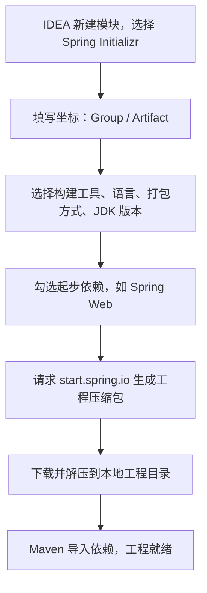

# 用 Spring Initializr 十秒钟生成工程骨架：每一步到底在选什么

手写 pom 和引导类其实都是固定套路，写两遍就会了，但每次新建工程都要重复一遍，漏一个标签就得排查半天。更省事的做法是让工具生成：填几个选项，勾几个依赖，IDE 直接给你一个能跑的 Spring Boot 工程。

这篇要讲清楚的是页面上那几个输入框分别决定了什么，以及生成出来的目录为什么长那样。

## 先给结论

- Spring Initializr 不是某个 IDE 的功能，它是 Spring Boot 官方提供的工程生成服务，网址是 `start.spring.io`，IDE 只是把它嵌了进来。
- Group 和 Artifact 就是 Maven 坐标的 `groupId` 和 `artifactId`，Artifact 同时决定工程名和引导类的包名。
- 构建工具选 Maven 或 Gradle，语言选 Java、Kotlin 或 Groovy，打包方式选 jar。
- 依赖选择界面勾什么，pom 里就多一个对应的 starter，不用再记坐标。
- 生成物里默认带引导类、空的 `application.properties`、空的测试类和 `spring-boot-maven-plugin`，删掉任何一个都不影响启动。

## Initializr 是谁提供的

在 IDEA 里新建模块时选择「Spring Initializr」，界面上会显示默认的 Service URL，就是 `start.spring.io`。这个地址在 Spring 官网上也能直接拿到：进 `spring.io` 找到 Spring Boot，点 Getting Started，里面给的工程生成入口同样是它。

也就是说，IDE 只是把浏览器里的网页表单搬到了新建工程的向导里。它**需要联网**，断网的时候这个界面打不开，这时候只能手工建 Maven 工程写 pom。

整个生成过程可以这样看：



图里 E 这一步是联网动作，也是唯一可能失败的地方。公司内网访问不了该地址时，可以自己搭一个私服镜像，或者回到手写 pom 的方式。

## 向导里每一步在选什么

**Group 和 Artifact。** 这两个会原样写进 pom 的 `groupId` 和 `artifactId`。Group 一般填公司或组织的域名倒写，例如 `com.example`；Artifact 填工程名，例如 `springboot-init`。Artifact 还会决定引导类的类名：工程名 `springboot-init` 会生成引导类 `SpringbootInitApplication`，包名则是 Group 加 Artifact 拼出来的 `com.example.springbootinit`。

**构建工具。** Maven 和 Gradle 二选一，选哪个就生成哪种构建文件（`pom.xml` 或 `build.gradle`）。课程和绝大多数企业项目用的是 Maven。

**语言。** Java、Kotlin、Groovy 三选一，决定生成的代码文件和对应的编译插件配置。

**打包方式。** Jar 和 War 二选一。选 Jar，因为 Spring Boot 工程靠引导类的 `main` 方法启动，内嵌服务器就在包里，不需要外部 Servlet 容器。选 War 的话，是为了部署到外置 Tomcat，那时的工程结构和启动方式都不一样。

**Java 版本。** 对应 pom 里的 `<java.version>` 属性，同时要保证本机装的 JDK 版本不低于它。

**Spring Boot 版本。** 列表里带 `SNAPSHOT`、`M1`、`RC1` 这类后缀的是测试版和不稳定版，正式项目选不带后缀的稳定版，例如 `2.1.8.RELEASE`。

**依赖。** 这是最省事的一步。做 Web 开发勾 Spring Web，pom 里就出现 `spring-boot-starter-web`；要做安全控制勾 Spring Security；要接数据库勾对应的持久层依赖。不用记坐标，也不用想版本。

## 生成出来的目录长什么样

```bash
springboot-init/
├── HELP.md                                  # 官方文档链接，可直接删除
├── pom.xml
└── src
    ├── main
    │   ├── java/com/example/springbootinit
    │   │   ├── SpringbootInitApplication.java   # 引导类，已带注解和 main 方法
    │   │   └── HelloController.java             # 后补的业务代码
    │   └── resources
    │       ├── application.properties           # 空配置文件
    │       └── application.yml                  # 后补的 yaml 配置
    └── test/java/com/example/springbootinit
        └── SpringbootInitApplicationTests.java  # 空的测试类
```

`HELP.md` 里是官方文档链接，留着或删掉都行。根目录下还有 `.gitignore`，不需要版本控制时可以删。`application.properties` 是空的，配置都往这里写。

## 生成的 pom 里有什么

```xml
<?xml version="1.0" encoding="UTF-8"?>
<project xmlns="http://maven.apache.org/POM/4.0.0" xmlns:xsi="http://www.w3.org/2001/XMLSchema-instance"
         xsi:schemaLocation="http://maven.apache.org/POM/4.0.0 https://maven.apache.org/xsd/maven-4.0.0.xsd">
    <modelVersion>4.0.0</modelVersion>
    <parent>
        <groupId>org.springframework.boot</groupId>
        <artifactId>spring-boot-starter-parent</artifactId>
        <version>2.1.8.RELEASE</version>
        <relativePath/> <!-- 从仓库查找父工程，不从本地路径找 -->
    </parent>
    <groupId>com.example</groupId>
    <artifactId>springboot-init</artifactId>
    <version>0.0.1-SNAPSHOT</version>
    <name>springboot-init</name>
    <description>Demo project for Spring Boot</description>

    <properties>
        <java.version>1.8</java.version>
    </properties>

    <dependencies>
        <dependency>
            <groupId>org.springframework.boot</groupId>
            <artifactId>spring-boot-starter-web</artifactId>
        </dependency>
        <dependency>
            <groupId>org.springframework.boot</groupId>
            <artifactId>spring-boot-starter-test</artifactId>
            <scope>test</scope>
        </dependency>
    </dependencies>

    <build>
        <plugins>
            <plugin>
                <groupId>org.springframework.boot</groupId>
                <artifactId>spring-boot-maven-plugin</artifactId>
            </plugin>
        </plugins>
    </build>
</project>
```

和手写版本相比多了三样东西。`<relativePath/>` 表示父工程从 Maven 仓库找，不要在相对路径里找，避免多级工程时找错。`spring-boot-starter-test` 是测试依赖，`scope` 为 `test`，只在测试代码里生效。`spring-boot-maven-plugin` 负责把工程打成可执行 jar，学习阶段不用它也能正常启动，但保留它是标准做法。

引导类是生成好的，注解和 `main` 方法都写完了，直接运行就能启动：

```java
package com.example.springbootinit;

import org.springframework.boot.SpringApplication;
import org.springframework.boot.autoconfigure.SpringBootApplication;

@SpringBootApplication
public class SpringbootInitApplication {

    public static void main(String[] args) {
        SpringApplication.run(SpringbootInitApplication.class, args);
    }
}
```

生成的测试类长这样，方法体是空的，往里填断言即可：

```java
package com.example.springbootinit;

import org.junit.Test;
import org.junit.runner.RunWith;
import org.springframework.boot.test.context.SpringBootTest;
import org.springframework.test.context.junit4.SpringRunner;

@RunWith(SpringRunner.class)
@SpringBootTest
public class SpringbootInitApplicationTests {

    @Test
    public void contextLoads() {
    }
}
```

## 补一个 Controller 就能访问

骨架生成完只剩业务代码要写。Controller 放在引导类所在的包或其子包下，否则组件扫描覆盖不到：

```java
package com.example.springbootinit;

import org.springframework.web.bind.annotation.RequestMapping;
import org.springframework.web.bind.annotation.RestController;

@RestController
public class HelloController {

    @RequestMapping("/hello")
    public String hello() {
        return "hello Spring Boot 222!";
    }
}
```

运行引导类，控制台出现 `Tomcat started on port(s): 8080` 后访问 `http://localhost:8080/hello`，就能拿到返回的字符串。课程源码里这个类后来被扩展成了读取配置的示例，加了 `@Value` 和 `Environment`，那是配置章节的内容。

## 常见误区

- **以为 Spring Initializr 是 IDE 的功能**：它是 `start.spring.io` 的服务，IDE 只是封装了一层。断网时向导打不开，这时要么配私服，要么手写 pom。
- **打包方式选了 War**：Spring Boot 工程默认不需要外置容器，选 War 会导致目录结构多出 `ServletInitializer`。不打算部署到外部 Tomcat 就选 Jar。
- **选了带 SNAPSHOT、M、RC 后缀的版本**：那些是开发中的版本，接口可能变动。正式项目用不带后缀的 RELEASE 版本。
- **Controller 放在了引导类的上层包**：默认组件扫描从引导类所在包往下扫，放到平行目录会 404。
- **把生成的 `application.properties` 删了**：它是默认配置文件的位置，删掉不影响启动，但后面所有配置都失去了默认落点。

## 面试可能被问到的问题

1. 面试官追问：「Spring Initializr 是什么？它是 IDE 提供的吗？」
   答：它是一个工程骨架生成服务，由 Spring Boot 官方提供，地址是 `start.spring.io`。IDE 只是在新建工程的向导里嵌入了这个服务，本质上等价于在网页上填表并下载生成的工程压缩包。

2. 面试官追问：「用 Initializr 创建工程时必须联网吗？」
   答：必须。`start.spring.io` 是外部服务，向导要请求它生成并下载工程包。断网环境下无法使用，只能手工创建 Maven 工程并写 pom，或者在内网搭建私服镜像。

3. 面试官追问：「Group 和 Artifact 分别决定什么？」
   答：它们就是 Maven 坐标里的 `groupId` 和 `artifactId`。Artifact 还决定工程名、引导类的类名以及默认包名，例如 `springboot-init` 会生成引导类 `SpringbootInitApplication` 和包 `com.example.springbootinit`。

4. 面试官追问：「为什么打包方式默认选 Jar 而不是 War？」
   答：Spring Boot 工程通过引导类的 `main` 方法启动，内嵌服务器已经包含在依赖里，不需要外部 Servlet 容器。`spring-boot-maven-plugin` 会把它打成可执行 jar，`java -jar` 直接运行。

5. 面试官追问：「生成的 pom 里 `spring-boot-starter-test` 有什么用，为什么要限定 scope？」
   答：它聚合了 JUnit、Spring Test 等测试所需的依赖。`scope` 设为 `test` 表示这些依赖只在测试代码的编译和运行期生效，不会打进最终的产物 jar，避免污染生产依赖。

6. 面试官追问：「生成的测试类里 `@RunWith(SpringRunner.class)` 和 `@SpringBootTest` 各自的作用是什么？」
   答：`@RunWith(SpringRunner.class)` 指定用 Spring 提供的运行器来执行 JUnit 测试，让测试跑在 Spring 容器环境里；`@SpringBootTest` 负责在测试启动时加载完整的 Spring Boot 应用上下文，这样测试里才能注入 Bean。

## 配套资料

- 快速构建工程（本课文中的工程）：`materials/code/01/1.spring boot/1.spring boot/SpringBoot 第一天/代码/springboot/springboot-init/`
  （含 `pom.xml`、`HELP.md`、`SpringbootInitApplication.java`、`HelloController.java`、`SpringbootInitApplicationTests.java`、`application.yml`，文中包名已改为 `com.example`）
- 手写 pom 版本对照工程：`materials/code/01/1.spring boot/1.spring boot/SpringBoot 第一天/代码/springboot/springboot-helloworld/`
- 配置读取示例（`@Value` 与 `Environment` 用法）：`materials/code/01/1.spring boot/1.spring boot/SpringBoot 第一天/代码/springboot/springboot-config/`
