# SpringBoot 全景进阶一篇通：起步依赖、配置体系、整合实战、自动配置原理、监控与部署

## 先给结论

- 这一篇把 Spring Boot 从入门到进阶的完整主线收进一个页面，按六大板块循序渐进：起步依赖原理、配置文件体系、常用框架整合、自动配置原理、启动流程与事件监听、监控与部署。
- 板块一讲起步依赖：parent 只做版本锁定，starter 才真正把 jar 带进来，dependencyManagement 与 dependencies 的分工是理解后续一切的前提。
- 板块二讲配置体系：两种格式三种后缀、yaml 五条基本语法与三种取值方式、profile 多环境组织、项目内外配置文件的加载顺序，配置不生效时按这套优先级逐层排查即可定位。
- 板块三讲整合实战：JUnit 让测试类正确加载容器与业务 Bean，Redis 只加一个起步依赖就能注入模板对象，MyBatis 给出注解与 XML 两种写法，套路都是加依赖、加少量配置。
- 板块四是全系列的重心：先用 Condition 理解按条件创建 Bean，借切换内置服务器的现象做验证，再沿 @Enable* 注解、@Import 四种方式、@EnableAutoConfiguration 与 spring.factories 一路深入，最终亲手实现一个自定义 redis-starter。
- 板块五讲运行机制：事件监听给出六个回调入口（四个接口加两个 Runner），启动流程分析把初始化阶段的四个动作与 run 阶段的九个节点完整走一遍。
- 板块六讲监控与部署：actuator 的 info、health 端点，一行配置暴露全部 endpoint，Spring Boot Admin 图形化监控台，以及打 jar 与打 war 两种部署方式各自的三处改动与常见坑。
- 六个板块合起来正好对应 Spring Boot 的两大核心：起步依赖与自动配置，前者解决依赖怎么引，后者解决配置怎么省。
- 每一部分原有的代码块、表格与 mermaid 图均原样保留，各部分的常见误区、面试问答与配套资料已统一合并到文末，便于集中复习。
- 学习建议：按板块顺序推进，先跑通现象再读原理；板块四（从 Condition 到自定义 starter）是面试高频区，值得反复对照源码看。
- 部署时优先选 jar：内嵌容器加一键启动，war 只在确需外部 Tomcat 时使用，且要记得继承 SpringBootServletInitializer 并把打包方式改成 war。
- 排查问题的通用顺序：配置问题先查加载顺序与优先级，Bean 问题先查 Condition 与包扫描范围，启动问题沿 run 阶段九个节点定位到具体回调。


## 第1部分：pom 里不写版本号也能引到 jar：拆解 Spring Boot 起步依赖的两个坐标

新建一个 Spring Boot 工程，只写了两个坐标就跑通了一个 Web 接口：一个 `<parent>`，一个 `spring-boot-starter-web`。
奇怪的是 `spring-boot-starter-web` 后面没有 `<version>`，工程照样能编译、能启动、能返回数据。

再想想以前搭 Spring MVC 工程的样子：Spring 核心、Spring MVC、Jackson、日志、Servlet API、
Tomcat 插件，一个个坐标往 pom 里塞，版本号还得自己挑。挑错了就是 `NoSuchMethodError`、
`ClassNotFoundException`，一排查一下午。Spring Boot 把这一堆压缩成一行，靠的就是两个东西：
版本锁定与依赖传递。这篇把这两个坐标的源码拆开看一遍。

做完快速入门那个工程，能明显感觉到它比传统 Spring 少了两步：**依赖坐标不用自己挑，配置文件不用自己写**。
前者叫起步依赖，后者叫自动配置，它们就是 Spring Boot 的两个核心。这一篇只拆前者，自动配置单独讲。

起步依赖这个名字容易误解，它不是什么新的依赖类型，本质就是一个普通的 Maven 坐标。
区别在于这个坐标的 pom 里已经帮你写好了一组依赖，你引一个，Maven 给你带一窝。

课程源码 `springboot-helloworld` 的 pom 是这样的（包名已统一改成 `com.example`）：

```xml
<project ...>
    <modelVersion>4.0.0</modelVersion>

    <groupId>com.example</groupId>
    <artifactId>springboot-helloworld</artifactId>
    <version>1.0-SNAPSHOT</version>

    <!-- Spring Boot 工程需要继承的父工程 -->
    <parent>
        <groupId>org.springframework.boot</groupId>
        <artifactId>spring-boot-starter-parent</artifactId>
        <version>2.1.8.RELEASE</version>
    </parent>

    <dependencies>
        <!-- Web 开发的起步依赖 -->
        <dependency>
            <groupId>org.springframework.boot</groupId>
            <artifactId>spring-boot-starter-web</artifactId>
        </dependency>
    </dependencies>
</project>
```

在 IDEA 里按住 Ctrl 点进 `spring-boot-starter-parent`，会发现它自己也带一个 `<parent>`，
指向 `spring-boot-dependencies` 2.1.8.RELEASE；再往里点，`spring-boot-dependencies` 就没有父工程了，
它就是这条继承链的终点。整条链可以这样看：

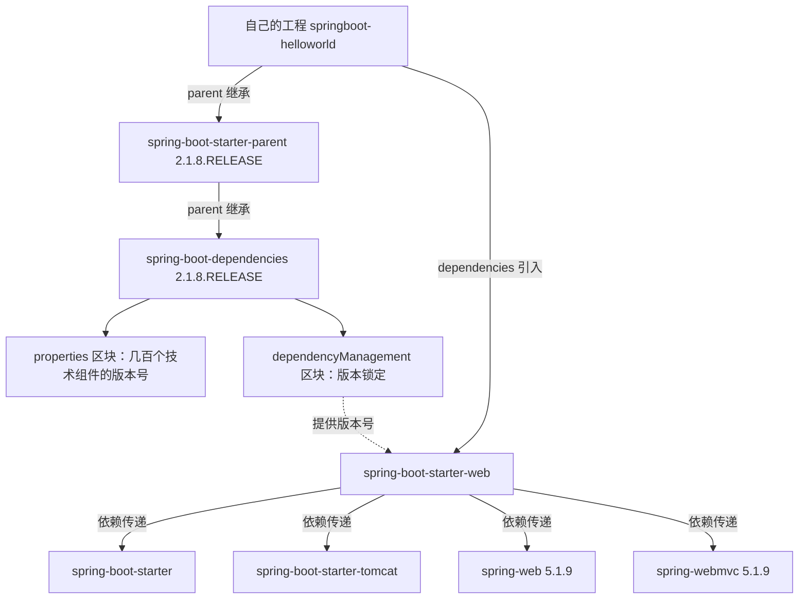

图里最关键的是中间那条虚线：`dependencyManagement` 不参与打包，只在你真正引入某个坐标时，
悄悄把版本号填上去。

`spring-boot-dependencies` 的骨架大致是这样：

```xml
<properties>
    <activemq.version>5.15.10</activemq.version>
    <tomcat.version>9.0.24</tomcat.version>
    <jackson-bom.version>2.9.9.20190812</jackson-bom.version>
    <mysql.version>8.0.17</mysql.version>
    <!-- 几百个技术组件的版本号 -->
</properties>

<dependencyManagement>
    <dependencies>
        <dependency>
            <groupId>org.springframework.boot</groupId>
            <artifactId>spring-boot-starter-web</artifactId>
            <version>2.1.8.RELEASE</version>
        </dependency>
        <!-- 几百个坐标的版本声明 -->
    </dependencies>
</dependencyManagement>
```

这些版本号不是随便写的。Spring Boot 在发布 2.1.8 这个版本时，把常用的技术组件都跑过兼容性测试，
挑出一套彼此不打架的组合固定下来。自己挑版本去拼，冲突几乎是必然的；用父工程锁好的这套，基本不会踩雷。

这是最容易看漏的一点。父工程里那一大段坐标包裹在 `dependencyManagement` 里面，
**不是** `dependencies`。两者的区别很直接：

| 标签 | 是否引入 jar | 作用 |
|---|---|---|
| `dependencies` | 是 | 声明工程真正依赖的坐标，Maven 会下载并打进包里 |
| `dependencyManagement` | 否 | 只声明版本号，子工程引用同名坐标时自动套用该版本 |

所以工程 pom 里写 `spring-boot-starter-web` 不写 `<version>`，Maven 会先去父工程的
`dependencyManagement` 里查，查到 2.1.8.RELEASE 就填进去。查不到才会报错要求你写版本。

**第一，继承只解决版本，不解决引入。** 光继承父工程，工程里一个 Spring 的 jar 都不会有。

**第二，锁定范围只覆盖被管理的坐标。** 引一个父工程里没管过的第三方包，比如某个小众工具类，
版本号还得自己写。

再点进 `spring-boot-starter-web` 的 pom，会看到它内部用的是 `<dependencies>`，
而且基本都不写版本，因为版本来自父工程。它声明的内容大致是这样：

```xml
<dependencies>
    <dependency>
        <groupId>org.springframework.boot</groupId>
        <artifactId>spring-boot-starter</artifactId>
    </dependency>
    <dependency>
        <groupId>org.springframework.boot</groupId>
        <artifactId>spring-boot-starter-tomcat</artifactId>
    </dependency>
    <dependency>
        <groupId>org.springframework.boot</groupId>
        <artifactId>spring-boot-starter-json</artifactId>
    </dependency>
    <dependency>
        <groupId>org.springframework</groupId>
        <artifactId>spring-web</artifactId>
    </dependency>
    <dependency>
        <groupId>org.springframework</groupId>
        <artifactId>spring-webmvc</artifactId>
    </dependency>
</dependencies>
```

最后两个坐标就是 Spring 的 Web 模块和 Spring MVC，版本是 5.1.9。工程依赖 starter-web，
starter-web 又依赖这一堆，于是这一堆就全部传递到了工程里。这就是 Maven 的依赖传递。

在命令行敲一行就能看到这条传递链：

```bash
mvn dependency:tree
```

输出里会看到 `spring-web`、`spring-webmvc`、`tomcat-embed-core`、`jackson-databind` 等等，
它们都没有出现在你的 pom 里，却已经在 classpath 上了。自己一个个引这些坐标完全没问题，
只是麻烦，starter 帮你省掉的就是这份麻烦。

框架锁好的版本不一定永远合用，比如要把内嵌 Tomcat 换成别的版本。正确做法是**覆盖属性**，
而不是在自己的依赖里硬写版本号。在工程的 pom 里加一段：

```xml
<properties>
    <tomcat.version>9.0.26</tomcat.version>
</properties>
```

父工程里 `dependencyManagement` 用的是 `${tomcat.version}`，子工程覆盖这个属性后，
所有引用它的坐标版本会一起变，不会出现同一个组件两个版本的情况。

直接在某个依赖上写 `<version>` 也能生效，但只改这一处，跟它相关的其他坐标还留在旧版本上，
这种半新半旧的状态最容易引发冲突。

## 第2部分：改个端口而已，为什么我配了三份还不生效：Spring Boot 配置文件的类型与优先级

内嵌 Tomcat 默认跑在 8080，想换成 8081，在 `application.properties` 里写一行 `server.port=8081` 就完事了。
问题是很多工程里同时躺着 `application.properties`、`application.yml`、`application.yaml` 三个文件，
三个都写了 `server.port`，值还不一样，启动后到底听谁的？

这种时候最容易出现的现场是：改了 yml 里的端口，重启后日志还打印 8080，于是怀疑配置没被读到、
怀疑缓存、怀疑 IDE，最后发现是另外一个文件里的同名属性把你的配置覆盖掉了。搞清楚配置文件的类型和优先级，
这个坑就一次性填平了。

Spring Boot 里绝大多数配置都有默认值。端口默认 8080，上下文路径默认 `/`，
这些默认值不用你写任何东西就已经在工作了。想改，才需要提供自己的配置去**覆盖**默认值。

覆盖的方式就是写一个配置文件。工程初始化完成后，`src/main/resources` 下会自动生成一个
`application.properties`，这个文件就是配置文件默认的位置和默认的名字。

**第一，`properties` 是老熟人。** 一行一个键值对，键和值用等号连接：

```properties
# 修改项目的访问路径，默认值为 /
server.servlet.context-path=/hello

server.port=8081
```

上面这段就来自课程源码的 `springboot-config` 工程，`server.port` 指定内嵌 Tomcat 的监听端口，
`server.servlet.context-path` 指定应用的上下文路径，配了它之后访问地址要带上 `/hello` 前缀。

**第二，`yaml` 用缩进表达层级。** 同样的配置写成 yml 是这样：

```yaml
server:
  port: 8082
```

`port` 缩进写在 `server` 下面，表示它是 `server` 的子元素。这里有个必须记住的细节：
**冒号后面必须跟一个空格**，写成 `port:8082` 语法就错了，值不会被解析成 8082。

`.yml` 和 `.yaml` 是同一种文件的两种后缀，就像 `.html` 和 `.htm` 一样，内容格式完全一致，
只是后缀不同。课程源码 `springboot-init` 工程里的 `application.yml` 长这样：

```yaml
person:
  name: zhangsan
  age: 20
  address:
  - beijing
  - shanghai

server:
  port: 8082
```

`person` 这一段是自定义配置，框架不会自动识别它，需要写代码去读取，后面讲取值的时候会用到。

把三个文件都放进 `src/main/resources`，分别写上 `server.port=8081`、`server: port: 8082`、
`server: port: 8083`，启动后控制台打印的是 `Tomcat started on port(s): 8081`。
把 properties 注掉，剩下 yml 和 yaml，生效的是 8082。

结论就是这条优先级链：

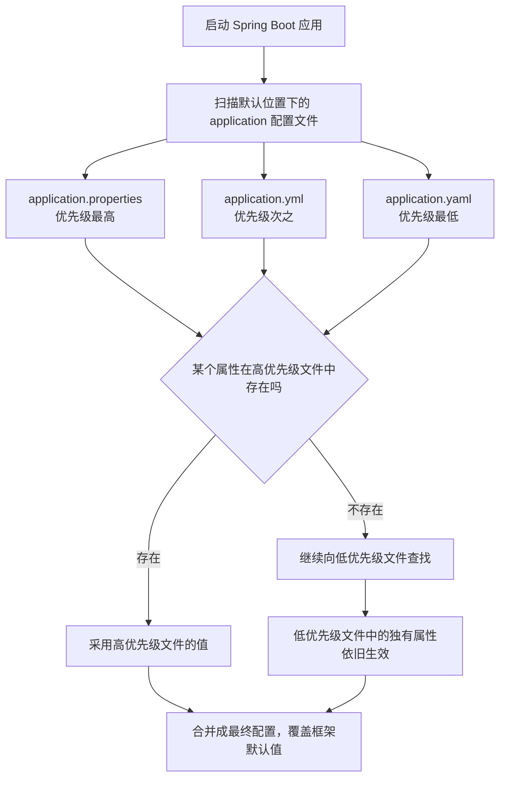

图上最需要注意的是「合并」这一步。低优先级文件不是被整体丢弃，而是**逐属性比对**：
高优先级里已经有的属性，低优先级里的同名属性被忽略；高优先级里没有的属性，低优先级里的照常加载。

举个具体例子：`application.properties` 里写了 `server.port=8081` 和 `name=abc`，
`application.yml` 里写了 `server.port=8082` 和 `age=20`。最终生效的是端口 8081，
同时 `age=20` 也会被读进来，因为 properties 里没有这个属性。

默认文件名 `application` 是硬约定。改成 `app.properties`，启动后一点效果都没有，
因为框架只认这个名字。真要改，得在启动参数里显式指定 `spring.config.name`。

位置也不止 `src/main/resources` 一处。常见的几处按优先级从高到低大概是：工程根目录下的 `config` 子目录、
工程根目录、`resources` 下的 `config` 子目录、`resources` 根目录。这一节的完整顺序在讲配置加载顺序时再展开。

在 IDEA 里写 Spring Boot 配置是有自动提示的，输入 `server` 就会弹出可选属性列表，
这是 IDE 读取了框架的配置元数据，写错属性名时提示不出来，可以据此快速判断名字对不对。

## 第3部分：YAML 怎么写、配置怎么读：从缩进语法到三种取值方式

配置文件里明明写了 `name: 张三`，代码里用 `@Value("${name}")` 取出来却是空的；
或者把 `server.port` 改成 8082，重启后日志还是打印 8080。这两类问题的根源通常不在 Java 代码，
而在 yaml 的写法上：冒号后面少了一个空格，整行配置就不再是配置了。

yaml 是 Spring Boot 推荐的配置格式，写起来比 properties 有层次，比 XML 干净。
但它对空格和缩进极其敏感，同时「写进去」和「读出来」是两件事。这一篇把语法规则、三种数据格式，
以及 `@Value`、`Environment`、`@ConfigurationProperties` 三种取值方式一次讲透。

先看同一份配置用三种格式写出来分别长什么样。

```properties
server.port=8080
server.address=127.0.0.1
```

properties 是一行一个键值对，看不出 `port` 和 `address` 同属 `server`，层级关系全靠键名里的点号去猜。

```xml
<server>
    <port>8080</port>
    <address>127.0.0.1</address>
</server>
```

XML 有标签嵌套，层级一目了然，代价是要写开始标签、结束标签、尖括号和斜杠，写起来啰嗦。

```yaml
server:
  port: 8080
  address: 127.0.0.1
```

yaml 保留了 XML 的层级感，又省掉了标签。它以数据为核心，靠缩进表达从属关系，
`port` 和 `address` 缩进相同，就表示它们是同一级、同属于 `server`。

**第一，yaml 不是标记语言。** 名字里的 Ain't 就是「不是」的意思，它没有标签的概念。

**第二，yaml 的后缀有两种。** `.yml` 和 `.yaml` 是同一种文件，和 `.html` 与 `.htm` 的关系一样。

**第三，yaml 容易被脚本语言处理。** 几乎所有主流语言都有 yaml 解析库，跨语言传配置很方便。

**第一，大小写敏感。** `Name` 和 `name` 是两个不同的键，Java 也一样，别指望框架帮你容错。

**第二，数据值前面必须有空格。** 冒号是键的分隔符，空格是值的分隔符，`port:8080` 不会被识别成端口配置，
必须写成 `port: 8080`。空格个数无所谓，一个就够，写多个也不影响解析。这个空格是 yaml 最经典的坑，
IDEA 里能给提示：加了空格 `port` 会高亮变色，删掉空格高亮就没了，可以拿这个现象反查自己有没有写对。

**第三，用缩进表示层级关系。** 缩进多的属于缩进少的；缩进相同的属于同一级。

**第四，缩进不允许用 Tab。** 不同系统对一个 Tab 渲染成几个空格的定义不一样，
在 Windows 上是四个空格、换台机器变成八个，层级就乱了。用 IDEA 这类工具不用担心，
按 Tab 键它会自动转成空格。

**第五，缩进的空格数目不重要，同级别左对齐就行。** 两个空格和四个空格都能表达层级，
只要同一层的元素对齐即可。

**第六，`#` 表示注释**，从 `#` 到行尾的内容都会被忽略。

课程源码 `springboot-init` 工程里的 `application.yml` 是这份样子（包名已统一改成 `com.example`）：

```yaml
person:
  name: zhangsan
  age: 20
  address:
  - beijing
  - shanghai

server:
  port: 8082
```

#### 对象（map）

对象就是键值对的集合，上面的 `person` 就是一个对象，下面挂着 `name`、`age`、`address` 三个属性。
对象还有行内写法，用大括号把键值对包起来，风格接近 JSON：

```yaml
person2: {name: zhangsan, age: 20}
```

行内写法里冒号后面的空格同样不能省。这种写法用得不多，了解即可，日常还是缩进写法更清楚。

#### 数组（list）

数组用「减号加空格」表示每一个元素：

```yaml
address:
  - beijing
  - shanghai
```

`beijing` 和 `shanghai` 组成了一个数组，挂在 `address` 下面。数组也有行内写法，用中括号：

```yaml
address2: [beijing, shanghai]
```

注意减号后面必须带空格，写成 `-beijing` 就变成了普通字符串而不是数组元素。

#### 纯量

纯量就是单个的、不可再分的值：数字、布尔、字符串都属于纯量。真正需要留意的是引号的差别：

```yaml
msg1: 'hello \n world'
msg2: "hello \n world"
```

`msg1` 用单引号，转义字符**不被识别**，`\n` 会原样输出成一串字符。
`msg2` 用双引号，转义字符**会被识别**，`hello` 和 `world` 会分两行输出。
需要换行、制表符这类效果时用双引号，需要原样保留反斜杠时用单引号。

#### 参数引用

一个键的值可以引用另一个键，写法是 `${键名}`：

```yaml
name: abc

person:
  name: ${name}
  age: 20
```

这样 `person.name` 取到的值就是 `abc`。多个地方要用同一个值时，改一处就够。

配置里的内容分两类：`server.port` 这类框架认识的属性会被自动应用；`name`、`person.name` 这类自定义属性
必须写代码读取。Spring Boot 提供了三种读取方式。

**第一种是 `@Value`，一个注解注入一个属性。** 课程源码里 `HelloController` 的写法是这样的：

```java
package com.example;

import org.springframework.beans.factory.annotation.Value;
import org.springframework.core.env.Environment;
import org.springframework.web.bind.annotation.RequestMapping;
import org.springframework.web.bind.annotation.RestController;

import org.springframework.beans.factory.annotation.Autowired;

@RestController
public class HelloController {

    @Value("${name}")
    private String name;

    @Value("${person.name}")
    private String name2;

    @Value("${person.age}")
    private int age;

    @Value("${address[0]}")
    private String address1;

    @Value("${msg1}")
    private String msg1;

    @Value("${msg2}")
    private String msg2;

    @Autowired
    private Environment env;

    @RequestMapping("/hello2")
    public String hello2() {
        System.out.println(name);
        System.out.println(name2);
        System.out.println(age);
        System.out.println(address1);
        System.out.println(msg1);
        System.out.println(msg2);

        System.out.println(env.getProperty("person.name"));
        System.out.println(env.getProperty("address[0]"));

        return "hello Spring Boot 222!";
    }
}
```

几个要点：

**第一，成员变量的名称和配置的键名没有关系。** 变量名可以随便起，起作用的是 `@Value` 表达式里写的键名。

**第二，对象的属性用点号取。** `person` 下面的 `name` 写作 `${person.name}`，取出来是 `zhangsan`。

**第三，数组用下标取。** `${address[0]}` 取数组第一个元素，`${address[1]}` 取第二个。

启动后控制台会依次打印 `abc`、`zhangsan`、`20`、`beijing`，以及 `msg1` 与 `msg2` 的输出差异，
单引号那行 `\n` 原样打印，双引号那行分成两行。

`@Value` 的短板很明显：属性一多就要写一堆字段，注入代码很零散。单个值用它最省事。

第二种方式是注入一个环境对象，注意包是 `org.springframework.core.env.Environment`，
同名的类有不少，别导错。Spring Boot 启动时容器里就已经初始化好这个对象，直接注入即可：

```java
@Autowired
private Environment env;

@RequestMapping("/hello2")
public String hello2() {
    System.out.println(env.getProperty("person.name"));
    System.out.println(env.getProperty("address[0]"));
    return "hello Spring Boot 222!";
}
```

`getProperty` 里传的键名写法和 `@Value` 表达式里完全一致，对象的属性写 `person.name`，
数组元素写 `address[0]`。

它比 `@Value` 精炼的地方在于只注入一个对象，后面想取什么就取什么，不用为每个属性声明字段。
值少的时候 `@Value` 更直接，值多、取值位置分散的时候 `Environment` 更顺手。

三种取值方式的关系可以这样看：

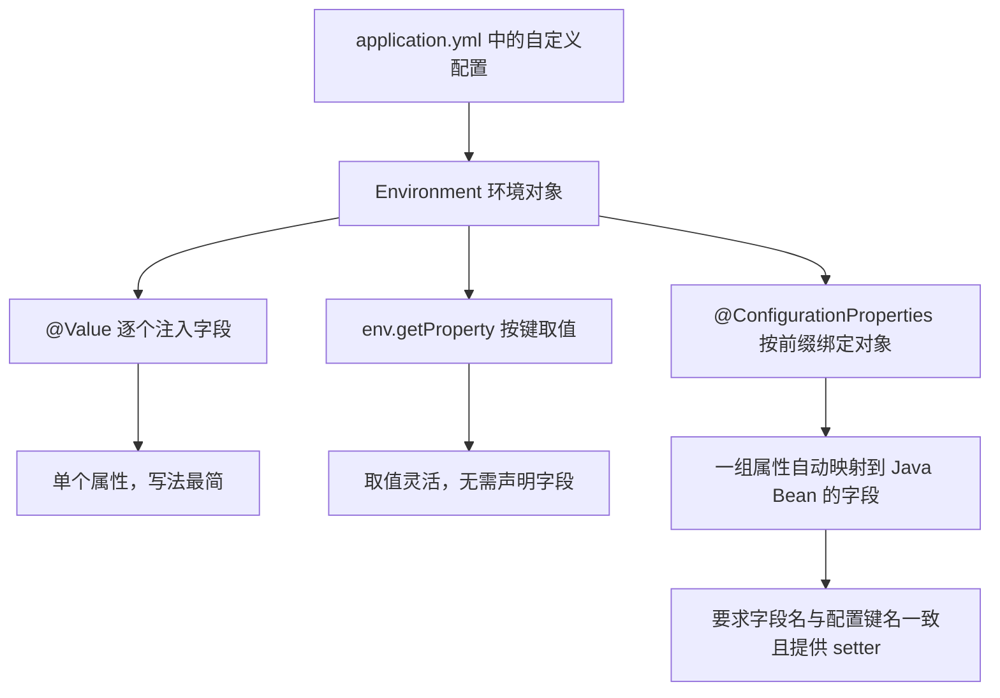

图里 `Environment` 在最上面，是因为三种方式最终都从同一个配置环境中取值，区别只是拿到值之后怎么交给你。

第三种方式适合属性成组的场景。先定义一个 Java 类，字段名和配置里的键名保持一致，并提供 setter：

```java
package com.example;

import org.springframework.boot.context.properties.ConfigurationProperties;
import org.springframework.stereotype.Component;

@Component
@ConfigurationProperties(prefix = "person")
public class Person {

    private String name;
    private int age;
    private String[] address;

    public String getName() {
        return name;
    }

    public void setName(String name) {
        this.name = name;
    }

    public int getAge() {
        return age;
    }

    public void setAge(int age) {
        this.age = age;
    }

    public String[] getAddress() {
        return address;
    }

    public void setAddress(String[] address) {
        this.address = address;
    }
}
```

两个注解缺一不可：`@Component` 把对象交给 Spring 管理，`@ConfigurationProperties` 声明要做配置绑定。
数组、集合类型的字段同样能绑，`person.address` 下面的 `beijing` 和 `shanghai` 会直接填进数组。

**`prefix` 是最容易写漏的地方。** 不加 `prefix` 时，框架会去找顶层的同名键：
`name` 会绑到顶层那个 `name`（值是 `abc`），而不是 `person` 下面的 `name`，
此时 `age` 绑不到任何值，输出是默认值 0。加上 `prefix = "person"` 之后，
取的才是 `person` 下面的 `name` 和 `age`，输出变成 `zhangsan` 和 `20`。

加了 `@ConfigurationProperties` 之后，IDEA 会在类名下方标一条红线，提示
`Spring Boot Configuration Annotation Processor not found in classpath`。它不影响运行，
只是说缺少配置注解处理器，导致写自定义配置时没有自动提示。

加上这个依赖就能消掉：

```xml
<dependency>
    <groupId>org.springframework.boot</groupId>
    <artifactId>spring-boot-configuration-processor</artifactId>
    <optional>true</optional>
</dependency>
```

加上之后，在 yml 里写自己定义的 `person` 下面的属性时，也会像 `server.port` 一样弹出提示和补全。

取值方式没有绝对优劣，按配置的形态选就行。

**第一，零散的一两个值用 `@Value`。** 比如只要一个开关 `feature.switch`，一个字段加一个注解就完事，
不用注入额外对象，代码最直观。

**第二，取值位置分散、键名运行时才确定的用 `Environment`。** 它把取值变成一个方法调用，
不用为每个属性声明字段，在工具类或需要按拼接键名取值的场景里特别顺手。

**第三，成组的配置一律用 `@ConfigurationProperties`。** 对象、数组、嵌套结构都能一次性绑定，
配置改了只要字段名对得上就自动生效，比逐个 `@Value` 好维护得多。
中间件连接池、业务参数集合这类配置，都应该走这条路。

还有一点值得记住：`@Value` 和 `Environment` 都要求配置里**必须存在**对应的键，
取不到就直接抛异常导致启动失败；`@ConfigurationProperties` 对缺失的键是宽容的，
字段保持默认值，应用照常启动。需要强校验时可以在配置类上加 `@Validated` 配合校验注解。

## 第4部分：用 Profile 管理 Spring Boot 的 dev、test、pro 多环境配置

同一套应用从开发环境进入测试环境，再部署到生产环境，代码通常没有变化，数据库、Redis、端口等外部资源却各不相同。如果每次打包前都手动改配置，不但操作繁琐，还可能把测试地址带进生产环境。

Spring Boot 的 Profile 机制把环境差异拆成独立配置，再在启动时选择需要生效的一组。应用构建一次，就可以通过配置文件、JVM 参数或命令行参数切换环境。

开发库、测试库和生产库可以拥有相同的表结构，但数据用途完全不同。缓存地址、消息中间件节点、日志级别和服务端口也常随环境变化。Profile 的思路是保留公共配置，把变化的部分按环境隔离。

课程工程用端口代替复杂的外部资源配置，三个环境分别对应 8081、8082、8083：

```properties
# application-dev.properties
server.port=8081

# application-test.properties
server.port=8082

# application-pro.properties
server.port=8083
```

课程源码中的三个文件最终把配置注释了，因为后续演示切换到了 YAML 多文档方式；去掉行首 `#` 后，就是多文件方案的实际生效写法。文件名必须遵守 `application-{profile}.properties` 格式，其中 `application-` 是约定前缀，`dev`、`test`、`pro` 是 Profile 名称。

`dev` 通常表示开发环境，`test` 表示测试环境，`pro` 表示生产环境。名称本身可以自定义，但激活时填写的值必须与文件后缀一致。文件叫 `application-pro.properties`，激活值就应当写 `pro`。

#### 1. 多个 Profile 文件

多文件方式结构清楚，每个环境有一个独立文件。公共项放在主配置 `application.properties` 中，环境差异放在对应的 Profile 文件中：

```properties
# application.properties
spring.profiles.active=dev
```

启动时，Spring Boot 会读取主配置，并在发现 `dev` 被激活后继续加载 `application-dev.properties`。如果环境文件和主配置声明了同一个配置项，已激活的 Profile 配置会覆盖主配置中的同名项。

这种方式适合环境配置较多、需要分开维护的项目。它也便于在代码审查时直接比较不同环境的差异。

#### 2. YAML 多文档

环境配置较少时，可以把多组配置放进一个 `application.yml`。课程源码使用三个连字符 `---` 分隔文档，并在每段中用 `spring.profiles` 标记环境名：

```yaml
---
server:
  port: 8081
spring:
  profiles: dev
---
server:
  port: 8082
spring:
  profiles: test
---
server:
  port: 8083
spring:
  profiles: pro
---
spring:
  profiles:
    active: dev
```

`---` 是 YAML 文档分隔符，必须写成三个连续的连字符。上面的末段负责激活 `dev`，因此应用监听 8081。改成 `test` 或 `pro` 后，端口会分别切换为 8082 或 8083。

多文档方式减少了文件数量，查看环境差异更集中；多文件方式隔离更明确。两者只是组织形式不同，激活 Profile 的目的相同。

Profile 从配置到生效的路径如下图所示：

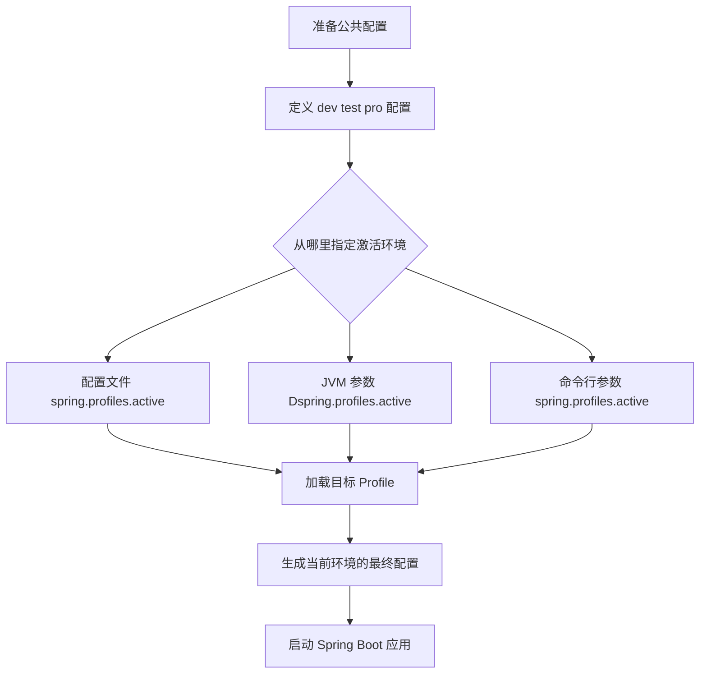

关键路径是先定义环境，再在启动阶段传入激活值。应用代码不需要感知自己运行在哪个环境。

**配置文件激活**适合本地开发和固定默认值。在 `application.properties` 或 `application.yml` 中设置：

```properties
spring.profiles.active=dev
```

**JVM 参数激活**通过 Java 系统属性传值，IDE 的 VM options 和直接运行 Java 命令都可以使用：

```bash
java -Dspring.profiles.active=test -jar springboot-profiles-0.0.1-SNAPSHOT.jar
```

`-D` 是大写字母 D，并且 JVM 参数应放在 `-jar` 之前。课程演示中，JVM 参数把配置文件里的 `dev` 覆盖为 `test`，最终启用 8082 端口。

**命令行参数激活**属于 Spring Boot 应用参数，写在 jar 文件名之后：

```bash
java -jar springboot-profiles-0.0.1-SNAPSHOT.jar --spring.profiles.active=pro
```

参数开头是两个连字符。这个命令激活 `pro`，应用使用 8083 端口。部署脚本和容器启动命令通常采用这种方式，同一个 jar 包可以直接投放到不同环境。

当多个位置同时设置 `spring.profiles.active` 时，课程涉及的三种方式中，命令行参数优先级高于 JVM 系统属性，JVM 系统属性又高于项目内部配置文件。外部参数因此能够覆盖打包进 jar 的默认值。

Profile 的选择发生在 Spring Boot 创建应用上下文、整理环境配置的阶段，业务入口保持不变。课程工程的引导类改成中性包名后如下：

```java
package com.example.springbootprofiles;

import org.springframework.boot.SpringApplication;
import org.springframework.boot.autoconfigure.SpringBootApplication;

@SpringBootApplication
public class SpringbootProfilesApplication {

    public static void main(String[] args) {
        SpringApplication.run(SpringbootProfilesApplication.class, args);
    }
}
```

无论激活 `dev`、`test` 还是 `pro`，运行的都是同一个 `main` 方法。变化的是 Spring Environment 中汇总后的属性值，而不是应用入口或业务代码。控制台中的 `The following profiles are active` 可以用于确认当前激活环境；出现 `No active profile set`，说明没有显式激活 Profile。

## 第5部分：Spring Boot 项目内部配置怎么覆盖：四个目录与三种后缀的优先级

同一个 Spring Boot 工程里，根目录有 `application.properties`，`src/main/resources` 下又有一份，`config` 子目录里可能还放着第三份。几个文件同时声明 `server.port` 时，改错位置就会出现配置明明保存了，启动端口却完全不变的现象。

排查这类问题不能只看某个文件是否存在，还要同时判断目录位置、文件后缀和属性名。Spring Boot 会加载多个配置文件，再按优先级逐项合并，而不是找到一份高优先级文件后就停止读取。

以课程的 `springboot-config` 模块为例，四个位置可以整理成下面的目录结构：

```text
springboot/
├── config/
│   └── application.properties
├── application.properties
└── springboot-config/
    └── src/main/resources/
        ├── config/
        │   └── application.properties
        └── application.properties
```

这里的 `springboot/` 是运行时的项目根目录，也就是当前工作目录；`src/main/resources/` 中的内容经过 Maven 构建后会进入 classpath。源代码目录名和运行时 classpath 不是同一个概念，不能简单地把所有 `resources` 文件都看成最高优先级。

四层配置的覆盖顺序如下图所示：

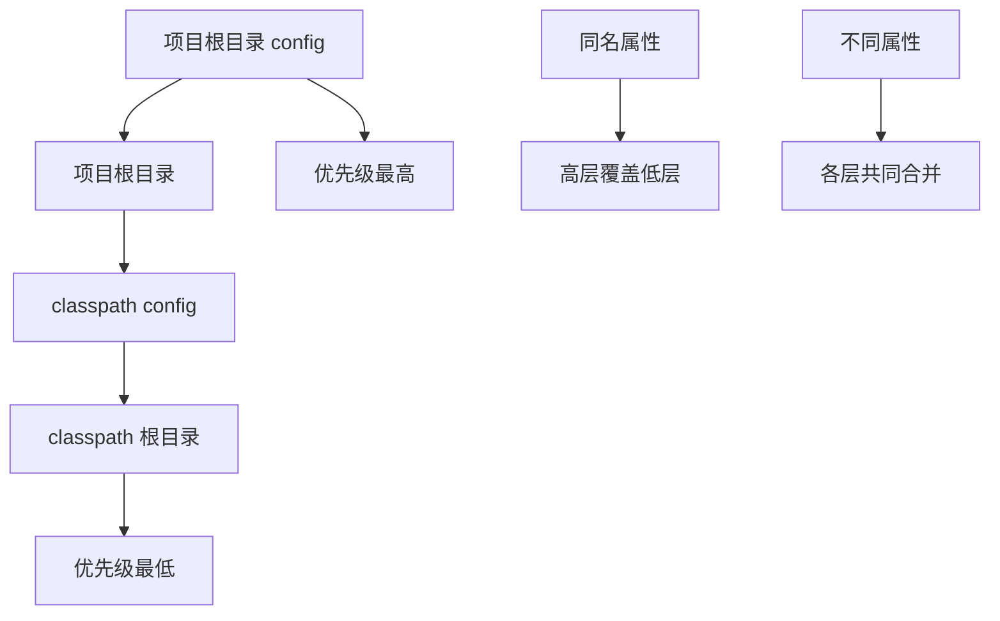

图中的纵向顺序表示目录优先级。覆盖只发生在同名属性之间，四个位置都可能为最终 Environment 提供配置。

课程实验分别给四层的 `server.port` 设置 8084、8083、8082、8081。四份文件同时存在时，项目根目录 `config` 下的 8084 生效：

```properties
# ./config/application.properties
server.port=8084

# ./application.properties
server.port=8083

# classpath:/config/application.properties
server.port=8082

# classpath:/application.properties
server.port=8081
```

课程资料最终保留了 8084、8083 和 classpath 根目录的 8081。classpath 的 `config` 文件用于课堂过程演示，结论仍然是它高于 classpath 根目录、低于项目根目录。

课程源码的 `springboot-config/src/main/resources/application.properties` 包含两个配置项：

```properties
# 修改项目的访问路径，默认值为 /
server.servlet.context-path=/hello

server.port=8081
```

项目根目录 `config/application.properties` 只声明了端口 8084。启动时，`server.port=8081` 会被高优先级的 8084 覆盖，但 `server.servlet.context-path=/hello` 在高层没有同名项，所以仍然进入最终配置。

最终效果是端口使用 8084，上下文路径使用 `/hello`。两项配置来自不同文件，这就是配置互补。Spring Boot 会把多个 PropertySource 汇总成统一的 Environment，查询某个键时从高优先级向低优先级寻找，找到后采用最先匹配的值。

课程源码还提供了一个真实的 Controller，包名改成中性名称后如下：

```java
package com.example.springbootconfig;

import org.springframework.web.bind.annotation.RequestMapping;
import org.springframework.web.bind.annotation.RestController;

@RestController
public class HelloController {

    @RequestMapping("/hello")
    public String hello() {
        return "hello config";
    }
}
```

Controller 的资源路径是 `/hello`，配置文件中的上下文路径也是 `/hello`，两者含义不同。实际访问地址需要同时带上应用前缀和资源路径：

```bash
curl http://localhost:8084/hello/hello
# hello config
```

前一个 `/hello` 来自 `server.servlet.context-path`，后一个 `/hello` 来自 `@RequestMapping`。能够访问成功，说明低优先级配置文件虽然失去了端口配置的决定权，其他属性仍被正常加载。

目录位置相同时，Spring Boot 还会比较默认配置文件的后缀。课程使用的 Spring Boot 2.1.8.RELEASE 中，顺序是：

```text
application.properties
    > application.yml
        > application.yaml
```

假设三份文件处在同一个 `src/main/resources` 目录，并分别把端口设为 8081、8082、8083，最终使用 8081。注释掉 `.properties` 中的端口后，`.yml` 的 8082 生效；再注释掉 `.yml` 后，才会使用 `.yaml` 的 8083。

YAML 中的层级写法会被转换成与 properties 相同的键再参与比较：

```yaml
server:
  port: 8082
```

上面的配置键仍是 `server.port`，因此会与 `server.port=8081` 发生覆盖，而不是被当作另一项配置。实践中不建议在同一目录同时维护三种后缀，选择一种格式可以显著降低误改文件的概率。

**第一，确认启动时的工作目录。** `./config/` 和 `./application.properties` 都相对于当前工作目录解析。IDE 启动配置与命令行所在目录不同，可能让文件系统配置的位置发生变化。

**第二，列出四个默认位置中的同名键。** 不要只搜索 `src/main/resources`，还要检查项目根目录及其 `config` 子目录。端口问题可以全局搜索 `server.port`。

**第三，检查同一目录是否存在多种后缀。** `.properties`、`.yml`、`.yaml` 都可能被读取，同名键由后缀优先级决定。

**第四，区分覆盖与未加载。** 某个值没有生效，不代表整个文件没加载。可在低优先级文件中放置一个高层没有的配置，通过最终运行结果判断它是否参与合并。

## 第6部分：Spring Boot 整合 JUnit：让测试类正确加载容器与业务 Bean

普通 JUnit 测试可以直接调用一个 Java 对象，却不会自动创建 Spring 容器。测试对象一旦依赖 `@Service`、`@Autowired` 或配置文件，直接运行就可能得到空引用，或者根本拿不到需要验证的 Bean。

Spring Boot 测试的关键不是多写一套业务代码，而是让 JUnit 在执行测试方法前找到引导类、启动应用上下文，再从容器中注入真实 Bean。课程工程使用 JUnit 4，核心组合是 `@RunWith(SpringRunner.class)` 与 `@SpringBootTest`。

课程源码基于 Spring Boot 2.1.8.RELEASE，`pom.xml` 中已经包含测试起步依赖：

```xml
<dependency>
    <groupId>org.springframework.boot</groupId>
    <artifactId>spring-boot-starter-test</artifactId>
    <scope>test</scope>
</dependency>
```

`spring-boot-starter-test` 把 Spring Test、JUnit 4 等测试组件组合起来，避免逐个声明坐标和处理版本关系。`<scope>test</scope>` 表示它只参与测试代码的编译和执行，不会作为生产运行依赖进入正常业务路径。

Spring Boot 初始化项目时通常会自动生成测试依赖和一个上下文加载测试类。手动创建工程时，如果 `org.junit.Test`、`SpringRunner` 或 `SpringBootTest` 无法导入，应先检查这个依赖是否存在，而不是直接复制注解。

课程的 `springboot-test` 工程定义了一个简单的业务 Bean。包名改成中性名称后，代码如下：

```java
package com.example.springboottest;

import org.springframework.stereotype.Service;

@Service
public class UserService {

    public void add() {
        System.out.println("add...");
    }
}
```

`UserService` 由 `@Service` 标记，它的实例应交给 Spring 容器管理。测试时不手动 `new UserService()`，而是启动测试上下文后通过 `@Autowired` 注入，这样才能验证真实的 Bean 创建、组件扫描和依赖注入过程。

当测试类与引导类位于同一个包时，课程源码采用下面的写法：

```java
package com.example.springboottest;

import org.junit.Test;
import org.junit.runner.RunWith;
import org.springframework.beans.factory.annotation.Autowired;
import org.springframework.boot.test.context.SpringBootTest;
import org.springframework.test.context.junit4.SpringRunner;

@RunWith(SpringRunner.class)
@SpringBootTest
public class UserServiceTest {

    @Autowired
    private UserService userService;

    @Test
    public void testAdd() {
        userService.add();
    }
}
```

`@RunWith(SpringRunner.class)` 把 JUnit 4 的执行过程交给 Spring Runner 扩展，使测试生命周期能够接入 Spring TestContext Framework。`@SpringBootTest` 告诉框架按 Spring Boot 应用方式加载上下文。`@Test` 标记真正要执行的测试方法。

运行 `testAdd()` 时，如果上下文创建成功，`userService` 会被注入并输出 `add...`。课程代码用控制台输出验证调用链，业务项目中的测试还应配合断言检查返回值或状态变化，避免只靠肉眼观察日志。

测试启动过程可以用下面这张图表示：

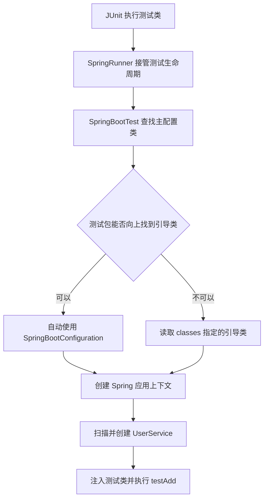

关键节点是主配置类查找。`@SpringBootApplication` 中包含 `@SpringBootConfiguration`，所以引导类就是默认的主配置类。Spring Boot 会从测试类所在包开始向上查找，而不会扫描平行包的所有子目录。

假设引导类在 `com.example.springboottest`：

- 测试类在 `com.example.springboottest`，可以自动找到引导类。
- 测试类在 `com.example.springboottest.service`，向上查找时也能找到引导类。
- 测试类在 `com.example.test`，它与引导类所在包是平行关系，自动查找无法进入另一个分支。

第三种情况必须显式指定引导类。课程源码中的外部包测试类改写包名后如下：

```java
package com.example.test;

import com.example.springboottest.SpringbootTestApplication;
import com.example.springboottest.UserService;
import org.junit.Test;
import org.junit.runner.RunWith;
import org.springframework.beans.factory.annotation.Autowired;
import org.springframework.boot.test.context.SpringBootTest;
import org.springframework.test.context.junit4.SpringRunner;

@RunWith(SpringRunner.class)
@SpringBootTest(classes = SpringbootTestApplication.class)
public class UserServiceTest {

    @Autowired
    private UserService userService;

    @Test
    public void testAdd() {
        userService.add();
    }
}
```

`classes` 属性给出了明确的配置源，不再依赖包路径推断。此时测试类可以放在平行包中，Spring Boot 仍能创建正确的应用上下文。

**第一，JUnit 发现 `@Test` 方法。** Maven Surefire 或 IDE 的测试运行器识别测试类，准备执行 `testAdd()`。

**第二，SpringRunner 初始化测试上下文。** 它读取 `@SpringBootTest` 的配置，自动查找或显式获取引导类。

**第三，Spring Boot 创建 ApplicationContext。** 组件扫描从引导类所在包开始，带有 `@Service` 的 `UserService` 被注册为 Bean。

**第四，Spring Test 为测试实例注入依赖。** `@Autowired` 字段拿到容器中的 `UserService`，随后测试方法才开始执行。

这种测试会启动 Spring 上下文，比不依赖容器的纯 JUnit 测试更重。只验证普通 Java 计算逻辑时不必使用 `@SpringBootTest`；需要验证 Bean、配置和依赖注入时再加载完整上下文。

## 第7部分：不打新包也能改配置：Spring Boot 外部配置的加载顺序与优先级

项目已经打好 jar 包丢上服务器了，这时候发现端口配错、数据库连接串写错，怎么办？改源码、重新打包、重新上传，
为了一个配置项走一遍完整发布流程，代价显然太大。Spring Boot 的设计里早就留了口子：配置不一定要写在 jar 包内部，
命令行、环境变量、jar 包旁边的目录，都可以作为配置来源，而且它们的优先级高于 jar 包内的配置。

这一篇就讲清楚这些「外部配置」有哪些来源、按什么顺序覆盖，以及怎么用它们做互补配置。

Spring Boot 参考文档的 Externalized Configuration 一节，把允许配置的位置从上到下排了 17 项。这个排列不是随便写的，
**序号越小优先级越高**，后面的会被前面的覆盖。完整清单如下（保留原文便于对照文档）：

```text
1  Devtools global settings properties on your home directory
2  TestPropertySource attributes on your tests
3  properties attribute on your tests
4  Command line arguments
5  Properties from SPRING_APPLICATION_JSON
6  ServletConfig init parameters
7  ServletContext init parameters
8  JNDI attributes from java:comp/env
9  Java System properties (System.getProperties())
10 OS environment variables
11 A randomValuePropertySource that has properties only in random.*
12 Profile specific application properties outside your packaged jar
13 Profile-specific application properties packaged inside your jar
14 Application properties outside your packaged jar
15 Application properties packaged inside your jar
16 @PropertySource annotations on your @Configuration classes
17 Default properties specified by SpringApplication.setDefaultProperties
```

**第一，前 3 项和最后 2 项在业务开发里几乎用不到。** 前 3 项是 Devtools 和测试注解专用，第 16、17 项属于编程式指定，
生产部署靠不上。

**第二，真正要记住的是第 4、9、10、12、13、14、15 这几项。** 它们分别对应命令行参数、JVM 系统属性、操作系统环境变量、
jar 包外带 profile 的配置、jar 包内带 profile 的配置、jar 包外的配置、jar 包内的配置。

**第三，「优先级高」的含义是覆盖而不是替换。** 高优先级来源里没写到的配置项，仍然会从低优先级来源里取值，这就是后面要讲的互补。

课程里用来演示的工程是 `springboot-config`，它的 `src/main/resources/application.properties` 内容如下：

```properties
# 修改项目的访问路径 默认值为/
server.servlet.context-path=/hello

server.port=8081
```

先 `mvn package` 打成 jar，然后不加任何参数直接运行：

```bash
java -jar springboot-config-0.0.1-SNAPSHOT.jar
# Tomcat started on port(s): 8081
```

这里有个容易困惑的现象：在 IDE 里直接运行时端口是 8084，打成 jar 运行却变成了 8081。原因是项目根目录下的
`application.properties` 和 `config/application.properties` 这两个文件**不符合 Maven 的目录结构，根本不会被打进 jar 包**。
把 jar 包用压缩工具打开，在 `BOOT-INF/classes` 下面只能找到 `src/main/resources` 里那份配置，端口 8081。
所以一旦脱离 IDE，能生效的就只剩打进包里的那份。

接下来在命令行上覆盖它：

```bash
java -jar springboot-config-0.0.1-SNAPSHOT.jar --server.port=8082
# Tomcat started on port(s): 8082
```

多个参数之间用空格隔开即可，访问路径同样可以指定：

```bash
java -jar springboot-config-0.0.1-SNAPSHOT.jar \
  --server.port=8082 \
  --server.servlet.context-path=/hehe
```

注意 `--` 是两个短横线，配置项的名字必须和 properties 里的键完全一致。课程演示时第一次因为把 `port` 写成了大写 `PORT`
而没有生效，这类拼写错误不会报错，只会静默地被忽略，排查时优先核对键名。

参数少的时候命令行很方便，一旦有几十项配置就完全不现实了。更实用的做法是**指定一个外部配置文件**，让 Spring Boot 去那个路径读。

```bash
java -jar springboot-config-0.0.1-SNAPSHOT.jar \
  --spring.config.location=E:/application.properties
```

假设 `E:/application.properties` 里只写了 `server.port=8088`，启动后端口就是 8088。官方文档还给了另外两种写法，
一并贴出来：

```bash
# 改配置文件的名字，不再叫 application
java -jar myproject.jar --spring.config.name=myproject

# 指定多个位置，用逗号分隔，后面的覆盖前面的
java -jar myproject.jar \
  --spring.config.location=classpath:/default.properties,classpath:/override.properties
```

`spring.config.location` 支持 `classpath:`、`file:` 前缀，也支持目录（目录必须以 `/` 结尾）。用目录时，
Spring Boot 会在该目录下按 `application.properties`、`application.yml` 的顺序去找。

如果连命令行参数都不想写，还有两个位置是 Spring Boot **默认就会去扫描**的，都在 jar 包所在的目录里：

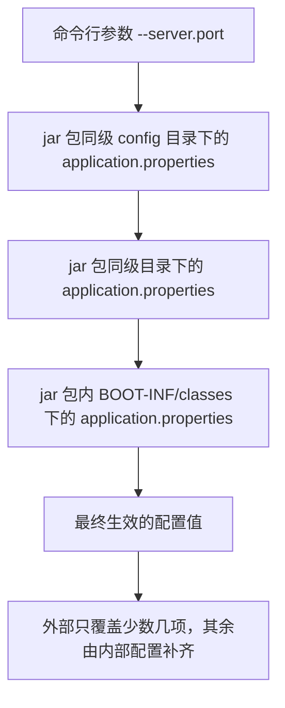

图里从上到下就是优先级由高到低。把 `application.properties` 复制到 jar 包同级目录，端口写成 8010，直接运行：

```bash
cd E:/workspace/springboot-config/target
java -jar springboot-config-0.0.1-SNAPSHOT.jar
# Tomcat started on port(s): 8010
```

再进一步，在同目录下建一个 `config` 子目录，把配置文件放进去，端口改成 8011，仍然不加任何参数运行，
生效的就是 8011。也就是说 `config/` 目录的优先级高于同级根目录，这正是清单里第 14 项内部的两个子层级。

单个配置项看不出威力，把内外配置放在一起看才明白它解决的是什么问题。

假设项目里已经写了一份完整的 `application.properties`，包含端口、数据源、Redis、日志级别等几十项。
部署到预发环境时只需要改端口和数据库地址，那么 jar 包旁边放一个只写两行的 `application.properties` 就够了。
启动时 Spring Boot 会**先读外部文件，再读内部文件，把两份合并**：外部有的以外部为准，外部没写的仍然取内部的。

这带来两个直接好处。一个是改配置不需要重新打包，运维在服务器上改一个文本文件即可。另一个是同一份 jar 可以在
不同环境原样部署，差异全部外置，避免「开发打一个包、测试打一个包、生产再打一个包」这种既容易出错又没法追溯的做法。

## 第8部分：Spring Boot 整合 Redis：只加一个起步依赖，模板对象直接注入就能用

以前用 Spring 整合 Redis 要做的几件事，做过的人都有印象：引 Redis 客户端坐标、写连接工厂配置、配置连接池、
再手动声明一个 `RedisTemplate` 的 Bean，最后才能注入使用。真正有价值的业务代码只有两三行，前面全是环境搭建。

换成 Spring Boot 之后，这套前置工作被压缩成了一个坐标。这一篇就讲清楚起步依赖替你做了什么、
什么时候必须配置、以及 `RedisTemplate` 与 `StringRedisTemplate` 该怎么选。

引入的坐标非常简单，课程源码里 `springboot-redis` 的 pom 是这样写的（包名已改为中性的 `com.example`）：

```xml
<parent>
    <groupId>org.springframework.boot</groupId>
    <artifactId>spring-boot-starter-parent</artifactId>
    <version>2.1.8.RELEASE</version>
    <relativePath/>
</parent>

<groupId>com.example</groupId>
<artifactId>springboot-redis</artifactId>
<version>0.0.1-SNAPSHOT</version>

<dependencies>
    <!-- Redis 起步依赖：包含 spring-data-redis 与 Lettuce 客户端 -->
    <dependency>
        <groupId>org.springframework.boot</groupId>
        <artifactId>spring-boot-starter-data-redis</artifactId>
    </dependency>

    <dependency>
        <groupId>org.springframework.boot</groupId>
        <artifactId>spring-boot-starter-test</artifactId>
        <scope>test</scope>
    </dependency>
</dependencies>
```

**第一，坐标里不需要写版本号。** 版本由父工程 `spring-boot-starter-parent` 统一管理，这也是 Spring Boot 工程的惯例。

**第二，客户端不用自己选。** 这个起步依赖默认带的是 Lettuce（基于 Netty 的连接驱动），它会作为传递依赖进来，
连接工厂 `RedisConnectionFactory` 也由自动配置创建好。

**第三，模板对象是现成的 Bean。** 自动配置类 `RedisAutoConfiguration` 在检测到 classpath 里有 Redis 相关类时生效，
向容器里注册 `RedisTemplate` 和 `StringRedisTemplate` 两个 Bean，所以你直接注入就能拿到实例。

自动配置的链路可以这样看：

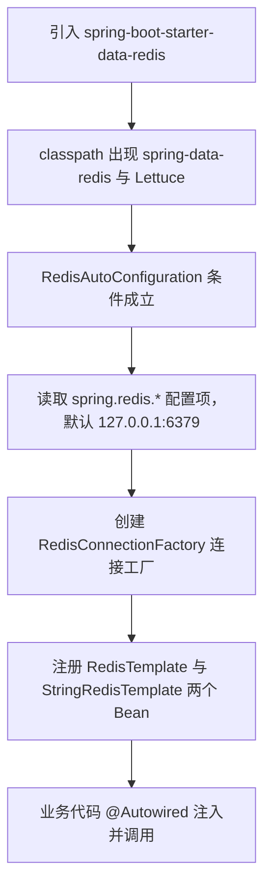

图里最关键的一步是条件判断：自动配置只有在 classpath 里能找到 Redis 相关类时才会触发，
这也是为什么删掉依赖之后，注入 `RedisTemplate` 立刻就报「找不到该类型的 Bean」。

课程里的测试类位于 `src/test/java/com/example/springbootredis/SpringbootRedisApplicationTests.java`，内容如下：

```java
package com.example.springbootredis;

import org.junit.Test;
import org.junit.runner.RunWith;
import org.springframework.beans.factory.annotation.Autowired;
import org.springframework.boot.test.context.SpringBootTest;
import org.springframework.data.redis.core.BoundValueOperations;
import org.springframework.data.redis.core.RedisTemplate;
import org.springframework.test.context.junit4.SpringRunner;

@RunWith(SpringRunner.class)
@SpringBootTest
public class SpringbootRedisApplicationTests {

    @Autowired
    private RedisTemplate redisTemplate;

    @Test
    public void testSet() {
        // 存入数据
        redisTemplate.boundValueOps("name").set("zhangsan");
    }

    @Test
    public void testGet() {
        // 获取数据
        Object name = redisTemplate.boundValueOps("name").get();
        System.out.println(name);
    }
}
```

**`boundValueOps(key)` 是绑定式操作。** 它返回一个和指定 key 绑定的 `BoundValueOperations` 对象，
后续 `set`、`get` 都不用再传 key。等价的写法是 `redisTemplate.opsForValue().set("name", "zhangsan")`，
前者适合对同一个 key 连续操作多次的场景，后者更通用。

**测试类上的两个注解缺一不可。** `@RunWith(SpringRunner.class)` 把 JUnit 交给 Spring 的测试框架驱动，
`@SpringBootTest` 负责启动完整的 Spring 容器，自动配置才有机会执行。少了任何一个，`redisTemplate` 都会是 null。

运行 `testSet` 看到绿条说明数据已经写进 Redis，再运行 `testGet` 控制台打印出 `zhangsan`，存取链路就通了。

本机 Redis 之所以能零配置，是因为默认值就是 127.0.0.1 和 6379。一旦换成测试环境或生产环境的机器，就必须显式指定。
课程里用的是 yml 格式，路径为 `src/main/resources/application.yml`：

```yaml
spring:
  redis:
    host: 127.0.0.1 # redis 的主机 IP，写主机名也可以
    port: 6379
```

**配置不需要死记硬背。** 在 IDE 里输入 `spring.redis` 会有完整的提示，连接池相关的 `lettuce.pool`、
超时时间、数据库索引等都在提示列表里，每项都有默认值，想改就直接写。

**properties 格式同样支持。** 等价写法是 `spring.redis.host=127.0.0.1` 和 `spring.redis.port=6379`，
两种格式 Spring Boot 都能识别，只是同一个目录下同时存在 `application.properties` 和 `application.yml` 时，
properties 的优先级更高，容易让人困惑，建议只保留一种。

连接远程 Redis 还有一个高频坑：**确认目标机器的 Redis 允许远程连接**。Redis 默认绑定本机地址并开启保护模式，
只改客户端的 `host` 是不够的，服务端还要改 `bind` 与 `protected-mode` 配置，并放行 6379 端口。

课程里注入的是原始类型的 `RedisTemplate`，它能存取任意 Java 对象，但默认序列化器是 `JdkSerializationRedisSerializer`。
结果是 value 里带着一串二进制前缀，用 `redis-cli` 或者其他客户端去看，`name` 这个 key 对应的值不是可读的 `zhangsan`。

存字符串时更合适的选择是 `StringRedisTemplate`，它的 key 和 value 都用 `StringRedisSerializer`，存取所见即所得。
下面这段是按本课写法补充的示例：

```java
@Autowired
private StringRedisTemplate stringRedisTemplate;

@Test
public void testStringSet() {
    stringRedisTemplate.boundValueOps("name").set("zhangsan");
}

@Test
public void testStringGet() {
    String name = stringRedisTemplate.boundValueOps("name").get();
    System.out.println(name); // zhangsan
}
```

`StringRedisTemplate` 是 `RedisTemplate<String, String>` 的子类，同样由自动配置注册，**不需要你额外声明任何 Bean**。
如果需要存对象又想让 Redis 里可读，那就得自己定义一个 `RedisTemplate<String, Object>` 并指定 Jackson 序列化器，
那属于进阶配置，不在这一课的范围内。

另一个实用技巧是指定泛型，避免每次都强转：

```java
@Autowired
private RedisTemplate<String, String> redisTemplate;

// 直接拿到 String，无需强转
String name = redisTemplate.boundValueOps("name").get();
```

## 第9部分：Spring Boot 整合 MyBatis：数据源配置、注解开发与 XML 映射两种写法

用 Spring 整合 MyBatis 的时候，SqlSessionFactory、数据源、Mapper 扫描器这些配置要写一大段 XML。
换成 Spring Boot 之后，同样的能力只需要一组 `spring.datasource.*` 配置加几个注解，
剩下的由自动配置补齐。这一篇把从建表到查出数据的完整链路走一遍，并给出注解和 XML 两种 Mapper 写法的对照。

课程源码 `springboot-mybatis` 的 pom 如下（包名已统一改为 `com.example`）：

```xml
<dependencies>
    <!-- MyBatis 官方提供的起步依赖，版本号需要显式指定 -->
    <dependency>
        <groupId>org.mybatis.spring.boot</groupId>
        <artifactId>mybatis-spring-boot-starter</artifactId>
        <version>2.1.0</version>
    </dependency>

    <!-- MySQL 驱动 -->
    <dependency>
        <groupId>mysql</groupId>
        <artifactId>mysql-connector-java</artifactId>
        <!--<scope>runtime</scope>-->
    </dependency>

    <dependency>
        <groupId>org.springframework.boot</groupId>
        <artifactId>spring-boot-starter-test</artifactId>
        <scope>test</scope>
    </dependency>
</dependencies>
```

**第一，命名规则暴露了提供方。** Spring Boot 官方的起步依赖都叫 `spring-boot-starter-xxx`，
而这个是 `mybatis-spring-boot-starter`，以框架自己的名字开头。这类依赖是**第三方框架自己为 Spring Boot 写的整合包**，
因为 Spring Boot 官方并没有打算为所有框架都提供 starter。识别方法很简单：看 groupId 是不是 `org.springframework.boot`。

**第二，驱动包的 scope 值得留意。** 用脚手架生成工程时 MySQL 驱动默认是 `<scope>runtime</scope>`，
意味着它只在运行时生效，编译期不可见，IDE 里写 `driver-class-name` 会标红提示找不到驱动类。
运行时其实没问题，看着别扭就把这行注释掉，默认的 compile 范围即可。

课程资料里提供了建表脚本，库名 `springboot`，表 `t_user`，三个字段：

```sql
CREATE DATABASE IF NOT EXISTS `springboot`
  DEFAULT CHARACTER SET utf8mb4 COLLATE utf8mb4_unicode_ci;

USE `springboot`;

CREATE TABLE `t_user` (
  `id` int(11) NOT NULL AUTO_INCREMENT,
  `username` varchar(32) DEFAULT NULL,
  `password` varchar(32) DEFAULT NULL,
  PRIMARY KEY (`id`)
) ENGINE=InnoDB AUTO_INCREMENT=3 DEFAULT CHARSET=utf8mb4;

insert into `t_user`(`id`,`username`,`password`) values (1,'zhangsan','123'),(2,'lisi','234');
```

对应的实体类放在 `domain` 包下，字段名和列名保持一致：

```java
package com.example.springbootmybatis.domain;

public class User {
    private int id;
    private String username;
    private String password;

    // getter / setter 省略，建议一并重写 toString 便于观察结果

    @Override
    public String toString() {
        return "User{" +
                "id=" + id +
                ", username='" + username + '\'' +
                ", password='" + password + '\'' +
                '}';
    }
}
```

`src/main/resources/application.yml` 的内容如下：

```yaml
# datasource
spring:
  datasource:
    url: jdbc:mysql:///springboot?serverTimezone=UTC
    username: root
    password: root
    driver-class-name: com.mysql.cj.jdbc.Driver

# mybatis
mybatis:
  mapper-locations: classpath:mapper/*Mapper.xml # mapper 映射文件路径
  type-aliases-package: com.example.springbootmybatis.domain
  # config-location:  # 指定 mybatis 的核心配置文件
```

**第一，url 里三个斜杠的写法是省略写法。** `jdbc:mysql:///springboot` 等价于 `jdbc:mysql://localhost:3306/springboot`，
省略了主机和端口，表示连本机默认端口。连远程库时要补全成 `jdbc:mysql://host:3306/springboot`。

**第二，`serverTimezone=UTC` 是必须的。** MySQL 8 的驱动要求显式指定时区，不加这一项启动时会直接报时区相关的异常，
异常信息里也会提示用 `serverTimezone` 配置项来修。

**第三，驱动类名用 `com.mysql.cj.jdbc.Driver`。** 旧的 `com.mysql.jdbc.Driver` 在 MySQL 8 驱动里已被标记为过时，
启动时控制台会打出一行警告建议换成 cj 包下的新类。改掉即可，行为上兼容。

数据源配好以后，Spring Boot 会默认使用 **HikariCP** 作为连接池，日志里能看到 `HikariPool` 初始化的输出，
不需要额外引依赖或写配置。

注解开发是最省事的写法，接口上加 `@Mapper` 标记，方法上加 `@Select` 写 SQL：

```java
package com.example.springbootmybatis.mapper;

import com.example.springbootmybatis.domain.User;
import org.apache.ibatis.annotations.Mapper;
import org.apache.ibatis.annotations.Select;
import org.springframework.stereotype.Repository;

import java.util.List;

@Mapper
@Repository
public interface UserMapper {

    @Select("select * from t_user")
    public List<User> findAll();
}
```

**`@Mapper` 是 MyBatis 的注解，负责把接口交给 MyBatis 生成代理实现并注册进容器。** 少了它，
注入时会报「找不到该类型的 Bean」。另一个做法是在引导类上写 `@MapperScan("com.example.springbootmybatis.mapper")` 批量扫描，
Mapper 接口多的时候更省事。

**`@Repository` 是可选的。** 它的作用是消除 IDE 的误报告警：IDE 只认 Spring 的 stereotype 注解，
看到 `@Mapper` 会提示找不到 Bean，加 `@Repository` 只是为了让编辑器安静。运行层面加不加都一样，
真正让 Bean 生效的是 `@Mapper`。

**这种写法不需要任何 mybatis 配置。** 没有 XML、没有映射文件路径、没有别名包，直接注入就能跑。

SQL 复杂、需要动态 SQL 或者希望 SQL 与代码分离时，用 XML 更合适。接口里不再写注解：

```java
package com.example.springbootmybatis.mapper;

import com.example.springbootmybatis.domain.User;
import org.apache.ibatis.annotations.Mapper;
import org.springframework.stereotype.Repository;

import java.util.List;

@Mapper
@Repository
public interface UserXmlMapper {

    public List<User> findAll();
}
```

映射文件放在 `src/main/resources/mapper/UserMapper.xml`：

```xml
<?xml version="1.0" encoding="UTF-8" ?>
<!DOCTYPE mapper PUBLIC "-//mybatis.org//DTD Mapper 3.0//EN" "http://mybatis.org/dtd/mybatis-3-mapper.dtd">
<mapper namespace="com.example.springbootmybatis.mapper.UserXmlMapper">
    <select id="findAll" resultType="user">
        select * from t_user
    </select>
</mapper>
```

三个对应关系必须严格一致，任何一处对不上都会报绑定失败：

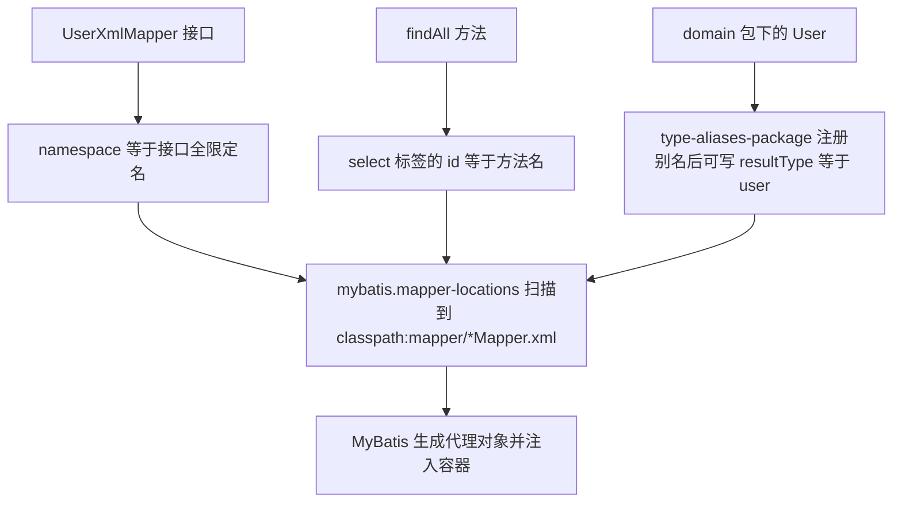

**第一，namespace 必须是接口的全限定名。** 写成接口名以外的任何值，启动时报「Mapped Statements collection does not contain value」。

**第二，`resultType` 能写短别名，靠的是 `type-aliases-package`。** 这个配置把指定包下的类注册成别名，
默认规则是类名首字母小写，所以 `User` 对应 `user`。不配这一项就得写全限定名，或者大小写不敏感但可读性差的写法。

**第三，`mapper-locations` 的通配符要覆盖到实际文件。** 这里写的是 `classpath:mapper/*Mapper.xml`，
如果你的文件叫 `UserDao.xml` 就匹配不上，惯例是统一以 `Mapper.xml` 结尾。

**第四，`config-location` 一般不配。** 它指向 MyBatis 的核心配置文件 `mybatis-config.xml`。
Spring Boot 下所有配置都写在 `application.yml` 里，通常不需要那份核心配置，所以课程里这一项是注释掉的。

```java
package com.example.springbootmybatis;

import com.example.springbootmybatis.domain.User;
import com.example.springbootmybatis.mapper.UserMapper;
import com.example.springbootmybatis.mapper.UserXmlMapper;
import org.junit.Test;
import org.junit.runner.RunWith;
import org.springframework.beans.factory.annotation.Autowired;
import org.springframework.boot.test.context.SpringBootTest;
import org.springframework.test.context.junit4.SpringRunner;

import java.util.List;

@RunWith(SpringRunner.class)
@SpringBootTest
public class SpringbootMybatisApplicationTests {

    @Autowired
    private UserMapper userMapper;

    @Autowired
    private UserXmlMapper userXmlMapper;

    @Test
    public void testFindAll() {
        List<User> list = userMapper.findAll();
        System.out.println(list);
    }

    @Test
    public void testFindAll2() {
        List<User> list = userXmlMapper.findAll();
        System.out.println(list);
    }
}
```

两个测试方法分别验证注解方式和 XML 方式，都能打印出 `[User{id=1, username='zhangsan', ...}, User{id=2, username='lisi', ...}]`。
两个 Mapper 可以在同一个工程里共存，互不干扰。

## 第10部分：Spring Boot 自动配置的第一块拼图：用 Condition 决定 Bean 该不该创建

导入一个 `spring-boot-starter-data-redis` 坐标，代码里就能直接注入 `RedisTemplate`；把坐标删掉再启动，控制台立刻甩出一句 `No bean named 'redisTemplate' available`。到这一刻就该意识到：Spring Boot 并不是无脑把自动配置里的 Bean 全塞进容器，它在注册之前先做了一次判断。

这个判断的载体叫 `Condition`，是 Spring 4.0 新增的条件评估能力，也是整个 Spring Boot 自动配置大厦的地基。下面把它拆开：怎么用、怎么做成动态、Spring Boot 又替我们准备好了哪些现成注解。

在基础篇里已经把 Spring Boot 怎么用、怎么整合第三方框架过了一遍，高级篇要回答的是「它凭什么这么省事」。整章分三块：

| 模块 | 要解决的问题 |
|---|---|
| Spring Boot 原理分析 | 自动配置是怎么实现的，起步依赖的原理是什么，容器启动过程都做了哪些事 |
| Spring Boot 监控 | 项目上线之后，怎么动态拿到内存、线程、配置项、健康状态等运行时信息 |
| Spring Boot 项目部署 | 写好的工程以什么形式交付到生产环境，jar 和 war 分别怎么打 |

三块里的第一块是后两块的基础，而自动配置又是原理分析的第一站。自动配置拆开看有若干小知识点，`Condition` 是排在最前面的一个。

新建一个最简 Spring Boot 工程，`pom` 里只有 `spring-boot-starter`，然后在引导类里获取 `redisTemplate`：

```java
package com.example.springbootcondition;

import org.springframework.boot.SpringApplication;
import org.springframework.boot.autoconfigure.SpringBootApplication;
import org.springframework.context.ConfigurableApplicationContext;

@SpringBootApplication
public class SpringbootConditionApplication {

    public static void main(String[] args) {
        // 启动 Spring Boot 应用，返回 Spring 的 IOC 容器
        ConfigurableApplicationContext context =
                SpringApplication.run(SpringbootConditionApplication.class, args);

        Object redisTemplate = context.getBean("redisTemplate");
        System.out.println(redisTemplate);
    }
}
```

`SpringApplication.run` 的返回值类型是 `ConfigurableApplicationContext`，它就是 Spring 的 IOC 容器。拿到容器后用 `getBean("redisTemplate")` 去取，此时工程里没有 Redis 相关依赖，运行直接报：

```bash
No bean named 'redisTemplate' available
```

往 `pom.xml` 里补一个起步依赖：

```xml
<dependency>
    <groupId>org.springframework.boot</groupId>
    <artifactId>spring-boot-starter-data-redis</artifactId>
</dependency>
```

重启之后同样的代码就能拿到对象了。问题来了：Spring Boot 是怎么知道「我导没导这个坐标」的？

`Condition` 翻译过来是条件。它的官方注释里写得很清楚，这是一个在组件注册之前必须被「匹配」的条件，匹配发生在 BeanDefinition 即将注册的那一刻，可以基于任意标准否决这次注册：

```java
public interface Condition {
    boolean matches(ConditionContext context, AnnotatedTypeMetadata metadata);
}
```

接口只有一个 `matches` 方法，返回值是 `boolean`。约定是：

**返回 `true`，** Spring 容器正常注册并创建这个 Bean。

**返回 `false`，** 这次注册被否决，容器里压根没有这个 Bean，后面 `getBean` 就会抛 `NoSuchBeanDefinitionException`。

回到 Redis 那个问题，答案就一句话：Spring Boot 判断当前环境里有没有 Redis 需要的字节码文件，有就创建 `RedisTemplate`，没有就不创建。判断的手段就是 `Condition`。

课程案例的需求是：IOC 容器里有一个 `User` 的 Bean，导入 Redis 客户端坐标后才加载它，没导入则不加载。

先准备实体类和配置类：

```java
package com.example.springbootcondition.domain;

public class User {
}
```

```java
package com.example.springbootcondition.config;

import com.example.springbootcondition.domain.User;
import org.springframework.context.annotation.Bean;
import org.springframework.context.annotation.Configuration;

@Configuration
public class UserConfig {

    @Bean
    public User user() {
        return new User();
    }
}
```

此时不管导没导坐标，`getBean("user")` 都能拿到对象。要加上条件，就得引入 `@Conditional`。点进这个注解可以看到它接收一个 `Class` 数组，数组里的每个类都必须是 `Condition` 的实现类。

第一步写一个条件类。最初的写法是把要判断的类名写死：

```java
package com.example.springbootcondition.condtion;

import org.springframework.context.annotation.Condition;
import org.springframework.context.annotation.ConditionContext;
import org.springframework.core.type.AnnotatedTypeMetadata;

public class ClassCondition implements Condition {

    @Override
    public boolean matches(ConditionContext context, AnnotatedTypeMetadata metadata) {
        // 需求一：导入 Jedis 坐标后创建 Bean
        // 思路：判断 redis.clients.jedis.Jedis.class 文件是否存在
        boolean flag = true;
        try {
            Class<?> cls = Class.forName("redis.clients.jedis.Jedis");
        } catch (ClassNotFoundException e) {
            flag = false;
        }
        return flag;
    }
}
```

判断逻辑用的是 `Class.forName` 加异常捕获：能加载到字节码，说明坐标一定在；加载不到就会抛 `ClassNotFoundException`，此时把标志位改成 `false`。用异常驱动业务流程并不推荐，这里只是为了把「类在不在」这件事讲清楚。

第二步把条件挂到 Bean 上：

```java
@Bean
@Conditional(ClassCondition.class)
public User user() {
    return new User();
}
```

把 Jedis 坐标注释掉再跑，`matches` 返回 `false`，控制台报 `No bean named 'user' available`；把坐标打开，Bean 又出现了。

上面的写法有个明显缺陷：一个条件类只能判断一个固定的类。想让它判断任意类，就得让类名由使用者传入。

做法是自定义一个注解，并把 `@Conditional` 作为元注解标注在它上面：

```java
package com.example.springbootcondition.condtion;

import org.springframework.context.annotation.Conditional;

import java.lang.annotation.*;

@Target({ElementType.TYPE, ElementType.METHOD})
@Retention(RetentionPolicy.RUNTIME)
@Documented
@Conditional(ClassCondition.class)
public @interface ConditionOnClass {
    String[] value();
}
```

三个元注解各有作用：`@Target` 声明这个注解能加到类上和方法上，`@Retention` 声明它保留到运行期才会被反射读到，`@Documented` 表示生成 Javadoc 时带上它。

关键的一行是 `@Conditional(ClassCondition.class)`。Spring 在解析 `@ConditionOnClass` 时会把它当成 `@Conditional` 处理，于是 `ClassCondition` 的 `matches` 被调用。

接下来的问题是：`matches` 怎么拿到注解上写的类名？答案在第二个参数 `metadata` 上：

```java
@Override
public boolean matches(ConditionContext context, AnnotatedTypeMetadata metadata) {
    // 需求二：导入通过注解属性 value 指定的坐标后，才创建 Bean
    Map<String, Object> map = metadata.getAnnotationAttributes(ConditionOnClass.class.getName());
    String[] value = (String[]) map.get("value");

    boolean flag = true;
    try {
        for (String className : value) {
            Class<?> cls = Class.forName(className);
        }
    } catch (ClassNotFoundException e) {
        flag = false;
    }
    return flag;
}
```

`getAnnotationAttributes` 返回一个 Map，键是注解属性名，值是对应的值。这里 `value` 是 `String` 数组，因为注解声明成了数组，可以一次指定多个类。遍历时只要有一个类找不到，`flag` 就置为 `false`。

使用侧变成这样：

```java
@Bean
@ConditionOnClass("redis.clients.jedis.Jedis")
public User user() {
    return new User();
}

@Bean
@ConditionOnClass("com.alibaba.fastjson.JSON")
public User user2() {
    return new User();
}
```

把 `Jedis` 换成 `com.alibaba.fastjson.JSON`，条件立刻变成「必须导入 fastjson 坐标」。想判断什么类，由注解上的字符串决定，条件类不用再动。

整个裁决过程可以画成下面这张图：

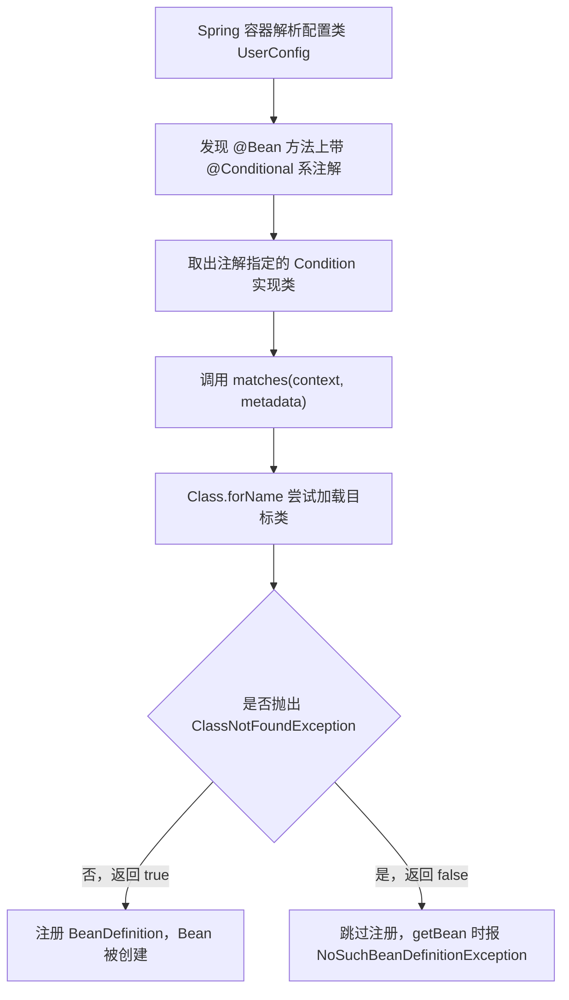

图里最关键的一环是 `matches` 的调用时机：它发生在 BeanDefinition 注册之前，所以返回 `false` 时这个 Bean 在容器里根本不存在，不是创建了再销毁。

自己写条件类在实际开发里很少见，因为 `spring-boot-autoconfigure` 这个 jar 的 `org.springframework.boot.autoconfigure.condition` 包下已经备好了一整套。

| 注解 | 生效条件 |
|---|---|
| `@ConditionalOnClass` | classpath 中存在指定的字节码文件 |
| `@ConditionalOnMissingClass` | classpath 中不存在指定的类 |
| `@ConditionalOnBean` | IOC 容器中已经存在指定的 Bean |
| `@ConditionalOnMissingBean` | IOC 容器中不存在指定的 Bean |
| `@ConditionalOnProperty` | 配置文件中存在指定的属性且值匹配 |
| `@ConditionalOnExpression` | SpEL 表达式求值为 `true` |
| `@ConditionalOnWebApplication` | 当前应用是 Web 应用 |

`@ConditionalOnClass` 的源码结构正是上面手写的那个模式的官方版本：

```java
@Target({ElementType.TYPE, ElementType.METHOD})
@Retention(RetentionPolicy.RUNTIME)
@Documented
@Conditional(OnClassCondition.class)
public @interface ConditionalOnClass {
    Class<?>[] value() default {};
    String[] name() default {};
}
```

注意它提供了两个属性：`value` 接收 `Class` 类型，`name` 接收类全限定名字符串。用字符串的好处是即使这个类不在 classpath 上，注解本身也不会因为类找不到而报错，这正是自动配置类需要的特性。

再看 `RedisAutoConfiguration`，它把两类条件组合在了一起：

```java
@Configuration
@ConditionalOnClass(RedisOperations.class)
@ConditionalOnMissingBean(RedisTemplate.class)
public class RedisAutoConfiguration {

    @Bean
    @ConditionalOnMissingBean
    public RedisTemplate string(RedisConnectionFactory redisConnectionFactory) {
        StringRedisTemplate template = new StringRedisTemplate();
        template.setConnectionFactory(redisConnectionFactory);
        return template;
    }
}
```

类上的 `@ConditionalOnClass(RedisOperations.class)` 意味着：classpath 里没有 Redis 相关的类，整个配置类都不解析，这就是「不导坐标就没有 `RedisTemplate`」的直接原因。

`@ConditionalOnMissingBean` 表达的是另一层意思：容器里已经有 `RedisTemplate` 了，就不再创建，优先用你自己定义的那一个。这个设计给了使用者覆盖默认配置的机会，也是自动配置「约定优于配置」的关键落点。

顺着这个思路，用现成注解可以一行搞定按配置开关 Bean，不需要任何自定义条件类：

```java
@Bean
@ConditionalOnProperty(name = "cache.type", havingValue = "redis")
public User user2() {
    return new User();
}
```

```properties
cache.type=redis
```

`name` 指定配置项的键，`havingValue` 指定期望的值，两者都对上才创建。配置文件里没有这一项，或者值不对，`getBean("user2")` 就会报错。

## 第11部分：把 Spring Boot 内置的 Tomcat 换成 Jetty：两处依赖改动背后的 Condition

每次启动 Spring Boot 的 Web 工程，控制台都会打一句 `Tomcat started on port(s): 8080`。没人在 pom 里写过 Tomcat，它就这么出现了，因为 `spring-boot-starter-web` 把它传递进来了。

真到了要换容器的时候，很多人第一反应是去找配置文件里的开关。其实没有开关，Spring Boot 一共内置了四种 Web 服务器，切换方式只有一条：改变 classpath 上有哪些字节码。

在演示切换之前，先把默认行为看清楚。把 `pom.xml` 里的 Web 起步依赖注释掉再启动：

```xml
<!-- <dependency>
    <groupId>org.springframework.boot</groupId>
    <artifactId>spring-boot-starter-web</artifactId>
</dependency> -->
```

此时控制台既没有 Tomcat 的启动日志，程序也是启动完就退出了。原因很直接：没有 Web 容器，就没有东西需要一直监听端口，主线程的活干完 JVM 就结束了。

把依赖重新打开再跑，`Tomcat started on port(s): 8080` 又出现了，进程常驻。这一步确认了两件事：Web 环境由起步依赖带来，默认容器是 Tomcat。

种类不用查文档，直接看源码。在 External Libraries 里找到 `spring-boot-autoconfigure` 这个 jar，展开 `org.springframework.boot.autoconfigure.web`，下面有一个 `embedded` 包，`embedded` 就是嵌入式的意思。包里有四个工厂定制器：

| 内置服务器 | 工厂配置类 | 说明 |
|---|---|---|
| Tomcat | `TomcatWebServerFactoryCustomizerConfiguration` | 默认，来自 `spring-boot-starter-tomcat` |
| Jetty | `JettyWebServerFactoryCustomizerConfiguration` | 轻量，长连接场景常用 |
| Undertow | `UndertowWebServerFactoryCustomizerConfiguration` | 高性能，非阻塞 IO |
| Netty | `NettyWebServerFactoryCustomizerConfiguration` | 响应式栈，配合 WebFlux 使用 |

它们的父配置类是 `EmbeddedWebServerFactoryCustomizerAutoConfiguration`，结构大致如下：

```java
@Configuration
@ConditionalOnWebApplication
@ConditionalOnClass({ServerProperties.class})
public class EmbeddedWebServerFactoryCustomizerAutoConfiguration {

    @Configuration
    @ConditionalOnClass({Tomcat.class, UpgradeProtocol.class})
    public static class TomcatWebServerFactoryCustomizerConfiguration {
        @Bean
        public TomcatWebServerFactoryCustomizer tomcatWebServerFactoryCustomizer(
                Environment environment, ServerProperties serverProperties) {
            return new TomcatWebServerFactoryCustomizer(environment, serverProperties);
        }
    }

    @Configuration
    @ConditionalOnClass({Server.class, Loader.class, WebAppContext.class})
    public static class JettyWebServerFactoryCustomizerConfiguration {
        // Jetty 相关定制器
    }
}
```

外层类上的 `@ConditionalOnWebApplication` 表示只有当前是 Web 应用时才解析，这也解释了为什么注释掉 Web 起步依赖之后整个配置都不生效。

内层每个静态内部类上的 `@ConditionalOnClass` 是切换的关键。以 Tomcat 为例，它要求 classpath 上同时存在 `Tomcat.class` 和 `UpgradeProtocol.class`，这两个类只有导入了 Tomcat 的坐标才会出现。Jetty 要求 `Server`、`Loader`、`WebAppContext` 三个类，Undertow 和 Netty 同理。

把这段逻辑画出来就是下面这张图：

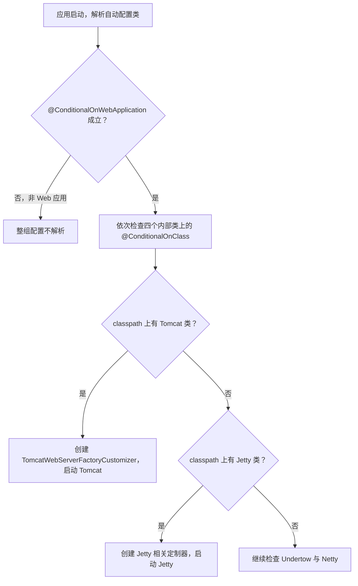

图里的分叉点全部由 classpath 上的字节码决定，没有任何配置项参与。想换容器，本质上就是把一组类换成另一组。

课程源码里 `springboot-condition` 工程的 `pom.xml` 就是切完之后的样子，只动了两个地方：

```xml
<dependency>
    <groupId>org.springframework.boot</groupId>
    <artifactId>spring-boot-starter-web</artifactId>
    <!-- 第一件事：排除 Tomcat 的依赖 -->
    <exclusions>
        <exclusion>
            <artifactId>spring-boot-starter-tomcat</artifactId>
            <groupId>org.springframework.boot</groupId>
        </exclusion>
    </exclusions>
</dependency>

<!-- 第二件事：引入 Jetty 的依赖 -->
<dependency>
    <artifactId>spring-boot-starter-jetty</artifactId>
    <groupId>org.springframework.boot</groupId>
</dependency>
```

`spring-boot-starter-web` 本身必须保留，它提供的是 Spring MVC 那一套基础设施，容器只是它内部的一个依赖。所以不能删 starter，只能把里面的 Tomcat 剔掉。

`<exclusions>` 里只需要写 `groupId` 和 `artifactId`，不需要版本号，版本由父工程管理。排除之后，Tomcat 相关的类从 classpath 上消失，`TomcatWebServerFactoryCustomizerConfiguration` 的条件不再成立；引入 `spring-boot-starter-jetty` 之后，`Server`、`Loader`、`WebAppContext` 到位，Jetty 分支被激活。

改完重启，日志从 `Tomcat started on port(s): 8080` 变成 `Jetty started on port(s): 8080`，端口没变，业务代码一行没动。

回头看，切换容器这件事里没有任何魔法：

**第一，自动配置类被批量列出。** `spring-boot-autoconfigure` 里列出了所有可能的服务器配置，包括你根本没用到的那几个。

**第二，每一条配置都自带条件。** 条件大多是 `@ConditionalOnClass`，判断依据是 classpath 上有没有特定的字节码文件。

**第三，依赖决定条件，条件决定 Bean。** 你在 pom 里增删坐标，改变的是 classpath，进而改变条件评估结果，最终决定容器里有哪些 Bean。

这也是为什么自动配置能同时做到「开箱即用」和「不引入无用对象」：所有可能性都写好了，但只有条件成立的那部分会真正进入容器。自定义 starter 时遵循的也是同一套思路。

## 第12部分：为什么第三方 jar 里的 Bean 拿不到：从 @ComponentScan 到 @Enable* 注解

引入 `spring-boot-starter-data-redis` 的坐标之后，别人 jar 包里定义的 `RedisTemplate` 就能直接注入。换成自己写的另一个工程，在里面老老实实定义一个 `User` 的 Bean，主工程里 `getBean("user")` 却直接报 `No bean named 'user' available`。

同样是别人工程里的 Bean，凭什么 Redis 能拿到，自己的拿不到？这两个问题的答案连在一起，就构成了 Spring Boot 自动配置的完整骨架。

引导类上只有一个 `@SpringBootApplication`，点进去可以看到它由若干注解组合而成，去掉元注解之外，有三个是核心：

```java
@SpringBootConfiguration
@EnableAutoConfiguration
@ComponentScan
public @interface SpringBootApplication {
}
```

**`@SpringBootConfiguration` 点进去就是 `@Configuration`。** 这意味着引导类本身就是一个配置类，可以在里面直接用 `@Bean` 定义对象，这也是课程源码里在引导类中写 `jedis()` 方法能够生效的原因。

**`@ComponentScan` 负责组件扫描。** 它的扫描范围是引导类所在的包及其子包，包外的组件一概扫不到。

**`@EnableAutoConfiguration` 是自动配置的总开关。** Spring Boot 的自动配置能力完全挂在它身上。

做一个最小实验：建两个模块，一个负责提供 Bean，一个负责启动并取 Bean。

提供方的配置类和实体类是这样的：

```java
package com.example.config;

import com.example.domain.Role;
import com.example.domain.User;
import org.springframework.context.annotation.Bean;

public class UserConfig {

    @Bean
    public User user() {
        return new User();
    }

    @Bean
    public Role role() {
        return new Role();
    }
}
```

启动方在 `pom.xml` 里引入提供方：

```xml
<dependency>
    <groupId>com.example</groupId>
    <artifactId>springboot-enable-other</artifactId>
    <version>0.0.1-SNAPSHOT</version>
</dependency>
```

然后在引导类里获取：

```java
ConfigurableApplicationContext context =
        SpringApplication.run(SpringbootEnableApplication.class, args);
Object user = context.getBean("user");
System.out.println(user);
```

运行直接报错，找不到名为 `user` 的 Bean。坐标明明已经引进来了，为什么还是没有？

原因出在扫描范围上。启动方引导类的包是 `com.example.springbootenable`，扫描范围就是它和它的子包；提供方配置类的包是 `com.example.config`，两者只是同父级关系，没有包含关系，所以 `@ComponentScan` 根本扫不到它。

到这里，前面那个「Redis 为什么能拿到」的疑问也就有了落点：自动配置一定用了别的加载手段，而不是靠包扫描。

既然扫不到，那就把那个包加进扫描范围：

```java
@Configuration
@ComponentScan("com.example.config")
public class SpringbootEnableApplication {
}
```

重启之后 `user` 拿到了。但这个方案在实际项目里很难用：每接入一个第三方功能就要加一行扫描路径，而且你必须记住对方的配置类放在哪个包下。包名属于实现细节，本不该由使用方承担记忆成本。

`@Import` 的语义很直白：括号里写的类，会被 Spring 创建并放入 IOC 容器。

```java
@Configuration
@Import(UserConfig.class)
public class SpringbootEnableApplication {
}
```

`UserConfig` 被导入后，它内部的 `@Bean` 方法同样会被解析，于是 `user` 和 `role` 都进了容器，效果与方案一一致。

这里有个值得注意的细节：**被 `@Import` 导入的类不需要标注 `@Configuration`。** 课程源码里 `UserConfig` 的 `@Configuration` 就是被注释掉的，照样能生效。因为被导入的类会被当作配置类解析，只是处于「lite 模式」，`@Bean` 方法照常处理。

方案二比方案一好，因为不用再关心包路径。但仍然要求你记住配置类的类名，用起来还是不够顺手。

第三条路是把 `@Import` 包进一个自定义注解里，让使用者只写一个注解。

```java
package com.example.config;

import org.springframework.context.annotation.Import;

import java.lang.annotation.*;

@Target(ElementType.TYPE)
@Retention(RetentionPolicy.RUNTIME)
@Documented
@Import(UserConfig.class)
public @interface EnableUser {
}
```

注解定义上四个元注解各有分工：`@Target` 限定它只能标在类上，`@Retention` 声明保留到运行期供反射读取，`@Documented` 控制是否写进 Javadoc，而 `@Import(UserConfig.class)` 才是真正干活的那一句。

使用侧因此简化成一行：

```java
@SpringBootApplication
@EnableUser
public class SpringbootEnableApplication {

    public static void main(String[] args) {
        ConfigurableApplicationContext context =
                SpringApplication.run(SpringbootEnableApplication.class, args);
        Object user = context.getBean("user");
        System.out.println(user);
    }
}
```

`@EnableUser` 和 `@Import(UserConfig.class)` 完全等价，只是把类名藏进了注解里。这也是 Spring Boot 里那一堆 `@Enable*` 注解的统一套路。

三种方案的加载路径可以画成下面这张图：

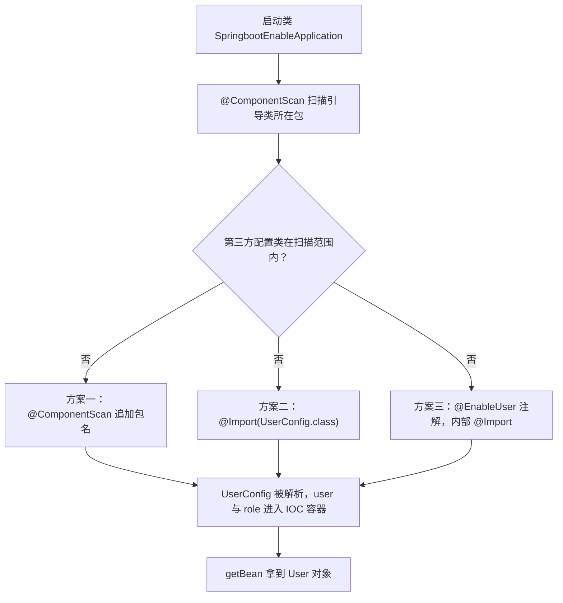

三条路径的终点一致，差别只在于「由谁来提供定位信息」：方案一是使用者记包名，方案二是使用者记类名，方案三由注解提供方封装，使用者的认知负担最小。

再看 `@EnableAutoConfiguration` 的源码，会发现它同样只是一个「壳」：

```java
@Target(ElementType.TYPE)
@Retention(RetentionPolicy.RUNTIME)
@Documented
@Inherited
@AutoConfigurationPackage
@Import(AutoConfigurationImportSelector.class)
public @interface EnableAutoConfiguration {
}
```

它导入的是 `AutoConfigurationImportSelector`，这是一个 `ImportSelector` 的实现类。这类实现会在容器启动时被调用 `selectImports`，返回一批配置类的全限定名，Spring 再把它们全部注册进来。

把这条链路接上，最前面那个疑问就解开了：

**第一，自动配置类不在扫描范围内。** `RedisAutoConfiguration` 等类位于 `spring-boot-autoconfigure` 这个 jar 里，包名和项目引导类的包名毫无关系，`@ComponentScan` 扫不到。

**第二，`@EnableAutoConfiguration` 用 `@Import` 把它们批量导入。** 这才绕开了包扫描的限制。

**第三，条件注解负责筛选。** 导入进来的配置类大多带 `@ConditionalOnClass` 之类的条件，只有依赖真正存在的那部分才会生效。

所以「Redis 的 Bean 能拿到，自己的拿不到」的答案是：Redis 的自动配置类通过 `@Import` 被导入，而自己的配置类既没被扫描到，也没有被任何人 `@Import`。

## 第13部分：一次看懂 @Import：四种方式把外部类装进 Spring 容器

业务类明明已经写好，启动后却无法从容器中获取，常见原因不是类不存在，而是它根本没有进入 Spring 的管理范围。尤其当类位于引导类扫描范围之外，单靠 `@ComponentScan` 的默认规则无法发现它。

`@Import` 提供了一条显式注册通道。它既能导入单个类和配置类，也能把「导入哪些类」交给选择器或注册器决定。Spring Boot 的自动配置正是在这套机制上继续扩展的。

Spring Boot 默认从引导类所在包向下扫描。如果引导类位于 `com.example.app`，而待加载的配置位于 `com.example.config`，两者属于平行包，默认组件扫描不会覆盖后者。

`@Import` 不依赖常规包扫描。只要主配置类明确导入目标，Spring 就会解析目标类型并注册相应 Bean。课程源码把启动模块与外部配置模块拆开，正好演示了这种跨模块装配方式。

这张图展示四种导入方式最终如何汇入同一个 IOC 容器。

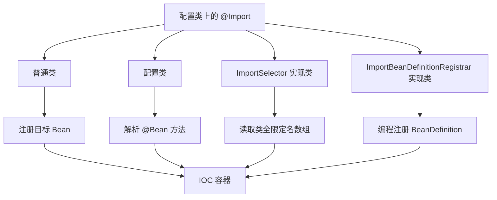

关键路径并不复杂：前两种方式直接声明导入对象，后两种方式把选择权交给扩展接口，处理结果都会变成容器中的 Bean 定义。

课程工程中的 `User` 是一个没有 `@Component` 的普通类。主配置类使用 `@Import(User.class)` 后，它仍然可以进入容器。

```java
package com.example.app;

import com.example.domain.User;
import org.springframework.context.annotation.Import;

@Import(User.class)
public class ImportApplication {
}
```

直接导入后应优先按类型获取：

```java
User user = context.getBean(User.class);
System.out.println(user);

Map<String, User> users = context.getBeansOfType(User.class);
System.out.println(users);
```

`getBeansOfType` 返回的 `Map` 同时包含 Bean 名和实例，可以用来确认真实注册名称。课程演示中的名称是类的全限定名，因此调用 `context.getBean("user")` 未必成功，按类型查询更可靠。

当一个类中集中声明了多个 `@Bean` 方法，可以直接导入这个配置类。课程源码的 `UserConfig` 同时创建 `User` 与 `Role`：

```java
package com.example.config;

import com.example.domain.Role;
import com.example.domain.User;
import org.springframework.context.annotation.Bean;

public class UserConfig {

    @Bean
    public User user() {
        return new User();
    }

    @Bean
    public Role role() {
        return new Role();
    }
}
```

在主配置类上导入后，两个 `@Bean` 方法都会被解析：

```java
@Import(UserConfig.class)
public class ImportApplication {

    public void verify(ConfigurableApplicationContext context) {
        User user = context.getBean(User.class);
        Role role = context.getBean(Role.class);
        System.out.println(user);
        System.out.println(role);
    }
}
```

**这里容易混淆的一点是：**被 `@Import` 明确导入的类即使没有写 `@Configuration`，其中的 `@Bean` 方法也能被发现。`@Configuration` 仍有完整配置类语义，但「能否通过本次导入注册两个 Bean」并不依赖它。

直接导入适合类列表固定的场景。如果导入列表需要从注解属性或配置中计算，`ImportSelector` 更合适。它的核心方法返回类全限定名数组，而不是 `Class<?>` 数组。

课程真实源码的选择器导入了 `User` 与 `Role`，改写包名后如下：

```java
package com.example.config;

import org.springframework.context.annotation.ImportSelector;
import org.springframework.core.type.AnnotationMetadata;

public class MyImportSelector implements ImportSelector {

    @Override
    public String[] selectImports(AnnotationMetadata importingClassMetadata) {
        return new String[]{
                "com.example.domain.User",
                "com.example.domain.Role"
        };
    }
}
```

主配置类导入的是选择器本身：

```java
@Import(MyImportSelector.class)
public class ImportApplication {
}
```

Spring 识别到目标实现了 `ImportSelector` 后，会调用 `selectImports`，再继续处理返回的类名。参数 `AnnotationMetadata` 描述发起导入的配置类及其注解信息，自定义启用注解可以借它读取属性，实现按条件组装导入列表。Spring Boot 的自动配置选择器也沿用了这条扩展路线。

`ImportBeanDefinitionRegistrar` 的控制粒度更细。它不返回类名，而是拿到 `BeanDefinitionRegistry`，由开发者自行构造并注册 `BeanDefinition`。

课程源码把 `User` 以固定名称 `user` 注册进容器：

```java
package com.example.config;

import com.example.domain.User;
import org.springframework.beans.factory.support.AbstractBeanDefinition;
import org.springframework.beans.factory.support.BeanDefinitionBuilder;
import org.springframework.beans.factory.support.BeanDefinitionRegistry;
import org.springframework.context.annotation.ImportBeanDefinitionRegistrar;
import org.springframework.core.type.AnnotationMetadata;

public class MyImportBeanDefinitionRegistrar
        implements ImportBeanDefinitionRegistrar {

    @Override
    public void registerBeanDefinitions(
            AnnotationMetadata importingClassMetadata,
            BeanDefinitionRegistry registry) {
        AbstractBeanDefinition beanDefinition = BeanDefinitionBuilder
                .rootBeanDefinition(User.class)
                .getBeanDefinition();
        registry.registerBeanDefinition("user", beanDefinition);
    }
}
```

导入注册器后，既可以按名称获取，也可以按类型获取：

```java
@Import(MyImportBeanDefinitionRegistrar.class)
public class ImportApplication {

    public void verify(ConfigurableApplicationContext context) {
        User user = context.getBean("user", User.class);
        System.out.println(user);
    }
}
```

这种方式适合动态命名、批量扫描后注册、按注解元数据生成 Bean 定义等场景。它的能力最强，也最接近 Spring 容器底层，因此普通的固定类导入没有必要使用注册器。

| 目标 | 合适方式 | 关键特征 |
|---|---|---|
| 注册一个没有组件注解的类 | 普通类 | 写法最直接 |
| 一次引入一组 `@Bean` | 配置类 | 适合成组配置 |
| 动态决定一批候选类 | `ImportSelector` | 返回类全限定名数组 |
| 自定义 Bean 名与定义 | `ImportBeanDefinitionRegistrar` | 直接操作注册表 |

**判断标准不是哪种更高级，而是谁来决定导入结果。** 类列表写死时使用前两种即可；列表需要计算时使用选择器；还要控制 Bean 名、构造方式或定义属性时再使用注册器。

## 第14部分：拆开 @EnableAutoConfiguration：Spring Boot 自动配置类从哪里来

Spring Boot 项目只引入一个 starter，数据源、Web 容器或缓存客户端就可能自动出现在容器里。看起来像是框架扫描了所有依赖并凭空生成 Bean，实际背后有一条明确链路：启用自动配置、导入选择器、读取候选配置、按条件筛选、注册 Bean。

课程工程使用 Spring Boot 2.1.8.RELEASE，这个版本通过 `META-INF/spring.factories` 保存自动配置候选类。理解这条链路后，遇到「依赖已经引入，自动配置却没有生效」时，就能沿着确定的节点排查。

课程启动模块的引导类使用 `@SpringBootApplication`，启动后直接从容器中获取 `Jedis`。包名改写为中性形式后，核心结构如下：

```java
package com.example.springbootenable;

import org.springframework.boot.SpringApplication;
import org.springframework.boot.autoconfigure.SpringBootApplication;
import org.springframework.context.ConfigurableApplicationContext;
import redis.clients.jedis.Jedis;

@SpringBootApplication
public class SpringbootEnableApplication {

    public static void main(String[] args) {
        ConfigurableApplicationContext context = SpringApplication.run(
                SpringbootEnableApplication.class, args);
        Jedis jedis = context.getBean(Jedis.class);
        System.out.println(jedis);
    }
}
```

引导类上没有直接写 `@EnableAutoConfiguration`，因为 `@SpringBootApplication` 已经组合了它。沿源码进入该注解，可以看到自动配置入口最终落在下面这层关系上：

```java
@AutoConfigurePackage
@Import(AutoConfigurationImportSelector.class)
public @interface EnableAutoConfiguration {

    String ENABLED_OVERRIDE_PROPERTY =
            "spring.boot.enableautoconfiguration";
}
```

`@AutoConfigurePackage` 负责登记自动配置基础包，`@Import(AutoConfigurationImportSelector.class)` 负责引入自动配置选择器。真正决定「导入哪些配置类」的是后者。

`AutoConfigurationImportSelector` 实现了 `ImportSelector`。Spring 解析 `@Import` 时会调用它的 `selectImports` 方法，并把返回的类全限定名继续作为配置类处理。

课程版本中的核心流程可以压缩成这段源码：

```java
@Override
public String[] selectImports(AnnotationMetadata annotationMetadata) {
    if (!isEnabled(annotationMetadata)) {
        return NO_IMPORTS;
    }
    AutoConfigurationMetadata autoConfigurationMetadata =
            AutoConfigurationMetadataLoader.loadMetadata(this.beanClassLoader);
    AutoConfigurationEntry autoConfigurationEntry =
            getAutoConfigurationEntry(autoConfigurationMetadata, annotationMetadata);
    return StringUtils.toStringArray(
            autoConfigurationEntry.getConfigurations());
}
```

其中 `isEnabled` 会读取 `spring.boot.enableautoconfiguration`，默认值为 `true`。开关开启后，选择器加载自动配置元数据，再取得经过筛选的配置类集合。

这张图展示从引导类到 Bean 注册的完整路径。

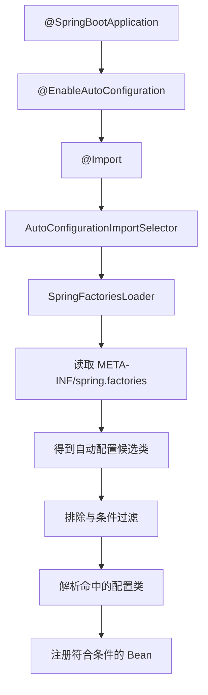

关键点在「候选」二字。`spring.factories` 给出可参与自动配置的类，条件系统决定当前应用真正采用哪些类。

`getAutoConfigurationEntry` 负责整理候选项。原始源码还包含事件通知等细节，主干逻辑是加载候选、去重、计算排除项、执行过滤，再封装返回值：

```java
protected AutoConfigurationEntry getAutoConfigurationEntry(
        AutoConfigurationMetadata autoConfigurationMetadata,
        AnnotationMetadata annotationMetadata) {
    if (!isEnabled(annotationMetadata)) {
        return EMPTY_ENTRY;
    }
    AnnotationAttributes attributes = getAttributes(annotationMetadata);
    List<String> configurations =
            getCandidateConfigurations(annotationMetadata, attributes);
    configurations = removeDuplicates(configurations);
    Set<String> exclusions = getExclusions(annotationMetadata, attributes);
    checkExcludedClasses(configurations, exclusions);
    configurations.removeAll(exclusions);
    configurations = filter(configurations, autoConfigurationMetadata);
    fireAutoConfigurationImportEvents(configurations, exclusions);
    return new AutoConfigurationEntry(configurations, exclusions);
}
```

**第一，去重。** 不同依赖可能重复声明同一个自动配置类，进入后续阶段前要收敛成唯一列表。

**第二，处理排除项。** `@EnableAutoConfiguration` 和 `@SpringBootApplication` 都支持排除特定自动配置，显式排除的类不会继续装配。

**第三，过滤候选。** 元数据过滤可以提前淘汰明显不满足条件的配置，减少后续解析工作。配置类上的条件注解还会在容器解析阶段继续判断。

候选列表不是写死在选择器中，而是由 `SpringFactoriesLoader` 从依赖中收集：

```java
protected List<String> getCandidateConfigurations(
        AnnotationMetadata metadata,
        AnnotationAttributes attributes) {
    List<String> configurations = SpringFactoriesLoader.loadFactoryNames(
            getSpringFactoriesLoaderFactoryClass(),
            getBeanClassLoader());
    Assert.notEmpty(configurations,
            "No auto configuration classes found in META-INF/spring.factories. "
                    + "If you are using a custom packaging, make sure that file is correct.");
    return configurations;
}
```

`getSpringFactoriesLoaderFactoryClass()` 在这里返回 `EnableAutoConfiguration.class`。加载器会查找类路径中各个 jar 包的 `META-INF/spring.factories`，读取以该类型全限定名为键的配置项。例如：

```properties
org.springframework.boot.autoconfigure.EnableAutoConfiguration=\
org.springframework.boot.autoconfigure.data.redis.RedisAutoConfiguration,\
org.springframework.boot.autoconfigure.data.redis.RedisReactiveAutoConfiguration
```

一个工程可以依赖多个 starter，每个依赖都可能携带自己的 `spring.factories`。加载器会合并这些声明，因此自动配置能够随 jar 包一起交付，不要求应用把第三方包加入组件扫描。

候选类很多，但自动配置类通常带有条件注解。课程源码中的自定义 Redis 自动配置就是一个完整例子，包名改写后如下：

```java
package com.example.redis.config;

import org.springframework.boot.autoconfigure.condition.ConditionalOnClass;
import org.springframework.boot.autoconfigure.condition.ConditionalOnMissingBean;
import org.springframework.boot.context.properties.EnableConfigurationProperties;
import org.springframework.context.annotation.Bean;
import org.springframework.context.annotation.Configuration;
import redis.clients.jedis.Jedis;

@Configuration
@EnableConfigurationProperties(RedisProperties.class)
@ConditionalOnClass(Jedis.class)
public class RedisAutoConfiguration {

    @Bean
    @ConditionalOnMissingBean(name = "jedis")
    public Jedis jedis(RedisProperties redisProperties) {
        return new Jedis(redisProperties.getHost(), redisProperties.getPort());
    }
}
```

`@ConditionalOnClass(Jedis.class)` 表示类路径中存在 `Jedis` 才让该配置生效；`@ConditionalOnMissingBean(name = "jedis")` 表示容器中没有同名 Bean 时才创建默认对象。用户自行声明 `jedis` 后，自动配置会退让。

配置值由真实源码中的 `RedisProperties` 承接：

```java
package com.example.redis.config;

import org.springframework.boot.context.properties.ConfigurationProperties;

@ConfigurationProperties(prefix = "redis")
public class RedisProperties {

    private String host = "localhost";
    private int port = 6379;

    public String getHost() {
        return host;
    }

    public void setHost(String host) {
        this.host = host;
    }

    public int getPort() {
        return port;
    }

    public void setPort(int port) {
        this.port = port;
    }
}
```

对应的应用配置只负责覆盖默认值：

```properties
redis.host=localhost
redis.port=6379
```

这套设计把「是否创建」交给条件注解，把「创建成什么参数」交给配置属性类，自动配置因此既能提供默认行为，也能接受业务侧覆盖。

**第一，确认入口存在。** 引导类应包含 `@SpringBootApplication` 或显式使用 `@EnableAutoConfiguration`。

**第二，确认候选配置已声明。** 课程版本要求依赖包中的 `META-INF/spring.factories` 使用 `EnableAutoConfiguration` 作为键，值写自动配置类全限定名。

**第三，确认条件成立。** 检查 `@ConditionalOnClass` 所需依赖是否存在、`@ConditionalOnMissingBean` 是否因用户 Bean 而退让，以及属性条件是否匹配。

**第四，确认没有被排除。** 查看 `exclude`、`excludeName` 以及相关配置项，防止目标自动配置被显式移出候选列表。

## 第15部分：自定义 redis-starter：导入一个坐标，Jedis 就自动进 Spring 容器

自己写一个 starter 之前，很多人对 Spring Boot 自动配置的理解停留在「加个依赖就能用」这个层面。真要动手时问题全冒出来了：starter 里到底放不放代码？自动配置类为什么没人 `@Import` 它却能生效？我提供的 Bean 和用户自己定义的 Bean 撞车了算谁的？

这一课把这些疑问一次解决掉：以「自定义 redis-starter，导入依赖后 Spring Boot 自动创建 `Jedis` 的 Bean」为需求，从拆解 MyBatis 的起步依赖开始，一步步把两个模块写出来并跑通。

需求只有一句话：自定义 `redis-spring-boot-starter`，当其他工程导入这个坐标后，Spring Boot 自动创建 `Jedis` 的 Bean，拿到 Bean 就能直接操作 Redis。

思路不一定要凭空想，第三方框架早就把标准答案写好了。MyBatis 就是典型：Spring Boot 官方没有为它提供起步依赖，是 MyBatis 自己写了一套，主动去跟 Spring Boot 整合。参考它的做法，先去 Maven 中央仓库查坐标：

```xml
<dependency>
    <groupId>org.mybatis.spring.boot</groupId>
    <artifactId>mybatis-spring-boot-starter</artifactId>
    <version>1.3.2</version>
</dependency>
```

**第一，从名字上就能读出归属。** 对比一下官方和第三方 starter 的命名：

| 提供方 | 命名格式 | 例子 |
|---|---|---|
| Spring Boot 官方 | `spring-boot-starter-功能` | `spring-boot-starter-web` |
| 第三方技术 | `功能-spring-boot-starter` | `mybatis-spring-boot-starter` |

官方的功能名在末尾，第三方的功能名在最前面，中间那截 `spring-boot-starter` 是一样的。照这个规则，我们要写的就命名为 `redis-spring-boot-starter`。

**第二，别指望一个模块解决所有问题。** MyBatis 的做法是拆成两个：starter 负责对外提供坐标，autoconfigure 负责写真正的配置代码。

打开 `mybatis-spring-boot-starter-1.3.2.pom`，里面声明的依赖大致是这样（省略了与本次无关的部分）：

```xml
<dependencies>
    <dependency>
        <groupId>org.springframework.boot</groupId>
        <artifactId>spring-boot-starter</artifactId>
    </dependency>
    <dependency>
        <groupId>org.springframework.boot</groupId>
        <artifactId>spring-boot-starter-jdbc</artifactId>
    </dependency>
    <!-- 真正承载自动配置代码的模块 -->
    <dependency>
        <groupId>org.mybatis.spring.boot</groupId>
        <artifactId>mybatis-spring-boot-autoconfigure</artifactId>
    </dependency>
    <dependency>
        <groupId>org.mybatis</groupId>
        <artifactId>mybatis</artifactId>
    </dependency>
    <dependency>
        <groupId>org.mybatis</groupId>
        <artifactId>mybatis-spring</artifactId>
    </dependency>
</dependencies>
```

再展开 starter 的 jar 包，里面除了一个 `META-INF` 文件夹之外没有任何 class。也就是说 starter 是一个纯 pom 工程，它的唯一职责就是把一组依赖打包成一个坐标，方便别人一次性引入。

真正有内容的是 autoconfigure 模块，里面有 `MybatisAutoConfiguration` 这样的配置类，还有让它被识别的关键文件 `META-INF/spring.factories`：

```properties
org.springframework.boot.autoconfigure.EnableAutoConfiguration=\
org.mybatis.spring.boot.autoconfigure.MybatisAutoConfiguration
```

这个键和 `@EnableAutoConfiguration` 注解的全限定名完全一致，值是要加载的配置类全限定名。Spring Boot 启动时会扫描 classpath 下所有 jar 里的这个文件，把配置类读进来，配置类里 `@Bean` 定义的对象就进了 IOC 容器。

参照 MyBatis 的结构，我们要做的事可以拆成四步，每步对应一个明确的产物：

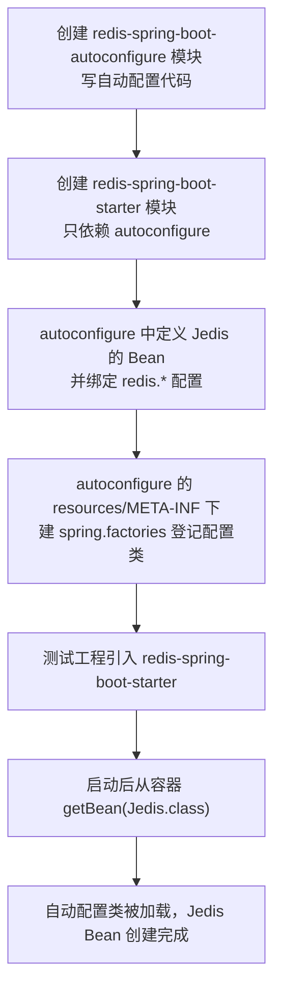

图里的关键路径是 D 到 G：没有任何一行代码显式引用过自动配置类，靠的全是 `spring.factories` 这一层约定。

先建 `redis-spring-boot-autoconfigure` 模块，pom 里除了 `spring-boot-starter`，还要把 `Jedis` 引起来，因为要在这里 `new` 出客户端：

```xml
<dependencies>
    <dependency>
        <groupId>org.springframework.boot</groupId>
        <artifactId>spring-boot-starter</artifactId>
    </dependency>

    <!-- 引入 jedis 依赖 -->
    <dependency>
        <groupId>redis.clients</groupId>
        <artifactId>jedis</artifactId>
    </dependency>
</dependencies>
```

**第一，把主机和端口做成可配置的。** 如果直接在代码里写 `new Jedis("localhost", 6379)`，那这个 starter 只能连本机，等于没给别人留余地。正确做法是定义一个属性类，让它和配置文件绑定：

```java
package com.example.redis.config;

import org.springframework.boot.context.properties.ConfigurationProperties;

@ConfigurationProperties(prefix = "redis")
public class RedisProperties {

    private String host = "localhost";
    private int port = 6379;

    public String getHost() {
        return host;
    }

    public void setHost(String host) {
        this.host = host;
    }

    public int getPort() {
        return port;
    }

    public void setPort(int port) {
        this.port = port;
    }
}
```

`prefix = "redis"` 意味着配置文件里所有以 `redis.` 开头的项都会往这个类的属性上映射。两个字段给了默认值，用户不配置时就是本机的 6379。

**第二，光有 `@ConfigurationProperties` 还不够。** 这个类上没有 `@Component`，且它所在的包通常不在用户工程的扫描范围内，容器根本不会认识它。需要在配置类上用 `@EnableConfigurationProperties` 显式启用：

```java
package com.example.redis.config;

import org.springframework.boot.autoconfigure.condition.ConditionalOnClass;
import org.springframework.boot.autoconfigure.condition.ConditionalOnMissingBean;
import org.springframework.boot.context.properties.EnableConfigurationProperties;
import org.springframework.context.annotation.Bean;
import org.springframework.context.annotation.Configuration;
import redis.clients.jedis.Jedis;

@Configuration
@EnableConfigurationProperties(RedisProperties.class)
@ConditionalOnClass(Jedis.class)
public class RedisAutoConfiguration {

    /**
     * 提供 Jedis 的 bean
     */
    @Bean
    @ConditionalOnMissingBean(name = "jedis")
    public Jedis jedis(RedisProperties redisProperties) {
        System.out.println("RedisAutoConfiguration....");
        return new Jedis(redisProperties.getHost(), redisProperties.getPort());
    }
}
```

`@EnableConfigurationProperties(RedisProperties.class)` 做的事情是把它注册成容器里的 Bean，注册之后就能在 `jedis()` 方法上按参数注入进来，`host` 和 `port` 也就由用户的配置文件决定了。

**第三，两个条件注解是 starter 的分寸感。** `@ConditionalOnClass(Jedis.class)` 表示 classpath 里没有 `Jedis` 这个客户端时，整个配置类跳过，避免用户没引 Redis 客户端却炸出一堆 `ClassNotFoundException`。`@ConditionalOnMissingBean(name = "jedis")` 表示容器里已经存在名为 `jedis` 的 Bean 时，自动配置让位，用户自己定义的优先。

在 autoconfigure 模块的 `src/main/resources/META-INF/` 下新建 `spring.factories`。键不能自己编，就是 `EnableAutoConfiguration` 注解的全限定名；值是自己写的配置类全限定名，一行写不下可以用反斜杠换行：

```properties
org.springframework.boot.autoconfigure.EnableAutoConfiguration=\
com.example.redis.config.RedisAutoConfiguration
```

这个文件是固定写法，写错一个字母都不会生效。不确定键名时，可以点进 `@EnableAutoConfiguration` 注解，再点进它 `@Import` 的 `AutoConfigurationImportSelector`，里面加载配置的方法上有明确提示指向 `META-INF/spring.factories`。

`redis-spring-boot-starter` 模块里不需要任何 Java 代码，启动类、测试类、打包插件都可以删掉，pom 只保留必要内容：

```xml
<dependencies>
    <dependency>
        <groupId>org.springframework.boot</groupId>
        <artifactId>spring-boot-starter</artifactId>
    </dependency>

    <!-- 引入自定义的自动配置模块 -->
    <dependency>
        <groupId>com.example</groupId>
        <artifactId>redis-spring-boot-autoconfigure</artifactId>
        <version>0.0.1-SNAPSHOT</version>
    </dependency>
</dependencies>
```

依赖传递在这里起了作用：用户只要引 starter，autoconfigure 及它内部的 `Jedis` 会一起进来，`spring.factories` 也就进入了 classpath，自动配置随之生效。

测试工程引自定义 starter（同时把之前演示用的 MyBatis 起步依赖注释掉，否则没有数据源配置会启动报错），引导类里直接从容器取 Bean：

```java
@SpringBootApplication
public class SpringbootEnableApplication {

    public static void main(String[] args) {
        ConfigurableApplicationContext context =
                SpringApplication.run(SpringbootEnableApplication.class, args);

        Jedis jedis = context.getBean(Jedis.class);
        System.out.println(jedis);

        jedis.set("name", "redis-starter");
        System.out.println(jedis.get("name"));
    }
}
```

启动后控制台能打印出 `Jedis` 实例，`get` 也能取回刚 `set` 的值，说明整条链路通了。

**第一，验证配置确实绑定上了。** 在 `application.properties` 里故意写一个错端口：

```properties
redis.port=6666
```

重新运行会报 `Failed connecting to host localhost:6666`，连接失败恰好证明 `redis.port` 被读进了 `RedisProperties`，参数不是摆设。

**第二，验证 `@ConditionalOnMissingBean` 真的会退让。** 在测试工程的引导类里自己也定义一个同名 Bean：

```java
@Bean
public Jedis jedis() {
    return new Jedis("localhost", 6379);
}
```

再启动时，配置类里那句 `RedisAutoConfiguration....` 不再打印，说明自动配置被跳过，容器用的是用户自己定义的那个。

打开 Spring Boot 自带的 `spring-boot-autoconfigure` 包，找到 `org.springframework.boot.autoconfigure.data.redis.RedisAutoConfiguration`，会发现套路几乎一致：`@ConditionalOnClass` 判断客户端是否存在，`@EnableConfigurationProperties(RedisProperties.class)` 启用属性类，`@ConditionalOnMissingBean` 保证用户优先。差别只在细节，官方的属性前缀是 `spring.redis` 而不是 `redis`，字段也远不止 `host` 和 `port`，还包含 `password`、`database`、`url`、`ssl` 等，并且默认值直接在字段上写死：

```java
private String host = "localhost";
private int port = 6379;
```

也就是说，自己写的这一版在机制上与官方是同一套，缺的是边界情况的严密程度。

## 第16部分：项目启动的这几个时机，Spring Boot 都留了回调给你

想在容器初始化前检查一下外部资源，想在服务一启动就把热点数据灌进 Redis，想在启动失败时记一笔日志，这些需求有个共同点：代码必须在某个精确的时刻被自动触发，而不是等着被调用。

Spring Boot 把项目启动过程拆成了一串明确的时机，每个时机都有对应的回调接口。实现接口、填好注册方式，代码就会在那一刻被回调。这一课讲清这四个接口怎么用、谁会自动生效、谁必须额外登记，以及它们的执行顺序。

先用一个生活化的例子建立直觉：计算器界面上的数字按钮是**事件源**，鼠标点击这个动作是**事件**，点击之后把数字显示到输入框的那段逻辑是**监听器**。同一个事件源上还能注册多个监听器、监听多种事件，比如鼠标悬停改样式是一个，单击输入是另一个。

Java 自己的事件模型就是这三个角色：

| 角色 | 约束 | 说明 |
|---|---|---|
| 事件 | 必须继承 `java.util.EventObject` | 描述发生了什么，携带事件源 |
| 事件源 | 任意 `Object` | 事件发生的那个对象，可以是属性变化、创建、销毁等 |
| 监听器 | 必须实现 `java.util.EventListener` | 事件发生后被回调的那段代码 |

Spring Boot 的监听机制是同一套思想，只是监听对象从按钮换成了应用本身：应用启动、环境准备、上下文刷新、启动完成、运行失败，这些生命周期节点都是事件。区别在于 Spring Boot 已经把「往事件源上注册监听器」的动作写好了，只把监听器接口暴露出来，你实现接口就行。

| 接口 | 时机 | 生效方式 |
|---|---|---|
| `ApplicationContextInitializer` | IOC 容器创建后、刷新前 | `spring.factories` 登记 |
| `SpringApplicationRunListener` | 覆盖启动全过程，共 7 个回调 | `spring.factories` 登记 |
| `CommandLineRunner` | 启动完成后，参数为原始 `String...` | `@Component` 进容器 |
| `ApplicationRunner` | 启动完成后，参数为 `ApplicationArguments` | `@Component` 进容器 |

`SpringApplicationRunListener` 的 7 个方法从上到下正好是启动过程的推进：`starting` 表示项目开始启动，`environmentPrepared` 表示环境对象开始准备，`contextPrepared` 表示上下文对象开始准备，`contextLoaded` 表示上下文开始加载（此时会创建大量 Bean），`started` 表示上下文加载完成，`running` 表示项目启动完成开始运行，`failed` 表示启动失败。

这两个接口功能几乎一样，只是入参不同。实现后加上 `@Component` 即可：

```java
package com.example.springbootlistener.listener;

import org.springframework.boot.CommandLineRunner;
import org.springframework.stereotype.Component;

import java.util.Arrays;

@Component
public class MyCommandLineRunner implements CommandLineRunner {
    @Override
    public void run(String... args) throws Exception {
        System.out.println("CommandLineRunner...run");
        System.out.println(Arrays.asList(args));
    }
}
```

```java
package com.example.springbootlistener.listener;

import org.springframework.boot.ApplicationArguments;
import org.springframework.boot.ApplicationRunner;
import org.springframework.stereotype.Component;

import java.util.Arrays;

/**
 * 当项目启动后执行 run 方法。
 */
@Component
public class MyApplicationRunner implements ApplicationRunner {
    @Override
    public void run(ApplicationArguments args) throws Exception {
        System.out.println("ApplicationRunner...run");
        System.out.println(Arrays.asList(args.getSourceArgs()));
    }
}
```

**第一，参数从哪来。** `args` 就是启动时传进来的命令行参数。在 IDE 的启动配置里填 `--name=redis`，打印出来的数组里就会出现这个参数。直接打印数组只会得到地址值，所以用 `Arrays.asList()` 包一层再输出。

**第二，这类回调最适合干什么。** 典型的场景是缓存预热：项目启动后立刻把数据库里的热点数据加载到 Redis，避免第一个用户访问时缓存为空、请求直接打到数据库。因为 `run` 方法是被自动回调的，把预热逻辑写在这里，容器就绪后就会执行。

**第三，两个接口选一个用就行。** 需要原始字符串数组时用 `CommandLineRunner`；需要按 `ApplicationArguments` 的封装做解析（区分选项参数和非选项参数）时用 `ApplicationRunner`。两者的执行时机完全相同。

只给这两个实现类加 `@Component` 是不够的，启动时它们不会被执行。原因是它们在容器还没准备好的阶段就要介入，Spring Boot 通过 `SpringFactoriesLoader` 从 `META-INF/spring.factories` 里加载它们，而不是靠组件扫描。

在 `src/main/resources/META-INF/spring.factories` 中按「接口全限定名 = 实现类全限定名」的格式写：

```properties
org.springframework.context.ApplicationContextInitializer=\
com.example.springbootlistener.listener.MyApplicationContextInitializer

org.springframework.boot.SpringApplicationRunListener=\
com.example.springbootlistener.listener.MySpringApplicationRunListener
```

`ApplicationContextInitializer` 的实现很简单，只有一个 `initialize` 方法，调用时机在 IOC 容器刷新之前，适合做资源检测：

```java
package com.example.springbootlistener.listener;

import org.springframework.context.ApplicationContextInitializer;
import org.springframework.context.ConfigurableApplicationContext;

public class MyApplicationContextInitializer implements ApplicationContextInitializer {
    @Override
    public void initialize(ConfigurableApplicationContext applicationContext) {
        System.out.println("ApplicationContextInitializer....initialize");
    }
}
```

`SpringApplicationRunListener` 的实现有个容易踩的坑，先看正确写法：

```java
package com.example.springbootlistener.listener;

import org.springframework.boot.SpringApplication;
import org.springframework.boot.SpringApplicationRunListener;
import org.springframework.context.ConfigurableApplicationContext;
import org.springframework.core.env.ConfigurableEnvironment;

public class MySpringApplicationRunListener implements SpringApplicationRunListener {

    public MySpringApplicationRunListener(SpringApplication application, String[] args) {
    }

    @Override
    public void starting() {
        System.out.println("starting...项目启动中");
    }

    @Override
    public void environmentPrepared(ConfigurableEnvironment environment) {
        System.out.println("environmentPrepared...环境对象开始准备");
    }

    @Override
    public void contextPrepared(ConfigurableApplicationContext context) {
        System.out.println("contextPrepared...上下文对象开始准备");
    }

    @Override
    public void contextLoaded(ConfigurableApplicationContext context) {
        System.out.println("contextLoaded...上下文对象开始加载");
    }

    @Override
    public void started(ConfigurableApplicationContext context) {
        System.out.println("started...上下文对象加载完成");
    }

    @Override
    public void running(ConfigurableApplicationContext context) {
        System.out.println("running...项目启动完成，开始运行");
    }

    @Override
    public void failed(ConfigurableApplicationContext context, Throwable exception) {
        System.out.println("failed...项目启动失败");
    }
}
```

**那个空构造方法不能省。** 如果不写它，启动会抛非法参数异常，根因信息是找不到匹配的方法，需要一个接收 `SpringApplication` 和 `String[]` 两个参数的构造。原因也好理解：`SpringApplication` 就是事件源，这个监听器要监听它上面产生的各种生命周期事件，必须把它和启动参数一起传进来。Spring Boot 内置的 `EventPublishingRunListener` 就是这么写的，照抄一个构造即可。

**这个类不要加 `@Component`。** 它由 `spring.factories` 加载，交给 Spring 扫描反而会因为构造参数无法自动注入而产生干扰。

把四个接口全部实现并注册后启动，控制台的输出顺序如下：

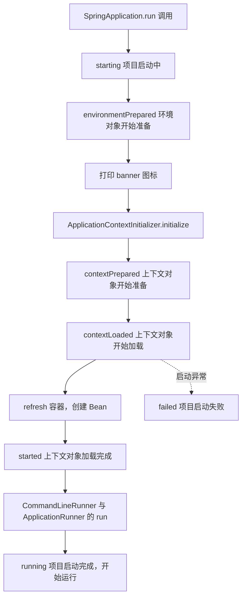

图里有两条值得记住的边界：`ApplicationContextInitializer` 的执行点非常靠前，此时容器还没刷新，可以检测外部资源是否可用；两个 Runner 的执行点在容器就绪之后，可以放心地从容器里取 Bean 干活。

顺藤摸瓜看一下源码。`org.springframework.boot.context.event` 包下有一批事件类，例如 `ApplicationStartingEvent`、`ApplicationPreparedEvent`。随便打开一个，它的继承链是这样的：

```text
ApplicationStartingEvent
  → SpringApplicationEvent
    → ApplicationEvent
      → java.util.EventObject
```

最上层正是 JDK 的 `EventObject`。也就是说 Spring Boot 在启动过程中发布这些事件，内置的监听器负责接收并回调到对应的接口方法上，你实现的接口只是这条链路末端的钩子。

## 第17部分：Spring Boot 启动时到底干了些什么：从 new SpringApplication 到 run 方法全回调

应用起不来的时候，控制台一堆日志刷过去，除了最后一行报错几乎没什么信息可读；想顺着源码看启动过程，点两下就到了一个几百行的 `run` 方法里，不知道哪一行才是自己要找的。
把 `SpringApplication.run(App.class, args)` 这一行背后的两条主线摸清楚，问题的排查方向就会清晰很多：`SpringApplication` 对象的构造（初始化）是一条线，`run` 方法的执行是另一条线。前者只做准备，后者才真正拉起容器。

下面跟着课程里的 `springboot-listener` 工程，用断点的方式把这两段走一遍。

课程里这个工程的引导类非常干净，只有一个 `main` 方法（源码包名已统一改为中性的 `com.example`）：

```java
package com.example.springbootlistener;

import org.springframework.boot.SpringApplication;
import org.springframework.boot.autoconfigure.SpringBootApplication;

@SpringBootApplication
public class SpringbootListenerApplication {

    public static void main(String[] args) {
        SpringApplication.run(SpringbootListenerApplication.class, args);
    }
}
```

在这一行上打断点，用 Step Into 往里走两跳，看到的就是下面这样一段。第一跳进到静态 `run`，它把引导类塞进 `primarySources` 数组之后转手交给另一个静态 `run`；第二跳的静态方法里 `new` 了一个 `SpringApplication` 对象，紧接着调用它的成员方法 `run`。静态方法只能直接调静态方法，所以源码里这两个 `run` 是挨着写的：

```java
public static ConfigurableApplicationContext run(Class<?>[] primarySources, String[] args) {
    return new SpringApplication(primarySources).run(args);
}
```

**第一，那个 `new SpringApplication(primarySources)` 就是要盯的第一条主线。** 这个对象将来是**事件源**，所有启动事件都在它身上产生，`MySpringApplicationRunListener` 的构造方法里要接收它，原因就在这里。

**第二，`SpringApplication` 对象诞生之后还什么都没发生。** 它得等到 `run(args)` 被调用才开始推动整个启动过程。把「构造」和「执行」分开记忆，源码会好读很多。

继续 Step Into 进到构造器，2.1.8 版本的源码整理后如下：

```java
public SpringApplication(ResourceLoader resourceLoader, Class<?>... primarySources) {
    this.resourceLoader = resourceLoader;
    Assert.notNull(primarySources, "PrimarySources must not be null");
    this.primarySources = new LinkedHashSet<>(Arrays.asList(primarySources));
    this.webApplicationType = WebApplicationType.deduceFromClasspath();
    setInitializers((Collection) getSpringFactoriesInstances(ApplicationContextInitializer.class));
    setListeners((Collection) getSpringFactoriesInstances(ApplicationListener.class));
    this.mainApplicationClass = deduceMainApplicationClass();
}
```

**第一，`primarySources` 就是传进来的引导类。** 它用 `LinkedHashSet` 装着，意味着可以传多个，日常只传一个。`Assert.notNull` 保证它不能为空，为空则直接抛异常，这就是「没有主配置类」那类报错的源头之一。

**第二，`deduceFromClasspath` 负责推断是不是 Web 环境。** 方法内部其实就是判断 classpath 下存不存在 Servlet 相关的一组 class。`springboot-listener` 工程只引了 `spring-boot-starter`，没有引 `spring-boot-starter-web`，调试器里这个变量最终是 `NONE`；换成 Web 工程引了 Tomcat，它就会是 `SERVLET`。这个结论后面直接决定创建 `AnnotationConfigApplicationContext` 还是 `ServletWebServerApplicationContext`。

**第三，两个集合都是从配置文件里读出来的名字。** `getSpringFactoriesInstances` 会去扫描所有 jar 包里的 `META-INF/spring.factories`，拿到全限定类名之后再用反射创建对象实例。调试器展开可以看到 initializers 有 7 个、listeners 有 10 个，其中既有框架自带的，也有自己写进 `spring.factories` 的那几个。这一步**只创建对象放进 List，一行回调代码都没有执行**，它们的执行要靠后面 `run` 方法里触发事件来驱动。

**第四，`deduceMainApplicationClass` 用的是一个有点 tricks 的办法。** 它现场 `new` 一个异常，遍历异常栈去找方法名叫 `main` 的那一帧，再把那帧的类名 `Class.forName` 回来：

```java
private Class<?> deduceMainApplicationClass() {
    try {
        StackTraceElement[] stackTrace = new RuntimeException().getStackTrace();
        for (StackTraceElement stackTraceElement : stackTrace) {
            if ("main".equals(stackTraceElement.getMethodName())) {
                return Class.forName(stackTraceElement.getClassName());
            }
        }
    } catch (ClassNotFoundException ex) {
        // Ignore
    }
    return null;
}
```

因为整个调用链就是从 `main` 方法出发的，所以异常栈里必然有一帧是它。

初始化阶段的整体脉络如图所示：

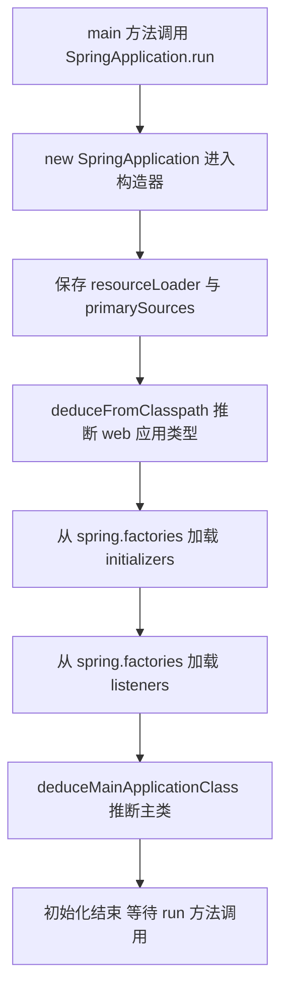

图中从 C 到 G 的每一步都只是在给 `SpringApplication` 这个对象填字段，箭头末端进入 `run` 方法之前，控制台不会输出任何一行你自己写的日志。理解了这一点，就不会再问「为什么我的监听器在构造时打印的东西没出来」。

课程资料里的监听器实现类保存完整，它实现了 `SpringApplicationRunListener` 的全部回调方法：

```java
package com.example.springbootlistener.listener;

import org.springframework.boot.SpringApplication;
import org.springframework.boot.SpringApplicationRunListener;
import org.springframework.context.ConfigurableApplicationContext;
import org.springframework.core.env.ConfigurableEnvironment;

public class MySpringApplicationRunListener implements SpringApplicationRunListener {

    public MySpringApplicationRunListener(SpringApplication application, String[] args) {
    }

    @Override
    public void starting() {
        System.out.println("starting...项目启动中");
    }

    @Override
    public void environmentPrepared(ConfigurableEnvironment environment) {
        System.out.println("environmentPrepared...环境对象开始准备");
    }

    @Override
    public void contextPrepared(ConfigurableApplicationContext context) {
        System.out.println("contextPrepared...上下文对象开始准备");
    }

    @Override
    public void contextLoaded(ConfigurableApplicationContext context) {
        System.out.println("contextLoaded...上下文对象开始加载");
    }

    @Override
    public void started(ConfigurableApplicationContext context) {
        System.out.println("started...上下文对象加载完成");
    }

    @Override
    public void running(ConfigurableApplicationContext context) {
        System.out.println("running...项目启动完成，开始运行");
    }

    @Override
    public void failed(ConfigurableApplicationContext context, Throwable exception) {
        System.out.println("failed...项目启动失败");
    }
}
```

这个接口有两点硬性约束。它的**构造方法签名必须是 `(SpringApplication application, String[] args)`**，因为 Spring Boot 是通过反射按这个签名找到构造器的；它**必须在 `resources/META-INF/spring.factories` 里注册**，资料包里只保留了 Java 类，注册文件按 Spring Boot 的约定补齐即可：

```properties
org.springframework.boot.SpringApplicationRunListener=\
com.example.springbootlistener.listener.MySpringApplicationRunListener
org.springframework.context.ApplicationContextInitializer=\
com.example.springbootlistener.listener.MyApplicationContextInitializer
```

至于同目录下的 `MyApplicationRunner` 和 `MyCommandLineRunner`，它们实现的是另一套接口，加了 `@Component` 就能被扫到，执行时机在容器刷新完成之后，属于收尾动作。

`run` 方法的结构比构造器长得多，去掉异常处理的枝枝蔓蔓之后，主干是这样：

```java
public ConfigurableApplicationContext run(String... args) {
    StopWatch stopWatch = new StopWatch();
    stopWatch.start();
    ConfigurableApplicationContext context = null;
    Collection<SpringBootExceptionReporter> exceptionReporters = new ArrayList<>();
    configureHeadlessProperty();
    SpringApplicationRunListeners listeners = getRunListeners(args);
    listeners.starting();
    try {
        ApplicationArguments applicationArguments = new DefaultApplicationArguments(args);
        ConfigurableEnvironment environment = prepareEnvironment(listeners, applicationArguments);
        configureIgnoreBeanInfo(environment);
        Banner printedBanner = printBanner(environment);
        context = createApplicationContext();
        exceptionReporters = getSpringFactoriesInstances(SpringBootExceptionReporter.class,
                new Class[] { ConfigurableApplicationContext.class }, context);
        prepareContext(context, environment, listeners, applicationArguments, printedBanner);
        refreshContext(context);
        afterRefresh(context, applicationArguments);
        stopWatch.stop();
        listeners.started(context);
        callRunners(context, applicationArguments);
    } catch (Throwable ex) {
        handleRunFailure(context, ex, exceptionReporters, listeners);
        throw new IllegalStateException(ex);
    }
    listeners.running(context);
    return context;
}
```

逐个节点看它们负责什么。

**第一，`StopWatch` 只是个计时器。** `stopWatch.start()` 在第 2 行就开始，方法快结束时有对应的 `stopWatch.stop()`，最后那条 `Started xxx in x.xx seconds` 日志就是它算出来的。

**第二，`listeners.starting()` 触发第一个回调。** `getRunListeners(args)` 拿到的 `SpringApplicationRunListeners`（注意复数形式）是一个容器，里面装着所有 `SpringApplicationRunListener`（单数），`starting()` 内部就是对这个集合做循环逐个回调。走过这一行，控制台立刻出现自定义的「项目启动中」。

**第三，`prepareEnvironment` 一边准备环境一边回调 `environmentPrepared`。** 这个方法把命令行参数、系统变量、`application.properties` 都装进 `ConfigurableEnvironment`。调试时可以对比这个动作前后的差异：准备前环境对象里的属性寥寥无几，走完之后一大堆字段涌进来。

**第四，`printBanner` 负责控制台上那个 Spring 图标。** 它通过 `spring.banner.location` 指定资源位置，默认值是 `banner.txt`，也就是说在 `resources` 下放一个同名文件写上新图案，启动时的 Logo 就被替换掉了，支持图片不过需要额外的 `ImageBanner`。

**第五，`createApplicationContext` 创建 IOC 容器。** 走到这里只是 new 出容器对象，`beanFactory` 里的 `beanDefinitionMap` 里仅有几个基础设施 Bean（非 Web 工程调试值是 6 个）。

**第六，`prepareContext` 会连续触发两件事。** 自定义的 `ApplicationContextInitializer.initialize` 在这里被调用，紧接着回调 `contextPrepared` 与 `contextLoaded`。

**第七，`refreshContext` 是最耗时的一步，Bean 在这一步才真正被创建。** 单步执行时会明显卡住一会儿，回来再看 `beanDefinitionMap`，非 Web 环境下大约涨到 32 个；如果是 Web 工程，数量上百很正常。

**第八，`listeners.started(context)` 之后紧接着 `callRunners`。** 容器就绪之后，`ApplicationRunner` 与 `CommandLineRunner` 的实现类被依次调用，命令行里传入的 `--name=xxx` 这类参数就是在这里通过 `ApplicationArguments` 读到的。

**第九，`listeners.running(context)` 发出最后一个「已就绪」事件，然后返回 `context`。** 至此整个启动过程结束，`failed` 是所有环节的兜底回调，任何一步抛异常都会走到它。

回调顺序用时序图表示更直观：

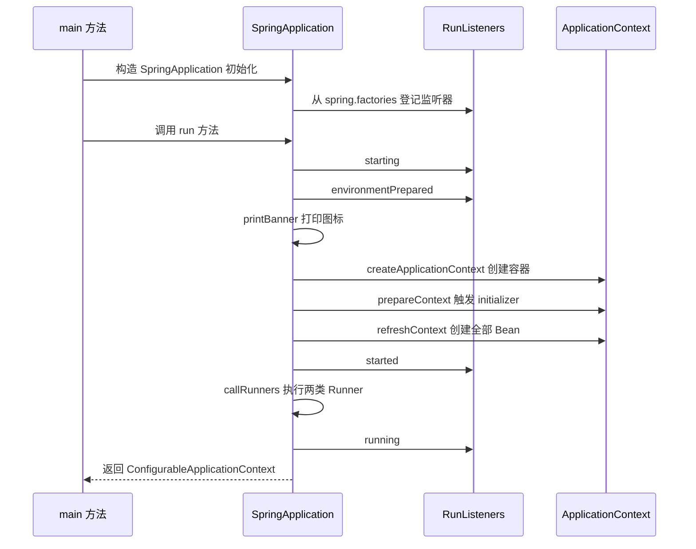

图里纵轴从上到下就是时间顺序。`starting`、`environmentPrepared`、`contextPrepared`、`contextLoaded`、`started`、`running`、`failed` 这七个回调点与 Spring Boot 的七个启动事件一一对应，记住这条时间线，往哪个阶段插代码就很明确。

## 第18部分：项目上线后怎么知道它还活着：用 Actuator 看 Spring Boot 的健康状态与信息端点

服务部署到机器上以后，最常见的问题不是报错，而是「它到底还正常吗」。磁盘是不是写满了，Redis 是不是连不上了，本次跑的实例版本是哪个。靠人工登录机器敲命令查，反应慢且不可持续；自己写一套健康探测接口，又要维护一堆重复代码。

Spring Boot 自带一个叫 Actuator 的监控模块，加一个依赖就能得到这些能力，通过 HTTP 直接拿到 JSON 结果。

课程里的 `springboot-actuator` 工程，坐标部分就三个依赖，其中 web 依赖是为了能走 HTTP 访问，data-redis 依赖是为了演示第三方组件的健康检查：

```xml
<dependencies>
    <dependency>
        <groupId>org.springframework.boot</groupId>
        <artifactId>spring-boot-starter-actuator</artifactId>
    </dependency>
    <dependency>
        <groupId>org.springframework.boot</groupId>
        <artifactId>spring-boot-starter-web</artifactId>
    </dependency>
    <dependency>
        <groupId>org.springframework.boot</groupId>
        <artifactId>spring-boot-starter-data-redis</artifactId>
    </dependency>
</dependencies>
```

**第一，Actuator 本身不需要任何代码。** 引导类还是那个最普通的样子，一个 `@SpringBootApplication` 加一个 `main` 方法（源码包名已统一改为 `com.example`）：

```java
package com.example.springbootactuator;

import org.springframework.boot.SpringApplication;
import org.springframework.boot.autoconfigure.SpringBootApplication;

@SpringBootApplication
public class SpringbootActuatorApplication {

    public static void main(String[] args) {
        SpringApplication.run(SpringbootActuatorApplication.class, args);
    }
}
```

**第二，启动日志里就写得明明白白。** 项目起来之后控制台会有一行 `Exposing 2 endpoint(s) beneath base path '/actuator'`，意思是把两个端点暴露在基础路径 `/actuator` 下面。以后记不住具体路径，看这行日志就够了。

浏览器访问 `http://localhost:8080/actuator`，返回的是一个索引，把当前可用的端点和它们的全路径列出来，其中最关键的两个是 `/actuator/health` 与 `/actuator/info`。

直接访问 `info` 端点，第一次拿到的往往是一个空的花括号。它并不神秘，`info` 端点的职责就是把配置文件中以 `info.` 为前缀的属性收集起来返回：

```properties
info.name=zhangsan
info.age=23
```

重启之后刷新，返回就变成了：

```json
{
  "name": "zhangsan",
  "age": "23"
}
```

这里的键值对完全由自己定义，通常用来放应用名称、版本号、构建信息等给人看的描述性内容。想要让它参与打包占位，也可以在 `info.*` 里写 Maven 属性占位符，由构建期替换。

`info.name` 这类配置与安全有关。把自己内部的版本细节、主机名写进去再暴露到公网，等于给攻击者递说明书，线上一般要么不显示，要么只对内网开放。

`health` 端点是日常运维用得最多的一个。默认情况下它返回得非常克制，只有一行：

```json
{
  "status": "UP"
}
```

`UP` 表示当前应用健康，`DOWN` 表示有问题。这个粒度显然不够，想知道具体是磁盘还是 Redis 拖后腿，就得把明细打开：

```properties
# 开启健康检查的完整信息
management.endpoint.health.show-details=always
```

`show-details` 有三个取值：`never`（默认，永不显示明细）、`when-authorized`（只对授权用户显示）、`always`（总是显示）。生产环境用 `when-authorized` 更稳妥，本地排查用 `always` 最省事。

打开明细之后，返回结构就变成了「总状态加组件明细」的两层形式：

```json
{
  "status": "DOWN",
  "details": {
    "diskSpace": {
      "status": "UP",
      "details": {
        "total": 6441359616,
        "free": 4256329120,
        "threshold": 10485760
      }
    },
    "redis": {
      "status": "DOWN",
      "details": {
        "error": "org.springframework.data.redis.RedisConnectionFailureException: Unable to connect to localhost:6379"
      }
    }
  }
}
```

**第一，没有任何第三方组件时，检查项只有 `diskSpace`。** 它看的是磁盘剩余空间，`threshold` 是告警阈值，剩余空间低于它就判定为不健康。

**第二，中间件是自动加进来的。** 工程里引了 `spring-boot-starter-data-redis`，`RedisHealthIndicator` 就自动注册，检查项里立刻多出一个 `redis`。本地没起 Redis 时它的状态是 `DOWN`，把 Redis 服务启动起来再刷新，状态就恢复成 `UP`。这类检查的实现原理很简单，大多数提供者就是向目标服务发一个 ping 级别的探测命令，能连上就健康。

**第三，总状态是所有组件里最差的那个。** 只要有一个组件是 `DOWN`，顶层的 `status` 就是 `DOWN`。这个特性让它非常适合对接负载均衡和容器编排的健康探针：整体不健康就把实例摘掉。

请求在这些组件之间流转的方式如图所示：

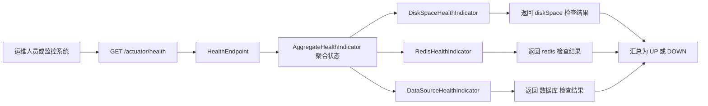

图中每个 `HealthIndicator` 只负责自己那一个组件的探测，由聚合器把结果汇总成最终的那个状态码。这也是为什么「只想看某一项」时可以直接访问 `/actuator/health` 的明细，而不需要为每个组件单独写接口。

## 第19部分：Actuator 只给我两个端点怎么办：暴露全部 endpoint 并读懂 beans、env、mappings

打开 `/actuator` 之后只看到 `health` 和 `info` 两个链接，想看容器里有哪些 Bean、想确认某个配置项最终从哪个文件读进来的，全都够不着。这不是功能没装，而是这些端点默认处于「已创建但不对外暴露」的状态。

一行配置就能把它们全部打开，代价是要清楚自己暴露了什么。

在 `application.properties` 里加最后一行的那句配置：

```properties
info.name=zhangsan
info.age=23

# 开启健康检查的完整信息
management.endpoint.health.show-details=always

# 将所有的监控 endpoint 暴露出来
management.endpoints.web.exposure.include=*
```

（末尾一句中的 `include=*` 是把全部端点对外暴露；原工程 `application.properties` 里这几行配置是齐全的。）

重启之后再次访问 `http://localhost:8080/actuator`，返回的索引会从两条变成十几条，`beans`、`env`、`mappings`、`conditions`、`heapdump`、`loggers` 等链接全部出现在其中。

配置的名字值得拆开看。`management.endpoints` 是复数形式，作用在**所有端点**上；与之相对的单数形式 `management.endpoint.xxx` 作用在**某一个具体端点**上，比如 `management.endpoint.health.show-details` 只管健康检查的明细。两个层级各有分工：

| 配置项 | 作用范围 | 例 |
|---|---|---|
| `management.endpoints.web.exposure.include` | 哪些端点通过 HTTP 暴露 | `health,info` 或 `*` |
| `management.endpoints.web.exposure.exclude` | 哪些端点排除在外 | `heapdump,threaddump` |
| `management.endpoints.web.base-path` | 修改基础路径 | 默认是 `/actuator` |
| `management.endpoint.<id>.enabled` | 单个端点是否创建 | `management.endpoint.info.enabled=true` |

`exclude` 与 `include` 同时出现时，`exclude` 优先级更高，这也是「先全开再排除敏感项」这条常用策略的依据。

`/actuator/beans` 返回的是一个巨大的 JSON，每项的结构包含 `bean`、`scope`、`type`、`resource`、`dependencies` 五个字段。用文本搜索定位到 `redisTemplate` 这一项，看到的内容大致如下：

```json
{
  "beans": {
    "redisTemplate": {
      "aliases": [],
      "scope": "singleton",
      "type": "org.springframework.data.redis.core.RedisTemplate",
      "resource": "class path resource [org/springframework/boot/autoconfigure/data/redis/RedisAutoConfiguration.class]",
      "dependencies": [
        "redisConnectionFactory"
      ]
    }
  }
}
```

**第一，`scope` 回答的是作用域。** 绝大多数 Bean 是 `singleton`，如果你自定义了一个 Bean 却看到 `prototype`，说明作用域配置和预期不符。

**第二，`resource` 回答的是「这个 Bean 从哪来」。** 上面这个 `resource` 指向 `RedisAutoConfiguration`，一眼就能确认它是自动配置装配进来的，而不是自己写的。排查「我明明加了 `@Bean` 为什么没生效」时，看这里最直接。

**第三，`dependencies` 回答的是依赖链。** `redisTemplate` 依赖 `redisConnectionFactory`，顺着箭头继续查这一项，就能把整条装配关系串起来。这也是它在 pojo 依赖注入出问题时的价值所在。

配置文件散落在 `application.properties`、`application.yml`、命令行参数、系统环境变量里，同一属性被多处定义时到底取哪个，肉眼很难判断。`/actuator/env` 把最终生效的每一项都标明了来源，滚到最下面能看到自己写的那几行：

```json
{
  "propertySources": [
    {
      "name": "applicationConfig: [classpath:/application.properties]",
      "properties": {
        "info.name": {
          "value": "zhangsan",
          "origin": "class path resource [application.properties]"
        },
        "management.endpoints.web.exposure.include": {
          "value": "*",
          "origin": "class path resource [application.properties]"
        }
      }
    }
  ]
}
```

`origin` 字段写清了具体是哪个文件，配合 `management.endpoint.health.show-details` 这类键名，可以核对相关配置是否真的被读进来了。这里只截取了自己写的那一段，上方还有大量由系统变量和自动配置贡献的属性。

需要提醒的是 `env` 会展示密码类配置的原始值，敏感属性会被自动替换成 `******`，但并非所有场景都覆盖得到，别指望它替你做脱敏。

`/actuator/mappings` 展示的是当前应用里全部 URL 与处理方法的映射关系。为了验证它的可读性，工程里加了一个最简单的接口：

```java
package com.example.springbootactuator;

import org.springframework.web.bind.annotation.RequestMapping;
import org.springframework.web.bind.annotation.RestController;

@RestController
@RequestMapping("/user")
public class UserController {

    @RequestMapping("/findAll")
    public String findAll() {
        return "success";
    }
}
```

重启后访问 `/actuator/mappings`，找到自己写的那一条，结构如下：

```json
{
  "handler": "public java.lang.String com.example.springbootactuator.UserController.findAll()",
  "predicate": "{[/user/findAll]}",
  "details": {
    "handlerMethod": {
      "className": "com.example.springbootactuator.UserController.findAll",
      "name": "findAll",
      "descriptor": "()Ljava/lang/String;"
    },
    "requestMappingConditions": {
      "patterns": ["/user/findAll"],
      "methods": [],
      "params": [],
      "headers": []
    }
  }
}
```

`handler` 给出方法的完整签名，`patterns` 给出实际可访问的路径，`methods`、`params`、`headers` 分别是限定的请求方式、请求参数和请求头。接口调不通又不报错时，先看这里有没有这条映射；映射存在再去查参数匹配条件。

返回的数据来自 `RequestMappingHandlerMapping` 内部维护的那张映射表，请求进来时查的就是同一份数据，所以它与实际行为必然一致。

| 端点 | 作用 |
|---|---|
| `conditions` | 显示自动配置类的条件评估报告，谁生效谁没生效一目了然 |
| `heapdump` | 下载堆转储文件，需要配合 MAT 等工具分析内存泄漏 |
| `loggers` | 查看并动态修改日志级别，无需重启 |
| `metrics` | 各项度量指标的索引，如 JVM 内存、GC、HTTP 请求耗时 |
| `threaddump` | 导出线程快照，用于排查死锁和线程堆积 |

这几个端点里，`conditions` 与前面的自动配置内容可以串起来看，`loggers` 在线上临时调整日志级别时非常实用。

各端点与配置的关系如图所示：

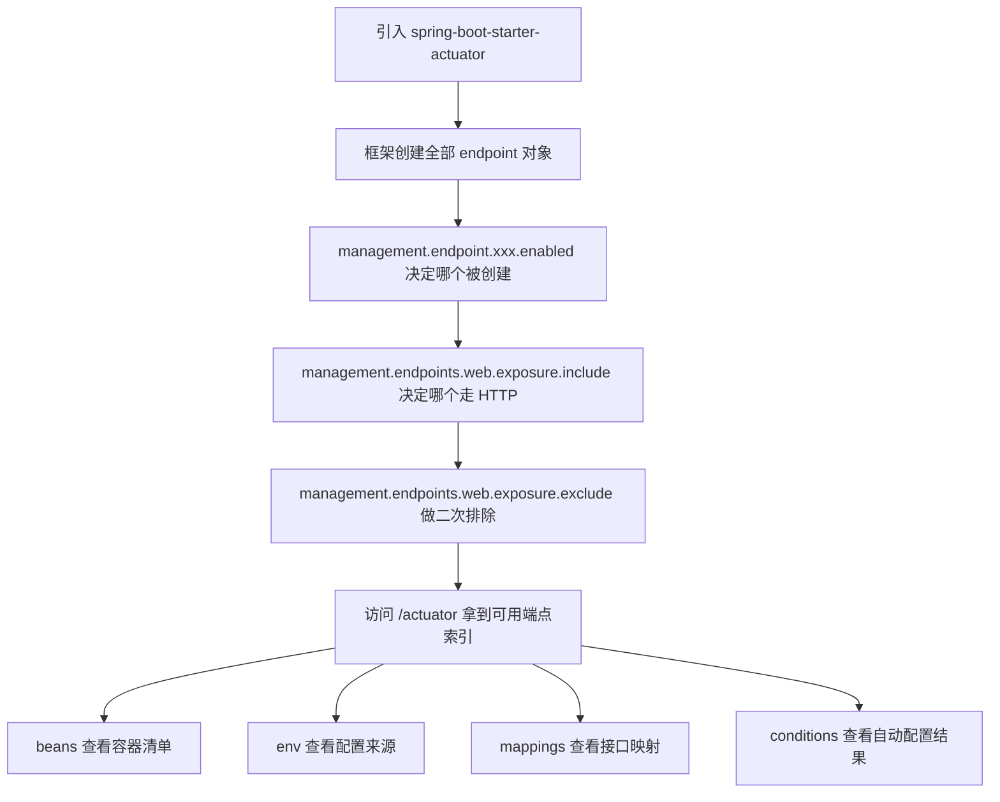

图中 C 到 E 是三级开关，任一级关掉，端点都不会出现在最后的索引里。判断「某个端点为什么访问不到」时，顺着这三层逐级检查即可。

## 第20部分：监控信息全是 JSON 怎么办：用 Spring Boot Admin 搭一个图形化监控台

Actuator 把监控能力给出来了，但实际用起来并不轻松：访问 `/actuator/beans` 返回上千行 JSON，想知道现在有几个 Bean、堆内存用了多少、某个接口被调用了几次，得在一大坨文本里翻。信息太多，不好找，看久了眼睛疼。

Spring Boot Admin 解决的就是这个「有数据但读不动」的问题。它是开源社区项目，把 Actuator 端点返回的 JSON 拉过来解析，渲染成带按钮、带图表、带颜色标记的网页，点开就能看。

把两个角色的职责摆清楚，后面的配置就不需要死记。

**第一，Client 是数据的提供方。** 被监控的应用引入 Admin 的客户端依赖后，会把自己 Actuator 端点能拿到的健康状态、指标、Bean 清单、环境属性等信息，主动上报给 Server。

**第二，Server 是数据的展示方。** 它自己也是一个 Spring Boot 应用，起一个 Web 服务，接收 Client 的注册请求，保存各实例的监控数据，再把这些数据画成页面。

**第三，两者之间是注册关系，不是侵入式改造。** Client 只是多了一个「定时向某个地址报数据」的动作，业务代码一行都不用动。

```mermaid
flowchart LR
    A["Client 应用 A：8080"] -->|"注册并上报 Actuator 数据"| S["Admin Server：9000"]
    B["Client 应用 B：8081"] -->|"注册并上报 Actuator 数据"| S
    S --> D["Admin 内置页面：Wallboard / Metrics / Beans"]
    D --> E["运维人员浏览器访问 localhost:9000"]
    A -.->|"本地仍可直接访问"| F["/actuator 原始 JSON"]
```

图里虚线那条路径值得留意：Admin 并没有取代 Actuator，原始数据接口依然在，Admin 只是多了一条图形化的读取路径。排查问题时两边对照着看最有效。

课程源码里 Server 工程的 pom 是这样的（包名已改成中性的 `com.example`）：

```xml
<properties>
    <java.version>1.8</java.version>
    <spring-boot-admin.version>2.1.5</spring-boot-admin.version>
</properties>

<dependencies>
    <dependency>
        <groupId>org.springframework.boot</groupId>
        <artifactId>spring-boot-starter-web</artifactId>
    </dependency>
    <dependency>
        <groupId>de.codecentric</groupId>
        <artifactId>spring-boot-admin-starter-server</artifactId>
    </dependency>
</dependencies>

<dependencyManagement>
    <dependencies>
        <dependency>
            <groupId>de.codecentric</groupId>
            <artifactId>spring-boot-admin-dependencies</artifactId>
            <version>${spring-boot-admin.version}</version>
            <type>pom</type>
            <scope>import</scope>
        </dependency>
    </dependencies>
</dependencyManagement>
```

`spring-boot-admin` 的版本单独用一个属性声明，再通过 `dependencyManagement` 以 `import` 作用域导入它的 BOM，这样 starter 坐标上就不用写版本号了，和 Spring Boot 管理依赖的思路一致。用 IDEA 的 Spring Initializr 创建工程时，在 Ops 分类里勾选 Admin Server，生成出来的就是这两段。

引导类只多一个注解：

```java
package com.example.springbootadminserver;

import de.codecentric.boot.admin.server.config.EnableAdminServer;
import org.springframework.boot.SpringApplication;
import org.springframework.boot.autoconfigure.SpringBootApplication;

@EnableAdminServer
@SpringBootApplication
public class SpringbootAdminServerApplication {

    public static void main(String[] args) {
        SpringApplication.run(SpringbootAdminServerApplication.class, args);
    }
}
```

`@EnableAdminServer` 这一个注解把 Admin Server 的控制器、注册端点、UI 静态资源全部装配进来，Server 端到此写完。

端口要单独改，因为 Client 默认也用 8080，同机启动必然冲突：

```properties
server.port=9000
```

Client 工程引的是客户端 starter，其余坐标与 Server 一致：

```xml
<dependency>
    <groupId>de.codecentric</groupId>
    <artifactId>spring-boot-admin-starter-client</artifactId>
</dependency>
```

配置文件里三行，缺一不可：

```properties
# 指定 admin server 的地址，监控信息往这里发
spring.boot.admin.client.url=http://localhost:9000

management.endpoint.health.show-details=always

# 把全部监控 endpoint 暴露出来，否则 Server 读不到数据
management.endpoints.web.exposure.include=*
```

**第一，`spring.boot.admin.client.url` 决定往哪注册。** 配置项名字有点长，它的含义是「待注册的 Admin Server 地址列表」，写错端口是最常见的注册失败原因。

**第二，后面两行是 Actuator 的配置，在 Client 上依然要写。** Admin 展示的数据全部来自这些端点，默认只暴露 `health` 和 `info` 的话，页面上的 Metrics、Beans、Mappings 全是空的。

为了在页面上看到有内容的接口统计，工程里放了一个最简单的 Controller：

```java
package com.example.springbootadminclient;

import org.springframework.web.bind.annotation.RequestMapping;
import org.springframework.web.bind.annotation.RestController;

@RestController
@RequestMapping("/user")
public class UserController {

    @RequestMapping("/findAll")
    public String findAll() {
        return "success";
    }
}
```

启动顺序没有强制要求，但先起 Server 再起 Client 更容易看清注册过程。Client 启动日志里出现 `Application registered itself as ...` 就说明注册成功，浏览器访问 `http://localhost:9000` 即可进入控制台。

首屏是应用墙 Wallboard，列出所有已注册实例，每个卡片显示实例数量、运行时长、状态颜色。点进去是单实例详情页，常用页签大致是这些：

| 页签 | 能看到什么 | 典型用途 |
|---|---|---|
| Metrics | 各 URI 的请求次数、响应时间 | 统计某个接口被调用了多少次 |
| Environment | 全部生效配置及其来源 | 确认某项配置到底有没有生效 |
| Beans | 容器内所有 Bean 及来源类 | 排查 Bean 没装配、被覆盖 |
| Threads | 线程列表与运行状态 | 绿色为运行中，红黄为等待，看线程堆积 |
| Mappings | 所有 URL 与处理方法映射 | 接口 404 时先查这里 |
| Loggers | 各包的日志级别 | 临时调整日志级别 |
| JVM / JMX | 堆与非堆内存、类加载数 | 观察内存趋势 |

想验证 Metrics 的统计效果，连续访问几次 `http://localhost:8080/user/findAll`，回到页面刷新，对应路径的 count 会跟着涨。这个数字是按 URI 维度累计的，可以直接用来核对某个接口的真实访问量。

Threads 页签里线程是交替运行的，单核 CPU 上多个线程随机切换，能看到哪个线程正在运行、哪些在等待，排查线程阻塞时很直观。

生产环境值得搭一套 Admin，本地开发测试却没必要每次都引坐标、起两个服务。IDEA 在运行窗口旁提供了 Endpoints 面板，应用启动后点开就能看到 Beans、Health、Mappings 三项，内容同样来自 Actuator，只是由 IDE 直接解析成树形结构展示，Bean 数量多时还能展开继承关系查看。

两者不冲突：本地用 IDE 面板快速核对，上了环境再接 Admin Server 做集中监控。

## 第21部分：项目写完了怎么放到服务器上跑：Spring Boot 打 jar 与打 war 的两种部署方式

本地 `main` 方法一跑，浏览器就能访问，这不算完。真正交付时要把工程搬到服务器上让它自己跑起来，这一步就叫部署。Spring Boot 给了两条路：打成 jar 用 `java -jar` 启动，或者打成 war 丢进外部 Tomcat。

官方文档推荐的是第一种。第二种在必须复用现有容器、由运维统一管理的场景里仍然用得上，但它有几个和直觉不符的地方，不提前知道就会在 404 上耗半天。

课程里的部署工程只有一个接口，用来验证部署后能不能访问：

```java
package com.example.springbootdeploy;

import org.springframework.web.bind.annotation.RequestMapping;
import org.springframework.web.bind.annotation.RestController;

@RequestMapping("/user")
@RestController
public class UserController {

    @RequestMapping("/findAll")
    public String findAll() {
        return "success";
    }
}
```

打包有两条命令，跳过测试可以加 `-DskipTests`：

```bash
mvn clean package
# target 目录下出现 springboot-deploy-0.0.1-SNAPSHOT.jar

java -jar springboot-deploy-0.0.1-SNAPSHOT.jar
# 控制台出现 Tomcat started on port(s): 8888
```

把 jar 复制到任意目录，`java -jar` 就能跑，不依赖 IDE，也不依赖外部容器。课程工程里把端口配成了 8888：

```properties
server.port=8888
```

启动后浏览器访问 `http://localhost:8888/user/findAll`，返回 `success` 即部署成功。

**第一，jar 是可执行 fat jar。** `spring-boot-maven-plugin` 在 `package` 阶段会把工程自身的 class、全部依赖 jar、内嵌 Tomcat 一起打进同一个文件，并写好 `MANIFEST.MF` 里的 `Main-Class`，所以 `java -jar` 能直接找到入口。

**第二，服务器环境依赖极简。** 只要有对应版本的 JDK 就行，不需要预先安装 Tomcat，也不需要配置容器。这也是容器化和云原生场景下 jar 方式更受欢迎的原因。

要复用外部 Tomcat，工程得按传统 Web 应用的方式被容器识别，改动集中在 pom 和引导类。

pom 里明确打包方式，顺手指定产出文件名：

```xml
<groupId>com.example</groupId>
<artifactId>springboot-deploy</artifactId>
<version>0.0.1-SNAPSHOT</version>
<packaging>war</packaging>

<build>
    <finalName>springboot</finalName>
    <plugins>
        <plugin>
            <groupId>org.springframework.boot</groupId>
            <artifactId>spring-boot-maven-plugin</artifactId>
        </plugin>
    </plugins>
</build>
```

`<finalName>springboot</finalName>` 让打出来的包叫 `springboot.war`，不再带版本号后缀。

引导类要做一次小手术，继承 `SpringBootServletInitializer` 并重写 `configure` 方法：

```java
package com.example.springbootdeploy;

import org.springframework.boot.SpringApplication;
import org.springframework.boot.autoconfigure.SpringBootApplication;
import org.springframework.boot.builder.SpringApplicationBuilder;
import org.springframework.boot.web.servlet.support.SpringBootServletInitializer;

@SpringBootApplication
public class SpringbootDeployApplication extends SpringBootServletInitializer {

    public static void main(String[] args) {
        SpringApplication.run(SpringbootDeployApplication.class, args);
    }

    @Override
    protected SpringApplicationBuilder configure(SpringApplicationBuilder builder) {
        return builder.sources(SpringbootDeployApplication.class);
    }
}
```

这段代码的必要性在于启动入口换了。外部 Tomcat 不认识 `main` 方法，它按 Servlet 规范去找 `ServletContainerInitializer` 的实现，`SpringBootServletInitializer` 就是 Spring Boot 提供的那个实现。容器启动时回调 `configure`，`builder.sources(本类.class)` 告诉它配置类在哪，Spring 容器这才被拉起来。

需要补充一点，课程演示里没有做但工程实践应当做：把内嵌容器的依赖声明为 `provided`，避免它被打进 `WEB-INF/lib` 与外置容器冲突。

```xml
<dependency>
    <groupId>org.springframework.boot</groupId>
    <artifactId>spring-boot-starter-tomcat</artifactId>
    <scope>provided</scope>
</dependency>
```

整条部署链路可以这样看：

```mermaid
flowchart TD
    A["Spring Boot 工程"] --> B{"pom 中 packaging 的值"}
    B -->|"jar"| C["spring-boot-maven-plugin 打 fat jar"]
    C --> D["java -jar 启动"]
    D --> E["内嵌 Tomcat 监听 server.port"]
    B -->|"war"| F["打 war 包"]
    F --> G["引导类继承 SpringBootServletInitializer"]
    G --> H["放入外部 Tomcat 的 webapps 目录"]
    H --> I["Tomcat 回调 configure 启动 Spring 容器"]
    I --> J["外部 Tomcat 监听自身端口"]
```

图里两条分支的关键差异在最后一步：jar 路线上端口归 Spring Boot 管，war 路线上端口归 Tomcat 管。

**第一，访问路径多了一层虚拟目录。** war 包放到 `webapps` 下解压成同名目录，这个目录名就是上下文路径。访问 `http://localhost:8080/user/findAll` 会 404，正确的地址是：

```bash
# 包名为 springboot.war，上下文路径就是 /springboot
http://localhost:8080/springboot/user/findAll
```

想去掉这层路径，把包名改成 `ROOT.war` 即可，或者由容器侧配置上下文。

**第二，`server.port` 不再生效。** 这个配置项管的是内嵌 Tomcat 的监听端口。既然已经交给外部容器，端口就得去 Tomcat 的 `conf/server.xml` 里改 `<Connector port="8080">`，工程里写 `server.port=9999` 不会有任何效果。

另外还有一条隐含约束：外部 Tomcat 需要 Servlet 3.0 及以上版本，实际使用建议 Tomcat 8 起步，版本太低识别不到 `SpringBootServletInitializer` 这套机制。

jar 方式把容器、依赖、应用打成一个整体，运行环境只依赖 JDK，部署动作退化成复制文件加一条命令，版本冲突和容器差异基本消失。war 方式引入了外部容器这个变量，端口、上下文路径、容器版本都要额外对齐，只有在运维要求统一托管时这份成本才值得付。

## 常见误区

- **以为继承 parent 就等于引入了 Spring 的 jar**：parent 里没有 `dependencies`，只有版本声明。
  真正引包的是 starter，两个缺一不可。

- **把 `dependencyManagement` 当成 `dependencies` 用**：在自己工程里写 `dependencyManagement` 引包，
  编译时会发现类根本不存在，因为它不下载任何 jar。

- **自己给 starter 写上版本号**：`spring-boot-starter-web` 写 2.3.0，父工程却锁着 2.1.8，
  两边不一致时行为会变得难以预测。要用新版本就升父工程的 `<version>`，让整套版本一起动。

- **多个 starter 里含同一个 jar 就以为会重复打包**：Maven 有依赖调解机制，同一坐标只保留一份，
  不会打进去两份。

- **冒号后面忘了加空格**：`port:8082` 在 yaml 里会被解析成一个整体字符串，端口配置直接失效。
  改成 `port: 8082` 才对。这是 yaml 最高频的错误。

- **以为高优先级文件会整体替换或忽略低优先级配置**：无论是四个默认位置之间，还是外部配置与 jar 包内配置之间，
  都是合并关系、按配置键覆盖。高层只有 `server.port` 时，低层的 `server.servlet.context-path` 仍会生效；
  外部只覆盖同名键，其余配置照常生效；低优先级文件里的独有属性依然会生效，
  这经常导致「我以为删掉了这个配置」的判断错误。

- **换了文件名还指望生效**：文件名必须是 `application`，后缀才是 `properties`、`yml` 或 `yaml`。

- **把自定义配置和框架配置混为一谈**：`server.port` 这类框架认识的属性会被自动应用，
  `name`、`person.name` 这类自定义属性必须写代码读取，光写在文件里不会有任何效果。

- **在同一级目录放多份同名配置**：`properties`、`yml`、`yaml` 并存时都会加载、按属性优先级合并且 properties 优先，
  排查问题时很容易改错文件，出现「改了 yml 却不生效」的假象。实践中选一种格式，只留一个文件。

- **用 Tab 做缩进**：不同系统对 Tab 宽度解释不同，层级可能错乱，一律用空格。

- **`@ConfigurationProperties` 不写 `prefix`**：绑定到了顶层同名属性，表现为某个字段永远是默认值，
  `int` 是 0，对象是 `null`。

- **实体类忘了加 setter**：配置是通过 setter 注入的，只有 getter 没有 setter 会导致属性全为空。

- **`@Value` 里写了变量名而不是键名**：表达式里必须是配置文件中的键名，和字段名无关。

- **只创建环境文件，却没有激活 Profile**：`application-dev.properties` 不会因为文件存在就自动生效。应通过 `spring.profiles.active=dev` 或外部参数明确激活。

- **激活值与文件后缀不一致**：文件名是 `application-pro.properties`，却传入 `production`，Spring Boot 找不到目标环境文件。两处名称必须完全一致。

- **把 JVM 参数写到 jar 文件名之后**：`-Dspring.profiles.active=test` 是 JVM 参数，应放在 `-jar` 前；放在 jar 后应改用 `--spring.profiles.active=test`。

- **每次部署都修改配置再重新打包**：这会产生多份难以追踪的构建产物。保留一个 jar，通过启动参数选择环境更稳妥。

- **把 `src/main/resources` 当成最高优先级目录**：它构建后属于 classpath 根目录，在四个默认位置中优先级最低。项目根目录及其 `config` 子目录可以覆盖它。

- **忽略启动工作目录**：文件系统位置以当前工作目录为基准。换一种启动方式后，原先的 `./config/application.properties` 可能不再位于预期位置。

- **只比较目录，不比较后缀**：同一目录下的 `.properties`、`.yml`、`.yaml` 也有覆盖顺序，多个文件声明同名键时不能只看修改时间。

- **只加 `@Test` 就注入 Spring Bean**：普通 JUnit 不会创建 Spring 容器，容器没启动自动配置也不执行，
  `redisTemplate` 这类依赖注入失败报空指针。JUnit 4 场景还需要 `@RunWith(SpringRunner.class)` 和 `@SpringBootTest`。

- **测试类放在平行包，却省略 `classes`**：自动查找只能从测试包向上寻找主配置类。平行包无法命中，应显式指定引导类。

- **把测试类写进 `src/main/java`**：测试代码应位于 `src/test/java`，这样测试依赖和测试类不会混入生产代码。

- **运行成功就等于测试有效**：只打印 `add...` 能证明调用完成，却不能验证业务结果。实际项目应使用断言检查返回值、异常或状态变化。

- **以为项目根目录的 `application.properties` 会被打进 jar**：Maven 只打包 `src/main/resources` 下的资源，
  放在工程根目录或根目录 `config/` 下的配置文件不会被打包，脱离 IDE 运行就失效了。

- **把配置项写成大写**：`--server.PORT=8082` 不会报错也不会生效。properties 的键区分大小写，照着配置文件抄。

- **只写一个短横线**：`-server.port=8082` 不是命令行参数，必须是 `--server.port=8082`。

- **把 `spring.config.location` 写成文件路径却忘了前缀**：绝对路径直接写即可，相对路径和 classpath 路径要带 `file:` 或 `classpath:` 前缀。

- **本机 Redis 没启动就跑测试**：会看到连接被拒绝或超时的异常。Spring Boot 在启动时并不会主动校验 Redis 是否可达，
  错误只会在第一次真正执行命令时暴露，排查时先手动确认服务状态。

- **用 `RedisTemplate` 存字符串后，在客户端里看到乱码**：这是 JDK 序列化的正常表现，不是数据损坏。
  想要可读就换 `StringRedisTemplate`，或者给 `RedisTemplate` 指定 `StringRedisSerializer`。

- **自己再手动声明一个 `RedisTemplate` Bean**：会覆盖自动配置提供的实例，如果没有配套设置序列化器，
  反而引入了不一致的行为。只有确实需要自定义序列化时才这么做。

- **漏配数据源**：MyBatis 无法凭空知道连哪个库，`spring.datasource.url` 不写会直接启动失败，报无法确定数据源。

- **MySQL 8 驱动没加 `serverTimezone`**：报 `The server time zone value is unrecognized` 之类的异常，
  在 url 后面追加 `?serverTimezone=UTC` 即可。

- **XML 的 namespace 写错**：报 `BindingException: Invalid bound statement`，
  检查 namespace 是否为接口全限定名、select 的 id 是否等于方法名。

- **`mapper-locations` 通配符匹配不到文件**：文件放错了目录或命名不符合通配符，映射根本没被加载，
  症状同样是 `Invalid bound statement`。

- **只加了 `@Repository` 忘了 `@Mapper`**：IDE 不报错但运行报找不到 Bean，两者职责不同，不能互相替代。

- **XML 里用短别名却没配 `type-aliases-package`**：报类型无法解析，要么补配置，要么写全限定名。

- **条件类被当成普通 Bean 注入使用。** `Condition` 实现类由 Spring 通过反射直接实例化并调用 `matches`，不走正常的 Bean 生命周期，在里面注入依赖是拿不到的。需要取 Bean 就用 `ConditionContext` 提供的 `getBeanFactory()`。

- **在 `matches` 里触发 Bean 的提前初始化。** 官方注释明确要求 `Condition` 遵守和 `BeanFactoryPostProcessor` 一样的限制，不要和 Bean 实例交互，否则会造成过早初始化，破坏后续的配置。判断「存不存在」请用 `getBeanNamesForType` 之类的类型查询方法，别直接 `getBean`。

- **把 `@Conditional` 和 `@ConditionalOnClass` 混用在同一处。** 手写条件类和 Spring Boot 的条件注解同时挂上去，两个条件都要满足，排查时容易忽略其中一个。演示可以，生产代码里只留一种。

- **改完依赖不重新编译就下结论。** 增删或排除坐标之后 IDE 的编译缓存可能没刷新，会出现「坐标已经改了但条件判断还是失败」的假象，别急着断定方法不对，随便改动一处源文件触发重新编译，或者重新导入一次依赖再观察日志。

- **以为条件不满足时 Bean 被创建了又销毁。** 条件评估发生在 BeanDefinition 注册之前，返回 `false` 时容器里从头到尾就没有这个 Bean 的定义。

- **删掉 `spring-boot-starter-web` 再引 Jetty。** starter 提供的是 Spring MVC 基础设施，删掉它 Web 环境就没了，应用启动即退出。正确做法是保留 starter，排除其中的 Tomcat。

- **排除了 Tomcat 却忘了引入替代容器。** 此时 classpath 上没有任何 Servlet 容器，Web 应用启动会直接失败。排除和引入必须成对出现。

- **切换后去改 `server.port` 之类的配置。** 端口、上下文路径这些由 `ServerProperties` 统一抽象，和具体容器无关，切换后配置原样生效，不需要也不应该改。

- **以为要靠配置文件开关来选容器。** 容器选择发生在自动配置的条件评估阶段，依据只有 classpath，配置文件里没有对应的开关。

- **以为第三方 jar 上的 Bean 只要引了坐标就能用。** 坐标只负责把字节码放进 classpath，Bean 是否进入容器取决于有没有被扫描或被导入。

- **用 `@ComponentScan` 去覆盖所有第三方包。** 扫描范围越大启动越慢，还会误扫到不该注册的组件，且耦合了对方的内部包名。

- **认为 `@Enable*` 注解有什么特殊机制。** 它们只是把 `@Import` 包了一层，真正的加载逻辑在被导入的类里。

- **给被 `@Import` 导入的类强制加 `@Configuration`。** 加不加都能工作，加上反而会让这个类进入完整配置模式，产生 CGLIB 代理。

- **混淆 `@Import` 的四种用法。** 导入 Bean、导入配置类、导入 `ImportSelector`、导入 `ImportBeanDefinitionRegistrar`，前两种是写死类名，后两种可以在运行期动态决定要注册什么。

- **把 `@Import` 当成扩大组件扫描范围**：它是显式导入机制，不会自动扫描目标包。要扫描整包仍应使用 `@ComponentScan`。

- **直接按 `user` 获取普通导入类**：普通类的注册名称不一定是 `user`。可按类型获取，或通过 `getBeansOfType` 查看实际名称。

- **让 `ImportSelector` 返回简单类名**：返回值必须是类的全限定名，如 `com.example.domain.User`，否则 Spring 无法定位目标类型。

- **注册 Bean 时遗漏类型**：`BeanDefinitionBuilder.rootBeanDefinition(User.class)` 必须带上实际 Bean 类型，再把生成的定义交给注册表。

- **认为 `spring.factories` 中列出的类都会实例化**：列表只是候选入口，条件不成立的配置类或 Bean 不会生效。

- **把自动配置理解成组件扫描**：第三方自动配置类通常不在应用根包下，它依靠 `@Import` 与工厂加载机制进入解析流程。

- **只引入自动配置模块却漏掉必要依赖**：例如缺少 `Jedis` 时，`@ConditionalOnClass(Jedis.class)` 不成立，Redis 配置自然不会启用。

- **用户 Bean 存在时仍期待默认 Bean 被创建**：`@ConditionalOnMissingBean` 的设计目标就是让自动配置退让，这是正常覆盖机制。

- **把代码写进 starter 模块**：starter 只是一个空壳 pom，写在这里的类不会被扫描，也不能被其他工程以自动配置的方式加载。代码一律放 autoconfigure 模块。

- **`spring.factories` 放错位置或键名写错**：必须是 `src/main/resources/META-INF/spring.factories`，键必须是 `org.springframework.boot.autoconfigure.EnableAutoConfiguration`。放在 `java` 目录下或写成 `spring.factory` 都会静默失效，表现为 Bean 拿不到且不报错。

- **忘了 `@EnableConfigurationProperties`**：`@ConfigurationProperties` 只负责绑定规则，不负责把类注册成 Bean。缺了启用注解，注入 `RedisProperties` 时会报找不到该类型的 Bean。

- **条件注解按类型写却想按名字覆盖**：示例里用的是 `@ConditionalOnMissingBean(name = "jedis")`，匹配的是 Bean 的名字。用户定义的 Bean 方法必须也叫 `jedis` 才能覆盖，改个名就不生效。

- **给四个接口都加 `@Component` 就以为万事大吉**：组件扫描发生在容器刷新阶段，而 `ApplicationContextInitializer` 与 `SpringApplicationRunListener` 要在刷新之前就位，只能走 `META-INF/spring.factories` 注册，且键必须是接口的全限定名，值为实现类的全限定名；`ApplicationRunner` 与 `CommandLineRunner` 因为执行时机靠后，加 `@Component` 靠容器扫描反而没问题。

- **自定义 `SpringApplicationRunListener` 不写带参构造**：启动报 `IllegalArgumentException`，需要用 `Caused by` 往下翻才能看到「找不到 `(SpringApplication, String[])` 构造」的真实原因。

- **在 `ApplicationContextInitializer` 里取业务 Bean**：此时容器尚未刷新，业务 Bean 还没创建，取不到。这个阶段只适合做环境检测、属性预处理。

- **在 Runner 里做耗时很长的同步操作**：Runner 跑在启动流程里且位于 `running` 之前，耗时过长会拖慢服务可用时间，甚至被健康检查判定为启动超时。重活应该丢给线程池异步执行。

- **以为 `webApplicationType` 是自己配出来的。** 它由 classpath 上的类推断。工程没引 `spring-boot-starter-web` 时它是 `NONE`，这时候自动创建的就是普通 IOC 容器，不会有端口监听，别对着 `NONE` 找 Tomcat 为什么没起来。

- **在初始化阶段寻找监听日志。** 构造器阶段只有对象创建，一条回调都不执行。发现自定义打印没出来，先去确认 `run` 有没有被调到，以及 `spring.factories` 的 key 写得对不对。

- **把 `SpringApplicationRunListener` 和 `ApplicationListener` 混为一谈。** 单数形式是运行期监听器接口，复数形式 `SpringApplicationRunListeners` 是它的一层集合封装；而 Spring 原生的 `ApplicationListener` 监听的是容器内的事件，两者属于不同体系。

- **打开了 Actuator 却访问 404。** 只有引了 `spring-boot-starter-web` 的情况下端点才会以 HTTP 方式暴露出来，纯非 Web 工程需要通过 JMX 或另行配置才能使用。

- **以为 `info` 端点会返回 `application.properties` 里所有配置。** 它只返回 `info.` 前缀的属性，其他配置要看另一个叫 `env` 的端点，而且那个端点默认是关闭的。

- **看到 `DOWN` 就以为是应用挂了。** 顶层状态是聚合结果，真正要看的是 `details` 里哪一项是 `DOWN`。磁盘是 `UP` 而 Redis 是 `DOWN`，修的是 Redis，不是应用。

- **把 `always` 直接用到生产环境。** 明细里含 TLS 证书信息、依赖地址等，属于敏感信息。对外网开放的实例应当用 `when-authorized` 或干脆关闭。

- **配了 `include=*` 之后还访问不到某些端点。** 端点本身可能没有启用（`enabled=false`），或者压根不在 classpath 上（比如没有 Web 环境就没有 HTTP 暴露这一说）。

- **把 `management.endpoints`（复数）写成 `management.endpoint`（单数）。** 单数是针对具体端点 id 的配置族，写错层级配置直接被忽略，端点依旧不被暴露。

- **以为 `heapdump` 会直接在浏览器里显示结果。** 访问它触发的是文件下载，需要专门的内存分析工具才能读懂。

- **在生产环境照搬 `include=*`。** 全部暴露意味着外部可以直接拿到 Bean 清单、环境配置、URL 映射，甚至触发堆转储拖垮服务。生产应以白名单方式列出必需端点。

- **Client 注册成功但页面一片空白。** 原因是 Client 没配 `management.endpoints.web.exposure.include=*`，Admin 拿到的只有 `health` 和 `info`，其余页签自然没数据。

- **两个应用都用 8080，Client 起不来。** 给 Server 单独指定 `server.port`，并让 Client 的 `spring.boot.admin.client.url` 指向这个端口。

- **在 Server 工程上找 Actuator 配置。** Server 是展示方，不需要暴露自己的端点；暴露配置要写在被监控的 Client 上。

- **把 Admin 当成新的监控实现。** 它底层读的还是 Actuator，Actuator 相关的知识和排错方法完全通用。

- **把 Admin Server 直接暴露在公网。** 控制台能看到 Bean 清单、环境配置甚至线程快照，必须加认证或只放内网访问。

- **改了 `packaging` 却忘了改引导类。** 打出来的 war 放进 Tomcat 后没有任何 Spring 日志，接口全 404，原因是容器找不到启动入口，必须继承 `SpringBootServletInitializer` 并重写 `configure`。

- **war 部署后照原路径访问，一直 404。** 上下文路径变成了 war 包解压后的目录名，访问时要补上这一层。

- **在 war 包里改 `server.port` 想换端口。** 该配置只作用于内嵌容器，外置 Tomcat 的端口要在 `server.xml` 里改。

- **把内嵌 Tomcat 打进了 war 的 `WEB-INF/lib`。** 不设 `provided` 作用域会与外部容器产生冲突，出现类加载异常。

- **服务器上没装 JDK 就想 `java -jar`。** jar 方式只免去了 Tomcat，JDK 仍然必需，版本要与编译版本匹配。

## 面试可能被问到的问题

1. 面试官追问：「Spring Boot 的起步依赖原理是什么？」
   答：它由两部分配合完成。父工程 `spring-boot-starter-parent` 通过 `dependencyManagement` 做版本锁定，
   提供一套经过兼容性测试的组件版本；具体的 starter 通过普通的 `dependencies` 声明完成某类功能所需的坐标集合。
   工程继承父工程并引入 starter，靠 Maven 的依赖传递拿到全部 jar，且版本已被锁定，不会冲突。
2. 面试官追问：「`dependencyManagement` 和 `dependencies` 有什么区别？」
   答：`dependencies` 是真正引入依赖，子工程会继承并把 jar 加入 classpath。
   `dependencyManagement` 只声明版本，不引入任何 jar，只有在别处真正引用该坐标时它声明的版本才会被套用，
   常用于多模块工程统一版本。
3. 面试官追问：「`spring-boot-starter-parent` 和 `spring-boot-dependencies` 是什么关系？」
   答：`spring-boot-starter-parent` 的父工程就是 `spring-boot-dependencies`，几百个组件的版本号定义在后者里。
   前者在此基础上补充了 `java.version`、资源过滤、插件配置等构建相关的内容。
   如果工程已经有自己的父工程，可以用 `dependencyManagement` 以 `import` 方式引入 `spring-boot-dependencies` 替代继承。
4. 面试官追问：「为什么要由 Spring Boot 统一管理版本，自己指定不是更灵活吗？」
   答：Spring Boot 每发布一个版本，都会对常用技术组件做一轮组合测试，挑选互不冲突的版本固化下来。
   自己逐个挑版本，很容易出现 Spring 与 Jackson、Hibernate 之间的隐性不兼容，
   表现为运行期的 `NoSuchMethodError`，排查成本很高。
5. 面试官追问：「想单独升级某一个依赖的版本，应该怎么做？」
   答：推荐在自己的 pom 的 `properties` 里覆盖父工程定义的同名属性，例如覆盖 `tomcat.version`，
   这样引用该属性的所有坐标会一起升。直接在某个依赖上写 `<version>` 只会改那一个坐标，容易造成版本混杂。
6. 面试官追问：「Spring Boot 支持哪些配置文件格式？」
   答：支持 `properties` 和 `yaml` 两种格式。`yaml` 有 `.yml` 和 `.yaml` 两种后缀，是同一种文件类型。
   默认文件名都是 `application`，放在 classpath 根目录时会被自动加载。
7. 面试官追问：「`application.properties` 和 `application.yml` 同时存在，谁的优先级高？」
答：`application.properties` 更高。课程使用的 Spring Boot 版本中，同目录下三者的优先级依次是 properties、yml、yaml，
   同名属性采用优先级更高的值。优先级是按单个属性生效的，高优先级文件里没有的属性，仍会从低优先级文件中读取。
8. 面试官追问：「yaml 文件里冒号后面不加空格会怎样？」
   答：值不会被正确解析。`port:8082` 会被当成一整个字符串键或值处理，配置失效。
   yaml 规定键值分隔符是冒号加空格，缩进也必须统一，不能用 Tab。
9. 面试官追问：「改了配置文件名还能生效吗？」
   答：不能自动生效，框架只识别默认名 `application`。想换名字需要通过 `spring.config.name` 显式指定，
   或者用 `spring.config.location` 指定完整路径。
10. 面试官追问：「SpringBoot 的配置为什么既有默认值又要覆盖机制？」
   答：这是约定优于配置的体现。框架为每个常用配置提供合理默认值，让零配置就能启动；
   同时允许用户用同名属性覆盖，保证需要定制时不用改框架源码。覆盖关系由配置源的优先级决定。
11. 面试官追问：「自定义的配置项写在配置文件里，为什么程序读不到？」
   答：框架只会自动应用它认识的属性，比如 `server.port`。自定义属性需要主动读取，
   可以用 `@Value` 注解、注入 `Environment` 对象，或者用 `@ConfigurationProperties` 绑定到实体类。
12. 面试官追问：「yaml 相比 properties 和 XML 有什么优势？」
   答：相比 properties，yaml 用缩进表达了层级关系，同组配置聚在一起，可读性更好；
   相比 XML，它不需要开始标签和结束标签，写法更简洁。它以数据为中心，且被绝大多数脚本语言支持，
   适合做跨语言的配置交换。
13. 面试官追问：「yaml 的基本语法有哪些必须注意的点？」
   答：大小写敏感；数据值前必须有至少一个空格作为分隔符；用缩进表示层级，缩进只能用空格不能用 Tab；
   同级元素只要左对齐即可，空格数量不重要；`#` 表示注释。
14. 面试官追问：「yaml 里单引号和双引号有什么区别？」
   答：单引号不识别转义字符，`'hello \n world'` 会把 `\n` 原样输出；
   双引号识别转义字符，`"hello \n world"` 会在 `hello` 和 `world` 之间换行。
15. 面试官追问：「Spring Boot 读取配置文件有哪几种方式？」
   答：三种。`@Value` 注解把单个属性注入字段，适合值少的场景；
   注入 `Environment` 对象后调用 `getProperty` 按键取值，无需为每个属性声明字段；
   `@ConfigurationProperties` 按前缀把一组配置绑定到 Java 对象，适合成组的配置项。
16. 面试官追问：「`@ConfigurationProperties` 不写 prefix 会发生什么？」
   答：框架会去匹配顶层的同名属性，而不是指定前缀下的属性。结果是部分字段被绑到了别的键上，
   其余字段拿不到值，保持默认（数值为 0，引用类型为 null），排查时很像注入失效。
17. 面试官追问：「`@ConfigurationProperties` 绑定失败，一般是什么原因？」
   答：常见三个原因。类上没有加 `@Component` 之类的注解，没被 Spring 容器管理；
   字段名与配置键名不一致，或者没有提供对应的 setter 方法；
   `prefix` 写错，与配置里的层级对不上。
18. 面试官追问：「Spring Boot Profile 主要解决什么问题？」
   答：它用于隔离并切换不同运行环境的配置。同一套代码可以为开发、测试、生产环境准备不同的数据库、缓存、端口等参数，启动时只激活目标环境，不必修改业务代码。
19. 面试官追问：「Profile 有哪些常见配置方式？」
   答：一种是多个 `application-{profile}.properties` 或 YAML 文件，每个文件对应一个环境；另一种是在单个 `application.yml` 中使用 `---` 分隔多个文档，并为各文档指定 Profile 名称。
20. 面试官追问：「怎么激活指定的 Profile？」
   答：可以在项目配置中设置 `spring.profiles.active`，也可以使用 JVM 参数 `-Dspring.profiles.active=test`，还可以在命令行中传入 `--spring.profiles.active=pro`。部署场景更常用外部参数。
21. 面试官追问：「未激活任何 Profile 会发生什么？」
   答：环境专属配置不会生效，应用使用公共配置和框架默认值。课程示例没有其他端口配置时会监听默认的 8080，并在控制台提示没有激活 Profile。
22. 面试官追问：「JVM 参数和命令行参数有什么区别？」
   答：JVM 参数以 `-D` 开头，放在 `-jar` 之前，属于 Java 系统属性；Spring Boot 命令行参数以 `--` 开头，放在 jar 文件名之后，属于应用参数。相同键冲突时，命令行参数优先级更高。
23. 面试官追问：「Spring Boot 项目内部配置文件的四个默认位置是什么？」
   答：按优先级从高到低是项目根目录的 `config` 子目录、项目根目录、classpath 的 `config` 子目录、classpath 根目录。Maven 工程的 `src/main/resources` 构建后对应 classpath 根目录。
24. 面试官追问：「高优先级配置文件会让低优先级文件完全失效吗？」
   答：不会。Spring Boot 按配置键合并，只有同名属性会被高优先级值覆盖。低优先级文件中没有冲突的属性仍会进入最终 Environment。
25. 面试官追问：「为什么根目录端口是 8084，resources 中的上下文路径仍然生效？」
   答：根目录高优先级文件只覆盖了同名的 `server.port`。它没有声明 `server.servlet.context-path`，因此该属性继续从低优先级的 classpath 配置中读取，最终形成互补配置。
26. 面试官追问：「排查配置不生效时应该先看什么？」
   答：先确认工作目录和四个默认位置，再全局搜索同名配置键，随后检查同目录下是否存在不同后缀文件。还要区分属性被覆盖和文件完全未加载，两者表现相似但原因不同。
27. 面试官追问：「`@SpringBootTest` 的作用是什么？」
   答：它为测试加载 Spring Boot 应用上下文，让测试类可以使用组件扫描、配置文件、自动配置和依赖注入。它适合验证需要 Spring 容器参与的代码，而不是所有普通 Java 方法测试。
28. 面试官追问：「JUnit 4 中为什么还要加 `@RunWith(SpringRunner.class)`？」
   答：JUnit 4 需要 Runner 扩展测试执行流程。`SpringRunner` 把 JUnit 生命周期接入 Spring TestContext Framework，负责上下文管理、测试实例依赖注入等工作。
29. 面试官追问：「`@SpringBootTest` 什么时候可以不写 `classes`？」
   答：测试类位于引导类同包或子包时，Spring Boot 可以从测试包向上找到带 `@SpringBootConfiguration` 的引导类，此时可以省略。测试类处于平行包或无关包时应显式指定。
30. 面试官追问：「为什么测试类放在 `com.example.test` 会提示找不到主配置类？」
   答：引导类位于 `com.example.springboottest`，两个包是平行关系。自动查找从测试包逐级向上进行，不会进入另一个平行分支，因此需要通过 `classes` 指向引导类。
31. 面试官追问：「`spring-boot-starter-test` 为什么使用 test 作用域？」
   答：测试框架只在编译和运行测试时使用，生产代码不需要它。设置 `test` 作用域可以避免测试组件进入正常运行依赖，保持构建产物边界清晰。
32. 面试官追问：「Spring Boot 的外部配置加载顺序是怎样的？」
   答：官方文档列了 17 个来源，序号即优先级，靠前的覆盖靠后的。常用的是命令行参数、Java 系统属性、OS 环境变量、
   jar 包外带 profile 的配置、jar 包内带 profile 的配置、jar 包外的 `application.properties`、
   jar 包内的 `application.properties`，最后是 `@PropertySource` 和默认属性。
33. 面试官追问：「命令行参数和配置文件谁优先？」
   答：命令行参数优先级更高，它排在第 4 位，高于所有配置文件形式。写法是 `java -jar app.jar --server.port=8082`，
   多个参数用空格分隔。
34. 面试官追问：「不想重新打包又想改配置，怎么做？」
   答：两种做法。一是启动时用 `--spring.config.location` 指定外部配置文件路径；二是直接在 jar 包同级目录或同级
   `config/` 目录下放一份 `application.properties`，这两个位置是默认扫描路径，不需要任何启动参数。
35. 面试官追问：「外部配置和 jar 包内配置是替换关系吗？」
   答：不是，是互补合并关系。多个来源的配置会全部加载进 Environment，同名键取优先级最高的那个，
   外部文件里没写的键仍然由 jar 包内的配置提供，因此外部文件通常只写需要覆盖的少数几项。
36. 面试官追问：「`spring.config.location` 和 `spring.config.name` 有什么区别？」
   答：`spring.config.location` 指定配置文件在哪里，可以是文件路径或目录；`spring.config.name` 只改文件名，
   默认叫 `application`，改成 `myproject` 后就会去找 `myproject.properties`。两者可以同时使用。
37. 面试官追问：「为什么 IDE 里跑是 8084，打成 jar 跑就变成 8081 了？」
   答：IDE 运行时工作目录是工程根目录，会读到工程根目录下和根目录 `config/` 里的配置文件，端口 8084。
   这两个位置不符合 Maven 资源目录约定，不会被打进 jar，所以 jar 包内只剩 `src/main/resources` 下那份配置，端口 8081。
38. 面试官追问：「Spring Boot 整合 Redis 需要几个步骤？」
   答：两步。引入 `spring-boot-starter-data-redis` 起步依赖，然后在需要的地方注入 `RedisTemplate`
   或 `StringRedisTemplate`。连接工厂和模板对象由 `RedisAutoConfiguration` 自动配置创建，不需要手动声明。
39. 面试官追问：「为什么连本机 Redis 不用写配置？」
   答：`RedisProperties` 里 host 和 port 都有默认值，分别是 127.0.0.1 和 6379，自动配置读取这些默认值创建连接工厂，
   恰好就是本机默认端口上的 Redis。换成其他机器时才需要显式配置 `spring.redis.host` 与 `spring.redis.port`。
40. 面试官追问：「`RedisTemplate` 和 `StringRedisTemplate` 有什么区别？」
   答：`StringRedisTemplate` 继承自 `RedisTemplate<String, String>`，key 和 value 都使用 `StringRedisSerializer`，
   存进去的字符串在 Redis 里可直接阅读。`RedisTemplate` 默认使用 `JdkSerializationRedisSerializer`，能存任意对象，
   但内容带序列化前缀，客户端里看是乱码。
41. 面试官追问：「Spring Boot 的 Redis 起步依赖默认用的是哪个客户端？」
   答：默认是 Lettuce，它基于 Netty 实现，连接是线程安全的，多个线程可以共享一个连接实例。
   老版本的默认客户端是 Jedis，如果想换回去需要排除 Lettuce 依赖并引入 Jedis。
42. 面试官追问：「整合 Redis 的自动配置是怎么触发的，Spring Boot 怎么知道要创建 `RedisTemplate`？」
答：靠条件注解。自动配置类 `RedisAutoConfiguration` 上标注了 `@ConditionalOnClass(RedisOperations.class)` 与
   `@ConditionalOnMissingBean` 等条件注解：引入 `spring-boot-starter-data-redis` 后依赖传递把 Redis 客户端带进 classpath，
   条件成立配置类才被解析，`RedisTemplate` 就被注册；没引坐标条件不成立，容器里也就没有这个 Bean。
   并且只有容器里没有同名 Bean 时才创建默认实例，这也是自定义一个 `RedisTemplate` 就会覆盖默认实现的原因。
43. 面试官追问：「测试类里注入 `RedisTemplate` 失败，可能是什么原因？」
   答：常见有三类。一是测试类缺少 `@SpringBootTest` 或 `@RunWith(SpringRunner.class)`，容器没有启动；
   二是测试类所在的包与引导类包路径不匹配，组件扫描覆盖不到；三是根本没有引入 Redis 起步依赖，
   自动配置的条件不成立。
44. 面试官追问：「`mybatis-spring-boot-starter` 和 `spring-boot-starter-web` 有什么区别？」
   答：前者由 MyBatis 官方提供，后者由 Spring Boot 官方提供。判断是否官方 starter 看命名前缀与 groupId，
   官方的都以 `spring-boot-starter-` 开头且 groupId 为 `org.springframework.boot`。第三方 starter 通常由框架方自己维护，
   版本号一般也需要显式指定。
45. 面试官追问：「Spring Boot 整合 MyBatis 必须配置哪些项？」
   答：数据源四项，`spring.datasource.url`、`username`、`password`、`driver-class-name`。
   纯注解开发不需要任何 mybatis 前缀配置；用 XML 时才需要 `mybatis.mapper-locations`，
   在 XML 中使用别名还需要 `mybatis.type-aliases-package`。
46. 面试官追问：「`@Mapper` 和 `@MapperScan` 有什么区别？」
   答：`@Mapper` 标注在单个接口上，逐个声明。`@MapperScan` 标注在引导类或配置类上，指定包路径批量扫描，
   Mapper 数量多时更省事。两者选其一即可，同时使用时要注意路径不重复导致冲突。
47. 面试官追问：「为什么很多项目在 Mapper 上同时写 `@Mapper` 和 `@Repository`？」
   答：`@Mapper` 才是让 MyBatis 生成代理并注册 Bean 的注解。`@Repository` 主要是消除 IDE 的告警提示，
   因为 IDE 只识别 Spring 自己的 stereotype 注解，另外它还能让持久层异常转成 Spring 的统一数据访问异常。
   运行层面不加也完全可以正常工作。
48. 面试官追问：「MyBatis 的自动配置是怎么把数据源接上的？」
   答：`MybatisAutoConfiguration` 在检测到容器中存在 `DataSource` 且存在 `SqlSessionFactory` 相关类时生效，
   它读取 `mybatis.*` 配置项创建 `SqlSessionFactory` 与 `SqlSessionTemplate`，
   并把 Spring Boot 自动配置好的数据源注入进去。数据源由 `DataSourceAutoConfiguration` 提供，默认实现是 HikariCP。
49. 面试官追问：「配置了 `mapper-locations` 还是报 `Invalid bound statement`，怎么排查？」
   答：按四个点查。一是通配符是否真的匹配到文件名；二是 XML 的 namespace 是否等于接口全限定名；
   三是 select 标签的 id 是否等于方法名；四是接口上是否有 `@Mapper` 或被 `@MapperScan` 扫到。
   另外确认 XML 确实被复制到 `target/classes` 下，放在 `src/main/java` 目录里的 XML 默认不会被打包。
50. 面试官追问：「`Condition` 接口的 `matches` 方法两个参数分别有什么用？」
   答：第一个 `ConditionContext` 是上下文对象，可以拿到 `Environment` 读取配置项、`BeanFactory` 查询 Bean 定义、`ClassLoader` 加载类、`ResourceLoader` 加载资源。第二个 `AnnotatedTypeMetadata` 是注解元数据，用于读取标注在当前类或方法上的注解属性值，自定义条件注解时就是通过它拿到 `value`。
51. 面试官追问：「`@ConditionalOnBean` 和 `@ConditionalOnMissingBean` 有什么区别？」
   答：`@ConditionalOnBean` 是容器里存在指定 Bean 时才创建，用于表达依赖顺序，比如有 `DataSource` 才创建 `JdbcTemplate`。`@ConditionalOnMissingBean` 相反，容器里没有指定 Bean 时才创建，是自动配置留给使用者的覆盖口子，用户自己定义了同类型 Bean，默认的那个就自动让位。
52. 面试官追问：「条件注解的判断发生在什么时候？」
   答：发生在 BeanDefinition 注册之前的解析阶段。Spring 解析配置类或 `@Bean` 方法时，会先执行条件评估，返回 `true` 才把 BeanDefinition 注册进容器，返回 `false` 则直接跳过。所以条件不满足时容器里没有这个 Bean 的任何定义，不是创建了再移除。
53. 面试官追问：「想自己写条件注解，标准做法是什么？」
   答：写一个类实现 `Condition` 并重写 `matches` 实现判断逻辑；再自定义一个注解，把 `@Conditional(条件类.class)` 连同 `@Target`、`@Retention(RUNTIME)`、`@Documented` 一起标在注解定义上；使用侧把自定义注解标到配置类或 `@Bean` 方法上。`matches` 里通过 `metadata.getAnnotationAttributes` 读取注解属性，实现动态判断。
54. 面试官追问：「`@ConditionalOnClass` 为什么既提供 `value` 又提供 `name` 属性？」
答：`value` 接收 `Class` 字面量，写在那里就要求这个类在编译期可见；`name` 接收全限定名字符串，
   编译期不需要类存在，运行期才解析。自动配置场景下要判断的类可能根本没被引进来，只能用字符串形式，
   否则注解自身就会因为类找不到而编译失败或抛出 `NoClassDefFoundError`。
55. 面试官追问：「Spring Boot 默认为什么用的是 Tomcat，可以换吗？」
   答：默认用 Tomcat 是因为 `spring-boot-starter-web` 内部依赖了 `spring-boot-starter-tomcat`，依赖传递把它带了进来。可以换，Spring Boot 一共内置 Tomcat、Jetty、Undertow、Netty 四种，切换方式是在 `spring-boot-starter-web` 里排除 Tomcat 起步依赖，再引入目标服务器的起步依赖。
56. 面试官追问：「切换内置服务器的底层原理是什么？」
   答：还是条件注解。自动配置类 `EmbeddedWebServerFactoryCustomizerAutoConfiguration` 下面按服务器类型分了多个静态内部类，每个上面标了 `@ConditionalOnClass`，比如 Tomcat 分支要求存在 `Tomcat.class` 和 `UpgradeProtocol.class`。改变依赖就改变了 classpath 上的字节码，条件评估结果随之改变，生效的分支也就换了。
57. 面试官追问：「`spring-boot-starter-web` 和 `spring-boot-starter-tomcat` 是什么关系？」
   答：`spring-boot-starter-web` 是 Web 开发的起步依赖，它依赖 `spring-boot-starter`（核心）、Spring MVC、Jackson，同时依赖 `spring-boot-starter-tomcat` 提供内嵌容器。Tomcat 只是它的一个传递依赖，所以可以通过 `exclusions` 精准剔除。
58. 面试官追问：「切换到 Jetty 之后，原来写的 Controller 和配置需要改吗？」
   答：不需要。业务代码面向的是 Spring MVC 的编程模型，容器被 `WebServerFactoryCustomizer` 和 `ServerProperties` 这层抽象隔开，`server.port`、`server.servlet.context-path` 这类配置对所有内置容器都生效，切换只涉及依赖层面的改动。
59. 面试官追问：「为什么 Spring Boot 工程不能直接获取第三方 jar 包中定义的 Bean？」
   答：因为 `@SpringBootApplication` 里的 `@ComponentScan` 只扫描引导类所在包及其子包。第三方 jar 里的配置类包名和项目包名通常没有包含关系，落在扫描范围之外，即使坐标已经引入，Bean 也不会被注册。
60. 面试官追问：「有哪些方式可以加载第三方 jar 中的 Bean？」
   答：三种。一是用 `@ComponentScan` 显式追加对方的配置类所在包；二是用 `@Import(配置类.class)` 直接导入配置类；三是自定义一个 `@Enable*` 注解，在注解上标注 `@Import`，使用者只写这个注解。第三种最常用，因为使用方不需要知道内部的包名和类名。
61. 面试官追问：「`@Import` 有哪几种用法？」
答：四种。导入普通类，该类会被注册为 Bean；导入配置类，其内部 `@Bean` 方法一起生效；
   导入 `ImportSelector` 实现类，由 `selectImports` 返回全限定名数组批量导入；
   导入 `ImportBeanDefinitionRegistrar` 实现类，可以直接操作 `BeanDefinitionRegistry` 手工注册定义。
   前两种偏声明式，后两种用于运行期动态选择和编程注册。
62. 面试官追问：「被 `@Import` 导入的类必须加 `@Configuration` 吗？」
   答：不必。被导入的类会被当作配置类解析，只是处于 lite 模式，`@Bean` 方法照常被处理。加上 `@Configuration` 才会进入 full 模式，被 CGLIB 增强以保证 `@Bean` 方法间的单例语义。
63. 面试官追问：「`@EnableAutoConfiguration` 是怎么把自动配置类加载进来的？」
答：它自身并不含加载逻辑，而是通过 `@Import(AutoConfigurationImportSelector.class)` 导入了一个 `ImportSelector` 实现，
   因此 `@Import` 是自动配置装配链路中的关键入口。容器启动时调用它的 `selectImports`，
   从候选清单里读取一批自动配置类的全限定名并返回，Spring 再逐个注册，随后由配置类上的条件注解决定哪些真正生效。
64. 面试官追问：「自动配置类为什么不直接用包扫描？」
   答：自动配置类分布在上百个不同的 jar 里，包名各不相同，靠扫描无法穷举，还会把大量无关组件卷入容器。用 `ImportSelector` 批量返回类名再配合条件注解筛选，既可控又避免了无用 Bean 的注册。
65. 面试官追问：「`ImportSelector` 的返回值为什么是字符串数组？」
   答：数组中的每个元素都是待导入类的全限定名。选择器可以在运行配置解析阶段根据注解元数据或外部配置计算结果，不必在注解上写死 `Class<?>` 列表。
66. 面试官追问：「`ImportSelector` 和 `ImportBeanDefinitionRegistrar` 有什么区别？」
   答：选择器负责返回待导入类名，后续注册工作仍由 Spring 完成；注册器直接操作 `BeanDefinitionRegistry`，能指定 Bean 名并构造完整的 `BeanDefinition`，控制粒度更细。
67. 面试官追问：「为什么 `@Import(User.class)` 后按名称可能取不到 Bean？」
   答：导入普通类时，实际 Bean 名未必是类名首字母小写。按类型获取不依赖名称，也可以通过 `getBeansOfType` 查看容器中登记的键值。
68. 面试官追问：「自动配置类从哪里加载？」
   答：在课程使用的 Spring Boot 2.1.8 中，`SpringFactoriesLoader` 会扫描类路径下的 `META-INF/spring.factories`，读取 `EnableAutoConfiguration` 键对应的类全限定名列表。
69. 面试官追问：「为什么自动配置候选很多，启动时却不会创建全部 Bean？」
   答：候选类还要经过排除、元数据过滤和条件注解判断。只有 `@ConditionalOnClass`、`@ConditionalOnBean`、`@ConditionalOnMissingBean` 等条件成立，相应配置才会生效。
70. 面试官追问：「`@ConditionalOnMissingBean` 解决了什么问题？」
   答：它让自动配置只在用户没有提供同类或同名 Bean 时补充默认实现。业务侧一旦自定义 Bean，框架默认配置就会退让，避免重复注册和强制覆盖。
71. 面试官追问：「`AutoConfigurationImportSelector` 与 `ImportSelector` 是什么关系？」
   答：前者是后者的实现类。Spring 处理 `@Import` 时调用 `selectImports`，前者借此返回筛选后的自动配置类名数组。
72. 面试官追问：「自定义 starter 为什么要拆成 starter 和 autoconfigure 两个模块？」
   答：职责不同。starter 只做依赖聚合，对外提供一个坐标，本身没有任何代码；autoconfigure 承载自动配置类、`spring.factories` 和属性绑定类。拆分后用户可以只引 autoconfigure 做定制，也让依赖关系更清晰，这是 MyBatis、Redis 等第三方 starter 的通行做法。
73. 面试官追问：「官方 starter 和第三方 starter 的命名有什么区别？」
   答：官方的是 `spring-boot-starter-功能`，功能名放末尾，如 `spring-boot-starter-web`；第三方的是 `功能-spring-boot-starter`，功能名放最前，如 `mybatis-spring-boot-starter`。这个约定让使用者一眼就能判断依赖出自官方还是第三方。
74. 面试官追问：「`spring.factories` 是怎么被 Spring Boot 读到的？」
   答：启动过程中 `@EnableAutoConfiguration` 通过 `@Import` 引入了 `AutoConfigurationImportSelector`，它调用 `SpringFactoriesLoader` 扫描 classpath 下所有 jar 的 `META-INF/spring.factories`，取出键为 `EnableAutoConfiguration` 全限定名的那组值，把这些配置类全限定名加载成配置类，其中的 `@Bean` 就注册进容器。
75. 面试官追问：「自动配置的 Bean 和用户自己定义的 Bean 冲突时谁生效？」
   答：用户定义的优先。做法是在自动配置的 `@Bean` 方法上加 `@ConditionalOnMissingBean`，容器里已有同名或同类型的 Bean 时自动配置跳过。这也是 Spring Boot「约定但不强制」的体现，用户随时可以用自己的定义覆盖默认行为。
76. 面试官追问：「`@ConfigurationProperties` 和 `@EnableConfigurationProperties` 分别起什么作用？」
   答：`@ConfigurationProperties` 声明绑定规则，通过 `prefix` 指定配置项前缀，把配置文件里的值映射到类的字段上；`@EnableConfigurationProperties` 负责把属性类注册为容器中的 Bean。只加前者，类不会被 Spring 管理，注入时会找不到 Bean。
77. 面试官追问：「`@ConditionalOnClass` 在自定义 starter 里有什么实际价值？」
   答：它让自动配置具备环境自适应能力。用户引了 starter 但没引具体客户端实现时，classpath 里不存在 `Jedis`，配置类整体跳过，不会抛出 `ClassNotFoundException` 或 `NoClassDefFoundError`。框架借此做到「有这个依赖才配这套东西」。
78. 面试官追问：「`CommandLineRunner` 和 `ApplicationRunner` 有什么区别？」
   答：执行时机完全相同，都在容器刷新完成、`running` 回调之前执行，区别只在入参。`CommandLineRunner` 的 `run` 接收原始的可变参数 `String... args`；`ApplicationRunner` 接收封装后的 `ApplicationArguments`，可以用 `getSourceArgs()` 拿到原始数组，也能区分选项参数和非选项参数。两者通常二选一使用。
79. 面试官追问：「为什么 `ApplicationContextInitializer` 加了 `@Component` 却没执行？」
   答：它不由组件扫描加载。它的执行点在容器刷新之前，那时扫描还没发生。Spring Boot 通过 `SpringFactoriesLoader` 读取 classpath 下 `META-INF/spring.factories` 中键为 `org.springframework.context.ApplicationContextInitializer` 的配置来实例化它，因此必须在该文件里登记实现类全限定名。
80. 面试官追问：「自定义 `SpringApplicationRunListener` 时为什么要写 `(SpringApplication, String[])` 构造方法？」
   答：这个监听器监听的事件源就是 `SpringApplication` 实例本身，框架在实例化监听器时需要把事件源和启动参数一并注入。缺少这个构造会抛 `IllegalArgumentException`，根因提示找不到匹配的构造。Spring Boot 内置的 `EventPublishingRunListener` 也是同样的构造签名。
81. 面试官追问：「`starting`、`environmentPrepared`、`contextPrepared`、`contextLoaded`、`started`、`running` 这几个回调分别代表什么？」
   答：它们描述了启动过程的推进：`starting` 是刚开始启动；`environmentPrepared` 是环境对象开始准备，配置还没读完；`contextPrepared` 是上下文对象开始准备；`contextLoaded` 是上下文开始加载，此时会创建大量 Bean；`started` 表示上下文加载完成；`running` 表示项目真正启动完成开始运行。此外还有 `failed`，在启动抛异常时触发。
82. 面试官追问：「项目启动后想做缓存预热，代码写在哪里合适？」
   答：写在 `CommandLineRunner` 或 `ApplicationRunner` 的 `run` 方法里，用 `@Component` 注册即可被自动回调。这时容器已经就绪，可以正常注入 Mapper 或 Redis 客户端，把热点数据提前加载进缓存，避免首个请求穿透到数据库。耗时较长的任务建议异步化，避免拖慢启动。
83. 面试官追问：「Spring Boot 的事件监听和 Java 原生事件机制有什么关系？」
   答：Spring Boot 的事件机制是 Java 原生事件模型的封装。Java 要求事件继承 `EventObject`、监听器实现 `EventListener`，Spring Boot 的 `ApplicationStartingEvent` 等事件类最终都继承自 `ApplicationEvent`，而 `ApplicationEvent` 继承自 `java.util.EventObject`。框架已经把注册监听的动作内置好，开发者只需实现对应的监听器接口。
84. 面试官追问：「Spring Boot 启动过程大概分为哪两个阶段？」
   答：`SpringApplication` 对象的构造（初始化）与 `run` 方法的执行。初始化负责保存主类、推断 Web 环境、加载 `spring.factories` 中的初始化器与监听器、推断 `main` 方法所在类，全部只是登记。`run` 方法负责准备环境、创建并刷新容器、触发全部回调并返回 `ConfigurableApplicationContext`。
85. 面试官追问：「`webApplicationType` 是怎么确定的？」
   答：由 `WebApplicationType.deduceFromClasspath()` 根据 classpath 中是否存在特定 class 推断，取值 `NONE`、`SERVLET`、`REACTIVE`。这个结果决定 `createApplicationContext` 创建哪种上下文实现，Web 环境创建的是 `ServletWebServerApplicationContext`，也才会有后面的内嵌容器启动。
86. 面试官追问：「自定义 `SpringApplicationRunListener` 为什么必须配 spring.factories？」
   答：它需要在容器、组件扫描机制生效之前就被实例化并挂到 `SpringApplication` 上。`@Component` 依赖包扫描加 Bean 注册，而包扫描发生在 `refreshContext` 阶段，时间上晚了太多，所以只能通过 `spring.factories` 这种 SPI 机制提前加载。
87. 面试官追问：「`ApplicationContextInitializer` 和 `ApplicationRunner` 的触发时机有什么不同？」
   答：`ApplicationContextInitializer.initialize` 在 `prepareContext` 阶段被调用，此时容器对象刚创建、刷新的动作还没开始，适合对上下文做前置加工。`ApplicationRunner` 与 `CommandLineRunner` 在 `callRunners` 中执行，容器已经刷新完毕、Bean 全部就绪，适合做数据预热、缓存加载这类启动后的初始化动作。
88. 面试官追问：「Bean 是在哪一步真正被创建的？」
   答：在 `refreshContext` 这一步，它调用的是 Spring 容器自身的 `refresh`。在此之前 `beanFactory` 的 `beanDefinitionMap` 里只有少量基础设施定义，单步过完 `refreshContext` 之后 Bean 数量会大幅增长，这也是整个启动里最耗时的部分。
89. 面试官追问：「想替换启动时的 Spring 图标怎么做？」
   答：在 `src/main/resources` 下放一个 `banner.txt` 写入自定义字符画即可，`printBanner` 会读取 `spring.banner.location` 指定的资源（默认就是 `banner.txt`）。想换成图片可以使用 `banner.gif` 或 `banner.jpg`，底层由 `ImageBanner` 解析。
90. 面试官追问：「Spring Boot Actuator 是什么，怎么用？」
   答：它是 Spring Boot 自带的监控模块，引入 `spring-boot-starter-actuator` 依赖后无需编码即可使用。Web 环境下默认通过 `/actuator` 基础路径暴露 `health` 与 `info` 两个端点，返回 JSON，更多端点需要配置后才开放。
91. 面试官追问：「`/actuator/health` 的状态是怎么算出来的？」
   答：由一组 `HealthIndicator` 分别探测各自负责的组件，再由聚合器汇总。只要有一个组件是 `DOWN`，顶层状态就是 `DOWN`；全部 `UP` 时顶层才是 `UP`。引入 Redis、数据库等 starter 时对应的 Indicator 会自动注册。
92. 面试官追问：「怎么让健康检查显示详细信息？」
   答：配置 `management.endpoint.health.show-details`，取值为 `never`、`when-authorized`、`always`。默认 `never` 只显示总状态，本地调试可设为 `always`，生产环境建议用 `when-authorized` 并配合权限控制。
93. 面试官追问：「`/actuator/info` 返回空是什么原因？」
   答：`info` 端点只收集配置文件中以 `info.` 为前缀的属性。没有写任何 `info.*` 配置时返回的就是空 JSON。补上 `info.name`、`info.version` 之类的配置并重启即可看到内容。
94. 面试官追问：「线上开放 Actuator 端点有什么风险？」
   答：明细信息里会暴露磁盘路径、组件连接地址、依赖版本、Bean 清单等，等于把系统内部结构公开出去。轻则泄露敏感信息，重则提供攻击线索。应当只暴露必要端点、限制 `show-details` 的访问范围，并通过安全框架或网关控制访问权限。
95. 面试官追问：「健康检查的作用除了人肉看还有什么？」
   答：它是提供给外部系统的标准化探针。负载均衡、Kubernetes 的存活探针与就绪探针都依赖这个 HTTP 端点自动判定实例是否可用， unhealthy 的实例会被摘除或重启，实现故障自愈。
96. 面试官追问：「Actuator 的端点默认只暴露 health 和 info，怎么调整？」
   答：通过 `management.endpoints.web.exposure.include` 配置，默认是 `health,info`。想全部开放设成 `*`，只想开放一部分则用逗号分隔列出端点 id。反向排除用 `management.endpoints.web.exposure.exclude`，它的优先级高于 include。
97. 面试官追问：「`include=*` 和 `enabled=true` 有什么区别？」
   答：`enabled` 决定这个端点对象是否被创建，属于单个端点的开关，写法是单数形式的 `management.endpoint.<id>.enabled`。`include` 决定已创建的端点是否通过 Web 方式对外暴露，属于全体开关。两者都开了才能通过 HTTP 访问到。
98. 面试官追问：「想知道某个 Bean 是自动配置来的还是自己配的，怎么查？」
   答：访问 `/actuator/beans`，找到 Bean 名称那一项，看 `resource` 字段。值为某个 `AutoConfiguration` 类的 class path 说明来自自动配置，值为自己工程下的配置类说明是自己定义的。`dependencies` 还能看到它的依赖 Bean。
99. 面试官追问：「配置文件里同一个属性写了多处，怎么确定最终生效值？」
   答：访问 `/actuator/env`，它会列出所有生效属性的最终值与来源，`origin` 字段标明来自哪个文件的哪一行。这也是验证外部化配置是否覆盖成功的常用手段。
100. 面试官追问：「`/actuator/mappings` 在排查接口 404 时能帮上什么？」
   答：它输出的是当前 `RequestMappingHandlerMapping` 中实际注册的映射表，包含路径、请求方式、参数与请求头限定条件。映射不存在说明 Controller 没被扫描或路径写错；映射存在却调不通，通常是请求方式或限定条件不匹配。
101. 面试官追问：「线上要不要开放 Actuator 端点？」
   答：可以开放但要收敛。只开放监控必需的端点如 `health`、`metrics`，其余用 exclude 排除掉了才安全。同时基础路径最好改掉默认值，端口可以独立到 `management.server.port`，再配合网关鉴权，避免外部直接访问到 `heapdump`、`env` 这类高危端点。
102. 面试官追问：「Spring Boot Admin 和 Actuator 是什么关系？」
   答：Actuator 负责采集并暴露监控数据，Admin 负责消费和展示。Admin 的 Server 端定期调用 Client 的 Actuator 端点拿到 JSON，再渲染成 UI。没有 Actuator，Admin 就没有数据来源；没有 Admin，Actuator 的数据依然可以通过 HTTP 直接读取。
103. 面试官追问：「搭建 Admin Server 需要哪几步？」
   答：建一个 Spring Boot Web 工程，引入 `spring-boot-admin-starter-server`，通过 `dependencyManagement` 导入 `spring-boot-admin-dependencies` 统一版本，再在引导类上加 `@EnableAdminServer`。业务代码不用写，改一下端口避免与 Client 冲突即可。
104. 面试官追问：「Client 端必须配哪些东西才能被监控到？」
   答：两样。一是 `spring.boot.admin.client.url` 指向 Server 地址，用于注册；二是 Actuator 的暴露配置，`management.endpoints.web.exposure.include=*` 加上 `management.endpoint.health.show-details=always`，否则 Server 读不到数据，页面是空的。
105. 面试官追问：「为什么 Admin 页面上 Metrics 里看不到我的接口？」
   答：通常是两种原因。接口没有被实际请求过，或者 Actuator 端点没有暴露。确认访问过该路径并刷新页面，同时检查 Client 的 exposure 配置是否包含全部端点。
106. 面试官追问：「线上想监控十几个 Spring Boot 应用，怎么组织？」
   答：部署一个独立的 Admin Server，每个应用引入 Client 依赖并配置同一个 Server 地址，页面上会以列表形式展示全部实例。Server 本身是无业务状态的展示服务，可以单独部署并配合鉴权，监控数据由各 Client 主动上报。
107. 面试官追问：「本地开发不想搭 Admin，还有什么办法看监控信息？」
   答：用 IDE 自带的 Endpoints 面板，应用启动后在运行窗口旁就能查看 Beans、Health、Mappings 三项，数据同样来自 Actuator 端点。适合快速核对，集中监控和长期观测仍然要用 Admin Server。
108. 面试官追问：「Spring Boot 项目有哪几种部署方式，推荐哪种？」
   答：两种，打 jar 和打 war。官方推荐 jar，打成可执行 fat jar 后用 `java -jar` 启动，服务器上只需要 JDK，容器由工程内嵌。war 方式用于必须部署到外部 Tomcat 的场景，需要改打包方式并让引导类继承 `SpringBootServletInitializer`。
109. 面试官追问：「为什么 Spring Boot 的 jar 可以直接 `java -jar` 运行？」
   答：`spring-boot-maven-plugin` 在打包时把工程 class、全部依赖和内嵌 Tomcat 打进同一个文件，并在 `MANIFEST.MF` 中写入 `Main-Class` 指向 Spring Boot 的启动器，由它加载引导类的 `main` 方法。这种包通常称为 fat jar 或可执行 jar。
110. 面试官追问：「打 war 包时引导类为什么要继承 `SpringBootServletInitializer`？」
   答：外部 Tomcat 按 Servlet 规范启动应用，不理会 `main` 方法，只会回调 `ServletContainerInitializer` 的实现。`SpringBootServletInitializer` 就是这个实现，容器启动时调用它的 `configure` 方法，通过 `builder.sources(引导类.class)` 拿到配置类，从而启动 Spring 容器。
111. 面试官追问：「war 部署到外部 Tomcat 后访问路径变了，是什么原因？」
   答：外部容器以 war 包解压后的目录名作为上下文路径，也就是虚拟目录。包名为 `springboot.war` 时，接口地址要加上 `/springboot` 前缀。想用根路径访问，把包命名为 `ROOT.war`。
112. 面试官追问：「`server.port` 在外部 Tomcat 部署时还生效吗？」
   答：不生效。它配置的是内嵌容器的监听端口，使用外部 Tomcat 时端口由容器的 `server.xml` 中 `Connector` 的 `port` 属性决定。这类配置差异是 war 部署最容易踩的坑之一。
113. 面试官追问：「生产环境选 jar 还是 war，依据是什么？」
   答：能自主部署就选 jar，交付物自包含、依赖少、启动方式统一，配合容器化也很自然。只有公司规范要求所有应用统一托管到既有 Tomcat 集群、由运维集中管理端口和日志时，才选择 war，并接受上下文路径与容器版本带来的额外约束。

## 配套资料

- 本课源码工程：`materials/code/01/1.spring boot/1.spring boot/SpringBoot 第一天/代码/springboot/springboot-helloworld/`
  （`pom.xml` 是起步依赖与父工程继承的完整示例，文中包名已统一改为 `com.example`）

- 同章节配置读取工程：`materials/code/01/1.spring boot/1.spring boot/SpringBoot 第一天/代码/springboot/springboot-config/`

- 配置读取工程：`materials/code/01/1.spring boot/1.spring boot/SpringBoot 第一天/代码/springboot/springboot-config/`
  （`src/main/resources/application.properties` 含 `server.port` 与 `server.servlet.context-path`，文中包名已统一改为 `com.example`）

- yml 示例工程：`materials/code/01/1.spring boot/1.spring boot/SpringBoot 第一天/代码/springboot/springboot-init/`
  （`src/main/resources/application.yml` 含 `server.port` 与自定义 `person` 配置）

- 取值演示工程：`materials/code/01/1.spring boot/1.spring boot/SpringBoot 第一天/代码/springboot/springboot-init/`
  （`HelloController.java` 同时演示 `@Value` 与 `Environment` 两种取值，
  `Person.java` 演示 `@ConfigurationProperties` 绑定，`application.yml` 含对象、数组与端口配置，
  文中包名已统一改为 `com.example`）

- 配置读取工程：`materials/code/01/1.spring boot/1.spring boot/SpringBoot 第一天/代码/springboot/springboot-config/`
  （`application.properties` 与引导类，可对照 properties 格式阅读）

- 课程源码工程：`materials/code/01/1.spring boot/1.spring boot/SpringBoot 第一天/代码/springboot/springboot-profiles/`

- 多环境配置：`materials/code/01/1.spring boot/1.spring boot/SpringBoot 第一天/代码/springboot/springboot-profiles/src/main/resources/application.yml`

- Profile 文件：`materials/code/01/1.spring boot/1.spring boot/SpringBoot 第一天/代码/springboot/springboot-profiles/src/main/resources/application-dev.properties`

- Profile 文件：`materials/code/01/1.spring boot/1.spring boot/SpringBoot 第一天/代码/springboot/springboot-profiles/src/main/resources/application-test.properties`

- Profile 文件：`materials/code/01/1.spring boot/1.spring boot/SpringBoot 第一天/代码/springboot/springboot-profiles/src/main/resources/application-pro.properties`

- 配置工程：`materials/code/01/1.spring boot/1.spring boot/SpringBoot 第一天/代码/springboot/springboot-config/`

- classpath 根配置：`materials/code/01/1.spring boot/1.spring boot/SpringBoot 第一天/代码/springboot/springboot-config/src/main/resources/application.properties`

- 项目根配置：`materials/code/01/1.spring boot/1.spring boot/SpringBoot 第一天/代码/springboot/application.properties`

- 项目根 `config` 配置：`materials/code/01/1.spring boot/1.spring boot/SpringBoot 第一天/代码/springboot/config/application.properties`

- JUnit 整合工程：`materials/code/01/1.spring boot/1.spring boot/SpringBoot 第一天/代码/springboot/springboot-junit/`

- 包位置对照工程：`materials/code/01/1.spring boot/1.spring boot/SpringBoot 第一天/代码/springboot/springboot-test/`

- 同包测试类：`materials/code/01/1.spring boot/1.spring boot/SpringBoot 第一天/代码/springboot/springboot-test/src/test/java/` 下的 `springboottest/UserServiceTest.java`

- 平行包测试类：`materials/code/01/1.spring boot/1.spring boot/SpringBoot 第一天/代码/springboot/springboot-test/src/test/java/` 下的 `test/UserServiceTest.java`

- 演示工程：`materials/code/01/1.spring boot/1.spring boot/SpringBoot 第一天/代码/springboot/springboot-config/`
  （引导类 `SpringbootConfigApplication.java`、`HelloController.java`、`src/main/resources/application.properties`）

- 工程根目录下的 `application.properties`（8083）与 `config/application.properties`（8084）在同目录
  `materials/code/01/1.spring boot/1.spring boot/SpringBoot 第一天/代码/springboot/` 下，可对照验证打包行为

- 官方文档：Externalized Configuration 一节，Spring Boot Reference Documentation

- 演示工程：`materials/code/01/1.spring boot/1.spring boot/SpringBoot 第一天/代码/springboot/springboot-redis/`
  （`pom.xml`、`SpringbootRedisApplication.java`、`SpringbootRedisApplicationTests.java`、
  `src/main/resources/application.yml`，文中包名已统一改为 `com.example`）

- Redis 服务端安装包见同目录资料：`materials/code/01/1.spring boot/1.spring boot/SpringBoot 第一天/资料/Redis/`

- 演示工程：`materials/code/01/1.spring boot/1.spring boot/SpringBoot 第一天/代码/springboot/springboot-mybatis/`
  （`pom.xml`、`SpringbootMybatisApplication.java`、`domain/User.java`、`mapper/UserMapper.java`、
  `mapper/UserXmlMapper.java`、`resources/application.yml`、`resources/mapper/UserMapper.xml`、
  `SpringbootMybatisApplicationTests.java`，文中包名已统一改为 `com.example`）

- 建表脚本：`materials/code/01/1.spring boot/1.spring boot/SpringBoot 第一天/资料/mybatis/user.sql`

- MyBatis 映射文件 DTD 模板：`materials/code/01/1.spring boot/1.spring boot/SpringBoot 第一天/资料/mybatis/UserMapper.xml`

- 条件案例工程：`materials/code/01/1.spring boot/1.spring boot/SpringBoot 第二天/代码/springboot02/springboot-condition/`

- 引导类与取 Bean 演示：`springboot-condition/src/main/java/com/example/springbootcondition/SpringbootConditionApplication.java`

- 自定义条件类：`springboot-condition/src/main/java/com/example/springbootcondition/condtion/ClassCondition.java`

- 自定义条件注解：`springboot-condition/src/main/java/com/example/springbootcondition/condtion/ConditionOnClass.java`

- 配置类：`springboot-condition/src/main/java/com/example/springbootcondition/config/UserConfig.java`

- 实体类：`springboot-condition/src/main/java/com/example/springbootcondition/domain/User.java`

- 依赖配置：`springboot-condition/pom.xml`（文中包名已统一改为 `com.example`）

- 切换演示工程：`materials/code/01/1.spring boot/1.spring boot/SpringBoot 第二天/代码/springboot02/springboot-condition/`

- 排除 Tomcat 并引入 Jetty 的依赖配置：`springboot-condition/pom.xml`

- 配置文件示例：`springboot-condition/src/main/resources/application.properties`

- 提供方模块：`materials/code/01/1.spring boot/1.spring boot/SpringBoot 第二天/代码/springboot02/springboot-enable-other/`
  - 自定义启用注解：`src/main/java/com/example/config/EnableUser.java`
  - 配置类：`src/main/java/com/example/config/UserConfig.java`
  - `ImportSelector` 示例：`src/main/java/com/example/config/MyImportSelector.java`
  - `ImportBeanDefinitionRegistrar` 示例：`src/main/java/com/example/config/MyImportBeanDefinitionRegistrar.java`
  - 实体类：`src/main/java/com/example/domain/User.java`、`src/main/java/com/example/domain/Role.java`

- 使用方模块：`materials/code/01/1.spring boot/1.spring boot/SpringBoot 第二天/代码/springboot02/springboot-enable/`
  - 引导类（含 `@ComponentScan`、`@Import`、`@EnableUser` 三种写法的对照注释）：`src/main/java/com/example/springbootenable/SpringbootEnableApplication.java`
  - 模块依赖配置：`pom.xml`

- 文中出现的包名已统一改为 `com.example`

- 启动模块：`materials/code/01/1.spring boot/1.spring boot/SpringBoot 第二天/代码/springboot02/springboot-enable/`

- 外部配置模块：`materials/code/01/1.spring boot/1.spring boot/SpringBoot 第二天/代码/springboot02/springboot-enable-other/`

- 真实代码文件：`SpringbootEnableApplication.java`、`UserConfig.java`、`MyImportSelector.java`、`MyImportBeanDefinitionRegistrar.java`、`User.java`、`Role.java`

- 正文中的源码包名已统一改为 `com.example`

- 自动配置模块：`materials/code/01/1.spring boot/1.spring boot/SpringBoot 第二天/代码/springboot02/redis-spring-boot-autoconfigure/`

- 真实代码文件：`SpringbootEnableApplication.java`、`RedisAutoConfiguration.java`、`RedisProperties.java`、`pom.xml`

- 正文中的源码包名与 Maven 坐标已统一改为中性命名

- 自动配置模块：`materials/code/01/1.spring boot/1.spring boot/SpringBoot 第二天/代码/springboot02/redis-spring-boot-autoconfigure/`
  （`pom.xml`、`RedisAutoConfiguration.java`、`RedisProperties.java`，文中包名已统一改为 `com.example.redis.config`；`META-INF/spring.factories` 需按文中内容自建，该目录在源码包中未提供）

- 起步依赖模块：`materials/code/01/1.spring boot/1.spring boot/SpringBoot 第二天/代码/springboot02/redis-spring-boot-starter/`（仅 pom，聚合 autoconfigure）

- 测试工程：`materials/code/01/1.spring boot/1.spring boot/SpringBoot 第二天/代码/springboot02/springboot-enable/`（`SpringbootEnableApplication.java` 中演示 `getBean(Jedis.class)` 与自定义同名 Bean 覆盖）

- 本课源码工程：`materials/code/01/1.spring boot/1.spring boot/SpringBoot 第二天/代码/springboot02/springboot-listener/`
  （含 `MyApplicationContextInitializer.java`、`MyApplicationRunner.java`、`MyCommandLineRunner.java`、`MySpringApplicationRunListener.java`、`SpringbootListenerApplication.java`，文中包名已统一改为 `com.example.springbootlistener`）

- `META-INF/spring.factories` 需按文中内容在该工程的 `src/main/resources/META-INF/` 下自建，源码包中未随附

- 本课源码工程：`materials/code/01/1.spring boot/1.spring boot/SpringBoot 第二天/代码/springboot02/springboot-listener/`
  （含 `pom.xml`、`SpringbootListenerApplication.java`、监听器目录下的 `MySpringApplicationRunListener.java`、`MyApplicationContextInitializer.java`、`MyApplicationRunner.java`、`MyCommandLineRunner.java`，文中包名已统一改为 `com.example`）

- 同一批工程另有 `springboot-condition`、`springboot-enable`、`springboot-actuator` 等示例，可与本课的加载机制对照阅读

- 本课源码工程：`materials/code/01/1.spring boot/1.spring boot/SpringBoot 第二天/代码/springboot02/springboot-actuator/`
  （含 `pom.xml`、`SpringbootActuatorApplication.java`、`UserController.java`、`application.properties`，文中包名已统一改为 `com.example`）

- 同批工程另有 `springboot-admin-client`、`springboot-admin-server`，用于把多个实例的监控数据汇总到统一控制台

- 本课源码工程：`materials/code/01/1.spring boot/1.spring boot/SpringBoot 第二天/代码/springboot02/springboot-actuator/`
  （核心文件为 `src/main/resources/application.properties` 与 `src/main/java/com/example/springbootactuator/UserController.java`，源码包名已统一改为中性的 `com.example`）

- 上一节同为 `springboot-actuator` 工程，可对照阅读 health 与 info 两个默认端点的基本用法

- Server 工程：`materials/code/01/1.spring boot/1.spring boot/SpringBoot 第二天/代码/springboot02/springboot-admin-server/`
  （核心文件为 `pom.xml`、`src/main/resources/application.properties`、`src/main/java/com/example/springbootadminserver/SpringbootAdminServerApplication.java`）

- Client 工程：`materials/code/01/1.spring boot/1.spring boot/SpringBoot 第二天/代码/springboot02/springboot-admin-client/`
  （核心文件为 `pom.xml`、`src/main/resources/application.properties`、`src/main/java/com/example/springbootadminclient/UserController.java`）

- 两个工程源码包名已统一改为中性的 `com.example`，文中示例控制器沿用课程工程的 `UserController`

- 本课源码工程：`materials/code/01/1.spring boot/1.spring boot/SpringBoot 第二天/代码/springboot02/springboot-deploy/`
  （核心文件为 `pom.xml`、`src/main/java/com/example/springbootdeploy/SpringbootDeployApplication.java`、
  `src/main/java/com/example/springbootdeploy/UserController.java`、`src/main/resources/application.properties`）

- 源码包名已统一改为中性的 `com.example`，文中 `provided` 作用域一段为工程实践补充，课程演示未包含
