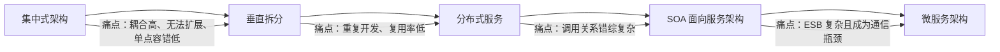

# 从一台服务器扛全部功能到微服务：系统架构是怎么一步步演变的

业务越做越多，一个工程里的功能模块互相牵扯，改一处要动一片，跑得越来越慢，出一次故障整站不可用。这些问题不是代码写得不够好，而是架构形态撑不住了。

想搞懂 Spring Cloud 为什么是现在这个样子，得先看清它要替代的东西是什么。下面按真实演进顺序梳理五种架构形态，每一步都是被上一步的某个具体缺点逼出来的。

## 先给结论

- 架构演进的顺序是：集中式架构、垂直拆分、分布式服务、SOA 面向服务架构、微服务架构。
- 演进的主线是两件事：一是把大系统拆小，二是把服务之间的调用关系管起来。
- 集中式架构开发快、成本低，但耦合高、无法水平扩展、单点容错率低。
- 垂直拆分解决了并发与扩展问题，代价是重复开发；分布式服务消除重复代码，代价是调用关系错综复杂。
- SOA 用 ESB 企业服务总线把复杂调用收拢到一根管道，代价是 ESB 自身复杂且成为通信瓶颈。
- 微服务本质也是一种 SOA，区别在于粒度更细，并且用服务注册中心取代 ESB。

## 一、集中式架构：全部功能塞进一个系统

网站流量很小的时候，只需要一个应用，把所有功能部署在一起，以减少部署节点和成本。商品管理、订单管理、用户管理、购物车管理、权限管理、内容管理这些模块写在同一份代码里，打成一个包，跑在一台服务器上，共用一个数据库。

**优点非常实在。** 开发速度快，维护成本低，调试测试都方便，适合并发要求不高的系统。

**缺点同样明显，而且四条都致命。** 代码耦合度高，模块之间互相调用，后期维护困难；无法针对单个模块做优化，任何一个模块要特别处理，整包都得跟着动；无法水平扩展，想给高频模块做集群，只能把整个系统整体复制；单点容错率低，一个模块出问题导致进程崩溃，其他正常的模块也一起不可用。

## 二、垂直拆分：按业务切成多个独立子系统

访问量上来之后，单个应用扛不住，于是按业务功能把系统拆开，原来的一个应用变成用户中心、搜索系统、后台管理系统、认证中心等若干独立子系统。

**第一，流量被分担了。** 请求从集中打到一个系统，变成分散到多个子系统，单台服务器的并发压力下降。

**第二，可以针对性优化和水平扩展。** 子系统彼此独立，给搜索系统加机器、给认证中心做优化都不会影响别人，前面挂反向代理就能做负载均衡。

**第三，容错率提高。** 某个子系统宕机，只影响它对应的那块业务，其他业务照常可用。

代价是重复开发。用户中心和后台管理系统都要用到商品相关逻辑，就得各写一遍，同样的代码维护两份，开发效率被拖累。

## 三、分布式服务：把共用逻辑抽成独立服务

既然重复代码是痛点，就把它抽出来。垂直应用越来越多之后，核心业务被抽取成独立服务，供各个应用调用：认证服务、消息服务、缓存服务、基础服务各自独立部署，谁要用就调谁。

**解决了什么问题。** 代码不再重复编写，复用率和开发效率都上来了。

**带来了什么问题。** 服务一多，调用关系就变成一张网。每个应用都要自己记住该调哪个服务、地址是什么、失败怎么处理，这种错综复杂的依赖关系导致耦合度高、难以维护。

## 四、SOA：用 ESB 把调用关系收拢到一根管道

SOA（Service Oriented Architecture，面向服务的架构）是一种设计方法，包含多个服务，服务之间通过相互依赖最终提供一系列功能。一个服务通常以独立形式存在于操作系统进程中，各个服务之间通过网络调用。

SOA 的结构里多了一个关键组件：ESB 企业服务总线。可以把它想象成一根管道，把所有服务节点连起来，由它统一做消息的转换、解释和路由，让不同协议、不同系统的服务互联互通。

这样做的好处是应用不再需要自己处理复杂的调用关系，调用被 ESB 屏蔽掉了。

坏处也出在 ESB 身上。

**第一，ESB 自身实现复杂。** 它承担协议转换、数据转换、路由，不同厂商的产品还有差异，部署、测试、运维都麻烦。

**第二，所有服务走同一条通路，通信速度下降。** ESB 从解耦功臣变成性能瓶颈，成也它，败也它。

## 五、微服务：去掉 ESB，改用服务注册中心

微服务架构也是一种 SOA，区别在于两点：业务拆分粒度更细，以及不再基于 ESB。

它的做法是把服务地址注册到一个服务治理中心统一管理，应用需要调用某个服务时，从注册中心拿到地址再发起访问，不用自己记录和维护这些地址。ESB 那根集中管道被去掉，服务之间直接通信，性能瓶颈消失。

微服务的具体特征和与 SOA 的详细差异，会在下一节展开。

整条演进脉络如下：



每两个节点之间的箭头上标的就是推动演进的那个具体缺点。记住这条因果链，比背每种架构的优缺点清单要牢靠得多。

## 六、用一段代码看「服务之间通过网络调用」

架构演变这节课本身是理论课，没有配套工程。下面这段代码取自同日资料里的示例工程 `http-demo`，它演示的正是分布式服务与 SOA 阶段的核心动作：一个应用通过网络去调用另一个服务提供的接口。

先把 `RestTemplate` 注册成 Bean：

```java
package com.example;

import org.springframework.boot.SpringApplication;
import org.springframework.boot.autoconfigure.SpringBootApplication;
import org.springframework.context.annotation.Bean;
import org.springframework.web.client.RestTemplate;

@SpringBootApplication
public class HttpDemoApplication {

    public static void main(String[] args) {
        SpringApplication.run(HttpDemoApplication.class, args);
    }

    @Bean
    public RestTemplate restTemplate() {
        return new RestTemplate();
    }
}
```

然后像调本地方法一样发起远程调用：

```java
package com.example.test;

import com.example.pojo.User;
import org.junit.Test;
import org.junit.runner.RunWith;
import org.springframework.beans.factory.annotation.Autowired;
import org.springframework.boot.test.context.SpringBootTest;
import org.springframework.test.context.junit4.SpringRunner;
import org.springframework.web.client.RestTemplate;

@RunWith(SpringRunner.class)
@SpringBootTest
public class RestTemplateTest {

    @Autowired
    private RestTemplate restTemplate;

    @Test
    public void test() {
        String url = "http://localhost/user/8";
        // RestTemplate 会把返回的 json 字符串反序列化成对象
        User user = restTemplate.getForObject(url, User.class);
        System.out.println(user);
    }
}
```

这段代码写起来很干净，但它把分布式架构的隐含成本全暴露出来了：地址 `http://localhost/user/8` 是硬编码的，服务换机器、加实例、下线都得改代码。到了微服务阶段，这个写死的地址就会被注册中心里的服务名取代，这也是后面 Spring Cloud 要解决的头一个问题。

需要说明的是，以上两段是本课配套资料中的示例工程代码，用于演示服务间调用，并非本课程要你实现的功能。

## 常见误区

- **以为垂直拆分等于微服务。** 垂直拆分出来的是按业务划分的独立子系统，粒度粗，且子系统内部仍然是单体；微服务要求单一职责、服务粒度小、面向服务对外暴露 REST 接口。
- **以为 SOA 和微服务只是叫法不同。** 二者是包含关系，微服务是一种 SOA，关键差异在是否使用 ESB 以及拆分粒度。用了 ESB 的 SOA 不等于微服务。
- **以为拆得越细越好。** 服务数量上升会带来调用链变长、排查困难、部署运维成本上升，拆分粒度应与团队规模和业务边界匹配。
- **把「分布式」当成架构目标。** 分布式是手段不是目的，它解决的是重复开发和复用问题，解决不了调用关系混乱，后者要靠服务治理。

## 面试可能被问到的问题

1. 面试官追问：「系统架构的演进过程是怎样的？」
   答：集中式架构、垂直拆分、分布式服务、SOA 面向服务架构、微服务架构。每一步都是为了解决上一步的缺点：集中式耦合高无法扩展所以垂直拆分；垂直拆分重复开发所以抽取分布式服务；分布式服务调用关系复杂所以引入 ESB 做 SOA；ESB 复杂且成为通信瓶颈所以演进到微服务。

2. 面试官追问：「集中式架构有哪些缺点？」
   答：代码耦合度高，后期维护困难；无法针对单个模块做优化和水平扩展，要扩展只能整体复制；单点容错率低，一个模块故障会导致整个系统不可用；并发能力差。优点是开发速度快、维护成本低、适合并发要求不高的系统。

3. 面试官追问：「垂直拆分解决了什么问题，又带来了什么问题？」
   答：解决了并发压力和扩展问题，流量被分担到多个子系统，可以针对性优化、方便水平扩展和负载均衡、容错率提高。带来的问题是系统间相互独立导致大量重复开发，同一份逻辑要在多个子系统各写一遍，影响开发效率。

4. 面试官追问：「SOA 中的 ESB 是什么，有什么作用？」
   答：ESB 是企业服务总线，可以看作连接各个服务节点的管道。它负责消息的转换、解释和路由，让不同系统、不同协议的服务互联互通，从而屏蔽了应用侧的复杂调用关系。缺点是自身实现复杂，部署测试运维困难，且所有服务都通过它通信会降低通信速度。

5. 面试官追问：「微服务架构和 SOA 架构的区别是什么？」
   答：微服务本质上也是一种 SOA。区别在于微服务没有使用 ESB，而是把服务注册到服务治理中心统一管理地址，应用从注册中心获取地址后直接调用；同时微服务的业务拆分粒度更细，强调单一职责、服务粒度小、面向服务对外暴露 REST 接口、服务之间相互独立。

6. 面试官追问：「为什么集中式架构无法水平扩展？」
   答：水平扩展的前提是只给压力大的那部分加机器。集中式架构把所有模块打成一个整体部署在同一台服务器上，要对某个高频模块做集群，只能把整个系统完整复制一份，成本不合理，因此实际上做不到按模块扩展。

## 配套资料

- 课堂笔记：`materials/code/01/2.springcloud/2.springcloud/day01/笔记/Spring Cloud 第一天课堂笔记.md`
  （含架构演变图、微服务架构特点、服务调用方式等本节要点）
- 示例工程：`materials/code/01/2.springcloud/2.springcloud/day01/资料/http-demo/`
  （文中引用的 `HttpDemoApplication.java` 与 `RestTemplateTest.java` 出自该工程，用于演示服务间远程调用，源码包名已统一改为中性的 `com.example`）
- 本节为理论课，无专属实现工程，上述代码为同日资料中的示例工程代码
