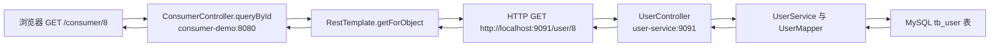
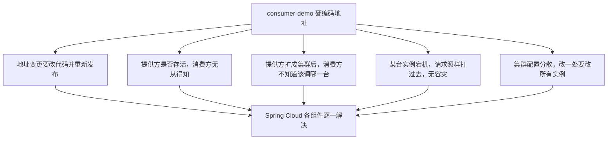

# 用 RestTemplate 打通两个微服务：搭建 consumer-demo 并调用 user-service

上一个工程 `user-service` 已经能在 9091 端口按 id 吐出用户 JSON，但数据只能躺在它自己的浏览器里。真实业务中订单服务要查用户、积分服务也要查用户，谁要调用，谁就被迫记住对方的地址。这一节搭一个服务消费工程 `consumer-demo`，让它对外暴露 `http://localhost:8080/consumer/8`，内部用 `RestTemplate` 去访问 `http://localhost:9091/user/8`，再把结果原样交回浏览器。

这段代码跑通非常快，几分钟就能看到结果。跑通之后你会发现它极其脆弱：地址写死在代码里，服务换个端口整套调用就断。后面引入注册中心，要解决的就是这种脆弱。

## 先给结论

- `consumer-demo` 只依赖一个 `spring-boot-starter-web`，它本身不连数据库。
- `RestTemplate` 不会凭空出现在容器里，必须在引导类中用 `@Bean` 注册一个，否则注入时报 `NoSuchBeanDefinitionException`。
- 消费端也需要一份 `User` 类，但它不碰数据库，实体上用于 ORM 映射的注解要全部删掉，只留字段。
- 端口按约定分开：`user-service` 用 9091，`consumer-demo` 用默认 8080，验证时要同时启动两个工程。
- 硬编码调用能跑，但留下五个问题：地址难维护、服务状态不可知、无法负载均衡、没有容灾能力、配置不统一，这些由 Spring Cloud 各组件逐一解决。

## 一、需求与调用链路

需求一句话：访问 `http://localhost:8080/consumer/8`，由消费工程使用 `RestTemplate` 获取 `http://localhost:9091/user/8` 的数据并返回。

一次请求要穿过两个进程，链路如下：



图上有两个新概念。服务提供方是 `user-service`，真正操作数据库、对外提供查询能力；服务消费方是 `consumer-demo`，自己没有数据，靠 HTTP 客户端向提供方要数据。`RestTemplate` 就是 Spring 提供的那个 HTTP 客户端，把「发请求、拿响应、把 JSON 反序列化成对象」封装成了一个方法调用。

按这条链路，搭建分四步：添加 web 启动器依赖、创建引导类并注册 `RestTemplate`、编写处理器 `ConsumerController`、启动测试。

## 二、工程依赖：只要一个 web 启动器

`consumer-demo` 作为父工程下的子模块，pom 只声明自己要用的东西，版本由父工程仲裁：

```xml
<project xmlns="http://maven.apache.org/POM/4.0.0"
         xmlns:xsi="http://www.w3.org/2001/XMLSchema-instance"
         xsi:schemaLocation="http://maven.apache.org/POM/4.0.0 http://maven.apache.org/xsd/maven-4.0.0.xsd">
    <modelVersion>4.0.0</modelVersion>

    <parent>
        <groupId>com.example</groupId>
        <artifactId>springcloud-parent</artifactId>
        <version>1.0-SNAPSHOT</version>
    </parent>

    <artifactId>consumer-demo</artifactId>

    <dependencies>
        <!-- web 启动器，消费工程只需要能接收请求、发出请求 -->
        <dependency>
            <groupId>org.springframework.boot</groupId>
            <artifactId>spring-boot-starter-web</artifactId>
        </dependency>
    </dependencies>
</project>
```

这里没有数据库相关的任何坐标。消费方不直接查库，它拿到的是提供方序列化好的 JSON。

## 三、引导类：把 RestTemplate 注册进容器

引导类比普通的 Spring Boot 工程多一个方法：

```java
package com.example.consumer;

import org.springframework.boot.SpringApplication;
import org.springframework.boot.autoconfigure.SpringBootApplication;
import org.springframework.context.annotation.Bean;
import org.springframework.web.client.RestTemplate;

@SpringBootApplication
public class ConsumerApplication {

    public static void main(String[] args) {
        SpringApplication.run(ConsumerApplication.class, args);
    }

    /**
     * 注册 RestTemplate，交给 Spring 管理，处理器里直接注入
     */
    @Bean
    public RestTemplate restTemplate() {
        return new RestTemplate();
    }
}
```

课程资料里示例工程的写法与之一致，也是这样在引导类中返回 `new RestTemplate()`：

```java
@SpringBootApplication
public class HttpDemoApplication {
    public static void main(String[] args) {
        SpringApplication.run(HttpDemoApplication.class, args);
    }

    @Bean
    public RestTemplate restTemplate() {
        return new RestTemplate();
    }
}
```

**为什么一定要注册成 Bean？** `RestTemplate` 不是 Spring Boot 自动配置提供的对象，`@Autowired` 拿不到凭空存在的实例。注册进容器之后，它可以在启动阶段完成一次初始化，各处复用同一个实例，后续要加拦截器、换消息转换器、接负载均衡都只改这一处。在 Controller 里每次 `new RestTemplate()` 虽然能跑，但那等于放弃了统一配置的能力。

## 四、实体类：消费端的 User 要瘦身

消费端的 `User` 只用来接收反序列化结果，不参与 ORM 映射，所以通用 Mapper 用的 `@Table`、`@Id`、`@KeySql` 全部删除，只保留字段：

```java
package com.example.consumer.pojo;

import lombok.Data;

import java.util.Date;

@Data
public class User {
    private Long id;

    // 用户名
    private String userName;

    // 密码
    private String password;

    // 姓名
    private String name;

    // 年龄
    private Integer age;

    // 性别，1男性，2女性
    private Integer sex;

    // 出生日期
    private Date birthday;

    // 创建时间
    private Date created;

    // 更新时间
    private Date updated;

    // 备注
    private String note;
}
```

字段名必须和提供方返回的 JSON 完全一致。`user-service` 返回的是 `userName`、`created` 这些驼峰 key，消费端字段名写成 `username` 时不会报错，只会静默变成 `null`，这是排查时最费时间的一类错。真实项目里通常把这类公用类抽到独立的 API 模块供双方依赖，课程为了保持两个工程互不依赖才直接复制了一份。

## 五、处理器：用 getForObject 发起远程调用

```java
package com.example.consumer.controller;

import com.example.consumer.pojo.User;
import org.springframework.beans.factory.annotation.Autowired;
import org.springframework.web.bind.annotation.GetMapping;
import org.springframework.web.bind.annotation.PathVariable;
import org.springframework.web.bind.annotation.RequestMapping;
import org.springframework.web.bind.annotation.RestController;
import org.springframework.web.client.RestTemplate;

@RestController
@RequestMapping("/consumer")
public class ConsumerController {

    @Autowired
    private RestTemplate restTemplate;

    @GetMapping("/{id}")
    public User queryById(@PathVariable Long id) {
        // 暂时硬编码服务提供方的地址，后面交给注册中心解决
        String url = "http://localhost:9091/user/" + id;
        return restTemplate.getForObject(url, User.class);
    }
}
```

`getForObject(url, User.class)` 的语义很直白：按这个地址发一个 GET，把响应体转成 `User` 对象返回。返回值刚好可以直接作为处理器方法的返回值，`@RestController` 会把它再次序列化成 JSON 写回浏览器，`return` 一行就够了。

## 六、启动与验证

两个工程都要起来。先启动 `user-service` 的 `UserApplication`，控制台出现 `Tomcat started on port(s): 9091`；再启动 `consumer-demo` 的 `ConsumerApplication`，日志里是：

```text
Tomcat started on port(s): 8080 (http) with context path ''
Started ConsumerApplication in 3.377 seconds
```

消费工程没有在配置文件里写 `server.port`，所以走默认的 8080，这也是需求里写成 `localhost:8080/consumer/8` 的原因。验证结果：

```bash
curl http://localhost:8080/consumer/8
curl http://localhost:9091/user/8
```

两条命令返回的数据应当完全一致，因为前者只是在内存中转发了后者的结果。

## 七、跑通之后，问题才刚开始

现在把视角从「能不能调通」换成「能不能上线」，这段代码的短板立刻暴露出来：



逐一展开。**第一，地址硬编码。** `http://localhost:9091` 写死在 Controller 里，将来地址变了必须改代码、重新编译、重新发布，违背持续交付降低管理成本的初衷。**第二，状态不可知。** 9091 那台实例是否启动、是否健康，消费工程完全不清楚，对方挂了它也照样发请求，只能等到连接超时。**第三，没有负载均衡。** 提供方一旦扩成 9091、9092、9093 多个实例，消费方要在多个地址里挑一个，这个选择逻辑还得自己实现。**第四，缺少容灾。** 挑中的那台实例不可用时应能自动换一台，现在没有这个能力。**第五，配置不统一。** 集群里每台的同一个配置项都得手动同步。

概括起来就是分布式服务必然面对的服务治理问题：如何自动注册与发现、如何监管服务状态、如何实现动态路由、如何实现负载均衡、如何解决容灾、如何统一配置。以上问题都可以在 Spring Cloud 的组件中找到答案，下一步先让服务自己报到处报到。

## 常见误区

- **忘了注册 `RestTemplate`**：Controller 里 `@Autowired` 注入时启动即失败，提示没有该类型的 Bean。补上引导类里的 `@Bean` 方法即可。
- **复制实体类时保留 ORM 注解**：消费端没有引入通用 Mapper 依赖，`@Table`、`@Id` 会直接编译不过；删掉即可，因为消费端不做数据库字段映射。
- **字段名与返回 JSON 不一致**：不报错但值为 `null`，例如把 `userName` 写成 `username`。对照提供方的返回内容逐个核字段。
- **两个工程端口冲突**：都留默认 8080 时，后启动的那个会因端口占用而失败。约定 `user-service` 用 9091，消费方保持 8080。
- **URL 拼接漏了 id**：写成 `"http://localhost:9091/user/"` 而不拼 `id`，拿到的是提供方路径匹配失败的错误，不是数据。

## 面试可能被问到的问题

1. 面试官追问：「`RestTemplate` 是什么，为什么不用原生 `HttpURLConnection`？」
   答：`RestTemplate` 是 Spring 提供的同步 HTTP 客户端模板类，封装了发请求、处理状态码、用消息转换器把响应反序列化成对象等步骤。`getForObject` 一行就能拿到目标类型的对象，原生写法要自己管连接、流、编码和 JSON 转换，还要处理异常。

2. 面试官追问：「为什么要把 `RestTemplate` 注册成 Bean，而不是在用的地方 `new` 一个？」
   答：注册成 Bean 可以在一处完成初始化并复用同一个实例，也方便统一加拦截器、更换消息转换器，后期接入负载均衡时由容器注入增强后的实例。每次 `new` 出来的对象彼此独立，无法享受这些统一配置。

3. 面试官追问：「`getForObject` 和 `getForEntity` 有什么区别？」
   答：`getForObject` 只返回反序列化后的响应体；`getForEntity` 返回 `ResponseEntity`，除了响应体还带状态码、响应头等信息。需要判断 404、读取自定义响应头时用后者，只要数据时用前者。

4. 面试官追问：「消费方为什么要自己定义一份 `User` 类？」
   答：因为两个工程之间没有依赖关系，远程调用传的是 JSON，消费方必须有一个结构一致的本地类型来承接反序列化结果。工程拆分到一定程度后，通常把这类 DTO 抽到公共 API 模块，由双方共同依赖，避免两边字段各写各的。

5. 面试官追问：「硬编码服务地址会带来哪些具体问题？」
   答：地址变更需要改代码并重新发布；消费方无法感知提供方是否存活；提供方集群后消费方要自己实现地址选择；实例宕机后请求仍会打过去导致失败；集群配置还需要逐一手工同步。这些问题分别对应服务注册发现、健康检查、负载均衡、熔断降级和配置中心。

6. 面试官追问：「`consumer-demo` 为什么也继承了父工程？」
   答：父工程负责统一仲裁依赖版本，子模块只需声明要用的坐标。没有父工程时每个子模块各写一份版本号，多个微服务之间很容易出现 Spring Boot 与 Spring Cloud 版本不匹配的问题。

## 配套资料

- `materials/code/01/2.springcloud/2.springcloud/day01/资料/http-demo/`：课程自带的 `RestTemplate` 示例工程，内含注册了 `RestTemplate` 的引导类 `HttpDemoApplication.java`、实体类 `User.java`、测试类 `RestTemplateTest.java`，文中的包名已统一改为 `com.example`
- 本课 `consumer-demo` 工程未在资料包中提供成品源码，正文中的 `ConsumerApplication` 与 `ConsumerController` 按课堂实录还原，可直接编译运行
- 课堂笔记：`materials/code/01/2.springcloud/2.springcloud/day01/笔记/Spring Cloud 第一天课堂笔记.md`（第 8 节含需求、实现步骤与服务治理问题清单）
