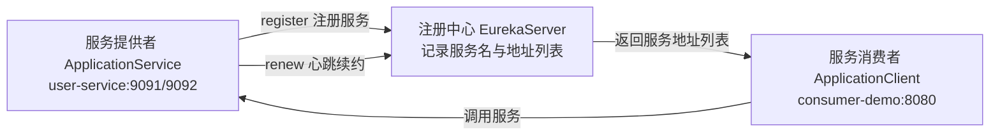
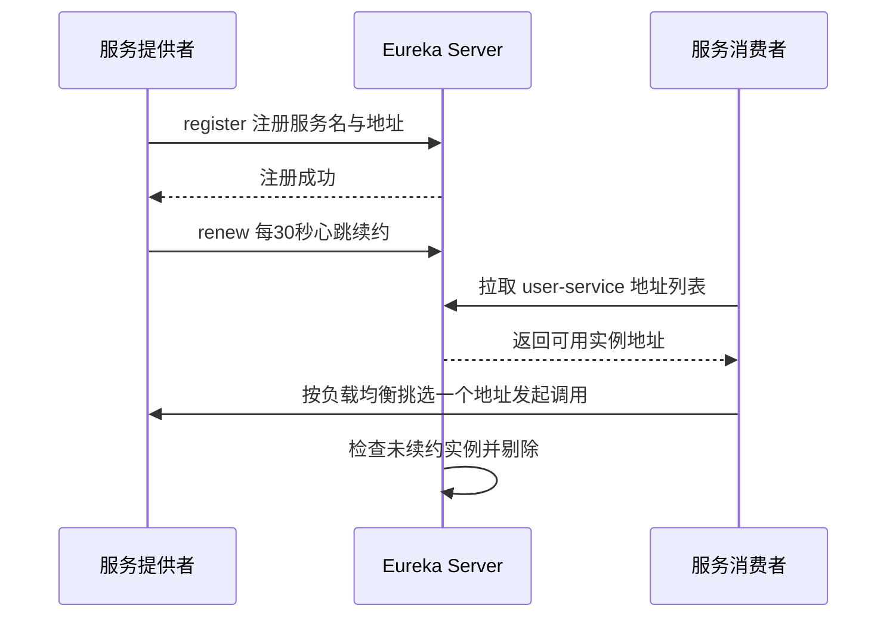

# Eureka 注册中心到底解决了什么：把「记住地址」这件事交给注册中心

上一节里 `consumer-demo` 把 `http://localhost:9091` 直接写进了 Controller。本地跑两个服务没问题，一旦拆出十几个微服务，每个调用方都要人工维护一张地址表，提供方挪个端口就得改代码重新发布，测试和运维也得跟着返工。开发与运维希望的是发布运维自动化、管理成本下降，硬编码地址的做法正好与之相反。

这一节不写代码，先把注册中心的角色、职责和工作流程讲清楚：Eureka 是什么，它在一次调用里站在哪个位置，服务是怎么被记录又怎么被剔除的。

## 先给结论

- Eureka 的主要功能是服务管理：登记谁能提供服务、定期检查服务状态、把可用的服务地址列表返回给调用方。
- 它有三个角色：服务提供者（Application Service）、服务消费者（Application Client）、注册中心（Eureka Server）。
- 工作流程是五步：提供者实例化服务、注册到 Eureka、消费者拉取服务列表、基于负载均衡挑一个地址调用、提供者持续心跳续约。
- Eureka Server 会检查哪些实例没有按时心跳，并在一定时间后把它们从地址列表中剔除，返回出去的列表基本都是可用的。
- 硬编码调用暴露的五个问题（地址变更、状态未知、负载均衡、容灾、统一配置），都由 Spring Cloud 的各组件分别解决。

## 一、为什么必须有注册中心

服务提供方要对外暴露自己的地址，服务调用方要记住这个地址，地址变更还得及时同步。服务少的时候这点负担可以忽略，项目一旦按业务拆成十几甚至几十个微服务，人为管理地址的开发、测试、发布、运维成本都会失控。

一个更直观的类比是网约车。早些年街上到处是车，路人并不知道哪辆车愿意载客；网约车平台出现后，想接单的车辆全部注册到平台，平台记录车型与身份，乘客只需要打开 App 说出目的地，平台自动派一辆符合条件的车到面前。乘客不必记任何车牌，车也不用自己招手揽客。

Eureka 扮演的就是这个平台的角色：服务不用自己找调用方，调用方也不用自己找服务，双方都只跟注册中心打交道。调用方把需求（服务名）告诉 Eureka，Eureka 返回符合条件的实例地址；提供方向 Eureka 注册自己并持续上报活着的状态，出问题就被剔除，这便是自动注册发现与状态监控。

## 二、三个角色与一次完整的调用

下图是课程里的原理图结构，箭头标注了各方之间的交互方式：



**服务提供者**是被调用的一方，比如 `user-service`，向外提供按 id 查询用户的能力。**服务消费者**是发起调用的一方，比如 `consumer-demo`。**注册中心**自身既不提供服务也不消费服务，它存在的意义就是维护一张「服务名到实例地址」的登记表。

把一轮完整调用拆成五步：

**第一步，实例化服务。** 提供方先把自己的服务跑起来，这是能提供服务的前提。

**第二步，把服务注册到 Eureka。** 提供方启动后向注册中心登记，注册中心记下服务名与地址的对应关系，形如 `user-service` 对应 `http://localhost:9091`。同一个服务名可以对应多个地址，集群场景下 9092、9093 都会被挂在同一个服务名下。

**第三步，消费者拉取服务列表。** 消费者不再写死地址，而是向注册中心问一句「`user-service` 有哪些实例」，拿到的是一个地址列表而不再是单个地址。

**第四步，按负载均衡挑一个地址调用。** 消费者从列表里选出一个地址发起请求，选择的策略由负载均衡器承担，这一步就是动态路由与负载均衡的落点。

**第五步，提供者持续心跳续约。** 提供者定期向注册中心发送心跳，告诉它这个实例还活着；注册中心检查那些没有按时续约的实例，超过一定时间就把它们剔除出地址列表，后续返回的列表里不会再包含它们，从根上避免了把请求打到已挂实例上。



两张图合起来看，注册中心把「谁知道谁在哪」这件易变的事收敛到了一处，服务之间的耦合从地址级降到了服务名级。

## 三、心跳、续约与失效剔除

这是原理里最容易被跳过、也最容易在面试中被追问的一段。

**第一，心跳是客户端主动发起的。** 实例定期向注册中心发送续约请求，告知自己仍然可用。默认间隔是 30 秒，通过 `eureka.instance.lease-renewal-interval-in-seconds` 调整。

**第二，长时间收不到心跳就会被判失效。** 服务端在 `lease-expiration-duration-in-seconds`（默认 90 秒）内没有收到某个实例的心跳，会把它标记为失效；再由服务端的失效剔除任务按 `eviction-interval-timer-in-ms`（默认 60 秒）的节奏真正删除。

**第三，这里的删除是「软」的。** Eureka 的注册表存在多级缓存，客户端本地也缓存地址列表且默认 30 秒才刷新一次（`registry-fetch-interval-seconds`），所以实例下线到彻底不再被调用存在一段延迟窗口，这是 AP 模型的取舍：宁可短时间返回过期地址，也要保证注册中心自身始终可用。这段延迟正是后面熔断与重试机制存在的理由。

相关的配置项集中在客户端和服务端两侧：

```yaml
eureka:
  instance:
    # 续约间隔，默认30秒
    lease-renewal-interval-in-seconds: 30
    # 服务失效时间，默认90秒
    lease-expiration-duration-in-seconds: 90
  client:
    # 获取服务地址列表的间隔，默认30秒
    registry-fetch-interval-seconds: 30
  server:
    # 失效剔除任务的间隔，默认60秒
    eviction-interval-timer-in-ms: 60000
```

这些值在生产上常被调小，好让故障实例更快被感知；开发环境里把失效时间调得太激进，则会因为一次网络抖动就让实例反复上下线。

## 四、注册中心之外的问题

注册中心解决的是服务管理这一类问题：自动注册发现、状态监管、动态路由。剩下的三件事由 Spring Cloud 的其他组件接手。负载均衡负责在多个地址中挑一个，对应 Ribbon；容灾负责在依赖出问题时快速失败或降级，对应 Hystrix；统一配置负责让集群共享一份配置，对应 Spring Cloud Config。学习目标就是把上一节那张问题清单逐项对应到具体组件上。

想确认注册中心里究竟登记了些什么，可以直接访问它暴露的 REST 接口，返回的是 XML 格式的实例清单：

```bash
# 查看注册到 Eureka 上的全部应用清单
curl http://127.0.0.1:10086/eureka/apps

# 查看某个应用名下的实例
curl http://127.0.0.1:10086/eureka/apps/USER-SERVICE
```

返回内容里的 `app` 节点就是服务名，`instanceId`、`ipAddr`、`port` 描述具体实例，`status` 为 `UP` 表示可用。管理页面展示的其实就是这份数据。

## 常见误区

- **以为注册中心会转发请求**：Eureka 只登记和返回地址，真正的数据流量不经过它，调用仍然是消费者直连提供者。
- **把服务名和实例地址混为一谈**：注册表中一个服务名对应多个地址，代码里用服务名寻址，具体地址由负载均衡在运行时挑选。
- **以为实例停了会立刻消失**：受心跳间隔、失效时间和多级缓存影响，存在数十秒的感知延迟，所以调用方必须有超时与容错处理。
- **忽略自我保护模式**：Eureka 在短时间内丢失大量心跳时会进入自我保护，保留那些可能已失效的实例而不剔除，此时控制台会提示异常，不要误判为 bug。
- **把注册中心当成配置中心用**：两者职责不同，统一的外部化配置要由专门的配置组件承担。

## 面试可能被问到的问题

1. 面试官追问：「Eureka 的主要功能是什么？」
   答：进行服务管理，具体是三件事：登记服务提供者上报的服务名与地址（自动注册发现）、通过心跳定期检查服务状态（状态监管）、把可用的服务地址列表返回给服务消费者（支撑动态路由）。

2. 面试官追问：「Eureka 里有哪几个角色？」
   答：服务提供者 Application Service，向注册中心注册并续约；服务消费者 Application Client，从注册中心拉取服务列表并发起调用；注册中心 Eureka Server，维护服务注册表，自身不提供也不消费任何业务服务。

3. 面试官追问：「一次远程调用在 Eureka 体系里是怎么走通的？」
   答：提供者实例化服务后向 Eureka 注册；消费者从 Eureka 拉取该服务名的地址列表；按负载均衡策略从中选一个地址发起调用；提供者持续发送心跳续约，未按时续约的实例会被服务端剔除，不再返回给消费者。

4. 面试官追问：「Eureka 的心跳机制是怎样的，实例下线后多久能被感知？」
   答：客户端默认每 30 秒发送一次续约心跳，服务端在默认 90 秒未收到后判定失效，再由默认 60 秒一次的剔除任务删除。客户端侧还有 30 秒的服务列表缓存刷新间隔，因此感知延迟通常在分钟级，这也是为什么调用方必须配合超时、重试与熔断。

5. 面试官追问：「使用注册中心后，服务之间的地址还需要写死吗？」
   答：不需要。调用方只依赖服务名，由注册中心负责把服务名解析成实例地址列表，再由负载均衡器选择具体实例。服务迁移、扩容、改端口都只影响注册表，不需要修改调用方代码。

6. 面试官追问：「Eureka 为什么选择 AP 而不是 CP？」
   答：注册中心一旦不可用会影响整个服务体系的调用，因此优先保证可用性与分区容错：节点之间数据可以短暂不一致，允许返回可能过期的地址列表，配合客户端缓存与容错机制弥补。相比之下，ZooKeeper 这类 CP 系统在选主期间会拒绝服务。

## 配套资料

- 课堂笔记：`materials/code/01/2.springcloud/2.springcloud/day01/笔记/Spring Cloud 第一天课堂笔记.md`（第 9 节为 Eureka 注册中心说明，含其功能小结与原理图；第 13 节含心跳续约、失效剔除、自我保护等配置项原文）
- 本课为基础原理讲解，资料包中没有对应的源码工程，正文中的配置项取自上述笔记
