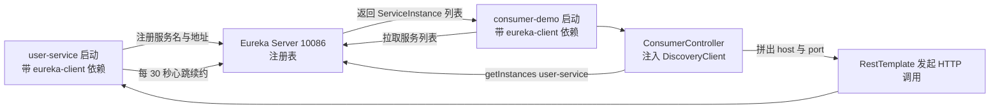

# 服务注册与发现：把 user-service 交给 Eureka，让 consumer-demo 按服务名调用

注册中心跑起来了，管理页面却空空荡荡。原因是没人往里登记。服务提供方 `user-service` 和消费方 `consumer-demo` 目前只是两个各自启动的 Spring Boot 应用，`consumer-demo` 的 Controller 里还写着 `http://localhost:9091/user/` 这样的硬编码地址，端口一改就得重新发版。

这一节做的事就是把这条硬编码删掉：让 `user-service` 启动后自动注册到 Eureka，让 `consumer-demo` 只凭服务名 `user-service` 问出真实地址，再发起调用。

## 先给结论

- 服务注册是在**提供方**加 Eureka 客户端依赖，效果是应用启动后自动把自己的服务名和地址登记到注册中心。
- 服务发现是在**消费方**加同样的客户端依赖，效果是可以用 `DiscoveryClient` 按服务名取出地址列表。
- 两边都要做三件事：加依赖、引导类加 `@EnableDiscoveryClient`、配置文件里指定 `defaultZone`。
- 消费方比提供方多一步：改造 Controller，把拼地址的 `localhost` 换成从实例对象里取出来的 `host` 与 `port`。
- 依赖坐标是 `spring-cloud-starter-netflix-eureka-client`，和注册中心的 `eureka-server` 只差一个词。

## 一、注册与发现各自解决哪半边问题

**服务注册**管的是「别人怎么知道我在哪」。服务提供方把 Eureka 客户端依赖放进工程，应用启动时客户端会主动向 `defaultZone` 指定的地址发送注册请求，注册中心记下服务名与实例地址的对应关系，之后按固定间隔发心跳续约。这一步不需要你写任何注册代码，依赖加对了就会发生。

**服务发现**管的是「我怎么知道别人在哪」。服务消费方同样引入客户端依赖，就能拿到 Spring Cloud 提供的 `DiscoveryClient` 工具，用服务名换回一组 `ServiceInstance` 实例对象，每个对象里带着 `host`、`port`、`serviceId`，拿它们拼出真实 URL 再交给 `RestTemplate` 发送。

两边用的依赖是同一个，注册中心的依赖才不一样，三者的坐标对比如下：

```xml
<!-- 注册中心：服务端 -->
<dependency>
    <groupId>org.springframework.cloud</groupId>
    <artifactId>spring-cloud-starter-netflix-eureka-server</artifactId>
</dependency>

<!-- 服务提供方与服务消费方：客户端，两个工程加的是同一个 -->
<dependency>
    <groupId>org.springframework.cloud</groupId>
    <artifactId>spring-cloud-starter-netflix-eureka-client</artifactId>
</dependency>
```

版本号照例不写，父工程已经通过 `spring-cloud-dependencies` 以 `scope=import` 的方式锁定了 `Greenwich.SR1`，子模块只声明坐标即可。

## 二、改造服务提供方 user-service

**第一，加客户端依赖。** 打开 `user-service` 的 pom，把上面那个 `eureka-client` 坐标放进 `dependencies`。

**第二，引导类加注解。** `UserApplication` 上原本只有 `@SpringBootApplication` 和通用 Mapper 的扫描配置，现在补一个 `@EnableDiscoveryClient`：

```java
package com.example.user;

import org.springframework.boot.SpringApplication;
import org.springframework.boot.autoconfigure.SpringBootApplication;
import org.springframework.cloud.client.discovery.EnableDiscoveryClient;

@SpringBootApplication
@EnableDiscoveryClient
public class UserApplication {

    public static void main(String[] args) {
        SpringApplication.run(UserApplication.class, args);
    }
}
```

`@EnableDiscoveryClient` 的含义是开启 Eureka 客户端发现功能，它让当前应用具备「向注册中心注册自己」和「从注册中心查询别人」两种能力。提供方和消费方的引导类都要加，注解本身是同一个。

**第三，改配置文件。** 提供方必须告诉客户端注册中心在哪，同时要有一个能被别人引用的服务名：

```yaml
server:
  port: 9091
spring:
  application:
    name: user-service
  datasource:
    driver-class-name: com.mysql.jdbc.Driver
    url: jdbc:mysql://localhost:3306/springcloud
    username: root
    password: root
eureka:
  client:
    service-url:
      # Eureka 服务地址，必须与 eureka-server 暴露的一致
      defaultZone: http://127.0.0.1:10086/eureka
```

`spring.application.name` 是服务名，注册中心管理页面上显示的 `USER-SERVICE` 就来自它，消费者查询时用的也是它，大小写不敏感。这项配置此前一直是空的，不写的话注册上去的应用名会是一个默认值，消费方按 `user-service` 查就会查空。

启动 `UserApplication`，打开 `http://127.0.0.1:10086` 刷新，实例列表里出现状态为 `UP` 的 `USER-SERVICE`，地址是 9091，注册这一步就完成了。

## 三、改造服务消费方 consumer-demo

消费方的前三步和提供方完全一样：加 `eureka-client` 依赖、`ConsumerApplication` 上加 `@EnableDiscoveryClient`、配置文件里写应用名和 `defaultZone`。应用名取 `consumer-demo`，`defaultZone` 同样指向 `http://127.0.0.1:10086/eureka`。

真正的差别在 Controller。改造前的写法把 host、port、id 全写死了：

```java
@GetMapping("/{id}")
public User queryById(@PathVariable Long id) {
    String url = "http://localhost:9091/user/" + id;
    return restTemplate.getForObject(url, User.class);
}
```

改造后注入 `DiscoveryClient`，先从注册中心取实例，再用实例里的 host 和 port 拼地址：

```java
package com.example.consumer.controller;

import com.example.consumer.pojo.User;
import org.springframework.beans.factory.annotation.Autowired;
import org.springframework.cloud.client.ServiceInstance;
import org.springframework.cloud.client.discovery.DiscoveryClient;
import org.springframework.web.bind.annotation.GetMapping;
import org.springframework.web.bind.annotation.PathVariable;
import org.springframework.web.bind.annotation.RequestMapping;
import org.springframework.web.bind.annotation.RestController;
import org.springframework.web.client.RestTemplate;

import java.util.List;

@RestController
@RequestMapping("/consumer")
public class ConsumerController {

    @Autowired
    private RestTemplate restTemplate;

    @Autowired
    private DiscoveryClient discoveryClient;

    @GetMapping("/{id}")
    public User queryById(@PathVariable Long id) {
        // 按服务名取出该服务在 Eureka 中注册的全部实例
        List<ServiceInstance> instances = discoveryClient.getInstances("user-service");
        // 目前只有一个实例，后续交给负载均衡挑选
        ServiceInstance instance = instances.get(0);

        String url = "http://" + instance.getHost() + ":" + instance.getPort() + "/user/" + id;
        return restTemplate.getForObject(url, User.class);
    }
}
```

`instances.get(0)` 这种写法只是过渡。当 `user-service` 起了 9091 和 9092 两个实例时，列表里会有两个 `ServiceInstance`，取第 0 个等于永远打同一台，负载均衡要交给后面的 Ribbon 去挑。

## 四、完整调用链与验证

下图把改造之后一次调用的来龙去脉串起来：



图里值得注意的一点是数据流量不经过注册中心：`consumer-demo` 拿到地址后是直连 `user-service` 的，Eureka 只在寻址这一刻参与。

验证时访问 `http://localhost:8080/consumer/8`，断点停在 `queryById` 里能看到 `instances` 有元素，拼出来的 URL 形如 `http://localhost:9091/user/8`。

有一个真实的调试坑值得记下来。如果方法签名写成 `queryById(Long id)` 却没有加 `@PathVariable`，请求进来时 `id` 会是 null，拼出来的 URL 变成 `http://localhost:9091/user/null`，`RestTemplate` 不报错，页面也只是空白。加上 `@PathVariable` 之后路径变量才会绑定进来。

## 常见误区

- **提供方和消费方只改了一边**：只有 `user-service` 注册上去，消费方没加依赖就调 `DiscoveryClient`，启动直接报注入失败。两个工程都要改，且改的内容几乎相同。
- **忘记配 `spring.application.name`**：注册上去的应用名是默认值，消费方按 `user-service` 查返回空列表，`instances.get(0)` 抛 `IndexOutOfBoundsException`。
- **`defaultZone` 少了 `/eureka` 后缀**：启动日志里刷一堆连不上注册中心的异常，服务始终注册不上去。
- **注册中心没先启动**：客户端启动时会报找不到注册中心，属于正常的启动顺序问题，把 `eureka-server` 先跑起来即可。
- **以为 `DiscoveryClient` 会做负载均衡**：它只负责返回实例列表，选哪个由调用方代码决定，这一步的正式解法是 Ribbon。

## 面试可能被问到的问题

1. 面试官追问：「服务注册和服务发现分别指什么？」
   答：服务注册是服务提供方引入 Eureka 客户端依赖后，启动时自动把服务名与实例地址登记到注册中心，并持续心跳续约。服务发现是服务消费方引入同样的客户端依赖后，用 `DiscoveryClient` 按服务名从注册中心取回地址列表，再挑一个实例发起调用。

2. 面试官追问：「`@EnableDiscoveryClient` 有什么作用，提供方和消费方都要加吗？」
   答：它开启 Eureka 客户端的注册与发现能力。两个工程都要加：提供方靠它把自己注册上去，消费方靠它获得查询服务列表的能力。实际使用中，只要 classpath 里有 Eureka 客户端依赖，Spring Cloud 也会自动开启，但显式标注能让意图更清晰，也便于切换其它注册中心实现。

3. 面试官追问：「`DiscoveryClient` 取到的是什么对象，能拿到哪些信息？」
   答：取到的是 `List<ServiceInstance>`，每个 `ServiceInstance` 描述一个可用实例，常用方法有 `getHost()`、`getPort()`、`getServiceId()`、`getUri()`。调用方用 host 和 port 拼出真实 URL 后再交给 `RestTemplate` 发送。

4. 面试官追问：「Eureka 客户端和服务端的依赖坐标有什么区别？」
   答：服务端是 `spring-cloud-starter-netflix-eureka-server`，配 `@EnableEurekaServer`，用来搭建注册中心；客户端是 `spring-cloud-starter-netflix-eureka-client`，配 `@EnableDiscoveryClient`，用于所有需要注册或被发现的微服务。两者都由 `spring-cloud-dependencies` 统一仲裁版本。

5. 面试官追问：「消费者能按服务名调用，那请求是不是经过 Eureka 转发？」
   答：不是。Eureka 只在寻址阶段返回地址列表，真正的业务请求由消费者直连提供者发出，注册中心不参与数据转发，这也是它压力很小、可以做成集群的原因。

## 配套资料

- 课堂笔记：`materials/code/01/2.springcloud/2.springcloud/day01/笔记/Spring Cloud 第一天课堂笔记.md`（第 11 节为服务注册与发现，含客户端依赖坐标、`defaultZone` 配置原文与改造步骤分析）
- 实体类与示例工程：`materials/code/01/2.springcloud/2.springcloud/day01/资料/User.java`、`materials/code/01/2.springcloud/2.springcloud/day01/资料/http-demo/`（含 `RestTemplate` 的注册方式与调用示例，文中包名已统一改为 `com.example`）
- 父工程依赖管理：`materials/code/01/2.springcloud/2.springcloud/day01/资料/` 目录下的父工程 pom 配置文件（`spring-cloud-dependencies` 的 `import` 写法与 `Greenwich.SR1` 版本定义）
- `user-service` 与 `consumer-demo` 两个工程的成品源码未在资料包中提供，正文中的依赖、注解与配置按上述笔记与课堂实录还原
